# 思维导图｜基于评论数据的、考虑用户充电偏好的充电站推荐

> Mermaid 渲染，Obsidian 直接可见。

```mermaid
graph TD
    ROOT["充电站推荐 LightGBM + SVD<br/>Li et al. / Energies 2024, 17, 5514<br/>国网 + 北京信息科技大学"]

    ROOT --> A["① 研究主题"]
    ROOT --> B["② 背景与动机"]
    ROOT --> C["③ 研究空白"]
    ROOT --> D["④ 数据"]
    ROOT --> E["⑤ 方法一 评分预测"]
    ROOT --> F["⑥ 方法二 偏好画像"]
    ROOT --> G["⑦ 方法三 SVD 推荐"]
    ROOT --> H["⑧ 实验与结果"]
    ROOT --> I["⑨ 讨论与局限"]
    ROOT --> J["⑩ 对我的启发"]

    A --> A1["用订单 + 评论数据<br/>做个性化充电站推荐"]
    A --> A2["核心思想：把机器学习输出的<br/>特征重要性当成用户偏好"]
    A --> A3["输出：每个用户的 Top-N 站点"]

    B --> B1["中国 2024.6：新能源车 2472 万辆<br/>充电桩 1024.4 万台"]
    B --> B2["桩与车建设不平衡<br/>制约 EV 普及"]
    B --> B3["个性化推荐三重价值"]
    B3 --> B31["帮用户自主决策"]
    B3 --> B32["提高站点利用率"]
    B3 --> B33["促进行业可持续发展"]

    C --> C1["以往 EVCS 推荐只用电量<br/>位置 价格 轨迹等客观数据"]
    C --> C2["偏好识别靠问卷或历史行为建模"]
    C --> C3["空白：用户评论这个<br/>主观数据源被忽略"]

    D --> D1["山东临沂 国网真实数据"]
    D --> D2["28306 条订单 / 508 用户 / 241 站"]
    D --> D3["筛选门槛：非空评论 ≥1<br/>且充电次数 > 30"]
    D --> D4["17 个特征<br/>14 普通 + 3 多分类"]
    D --> D5["致命问题：89.4% 评分为 0"]

    E --> E1["评论文本数值化"]
    E1 --> E11["8 个正向词 +1<br/>20 个负向词 −1"]
    E1 --> E12["空评论记为 0"]
    E1 --> E13["缺点：无语义强度<br/>无否定处理"]
    E --> E2["LightGBM 训练"]
    E2 --> E21["GBDT + 直方图 + 逐叶生长"]
    E2 --> E22["参数 lr 0.01 / 200 棵 / 深度 10"]
    E2 --> E23["对比 XGBoost 与随机森林"]
    E --> E3["结果：LightGBM 最优"]
    E3 --> E31["MSE 0.9446 MAE 0.2969"]
    E3 --> E32["R 方仅 0.2935 解释力弱"]

    F --> F1["LightGBM 输出特征重要性 Fi"]
    F --> F2["总体 TOP5 特征"]
    F2 --> F21["充电时长 / 交易金额 / 交易电量"]
    F2 --> F22["优惠金额 / 交易结束原因"]
    F --> F3["最弱：免费停车 充电方式<br/>扫码次数 峰谷时段"]
    F --> F4["因人而异的证据"]
    F4 --> F41["304 用户全零 学不出偏好"]
    F4 --> F42["204 用户识别出个性偏好"]
    F4 --> F43["例：故障分 78 次充电 16 次故障"]
    F4 --> F44["例：充电时长 81 分钟 vs 均值 42"]

    G --> G1["偏好得分 P = Σ Fi × 特征值"]
    G --> G2["按站点累加成共现矩阵 U"]
    G --> G3["与 ItemCF 的关键区别"]
    G3 --> G31["ItemCF 矩阵元素 = 充电次数"]
    G3 --> G32["本文矩阵元素 = 偏好加权得分"]
    G --> G4["SVD 分解 U = R Σ V 转置"]
    G --> G5["预测评分并排序取 Top-N"]
    G --> G6["原文 SVD 符号维度有瑕疵"]

    H --> H1["超参数"]
    H1 --> H11["分解维度 K 50 到 200，最优 160"]
    H1 --> H12["列表长度 N 1 到 10，选 5"]
    H --> H2["2×2 消融：SVD 或 ItemCF<br/>交叉 LightGBM 或充电次数"]
    H --> H3["最优成绩 SVD + LightGBM"]
    H3 --> H31["Precision 0.5604"]
    H3 --> H32["Recall 0.6040"]
    H3 --> H33["F1 0.5527"]
    H --> H4["F1 提升 15% 到 96%<br/>对比传统 ItemCF 提升 96%"]

    I --> I1["数据不平衡"]
    I1 --> I11["25308 / 28306 评分为 0"]
    I1 --> I12["模型倾向全预测 0<br/>准确率陷阱"]
    I1 --> I13["处理：过采样 + 调整权重"]
    I --> I2["时变偏好实验失败"]
    I2 --> I21["增量学习 前 30 单作基线"]
    I2 --> I22["重要性标准差仅 0 到 0.009"]
    I2 --> I23["动态推荐 Top5 完全不变"]
    I --> I3["计算复杂度挑战"]
    I --> I4["我补充的局限"]
    I4 --> I41["情感词表太粗糙"]
    I4 --> I42["K=160 几乎未降维"]
    I4 --> I43["基线偏弱 无深度学习对比"]
    I4 --> I44["评分阶段未做时间切分"]
    I4 --> I45["数据未公开 单城市"]

    J --> J1["与充电桩方向直接相关 五颗星"]
    J --> J2["方法链全现成库 复刻门槛最低"]
    J --> J3["可改进：属性级情感<br/>预训练模型"]
    J --> J4["接导师方向：累积前景理论 CPT<br/>文献 34"]
    J --> J5["题眼延伸：推荐候选<br/>再接预约分配与定价"]
    J --> J6["2×2 消融设计可直接照抄"]
```

---

## 附：极简版大纲（快速回忆用）

1. **主题**：用订单 + 评论做个性化充电站推荐
2. **数据**：山东临沂，28306 单 / 508 用户 / 241 站，89.4% 评分为 0
3. **三步法**：①词表法把评论转评分 → LightGBM 预测（MSE 0.9446，R² 仅 0.2935）；②取 LightGBM 的 feature importance 当用户偏好画像；③用 Fi 加权构造共现矩阵 → SVD 分解 → 预测 → Top-N
4. **关键设计**：ItemCF 矩阵是"次数"，本文矩阵是"偏好加权得分"
5. **结果**：K=160、N=5；Precision 0.5604 / Recall 0.6040 / F1 0.5527；比传统 ItemCF 的 F1 提升 96%
6. **两大软肋**：R² 仅 0.2935；60% 用户（304/508）学不出偏好
7. **诚实的负结果**：增量学习做时变偏好失败（Top5 不变），归因于时间跨度短
8. **对我最有用**：与课题最直接相关 + 方法链最好复刻 + 消融设计可照抄
