# 思维导图｜基于卡车-无人机协同配送的双目标应急物资运送优化

> 用 Mermaid 渲染，Obsidian 直接可见。点击节点文本可折叠子分支（需用 Obsidian 的 mermaid 交互）。

```mermaid
graph TD
    ROOT["🚚 卡车-无人机协同<br/>双目标应急物资运送优化<br/>张林静·丁溢 / 东南大学 / 系统管理学报 2025"]

    ROOT --> A["① 研究主题"]
    ROOT --> B["② 背景与动机"]
    ROOT --> C["③ 研究空白"]
    ROOT --> D["④ 研究目的与贡献"]
    ROOT --> E["⑤ 模型 MINLP"]
    ROOT --> F["⑥ 算法 INSGA-II"]
    ROOT --> G["⑦ 实验与结果"]
    ROOT --> H["⑧ 结论·局限·展望"]

    A --> A1["灾后初期用 1 卡车 + 1 无人机<br/>组队运送应急物资"]
    A --> A2["双目标同时优化：<br/>物流成本 + 剥夺成本"]
    A --> A3["本质：TSP-D 在应急场景的<br/>双目标扩展"]

    B --> B1["现实背景"]
    B1 --> B11["2020 全球 313 次灾害<br/>1.5 万人死亡 / 1700 亿美元损失"]
    B1 --> B12["卡车是主力但山区受限<br/>直升机船舶适用面窄"]
    B1 --> B13["无人机快但续航与载重受限"]
    B1 --> B14["STDD 协同模式兴起<br/>亚马逊 2021 已申请专利"]
    B --> B2["学术背景"]
    B2 --> B21["商业物流：效率与成本权衡"]
    B2 --> B22["应急物流：对成本容忍度高<br/>还要减轻灾民痛苦"]

    C --> C1["已有研究多用单一运输方式<br/>极少做协同配送"]
    C --> C2["协同配送研究多为商业领域<br/>目标只最小化成本或时间"]
    C --> C3["空白：尚无从灾民角度<br/>刻画剥夺成本的研究"]

    D --> D1["目的：把 STDD 引入救灾<br/>建双目标模型 + 实用算法"]
    D --> D2["贡献1 建模<br/>刻画剥夺成本性质"]
    D --> D3["贡献2 算法<br/>设计最小化剥夺成本解码"]
    D --> D4["贡献3 验证<br/>协同优于纯卡车<br/>INSGA-II 优于 NSGA-II"]

    E --> E1["问题描述"]
    E1 --> E11["无人机轨迹三元组 i j k<br/>发射点 / 服务点 / 会合点"]
    E1 --> E12["可行条件：续航 ≤ ε<br/>且需求重量 ≤ Q"]
    E1 --> E13["一次飞行只服务一个点"]
    E1 --> E14["每点只能被服务一次"]

    E --> E2["目标1 物流成本 线性"]
    E2 --> E21["卡车 c1·d + 无人机 c2·d'"]
    E2 --> E22["等待成本 α·w + β·w'"]
    E2 --> E23["会合时只有一方等待"]

    E --> E3["目标2 剥夺成本 非线性"]
    E3 --> E31["γg t = e 的 g1+ht 次方 − e 的 g2 次方"]
    E3 --> E32["福利经济学：痛苦的经济价值"]
    E3 --> E33["同时含需求量与时间维度"]
    E3 --> E34["收到物资后剥夺成本降为 0"]
    E3 --> E35["全区域 = Σ πj · ∫ γg t dt"]

    E --> E4["约束 44 条"]
    E4 --> E41["访问与流平衡 6 7 8 9 10"]
    E4 --> E42["无人机-卡车耦合 11 12 13 14 15"]
    E4 --> E43["节点先后顺序 16 17 18 19 20"]
    E4 --> E44["时间递推 21 至 30"]
    E4 --> E45["续航与载重 31 43"]

    F --> F1["为何不用精确算法"]
    F1 --> F11["分支定界最多解 14 节点<br/>单目标耗时 1 小时"]
    F1 --> F12["救灾时间就是生命"]

    F --> F2["编码"]
    F2 --> F21["只编码全卡车 TSP 访问顺序"]
    F2 --> F22["无人机分配推迟到解码环节"]

    F --> F3["解码 核心创新"]
    F3 --> F31["指数目标等价变换<br/>λ = e 的 g1 次方 / h，η = e 的 g2 次方"]
    F3 --> F32["拆成可递推的前项与后项"]
    F3 --> F33["构建辅助图：卡车弧 + 可行三元组"]
    F3 --> F34["弧用九元组记录<br/>成本 剥夺前项 剥夺后项 人口 时间 路径"]
    F3 --> F35["标签算法 动态规划"]
    F3 --> F36["每节点两套标签<br/>最小物流成本 / 最小剥夺成本"]
    F3 --> F37["支配策略 4 种情况分别更新"]
    F3 --> F38["复杂度 O n 的 3 次方 多项式时间"]

    F --> F4["改进排序与拥挤度"]
    F4 --> F41["一个染色体解出两套方案 R1 R2"]
    F4 --> F42["两对目标值，传统 NSGA-II 无法处理"]
    F4 --> F43["个体非支配序 = 两方案中较小等级"]
    F4 --> F44["拥挤度：等级相同取均值<br/>不同则取较优方案"]

    G --> G1["实验设置"]
    G1 --> G11["Matlab 2014b<br/>i5 1.8GHz 8GB"]
    G1 --> G12["Agatz 正态分布算例<br/>10 / 20 / 50 节点"]
    G1 --> G13["卡车曼哈顿距离<br/>无人机欧氏距离"]
    G1 --> G14["卡车 40 无人机 80 km/h"]
    G1 --> G15["c1 = 5 元/km，c2 = 0.2 元/km<br/>无人机载重 5kg，单件 0.5kg"]
    G1 --> G16["参数选定 m=150 pc=0.95 pm=0.30"]

    G --> G2["评价指标"]
    G2 --> G21["HV 超体积 越大越好"]
    G2 --> G22["覆盖率 C 二元指标"]
    G2 --> G23["Δlcost Δdcost 自定义对比指标"]

    G --> G3["结果1 TSP-D vs TSP"]
    G3 --> G31["C S1 S2 全为 1<br/>纯卡车解全被支配"]
    G3 --> G32["Δ 指标均值均在 90% 以上"]
    G3 --> G33["N=50 约 30 分钟<br/>对比基线 14 节点需 1 小时"]
    G3 --> G34["解码时间占比 51% → 71% → 96%"]

    G --> G4["结果2 算法对比"]
    G4 --> G41["物流成本：INSGA-II 最低"]
    G4 --> G42["剥夺成本：INSGA-II 曲线最下方"]
    G4 --> G43["帕累托前沿整体位于另两者下方"]

    H --> H1["结论"]
    H1 --> H11["协同模式成本与痛苦双降"]
    H1 --> H12["INSGA-II 得到更优帕累托前沿"]

    H --> H2["局限与展望"]
    H2 --> H21["未做前期选址与物资分配"]
    H2 --> H22["假设偏强：单机单无人机<br/>一次一点 仅节点会合"]
    H2 --> H23["剥夺函数仅水的实验参数"]
    H2 --> H24["确定性模型 无鲁棒处理"]
    H2 --> H25["同质灾民 未区分异质性"]
    H2 --> H26["全部合成算例 无真实案例"]

    H --> H3["对我的启发"]
    H3 --> H31["剥夺成本范式可迁移到充电等待焦虑"]
    H3 --> H32["编码简化 + 解码承担复杂度"]
    H3 --> H33["异质用户痛苦曲线 + 前景理论"]
    H3 --> H34["文献 27 卡车当移动充电桩<br/>与充电桩方向最近"]
    H3 --> H35["HV + C 指标是双目标标配"]
```

---

## 附：极简版大纲（快速回忆用）

1. **主题**：灾后 STDD 协同配送，双目标（物流成本 + 剥夺成本）
2. **背景**：卡车受限、无人机受限 → 协同；应急物流要管"人的痛苦"
3. **空白**：协同配送研究没人从灾民角度建模剥夺成本
4. **模型**：MINLP，44 条约束；剥夺成本为指数函数积分（非线性）
5. **算法**：INSGA-II —— 编码只存 TSP 顺序；解码用辅助图九元组 + 标签算法（O(n³)，双标签）；排序与拥挤度改造以支持"一染色体双方案"
6. **实验**：10/20/50 节点；C=1 且 Δ>90%；N=50 约 30 分钟；帕累托前沿全面优于 NSGA-II
7. **局限**：无选址分配、假设强、无鲁棒、同质灾民、合成算例
