# ⑩ 不确定需求与截止时间下的鲁棒调度

## 

在满足**需求量与截止时间**的前提下最小化**同时充电会话数**（= 峰值电网负荷/购电成本）；用**贝叶斯深度学习（BNN）预测到达率时不只给均值，还给上界（预测区间 PI）**，再用上界去电网"订"会话数，从而扛住到达不确定性。

---

## 文献底细

| 项   | 内容                                                                                                                            |
| --- | ----------------------------------------------------------------------------------------------------------------------------- |
| 题名  | Robust EV Scheduling in Charging Stations Under Uncertain Demands and Deadlines                                               |
| 作者  | **Su Pyae Sone（一作，芬兰奥卢大学博后）**、Janne J. Lehtomäki、Zaheer Khan（奥卢）、**Kenta Umebayashi（日本农业工业大学）**、**Kwang Soon Kim（韩国延世大学，通讯）** |
| 单位  | 芬兰奥卢大学 CWC 无线中心 + 日本农业工业大学 + 韩国延世大学（**跨三国团队，纯电气/通信背景，无管理科学/运筹口**）                                                             |
| 篇幅  | 16 页，6 个 Section（II 文献 / III 模型 / IV 数据+预测 / V 调度 / VI 竞争比 / VII 主动分配 / VIII 结论）                                              |

---

## 研究背景与空白

### 背景

大型公共充电站（商场/医院/大学停车场）里**物理充电枪 K 远多于可同时供电的会话上限 M（K≫M）**——即"阵列充电模型"：每个枪不一定同时通电，由调度算法决定"何时激活哪个枪、激活多久"。目标是**用尽可能少的并行会话**服务所有车，从而少向电网"订"功率、压低谷时电价成本、避免电网过载。

###

1. **真实 EV 数据稀缺**：ACN（Caltech）只有约 1 年、还有 COVID 缺口 → 用**合成数据生成器**补足。
2. **预测只考虑均值、不管不确定性**：既有研究 [5][6] 用点预测，没把"到达不确定"量化成可信任区间 → 用 **BNN（AE-LSTM + MC-dropout）输出预测区间 PI**，不仅给均值还**给上界**。
3. **离线与在线调度都做了，但没证明在线的最坏情况**：用 **mEDF / mMinFit 两种改进启发式** + **竞争比理论**说明"立即分配、不可重排"的在线算法在泊松到达+均匀截止余量下**不存在有界竞争比**。

> ⚠️ 注意：本文的"robust"是**统计预测意义上的鲁棒**（预测上界扛波动），**不是**分布鲁棒优化（DRO）/ 鲁棒优化（RO）那种"模糊集内最坏分布"的鲁棒——这点对你很关键（下面「我的想法」展开）。

---

## 核心方法链（三步，逐层拆）

### 第①步 合成数据生成（Section IV-B）—— 数据不足时的救命招

基准：从 ACN 按"月×工作日/周末×小时"取平均到达率 `R_i(t,d,m)`。
最终到达率：`R_t = (1+E_t)(1+W_t)(1+G_t)·R_i(t,d,m)`

| 因子 | 含义 | 怎么算 |
|---|---|---|
| `G_t` | 增长因子 | 线性增长（EV 渗透率上升） |
| `W_t` | 天气因子 | 用 Caltech 气象站逐时降雨/风速/温度，与历史到达做**相关系数**后折算 |
| `E_t` | 事件因子 | 5 类（工作日假日/周末假日/工作日事件/周末事件/同日）分别调系数 |

实际到达数 `A_t` 用 **泊松分布**生成（保证随机性）。最终只用了 ACN 的 1 年数据 → 扩成 2020–2022 三年合成数据。
**相似性验证**：KL 散度（0.14→0.21）、Pearson（高正相关）、EMD（0.033→0.042）—— 证明合成数据与真实平均到达分布接近。

### 第②步 不确定性感知的到达预测（Section IV-C）—— 全文最值钱的一步

模型：**BNN = AE-LSTM（自编码器+双 LSTM）+ MC-dropout 预测网络**。
它一次性捕捉**三种不确定性**（这是它比普通 BNN 强的地方）：

| 不确定性 | 怎么捕捉 |
|---|---|
| 模型不确定性 | MC-dropout 多次前向取方差 |
| **模型误设（misspecification）** | 编码器在测试时评估样本与训练集的"相似度"，识别异常模式 |
| 固有噪声 σ² | 在独立验证集上用残差平方和自适应估计 |

输出：**均值 + 预测区间（PI）**，PI 取 80%/85%/90%/95% 多档，取**上界**用于鲁棒功率分配。
**效果**：R²=0.9024、MAE=0.3743、相对 persistence 基线 **PIP = +33.04%**。

### 第③步 离线 MILP + 在线启发式（Section V）—— 调度本体

**目标（Eq.10）**：`min Σ x_m`（最小化同时激活会话数）。
**约束（Eq.11)–(17）**：充电开始 ≥ 到达、完成 ≤ 截止时间、单会话时长 ≤ 日窗口、每车只分配一次、同会话两车不重叠。
用 **CPLEX** 求最优；作者引 [17] 证明该 MILP 的最优性下界。**复杂度 O(2^A·V)**，A 是全天车数、V 是会话数上界 → 大规模只能启发式。

**两种改进启发式**（把经典任务调度改造成 EV 场景）：

| 算法 | 排序依据 | 离线/在线 | 复杂度 |
|---|---|---|---|
| **mEDF**（改最早截止优先） | 按截止时间升序，贪心塞进满足 deadline 的第一个会话 | 都做 | 离线 O(A log A) |
| **mMinFit**（改 MinFit） | 排序权重 `s_i = P_i/(D_i−a_i)`，在 [到达,截止] 内找使峰值最小的开始时刻 | 都做 | 在线 O(A_I log A_I) |

在线版：每 10 分钟一个小区间，区间末立刻排本区间到达的车，**不预知未来到达**（这是现实设定）。

---

## 关键结论与数字

**小例子（24 车，Section V-C）**：最优 M=V=9（CPLEX）；mEDF 离线=10、mMinFit 离线=10；在线 mEDF=11、在线 mMinFit=10；原始 EDF/MinFit 在线=**12**。
→ **在线 mMinFit 全面最优**（比 oEDF/oMinFit 少 2 个会话，且几乎追平离线版）。

**蒙特卡洛（45 车，图5）**：在线 mEDF 峰值概率在 13 会话、mMinFit 在 12 会话且极端值概率更低。

**竞争比（Section VI，理论贡献）**：**命题1 —— 对泊松到达 + 均匀截止余量，任何"立即分配、禁止后续重排"的在线算法都不存在有界竞争比**。证明用反证法：构造两段到达，第一段宽松、第二段极紧 deadline，迫使算法额外开 M* 个会话 → 坏例下 ρ 可任意大。**这是本文唯一的"硬理论"结果**，值得在汇报时提一句（说明在线无重排的本质局限，正好反衬你打算加 recourse/重排的价值）。

**主动分配（Section VII）**：用 95% PI 的上界 ˆA_{t+1} 喂给多元线性回归 `M̂_{t+1} = b0 + b1·M_t + b2·Â_{t+1}`，估算下个小时需要多少并行会话去电网"订"功率。mMinFit+95%PI 下 **真实值与预测值平均绝对差最小 = 0.4633**（≤1 个会话）→ 鲁棒且够准。

---

## 作者自述局限 

### 作者自己的 future work
1. 用 DL 进一步提升会话数估计精度；
2. 引入**实时电价**与**可再生能源**评估对调度的影响；
3. 动态定价优化成本。

### 我额外挑的硬伤
1. **"robust"名不副实**：它只是用预测上界做启发式缓冲，**没有正式的鲁棒/分布鲁棒优化（RO/DRO）框架**（没有模糊集、没有 worst-case）。这恰好是 TRC2025 那篇用 ρmax 反推缓冲做过的、但本文没做的——**你可以把 DRO 套上去**。
2. **用户行为完全空白**：没有取消（cancellation）、没有不准时（unpunctuality）、没有异质性、没有风险态度。和你在前 9 篇挖出的"共同缺口"完全一致。
3. **无最坏情况保证**：竞争比命题已经说明在线无重排本质无界；mMinFit 只是"实验上好"，不是"理论上稳"。
4. **截止余量假设过简**：`D_i = a_i + P_i + θ`，θ~U[P_i, P_i+θ0] 均匀——真实用户离开时间是高度异质的，跟 NatComm2026 那篇的 5 类聚类差很远。
5. **数据仍是合成的**：训练只用合成数据（ACN 仅 1 年且 COVID 缺口用 Pandas 插值填），没有真实部署验证；合成与真实不可直接比对（外部因子信息缺失）。
6. **目标单一**：只最小化并行会话（= 运营商电网成本），**没建模用户等待、公平性、收入、满意度**——跟你导师"决策/人因"方向离得远，需要你自己加第二目标。

---

## 术语中英对照（照顾零基础）

| 中文 | 英文 | 一句话 |
|---|---|---|
| 阵列充电模型 | array charging model | 枪多但可同时通电的会话少，调度决定何时激活哪把枪 |
| 同时充电会话 | simultaneous charging session | 同一时刻并排通电的枪数，本文的"峰值成本"代理 |
| 截止时间 | deadline | 每辆车必须离开的时刻，充不满就是违约 |
| 合成数据生成器 | synthetic data generator (SDG) | 用真实数据当底，乘上增长/天气/事件因子造大量假数据 |
| 贝叶斯神经网络 | Bayesian Neural Network (BNN) | 把权重当分布，输出带不确定度的预测 |
| 预测区间 | Prediction Interval (PI) | 预测值的可信范围（如 95% PI = 真值 95% 落在区间内） |
| MC-dropout | Monte Carlo dropout | 测试时也随机关神经元，用多次结果估不确定性 |
| 模型误设 | model misspecification | 测试样本长得和训练集不像，模型认不出的那种不确定 |
| 竞争比 | competitive ratio ρ | 在线算法最坏情况 vs 离线最优的比值，ρ=1 即完美 |
| 修改最早截止优先 | modified EDF (mEDF) | 按截止时间贪心塞车的启发式 |
| 修改最小适配 | modified MinFit (mMinFit) | 按 s_i=P_i/(D_i−a_i) 排序、找峰值最小开始时刻的启发式 |
| 主动需求分配 | proactive demand allocation | 提前用预测上界去电网"订"会话数 |

---

## 与你已读文献的横向对照

| 维度 | 本文（TITS2024） | TRC2025（TR-C） | EJOR2026 | Applied Energy2026（第9篇） |
|---|---|---|---|---|
| 鲁棒的来源 | 预测上界（PI）启发式 | 分布已知+机会约束反推时间缓冲 | 随机在线+MDP/RL | 日前包络+实时滚动校正 |
| 是否正式 RO/DRO | **否** | **是（ρmax 机会约束）** | 否（随机，非鲁棒） | 否（投影回允许集） |
| 需求建模 | 泊松到达+预测 | 到达/离开分布已知 | 随机到达 | 预测+残差 |
| 在线能力 | 有（无重排） | 有（滚动重排） | 有（MDP） | 有（Kalman 校正） |
| 用户行为 | 无 | 不准时（到达偏差） | 无 | 无 |
| 对你的最值钱处 | **PI 预测上界 + 合成数据构造** | 鲁棒缓冲形式化 | 开源 Gym 环境 | 包络五要素 |

**一句话定位**：本文是**"到达预测上界 + 在线无重排启发式"**那一档；它的预测上界思路可以直接喂给你的预约/随机层，而它的"无最坏保证"正好是你可以补 DRO/recourse 的缺口。

---

## 我的想法（回答占位笔记里的两个问题）

### 问题①：它的"突发事件"怎么定义？跟我的场景一样吗？

**不一样，而且差得挺远**，需要先厘清"不确定性/突发事件"在本文里到底是什么：

- 本文的"uncertainty"是**需求侧统计不确定性**：到达率波动（泊松）、到达/需求/截止时间未知、预测本身有误差。
- 它**唯一**接近"事件"的概念是合成数据里的**事件因子 E_t**（节假日/公共活动使到达率整体抬升）——这是**可预测、可纳入因子的平稳扰动**，不是你那个意义的突发事件。
- 它**完全没有**处理：充电桩故障（供给−1）、恶劣天气导致一批人同时延误（相关性冲击）、电网 outage、用户取消/no-show。

所以对照你之前在 TRC2025 那篇挖的"我的突发事件"六类（供给-设备/空间/网络、需求-批量/行为、信息-平台），**本文只碰到了"需求-批量"里最温和的那一档（到达率整体抬升），而且是用预测上界平滑掉，不是用鲁棒/随机框架硬抗**。

**我的判断**：本文不能当"突发事件"的现成答案，但能当**"需求不确定性怎么量化成可调度输入"**的工具——它的 PI 上界预测，本质是 TRC2025 时间缓冲的**需求侧镜像**：一个管"用户会不会迟到"（供给侧操作缓冲），一个管"会不会来一大批"（需求侧功率缓冲）。两者可以拼。

### 问题②：预测上界这一步我能不能照搬到"临时充电请求到达率"上？

**能，而且非常值得搬——这是本文对你最该抄的一招。** 具体怎么搬：

1. **直接搬**：把"每小时 EV 到达数"换成"每个调度时隙的**临时充电请求到达率**"，用 BNN / 更简单用 **分位数回归（Quantile Regression）或 GBRT 的 quantile loss** 预测其**上界（如 95% 分位）**，把这个上界喂给你的准入/缓冲/功率决策。比"预测均值 + 拍脑袋加安全余量"有说服力得多（这也是本文摘要和引言反复强调的卖点）。
2. **升级搬**：本文是用 PI 上界去"向电网订会话数"；你可以用这个上界去**定预约系统的临时请求接纳上限 / 移动充电桩的预备功率**，正好接第 9 篇的"日前包络 + 实时校正"——把本文的预测上界当成第 9 篇包络里的 `R^up`（临时可挤占额度）的需求侧来源。
3. **我的建议切口（最高层次）**：本文的 PI 是**纯统计**的，没有行为含义。你可以把"预测上界"改写成**按用户行为类型分层的上界**——可靠型/灵活型/高违约风险型分别给不同的到达上界与接纳策略，再用 **CPT（前景理论，见第107篇 TRC2019）** 把"上界被突破的损失"映射成价值函数。这样：
   - 方法论来自本文（预测上界）
   - 分层证据来自 NatComm2026（行为异质性）
   - 建模工具来自 TRC2019（CPT）
   - **增量在"行为假设"，不在算法**——正好是你导师决策理论方向的比较优势。

> ⚠️ ：本文是**聚合到达预测**，如果你是预约场景，临时请求往往是**稀疏、突发的个体事件**，单纯聚合上界可能太粗。可考虑"聚合上界 + 个体预约层"两层：预约层用 TRC2025 的滚动重排扛不准时，临时层用本文的 PI 上界扛批量到达——这就把两篇拼接成一个完整的两层鲁棒框架了。

---

## 可复用的建模点

1. **「预测上界而非均值」** —— 鲁棒调度里很讨巧的一招，比单纯加安全余量有说服力 ✅（最该搬）
2. **数据不足时合成数据的构造逻辑** —— 基准平均到达 ×（增长×天气×事件）三因子相乘 + 泊松采样，且用 KL/Pearson/EMD 三指标验证保真度 ✅
3. **在线/离线双算法对比的实验设计** —— 离线 MILP 当上界基准、在线启发式看现实性、再加竞争比理论兜底 ✅
4. **（我补）竞争比反证法** —— 用来论证"为什么必须允许实时重排/补救"，正好支撑你加 recourse 的决策
5. **（我补）AE-LSTM+MC-dropout 的三种不确定性拆解** —— 写 Related Work 时可直接引用"预测不确定性的三个来源"

---

## 内嵌思维导图

```mermaid
flowchart TD
    ROOT["TITS2024 鲁棒EV调度"]

    ROOT --> A["问题"]
    A --> A1["大型公共充电站 K远大于M"]
    A --> A2["最小化同时充电会话数"]
    A --> A3["满足需求与截止时间"]

    ROOT --> B["数据"]
    B --> B1["ACN真实1年+COVID缺口"]
    B --> B2["合成数据 增长x天气x事件"]
    B --> B3["泊松采样 KL/Pearson/EMD验证"]

    ROOT --> C["预测"]
    C --> C1["BNN AE-LSTM+MCdropout"]
    C --> C2["三种不确定性"]
    C --> C3["输出均值+PI上界"]
    C --> C4["R²0.9024 PIP+33%"]

    ROOT --> D["调度"]
    D --> D1["离线MILP CPLEX"]
    D --> D2["复杂度 O(2^A V)"]
    D --> D3["mEDF 按截止排序"]
    D --> D4["mMinFit 找峰值最小"]
    D --> D5["在线10分钟区间 不预知未来"]

    ROOT --> E["理论"]
    E --> E1["命题1 在线无重排"]
    E --> E2["竞争比无界 反证法"]

    ROOT --> F["主动分配"]
    F --> F1["PI上界喂MLR"]
    F --> F2["估算下时段会话数"]
    F --> F3["误差0.4633"]

    ROOT --> G["局限与缺口"]
    G --> G1["非正式 RO/DRO"]
    G --> G2["用户行为空白"]
    G --> G3["无最坏保证"]
    G --> G4["截止余量过简"]
    G --> G5["数据仍合成"]
    G --> G6["目标单一"]

    ROOT --> H["我的切口"]
    H --> H1["预测上界搬临时请求"]
    H --> H2["分层上界+CPT"]
    H --> H3["接TRC2025重排"]
    H --> H4["接第9篇包络"]
```

---

