# ⑦ 累积前景理论（CPT）建模充电行为

## 

把"行为差异"变成数学：用 **CPT 价值函数 + 概率权重函数** 把"司机在下一个充电机会充不充电"建模成一个可计算的前景决策，再用 NHTS 数据自下而上聚合出全国充电负荷画像。

是"行为决策 + 预约"方向的奠基性方法论**，不是选题模板，而是工具箱里最硬的那把锤子。

---

## 文献底细

| 项   | 内容                                                                                                          |
| --- | ----------------------------------------------------------------------------------------------------------- |
| 题名  | Modeling Charging Behavior of Battery Electric Vehicle Drivers: A Cumulative Prospect Theory Based Approach |
| 作者  | **Liang Hu、Jing Dong（通讯）、Zhenhong Lin**                                                                     |
| 单位  | **爱荷华州立大学（ISU）** + **橡树岭国家实验室（ORNL，美国能源部下属）**                                                               |
| 层级  | **TR-C，交通顶刊**，IF≈8.4（与 TRC2025、TITS2024 同级），中科院大类 1 区 Top                                                   |
| 数据  | 2017 美国国家家庭出行调查（NHTS，Public 数据）+ FleetCarma 实车数据 + MA3T 市场模型                                                |

## 背景与问题

- **痛点**：早期 EV 充电行为模型都用**简单确定性规则**（"电量低于某阈值才去充"）或**随机效用理论（RUT，假设人完全理性）**。但行为学早就证明人不是完全理性的。
- **立论支点**：开 BEV 时，**没超里程时几乎没感知收益，一旦意外超里程抛锚/绕路找桩，损失感知巨大** → 这种"损失厌恶 + 参照依赖"正是 CPT 的用武之地。
- **研究问题**：用 CPT 框架刻画 BEV 司机在"充 / 不充"上的有限理性决策，并聚合到全国层面看对电网负荷、选址、容量规划的影响。
- **明确不做的**：作者声明 CPT 参数**没有用真实行为数据标定**，直接用了 Tversky & Kahneman (1992) 的实验参数；也**没有把参数按个体差异区分**（所有人用同一套 α/β/λ/γ/δ）。→ 这恰好是你的切口（见"我的想法"）。

## 方法（全文枢纽：CPT 两阶段框架）

### 编辑阶段（editing）
1. **成本函数**把"到下一个充电桩的剩余里程 `rₙ`"翻译成结果：
   - 充电结果 `C1(rₙ)`：若 rₙ≥舒适阈值 rₐ(=20mi)，成本 = 麻烦成本 cₕ + 服务费 cₛ + 电费 cₑ；若 rₙ 跌破 rₐ，线性叠加心理焦虑惩罚；若 rₙ<0 抛锚，再叠加拖车/打车成本 cₜ。
   - 不充电结果 `C2(rₙ)`：无充电成本，但焦虑/抛锚风险更高。
2. **参照点** `c0 = -d×er×ec`（开到下一桩的电费成本），结果相对参照点被框定为**收益（gain）或损失（loss）**。
3. **价值函数**（Tversky & Kahneman 1992 标准式）：
   `V(c) = (c-c0)^α`（收益，凹、风险厌恶）；`−λ(c0−c)^β`（损失，凸、风险寻求）
   其中 **α=β=0.88（风险偏好）、λ=2.25（损失厌恶）**。
4. **概率估计**：rₙ 服从正态 `N(rₙ, (cv×rₙ)²)`，`cv=0.234`（来自 FleetCarma 436 辆 Leaf 实车数据）。为套用 CPT，把连续正态**离散成 10 个等概率区间**的结果。

### 评价阶段（evaluation）
5. **概率权重函数**（累积权重 π）：`w⁺(p)=p^γ/((p^γ+(1-p)^γ)^(1/γ))`、`w⁻(p)=p^δ/((p^δ+(1-p)^δ)^(1/δ))`，**γ=0.61、δ=0.69**——小概率被高估、大概率被低估（决策中的"过度反应"）。
6. **累积前景值** `U = Σπ·V`，分别算充电 U1、不充电 U2。
7. **充电概率** `pc = e^U1 / (e^U1 + e^U2)`（logit 形式）。
8. **阈值概率** `pt = 1/(1+e^(−ε·h/l))`：考虑"今天后面还有几个充电机会 h、离最终目的地多远 l"——后面机会多就不急着充。pc > pt 才决定充。

> **一句话抓住机制**：司机不是看"绝对电量"，而是看"相对参照点的得失 + 对抛锚小概率的过度担忧"来决定充不充。风险偏好 α/β 越高（越保守）→ 越早、越高 SOC 就充；损失厌恶 λ 影响较弱。

## 数据

- **2017 NHTS**：原始 242,160 辆车，筛出 392 辆真 BEV（剔除了被误报的 PHEV）；非 Tesla BEV 日均里程 28.1 mi 显著短于汽油车。
- **成熟市场情景**：用 ORNL 的 MA3T 模型预测 2030 年 BEV 渗透率 17%，从 NHTS 抽 43,540 辆（每样本权重 869，代表全国 3,780 万辆），续航 100/200/300 mi 按 58.7%/41.1%/0.3% 分配；家充覆盖 1.0、工作/公共 0.5；家充 6.6kW、工作 19.2kW、公共直流快充 50kW。
- **参数来源**：cv 来自 FleetCarma；cₕ/cₛ/cₑ/cₚ/cₜ 全部是美国公开价（附录 A 列表，已折算到 2017 美元）。

## 结果

| 发现 | 数值 |
|---|---|
| 平均开始充电 SOC | **41%**（多数落在 40–50%） |
| 在 SOC<50% 时才充电的比例 | **73%** |
| 在剩余里程<20mi（冒险充电）的比例 | 7.5% |
| 风险极度寻求（α=β=0.05）时平均起始 SOC | 33.4%，>20% 的充电在<20mi 时发起 |
| **理性假设 vs CPT**：理性假设低估晚高峰峰值负荷 | **4%**（会误导电网扩容不足） |
| 公共桩覆盖>0.6 时公共充电占比 | ~20%，但**家充仍占 63%** |
| TOU + 延迟充电：TOU4 把 18–19 点峰值削减 | **近 50%** |

- **风险态度敏感性**：α/β 对行为影响**显著**（越风险厌恶越早充、越高 SOC 充）；**λ 影响很弱**（作者原话）。
- **公共桩扩张**：家充部分转移到工作/公共，但家充仍主导；公共快充对电网冲击最大。
- **TOU 分时电价 + 延迟充电**：负荷曲线明显变平，峰值转移到午夜–凌晨。

## 结论与讨论

- CPT 框架能合理刻画 BEV 司机的有限理性充电行为，比"完全理性假设"更适合指导电网容量规划。
- 平均 41% SOC 充电、晚高峰是负荷峰值、家充主导、公共快充冲击最大——这些是后续充电设施规划的关键事实。
- TOU 定价按 BEV 自身负荷曲线调整（TOU3/4）比固定分时（TOU1/2）削峰效果更好。

## 局限

**作者自述 2 条：**
1. **没有行为数据标定 CPT 参数**，直接套用 Tversky & Kahneman (1992) 实验参数；且参数**跨个体同质**（没区分不同人格/风险态度的人）。
2. **成熟市场情景是假设**的（渗透率、桩覆盖基于前人研究），实际可能更快。

**我额外挑的 4 条（对你最有用的）：**
1. **参数同质 = 你的头号切口**：作者自己承认没分人。你前面在 NatComm2026 挖的"行为异质性"、在 Applied Energy2026 挖的"按用户类型动态调 R_up/R_down"，正好可以接到这里——**用中国场景 + 真实/问卷数据标定并区分 α/β/λ**，就是一篇干净的增量。
2. **只做行为仿真，没做优化**：本文是 agent-based 聚合负荷，**完全没有预约/分配/调度层**。把 CPT 行为模型当成"用户侧子模块"嵌进你前面的 TRC2025（滚动分配）或 Applied Energy2026（日前+实时）框架，是天然的组合创新。
3. **决策粒度是"充/不充"，不是"预约履约"**：本文的"下一桩充不充"对应你场景的"收到预约邀约接不接 / 会不会按时来 / 会不会取消"——**把价值函数的"结果"从剩余里程换成"预约偏差+取消损失"即可平移**。
4. **美国数据，结论未必适用于中国**：里程焦虑阈值（20mi≈32km）、家充主导结构、电价机制都美国化。你做中国充电桩预约，用问卷/stated-preference 重新标定参数，反而比直接搬更有价值。

## 术语中英对照

| 中文 | 英文 | 解释 |
|---|---|---|
| 累积前景理论 | Cumulative Prospect Theory (CPT) | 行为经济学理论，刻画人在风险下的有限理性：参照依赖、损失厌恶、概率权重失真 |
| 价值函数 | Value function | CPT 中把结果相对参照点折算成"心理得失"的函数，收益段凹、损失段凸 |
| 概率权重函数 | Weighting function | 把客观概率扭曲成"决策权重"：小概率被高估、大概率被低估 |
| 参照点 | Reference point | 判断得失的基准（本文=开到下一桩的电费成本） |
| 风险偏好参数 | Risk preference (α, β) | 0<α,β<1，越大越风险厌恶（越保守越早充） |
| 损失厌恶参数 | Loss aversion (λ) | λ>1，越大越怕损失（本文影响较弱） |
| 范围焦虑 | Range anxiety | 电量低时的心理焦虑，本文用 20mi 舒适阈值量化 |
| 舒适里程阈值 | Comfortable range (rₐ) | 本文设 20 mi，低于此开始叠加心理惩罚成本 |
| 阈值概率 | Threshold probability (pₜ) | 考虑"后面还有几个充电机会"后的充电决策门槛 |
| 国家家庭出行调查 | NHTS | 美国交通部公开出行数据库，本文行为数据来源 |
| 成熟市场情景 | Mass-market scenario | 用 MA3T 模型构造的高渗透率未来 BEV 市场 |
| 分时电价 | Time-of-use (TOU) | 按时段浮动电价，引导削峰填谷 |

## 与已读文献的横向对照

| 维度 | 本文 (TR-C 2019) | TRC2025 滚动分配 | EJOR2026 离线vs在线 | Applied Energy2026 日前+实时 |
|---|---|---|---|---|
| 处理"用户行为" | **CPT 行为模型（核心）** | 假设分布已知、同质 | MDP 但用户统一权重 | 用户侧仅一个聚合量，空白 |
| 有没有优化层 | ❌ 仅行为仿真 | ✅ 滚动 MIP | ✅ MILP + RL | ✅ 日前包络+实时校正 |
| 与你的接点 | **方法论母体** | 套 CPT 当扰动 | MDP 嵌入 CPT 奖励 | R_up/R_down 按 CPT 分型 |
| 参数是否异质 | ❌ 同质（作者自认） | — | — | — |
| 期刊层级 | TR-C 顶刊 | TR-C 顶刊 | EJOR 顶刊 | Applied Energy 顶刊 |

> 一句话串联：本文给了**"行为为什么异质"的理论与公式**，TRC2025/EJOR2026/Applied Energy2026 给了**"调度怎么优化"的框架**，NatComm2026 给了**"异质性证据与聚类方法"**。你的论文 = **行为母体(本文) + 异质标定(你的增量) + 优化框架(前几篇)**，三者拼起来就是一条完整的故事线。

---

## 我的想法（回答占位笔记里的两个问题）

### Q1：我打算用 CPT 吗？还是用更简单的"分类 + 差异化策略"？

**我的建议：两者不冲突，应该"分类做机制、CPT 做依据"，组合起来用。**

- **"分类 + 差异化策略"（可靠/灵活/高违约风险三类）** 是**操作层**——落地简单、导师和审稿人都容易懂，直接对应你前面在 Applied Energy2026 挖的"按用户类型调 R_up/R_down"切口。
- **CPT** 是**理论层 / 解释层**——它回答"为什么这三类人行为不一样、各自该给多大的预约容忍度"。没有 CPT，你的分类只是"拍脑袋分三档"；有了 CPT，你能**用价值函数和概率权重函数推导出每一类的容忍参数**，层次直接从"启发式分类"升到"行为决策建模"。

**具体落地路径（推荐）：**
1. 先用分类法把用户分成 3 类（履约可靠 / 时间灵活 / 高违约风险），作为预约框架的**操作变量**；
2. 用 CPT 给每一类**推导差异化的 α/β/λ/γ/δ**（或用中国问卷/stated-preference 标定），解释"为什么可靠型敢给大 R_up、风险型要给小 R_up"；
3. 把 CPT 算出的"预约偏差损失/取消损失"作为价值函数里的"损失项"，喂进你前几篇的 MIP/滚动/日前实时框架。

### Q2：若不用 CPT，这篇给我留下什么可用的东西？

即使最终不采用完整 CPT 数学，这篇至少给你 **4 件能直接用的东西**：
1. **权威证据**："EV 司机不是理性的、行为异质会显著影响电网负荷（理性假设低估峰值 4%）"——这是你论证"为什么要在预约模型里加入行为"的**最硬 citations**。
2. **参数取值表**（附录 A）：α=0.88、β=0.88、λ=2.25、γ=0.61、δ=0.69，以及 cₕ/cₛ/cₑ/cₚ/cₜ 全套美国价——**做敏感性分析时的标准基准值**，省得你瞎设。
3. **"参照点 + 得失框架"的建模思路**：哪怕不用完整公式，把"用户满意度"定义成"相对参照点的损失"（迟到多久、等桩多久、被拒几次）这个**思维框架**就能让你的模型比纯工程模型高级一截。
4. **作者亲手留的缺口**：参数未标定 + 未异质 + 无优化层 + 美国数据。这四条每一条都是你论文里可以写的"本文局限，本文予以改进"。

**结论**：这篇是你方向里**最该吃透的一篇方法论**。如果你研一就决定走"行为决策 + 预约"路线，这篇的 Eq.7（价值函数）、Eq.14–15（权重函数）、Eq.16–17（前景值→充电概率）这三组公式必须能默写出结构。

---

## 内嵌思维导图（Obsidian 原生渲染）

```mermaid
flowchart TD
    ROOT["Hu 2019 CPT充电行为<br/>TR-C 2019"]

    ROOT --> A["文献底细"]
    A --> A1["TR-C 2019 顶刊"]
    A --> A2["爱荷华州立+橡树岭国家实验室"]
    A --> A3["DOI 10.1016/j.trc.2019.03.008"]
    A --> A4["被Li2024引为[34]"]

    ROOT --> B["核心贡献"]
    B --> B1["用CPT刻画有限理性充电决策"]
    B --> B2["自下而上聚合全国负荷"]

    ROOT --> C["方法两阶段"]
    C --> C1["编辑阶段"]
    C1 --> C11["成本函数 C1充 C2不充"]
    C1 --> C12["参照点 c0=-d·er·ec"]
    C1 --> C13["价值函数 V=(c-c0)^α / -λ(c0-c)^β"]
    C1 --> C14["正态离散10区间 cv=0.234"]
    C --> C2["评价阶段"]
    C2 --> C21["权重函数 γ=0.61 δ=0.69"]
    C2 --> C22["累积前景值 U=ΣπV"]
    C2 --> C23["充电概率 pc=e^U1/(e^U1+e^U2)"]
    C2 --> C24["阈值概率 pt 看后续机会"]

    ROOT --> D["参数基准"]
    D --> D1["α=β=0.88"]
    D --> D2["λ=2.25"]
    D --> D3["Tversky1992实验值"]

    ROOT --> E["关键结果"]
    E --> E1["平均充电SOC 41%"]
    E --> E2["73%在 SOC<50% 充"]
    E --> E3["理性假设低估峰值4%"]
    E --> E4["TOU4削峰近50%"]

    ROOT --> F["作者局限"]
    F --> F1["参数未用真实数据标定"]
    F --> F2["跨个体同质"]

    ROOT --> G["我的切口"]
    G --> G1["异质标定中国场景"]
    G --> G2["嵌进预约优化框架"]
    G --> G3["把结果换成预约偏差"]
```

---

[[000 索引 · 顶刊8篇]]
