# ⑧ 菜单式在线调度（激励相容）

## 一句话

承认用户**无法用闭式效用函数表达偏好**，改为在线生成「充电时段菜单 + 不同急迫度对应不同价格」，让用户自己选。到达即承诺完成时间、近最优加权完成时间、**激励相容（虚报无利可图）**，且有 **O(log Pmax) 竞争比**理论保证。

## 文献底细

| 项 | 内容 |
|---|---|
| 题名 | Online Menu-Based Scheduling of Electric Vehicle Charging |
| 作者 | **Angeliki Mathioudaki（一作）**、**Georgios Tsaousoglou（IEEE 会员，通讯）**、Emmanouel Varvarigos、Dimitris Fotakis |
| 单位 | **雅典国家技术大学（NTUA，希腊）电子与计算机工程系** + **丹麦技术大学（DTU）应用数学与计算机科学系**（通讯 Fotakis 同时隶属雅典 Athena 研究中心 Archimedes 单元） |
| 期刊 | **IEEE Transactions on Smart Grid 16(3): 2478–2491 (2025)** |
| DOI | 10.1109/TSG.2025.3539962 |
| 版本 | 作者版（peer reviewed version，非最终编辑版） |
| 篇幅 | 15 页，正文 8 节 + 附录 A/B（定理 2、定理 1/3 证明） |
| 基金 | NTUA 基础研究基金 PEBE 2020「LEADAlgo：学习增强与数据驱动在线算法」 |

**期刊层级（重点）**：IEEE TSG **2024 IF=9.8 / 2025 IF=10.1，JCR Q1，中科院大类工程技术 1 区 Top**（小类：工程:电子与电气 1 区），CiteScore ≈ 22.1，自引率 8.1%，不在预警名单。
→ 这是**智能电网/电力系统顶刊**，跟 EJOR（运筹）、TR-C（交通）、Applied Energy（能源）同级 IF，但**不属于管理科学/运筹口、也不属于交通工程口**——所以它的定位是"**机制设计方法库**"，不是你的选题模板，引用时放在 Related Work 的"激励相容/在线机制"那一格最合适。

---

## 研究背景与空白

### 背景（作者叙事主线）
城市出行电气化带来充电需求，充电站（CS）需在变压器容量上限 L 约束下服务 EV。EV 用户有**灵活性**（可选非高峰慢充省钱），但这让调度变复杂；更麻烦的是——**调度依赖用户声明的特征（能量需求 En、急迫度 wn），而用户会策略性虚报以抢优先级/低价**（p.2 第二段）。

### 两类经典做法 + 作者挖的空白

| 类别 | 做法 | 作者挑的毛病 |
|---|---|---|
| 直接揭示机制（direct revelation） | 用户直接上报偏好/效用 | 要求用户"能用闭式效用函数精确量化偏好"，而真实用户**既不会算、也不愿报** |
| 闭式效用假设 | 用 u(·) 建模用户偏好以定义 IC | 闭式函数**抓不住真实偏好的复杂性与可变性** |
| Eden et al. [17] 菜单法（前置工作） | 首次提出"菜单区间 + prompt 在线" | 时间轴划分要么非周期、要么动态依赖"迄今最大充电时长"，**构造复杂、可解释性差** |

**作者的空白一句话**：在 EV 充电里，**既不要用户上报、也不要假设闭式效用**的前提下，怎么做到"真在线、到达即承诺、近最优、且用户诚实选"？本文用**静态周期划分 + 菜单 + 紧迫度定价**同时解决，并把竞争比从 Eden 的 O(log(n·Pmax)) 提到 **O(log Pmax)**（指数级改进，因为利用了 Pmax 上界先验）。

> ⚠️ 注意：作者引言第三段明确说"绝大多数研究假设用户**诚实地**上报且能用闭式效用表达"——这正是你在 OJVT 综述（103）里看到的"user compliance 被默认满足"这条研究空白的**正面回应文献之一**。本文不是用 CPT 去"建模"用户心理，而是用**机制设计**让"诚实"成为用户的占优策略，是 OJVT 缺口的第 ⑤ 条的另一条路。

---

## 系统模型（Section III，逐式拆）

### 设定
- 单一充电站 CS，时间轴 T={1,…,|T|}，EV 集合 N
- 每辆车 n 特征：**到达时间 an**、**能量需求 En**、**急迫度 wn∈ℕ**（私有的、用户自己都不知道数值）、最大/最小充电功率 [x̄n, x̲n]
- 变压器容量：每时段聚合用电 ≤ **L**（可扩展为时变 L(t)）

### 关键决策变量
- yn,t 二值：n 在 t 充电；xn,t 连续：t 时段充电功率（Eq.1 把功率夹在 yn,t·x̲n 到 yn,t·x̄n 之间）
- un,t 二值：n 在 t 离开（能量攒够才离开，Eq.4；每车只离开一次，Eq.5）

### 离线最优目标（Eq.6）
$$\min\ \sum_{n}\sum_{t} w_n·u_{n,t}·t\quad \text{s.t. (1)–(5)}$$
即**最小化总加权完成时间**（∑ 急迫度 × 完成时刻），这是调度文献里经典的 QoS 指标。
- 该问题是**多机加权完成时间最小化**的推广，**NP-hard**（单机加权版本就是 NP-hard，见 [14]）
- 抢占式下 SRPT 规则给出 **2-近似**（[13]）；本文因此把竞争比基准定为 SRPT

### 用户成本函数（Eq.7）—— 全文枢纽
$$\kappa_n([b,e],\pi) = (b+p_n)·w_n + \pi + \lambda·E_n$$
- b 是所选充电区间起点，p_n = E_n/x̄n 是最大速率下所需充电时长，cn = b+p_n 是完成时刻
- π 是**紧迫度价格**（对用户强加给别人的外部性收费）
- λ·E_n 是电费（平电价下 λ=0 不影响排序，作者直接设 λ=0 简化）
- 用户只需从菜单里挑**使 κn 最小**的选项 → 自然"说实话"，无需知道/上报 wn

> 这一步是整篇最妙的：把"用户私有急迫度 wn"和"外部性价格 π"通过同一成本函数绑定，选最小成本 ≡ 选算法想让他选的区间。这是**显示原理（revelation principle）**的落地版。

---

## 方法（核心，三套算法）

### 基础序列 S（Section IV）—— 时间轴怎么切
受 Eden [17] 启发，把时间轴切成**长度为 2 的幂**的区间序列：
```
S₀ = ⟨1⟩
S₁ = S₀ ‖ S₀ ‖ ⟨2⟩ = ⟨1,1,2⟩
Sₖ = Sₖ₋₁ ‖ Sₖ₋₁ ‖ ⟨2ᵏ⟩
```
- 每个 Sₖ 含 2ᵏ⁺¹−1 个 2 的幂，其中 2ᵈ 出现 2ᵏ⁻ᵈ 次
- 取 S = S_{emax}，emax = log₂(Pmax)（Pmax = 最大充电时长上界，假设为 2 的幂）
- 把 S 自连接成 S* 覆盖整条时间轴
- **直觉**：在早段保留一些短区间"空着"，以防后续更短的车到达（在线无法预知，用结构预留应对）

### Algorithm 1（单位权重，unweighted）
- 车辆 n 到达 an，从 S* 里从 b≥an 起逐个找**最早可行区间**（该长度区间里已排车辆数 < C=⌊L/x⌋）
- 把"每个长度的最早可行区间"放进菜单，n 选 b 最早的、且 e−b≥p_n 的
- 每个区间的"可行性检查 + 选择"只需 **O(log Pmax)** 时间

**Theorem 1**：Algorithm 1 对"总完成时间"目标是 **O(log Pmax)-competitive**。
（直觉：把 emax+1 个并行机投影到单机上、保持车辆顺序，完成时间放大约 C 倍，竞争比不变；最坏情形 N 辆单位时长车在 t=0 到达，算法给 O(N²/2)，最优用全部 emax+1 槽得 O(N²/2(emax+1))，比为 O(emax)=O(log Pmax)）

### Algorithm 1 with Urgency Weights（Section V）
- 急迫度 wn 只取 2 的幂（向上取整，竞争比仅损失因子 2）；构造序列 V，把每个区间按 τmax+1 种急迫度复制
- 菜单里每个区间 [b, e) 配一个**紧迫度价格 π**（Eq.8）：
  $$\pi_\ell^\tau = \pi_\ell^{\tau-1} + (b_\ell^{\tau-1}-b_\ell^\tau)·2^\tau$$
  （时间优势按 2τ 每单位收费）
- **Theorem 2（真实性/IC）**：用户按 Eq.7 最小化成本，恰好选中算法想让他选的"最早可行区间 + 满足 wn≥2τ 的最大 τ"——**虚报无利可图**
- **Theorem 3**：带权版本竞争比 **O((log wmax)(log Pmax))**

### Algorithm 2（时变容量 L(t)，Section VI）
- 现实里变压器容量随时间波动（市场、电网约束）。定义 **α-active**：∀t, Σ_{τ=0..t} L(τ) ≥ α·t·Lmax
- 仍用 Algorithm 1 在 Lmax 下给每区间排好序，再按**实际 L(t) 用 FCFS（优先最早完成时间）**动态分配槽位，必要时可抢占（中途断、后补）
- **结论**：每车完成时间 ≤ Algorithm 1 的 1/α 倍（最坏情形）

---

## 实验（Section VII）

### 设定
- 10 款主流 EV 车型（Tesla Model S/X、Nissan Leaf、BMW i3…），充电时长 3–6h，离散成半小时槽，请求充电时长范围 [1,12] 个半小时
- 合成实例：充电时长集合 P={1,3,4,8,10,12}，概率 q=(0.2,0.1,0.3,0.2,0.1,0.1)
- 三组序列：seq1（指数序列 ⟨1,1,2,…,8,10,12⟩）、seq2 ⟨1,1,4,4,12⟩、seq3 ⟨1,1,3,4,4,4,8,8,10,12⟩
- 两种模式：**wc（work-conserving，区间余量可给别人用）** vs **nwc（non-work-conserving，占满）**
- 三种需求场景：标准 / 可变（50% 概率减半）/ 含噪
- 到达：泊松，均值≈5 辆/时隙，期望充电 4.5，需 ≥22.5 槽才稳态；实验**故意压到 C=8** 制造压力

### 关键结果
- **wc 普遍优于 nwc**（余量能被利用）；但现实里 CS 事先不知道余量（用户选完才暴露），wc 受限
- **优化序列（seq2/seq3）整体最好**；指数 seq1 在"含噪/可变需求"下反而更稳（无需任何序列优化或需求先验，seq1 也能打）
- **运行时间极快**：每车几微秒找到槽，10 万辆车总运行 <1 秒
- **Algorithm 2 vs 1（Fig.9–12）**：槽位多（30/20）时 Algorithm 1 更好；**槽位受限（≤10，尤其 5）时 Algorithm 2 反超**——FCFS 动态分配在资源稀缺场景更优
- 竞争比随 EV 数上升趋于平稳（近最优），对分布变化鲁棒

---

## 结论与局限

### 作者自述结论
- 给出单 CS 的**在线、prompt、truthful** 框架；容纳急迫度权重与时变容量；实验证近最优与鲁棒
- 未来方向：①用 ML 学需求分布/变压器容量（学习增强在线算法）；②放开 λ 常量假设做 λ(t) 时变电价（需经济优化而非仅最小化完成时间，且要引入用户 deadline）；③确定全时段最优价格

### ⚠️ 我额外挑的硬伤（老师若问"这篇有什么不足"就用这几条）
1. **目标单一**：只最小化（加权）完成时间，**没有收入/利润、没有公平性、没有等待焦虑**——而你的预约机制恰恰要权衡"站方收益 vs 用户满意度"，本文目标太窄。
2. **模型是"在线即承诺、不可撤销"（prompt & irrevocable）**：车辆到达即锁死起止时间，**完全没有 no-show、取消、迟到、超时占位**——这正是你在 TRC2025 挖的"突发事件/取消"缺口，本文结构上装不下。
3. **单一充电站（single CS）**：没有站间竞争/分流，没有"用户挑站"维度；[33] 那类"多站选一"被作者自己排除。
4. **用户侧仍"黑箱"**：菜单让"诚实"成为占优策略，但**没有建模用户异质性本身**（可靠/灵活/违约三类在本文里不存在，所有用户都被同一菜单对待）；它解决"虚报"问题，没解决"行为差异"问题——你若把"按行为类型给不同菜单/价格"加进去，就是干净增量。
5. **合成数据、无真实数据验证**：实验全是泊松合成，没有真实充电站 trace（对比 TRC2025 有真实场景、NatComm 有 NHTS/FleetCarma 真实数据）。
6. **静态周期划分的代价**：为求可解释与简单，序列 S 是固定的，对需求分布不敏感；作者自己也靠 seq2/3 做"事后优化"，说明默认 seq1 并非最优。
7. **无 worst-case 之外的统计保证**：竞争比是 adversarial 最坏界，没做分布鲁棒（DRO）；而 TRC2025 用 ρmax 反推缓冲、Sone2024 用预测区间上界，都比本文更"鲁棒导向"。

---

## 术语中英对照（零基础友好）

| 中文 | 英文 | 大白话 |
|---|---|---|
| 激励相容 | incentive compatibility (IC) / truthful | 机制设计成"说实话"是用户的最优选择，撒谎占不到便宜 |
| 显示原理 | revelation principle | 任何诚实机制都能改写成"菜单+支付"的形式 |
| 菜单机制 | menu-based mechanism | 给用户一组现成选项让他挑，而不是让他报数字 |
| 直接揭示机制 | direct revelation mechanism | 用户直接把私有信息（偏好/效用）报给系统 |
| 闭式效用函数 | closed-form utility function | 一个精确的数学式子，算出"这个方案给我多少爽" |
| 竞争比 | competitive ratio | 在线算法最坏情况 / 离线最优，≥1，越接近 1 越好 |
| Prompt 调度 | prompt scheduling | 到达即定下精确起止时间，不拖延、不改主意 |
| 加权完成时间 | weighted completion time | ∑（急迫度 × 完成时刻），越小服务越好 |
| SRPT | Shortest Remaining Processing Time | 最短剩余处理时间优先，抢占式 2-近似 |
| 时变容量 | time-varying capacity L(t) | 变压器每时段能用的电不一样 |
| α-active | α-active | 容量累计至少达到 α 比例的"活跃"程度 |
| 工作保持 / 非工作保持 | work-conserving / non-work-conserving | 区间余量能不能挪给别人用 |

---

## 与已读文献的横向对照（这条线把"行为/机制"讲圆）

| 维度 | 本篇（TSG 2025 菜单） | Hu 2019 CPT（107/11） | TRC2025（1） | OJVT 综述（103） | Applied Energy 2026（9） |
|---|---|---|---|---|---|
| 处理用户"不听话"的方式 | **机制设计**：让诚实成占优策略 | **行为建模**：用 CPT 算出人怎么决策 | **鲁棒优化**：用 ρmax 反推缓冲扛偏差 | 点名"user compliance 被默认"是空白 | 包络 + Kalman，用户侧仍空白 |
| 是否要用户报偏好 | 不要（菜单选） | 要（标定行为参数） | 假设已知 | — | 假设已知 |
| 数学硬度 | ★★★★★（理论竞争比） | ★★★（概率+数值） | ★★★★（MIP+鲁棒） | ☆（综述） | ★★★★（MILP+PSO） |
| 目标 | 最小化加权完成时间 | 充电概率/电网负荷 | 最大化成功服务率+收入 | — | 日前基线+实时校正 |
| 对你的价值 | **接口层**：怎么让用户乖乖说真话 | **理论层**：为什么行为不一样 | **框架层**：预约+滚动+鲁棒 | **地图**：确认这是领域空白 | **框架层**：包络思想 |

**叙事串法（汇报/开题能用）**：OJVT 综述说"用户合规被默认"是领域通病 → Hu 2019 用 CPT 把"人非理性"建模出来（理论层）→ 本篇用机制设计把"人会说谎"在调度层解决（接口层）→ TRC2025 / Applied Energy 用鲁棒/包络把"人不准时"扛住（框架层）。**你的切入点可以是：把"行为异质（可靠/灵活/违约）+ CPT 参数"塞进本篇的菜单框架——给不同行为类型生成不同菜单/价格，既保留 IC 保证，又显式处理异质性**。这比单纯"换算法"高一个层次，且正好落在导师决策理论方向的比较优势区。

---

## 我的想法（占位已填实）

### 这篇跟我课题的关系：它是"机制设计"这一支的母文献
我的方向是**充电桩预约机制**，"预约"天然要求用户**声明**偏好（何时来、何时走、急不急）。但声明就会撒谎（抢好时段/低价）。本篇给出的"菜单 + 紧迫度定价"正好回答：**怎么设计预约界面，让车主诚实申报急迫度、且系统仍能近最优调度**。这是比"假设用户诚实"高级得多的路线。

### 我能从这里拿走的 3 件东西
1. **"菜单 + 定价"机制本身**：把预约从"用户填表单"升级成"系统给选项、用户挑"，绕过"必须假设闭式效用"的老大难。**这是处理用户异质性的高级路线**（你的 priority 标"最硬但 idea 高级"是对的）。
2. **IC 论证范式**：Theorem 2 那种"证明用户最小化自身成本 ≡ 选中算法目标"的写法，是机制设计类论文的标配，我将来写"预约 + 激励"必须会。
3. **理论保证（竞争比）**：SCI/顶刊与普通中文论文的差距往往就在"有没有最坏情况界"——本篇 O(log Pmax) 是直接可引用、可对标的目标。

### 我打算怎么跟它区分开（关键）
本篇的"用户"是**同质的、黑箱的**——所有车面对同一套菜单，只有"急迫度 wn"一个私有参数，且**到达即锁死、不可撤销**。而我的场景要处理三件它没碰的事：

1. **行为异质性（不是单一 wn）**：车主分"可靠/灵活/高违约风险"三类，不止一个急迫度标量。→ 切口：给不同行为类型生成**不同菜单结构/价格梯度**（可靠性高的给更紧的预约窗口，违约风险高的收更高押金或给更晚的默认时段）。IC 保证可保留，但異质性被显式建模——这是 OJVT 缺口 ⑤ 的深化。
2. **取消 / no-show / 迟到 / 超时占位**：本篇 prompt & irrevocable，结构上没有"预约了不来"的概念。→ 切口：在菜单里加入**可取消/改约选项 + 违约惩罚（押金）**，用 CPT（Hu 2019）建模用户"要不要取消"的决策，把取消概率写进容量预留（接 TRC2025 的 R-DRA 与 Applied Energy 的 R_up/R_down）。
3. **目标从完成时间 → 站方收益 + 用户公平**：本篇只最小化加权完成时间，没有钱。→ 切口：把目标改成"预约费 + 违约罚 − 等待成本"的站内收益最大化，菜单价格 π 同时承担"外部性收费"和"收益优化"双重角色（作者 future work ③ 自己写了"确定全时段最优价格"留白）。

**一句话定位**：本篇是"让用户诚实说急迫度"的方法母体；我把它从"单一私有参数 + 不可撤销"扩展到"多类行为 + 可取消 + 收益目标"，增量在**行为假设与目标函数**，不在算法——正好是你导师决策理论方向的比较优势。

### 跟导师方向最贴的一点
本篇 future work + 引言反复说"用户不会用闭式效用表达、会策略性虚报"。这跟你在 Hu 2019（CPT 行为）和 TRC2025（不准时/取消）挖的缺口**跨三篇重合且互相支撑**：CPT 告诉你人怎么决策 → 本篇告诉你怎么设计机制让人诚实表态 → TRC2025 告诉你怎么扛住表态后的偏差。三者拼起来就是一条完整的"行为 + 机制 + 鲁棒"故事线，**这比任何单篇都更能说服导师"这题该你来做"**。

---

## 思维导图（Obsidian 原生渲染）

```mermaid
flowchart TD
    ROOT["菜单式在线 EV充电调度<br/>TSG 2025"]

    ROOT --> A["文献底细"]
    A --> A1["IEEE TSG 2025 16(3):2478-2491"]
    A --> A2["IF 9.8-10.1 Q1 1区Top"]
    A --> A3["雅典NTUA + 丹麦DTU"]
    A --> A4["机制设计方法库"]

    ROOT --> B["背景与空白"]
    B --> B1["用户会策略性虚报抢优先"]
    B --> B2["闭式效用假设不现实"]
    B --> B3["Eden2017菜单法构造复杂"]
    B --> B4["本文空白:不要上报也不要闭式效用"]

    ROOT --> C["系统模型"]
    C --> C1["目标:最小化加权完成时间"]
    C --> C2["约束:变压器容量L"]
    C --> C3["用户成本 κ=(b+pn)wn+π"]
    C --> C4["λ=0 平电价"]

    ROOT --> D["方法三件套"]
    D --> D1["S序列:2的幂周期划分"]
    D --> D2["Alg1:O(log Pmax)竞争比"]
    D --> D3["Alg1+权重:O(logw·logP)"]
    D --> D4["Alg2:时变容量1/α倍"]
    D --> D5["紧迫度定价π保证IC"]

    ROOT --> E["实验"]
    E --> E1["合成数据泊松 C=8压测"]
    E --> E2["wc优于nwc"]
    E --> E3["seq2/3最优"]
    E --> E4["10万辆 <1秒"]
    E --> E5["Alg2在槽少时反超"]

    ROOT --> F["局限(我挑的)"]
    F --> F1["目标单一无收益公平"]
    F --> F2["prompt不可撤销无取消"]
    F --> F3["单一充电站"]
    F --> F4["用户黑箱无异质"]
    F --> F5["合成数据无真实"]
    F --> F6["无分布鲁棒"]

    ROOT --> G["我的切口"]
    G --> G1["多类行为 → 不同菜单"]
    G --> G2["加可取消+违约罚(CPT)"]
    G --> G3["目标改收益最大化"]
    G --> G4["保留IC增量在假设"]

    ROOT --> H["横向串线"]
    H --> H1["OJVT:user compliance空白"]
    H --> H2["Hu2019:CPT行为层"]
    H --> H3["TRC2025:鲁棒扛偏差"]
    H --> H4["ApplEnergy:包络框架"]
```



---
