# ⑬ PDQN：用户偏好充电站推荐（DRL + 偏好学习）

## 一句话

前人的 DRL 充电站推荐**默认用户 100% 服从系统推荐**；本文指出真实用户会按自己的偏好（最近站、快充、特定运营商）选站、不跟推荐，于是把**用户偏好作为 MDP 里的不确定性来源**显式建进来，并设计 **PDQN**（Preference-based DQN）：用 **LSTM 从历史选站行为里自动提取偏好特征** + **attention 把偏好特征与系统状态特征对齐**，从而比"最近站 / 最短排队 / 无偏好的 DQN"取得更低的均充时间、更高奖励。

## 文献底细

| 项 | 内容 |
|---|---|
| 题名 | PDQN: User Preference-Based Charging Station Recommendation |
| 作者 | **Hai Lin（一作，武汉大学 网络安全学院 副教授）**、Xiaoyu Li（武大硕士生）、**Yue Cao（通讯，武大 教授/IEEE 高级会员）**、Houda Labiod（华为法国 / Telecom Paris 教授）、Naveed Ahmad（沙特 Prince Sultan 大学） |
| 单位 | **武汉大学 国家航天信息安全与可信计算重点实验室 + 网络安全学院** 为主，通讯在武大；合作方华为法国、沙特高校 |
| 期刊 | **IEEE Transactions on Consumer Electronics 70(3): 5237–5250 (2024)** |
| DOI | 10.1109/TCE.2024.3413044 |
| 时间 | 收 2024-02，接 2024-06，刊 2024-06（走得很快，工程应用型） |
| 基金 | 湖北省重点研发 2023BAB022 + 湖北省国际科技合作 2022EHB002 |
| 篇幅 | 13 页，6 节 + 4 张参数表 + 11 张图 |

**期刊层级（重点，别被"IEEE"唬住）**：IEEE TCE **2023 IF≈4.3 / 2024 同量级（约 4–5）**，**JCR Q2（工程:电子与电气 小类），中科院大类工程技术 4 区左右**，不在预警名单。
→ 这是**消费电子/智能系统口**的期刊，**不是**运筹(EJOR) / 交通(TR-C) / 能源(Applied Energy) / 电力(TSG)口。它的定位是"**DRL 基线 + 相关工作**"，不是你的选题模板。引用时放在 Related Work 的"**偏好感知推荐 / 用户不遵从推荐**"那一格最合适，别拿它去对标 TSG/TR-C 的层级。

> ⚠️ 跟你的笔记 **4（基于评论数据的、考虑用户偏好的电动汽车充电站推荐）** 是**同一问题域、两条不同技术路线**：4 用**评论文本/显式数据**抽偏好；本文用 **DRL 从历史行为隐式学偏好**。二者都叫"user preference CS recommendation"，但**都没碰你关心的"取消/no-show/迟到/不履约"那条行为异质性**——它们的"偏好"是"喜欢哪种站"，不是"会不会爽约"。

---

## 研究背景与空白

### 背景（作者叙事主线）
EV 是下一代消费电子载体，充电请求暴增。随便选个过载的站 → 等待久、驾驶久、体验差。CS 推荐就是给每辆车挑个"合适的站"，目标通常是**充电成本最小 / 电网越限最小 / 充电时间最小**。

前人建模方式：博弈论、线性规划、Pareto 优化，最主流是 **MDP**（在线决策、兼顾当前与未来）。为解 MDP 维度灾难，有人用多阶段 MDP、有人用 **DRL（DQN / 图 DRL）**。

### 作者挖的空白（一句话）
**上述所有 DRL 推荐都假设用户 100% 服从推荐**。但现实里用户会按自己偏好（更近的站、快充站）选，**不跟系统走** → 这种"用户偏好"给推荐系统引入**不确定性**，系统若不管，性能就崩。

作者用 Fig.1 举了个极简例子：两站 CS1/CS2，用户 u1 在两站中间但更靠 CS1，系统本该推 CS1；但若系统预测**未来 u2 极可能选 CS1 且更早到**，那此时推 u1 去 CS2（哪怕 u1 多花点时间）反而能**最小化总充时间**。→ 说明"不考虑用户偏好"会劣化推荐。

### 本文贡献（两条）
1. **建模**：把 CS 推荐写成"集成用户偏好的扩展 MDP"，把"用户不跟推荐"这种不确定性显式纳入，目标是整体充时间最小。
2. **算法 PDQN**：挑战在于"自动从用户历史选站行为里抽偏好" + "把偏好特征与系统状态特征正确关联"。→ 用 **LSTM**（抓历史行为序列）抽偏好特征，用 **attention**（学偏好与状态的关联权重）喂给 DQN。

---

## 系统模型（Section III，逐式拆）

### 基础 MDP 五元组 (K, S, A, P, R)
- K 决策周期，S 状态集，A 动作集（推荐哪站），P 状态转移概率，R 奖励
- 目标：找最优策略 π* 最大化期望总奖励

### 系统状态 s_t = (ζ_t, v_t, k_t)
- **ζ_t**（CS 信息）：n 个站的 csi,t = {ci, typei, qui, owi}
  - ci 容量、typei 站类型（如快充）、**qui 在站等待的车辆数**、**owi 已被推荐但还在路上的车辆数**（这个 owi 是"在途"的概念，很关键）
- **v_t**（请求 EV 信息）：(lt, et)，lt 位置、et 剩余电量 SoC
- **k_t ∈ {1,2,3}** 交通负载等级（轻/中/重）

### 动作与转移
- A = {a1,…,an}，推荐第 i 站；转移概率 P(s_{t+1}|s_t, a_t)

### 用户偏好建模（全文枢纽，Eq.1–4）
- **â** = 系统推荐的站（推荐动作）；**ǎ** = 用户偏好的站（偏好动作）
- **最终动作 a 是概率性的**（Eq.1）：
  $$a = \begin{cases} \hat a & \text{w.p. }\hat P \\ \check a & \text{w.p. }\check P \end{cases}$$
  → 这就是一个**伯努利服从模型**：用户以概率 P̂ 跟推荐、以概率 P̌ 走自己偏好。
- 系统函数：**â = f(s, p)**（Eq.2），p 是用户偏好
- 用户偏好函数：**ǎ = f_p(s)**（Eq.3），如"就近"用户 f_p 直接输出最近站
- 策略 π ≜ Γ(f, f_p)，π(s,p)=a（Eq.4）

### 目标函数（Eq.5–10）
- 单步奖励（Eq.5）：$$r_a(s,p)=\frac{1}{\tau_{tr}+\tau_{qu}+\tau_{ch}}$$
  即奖励 = 1 /（驾驶+排队+充电 总时长），**奖励越大 ≡ 总充时间越短**（方向一致，非严格等价，见下方"符号小坑"）
- 期望总奖励（Eq.6–7）：$$R_π(s,p)=r_a(s,p)+\sum_{s',p'}\lambda\,p_t(s',p'|s,a)\,R_π(s',p')$$
- 最优策略（Eq.8）：π* = argmax R_π(s,p)
- 因 f_p 给定，π 只依赖 f（Eq.9）：f* = argmax R_π(s,p)

**关键设计点（作者最妙的一步）**：与其把"偏好"预定义为离散标签（'1'=就近、'2'=最短排队…），作者发现**预定义标签效果差**，改为**让系统自己从 (â, a) 这对"推荐 vs 实际所选"里学出偏好 p**：φ:(â,a)→p（Eq.10）：
$$(f^*,φ^*)=\arg\max_{f,φ}R_π(s,\hat a,a)$$
直觉：**推荐什么 vs 最终选什么** 这俩的差距，本身就编码了用户的偏好（永远跟推荐=无偏好；总选就近=有就近偏好）。这样既不用用户上报偏好，也顺带**保护了隐私**（偏好不泄露给系统）。

---

## 方法：PDQN 算法（Section IV）

### 框架三模块（Fig.3）
1. **偏好提取模块 φ（LSTM）**：输入 (â, a) → 输出偏好特征 p
2. **系统函数模块 f（attention + 6 层 FC + 残差）**：输入 (s, p) → 输出每个动作 a 的 Q 值 → 推推荐动作 â（概率最高者）
3. **选择模块**：在 â 与 ǎ=f_p(s) 之间按 Eq.1 概率选最终动作 a

### 两个值得记的工程细节
- **一个用户类型配一个 LSTM**（不是所有用户共用一个）：作者经验说共用效果差（引 [41]）。按用户样本切到对应 LSTM。
- **attention 模块**替代"直接拼接(state, preference)"：直接 concat 建立不好两者关系；attention 自适应学出"偏好特征 vs 状态特征"的关联权重，再喂 6 层全连接（每层 128 神经元）+ 残差块（每残差块 2 个 FC，防梯度消失/网络退化）。

### 训练（Algorithm 1，标准 DQN 套路）
- 双网络：Main + Target（像 DQN）
- Target 动作值（Eq.11）：$$y=r_a(s,p)+η\max_{a'}Q(s',p';a')$$
- 损失（Eq.12）：$$L(θ_f,θ_φ)=\mathbb E\Big[(Q_{θ_f,θ_φ}(s,p;a)-y)^2\Big]$$
- 经验回放存样本 (s, â, a, tp, r, s', â', a', tp')，tp=用户类型
- 每 L 步更新一次 target 网络

> 🔧 **符号小坑（复现时别踩）**：折扣因子在式(6)(7)写成 **λ**，式(11)写成 **η**，同一个折扣参数两种记号；且奖励用 **1/总时间**（调和意义上"最大化奖励≈最小化时间"），但实验里汇报的"平均充时间"是**算术和 τtr+τqu+τch**——奖励定义与汇报指标并非严格同一量，读代码时留意。

---

## 实验（Section V）

### 设定
- 1000×800 区域 Z，10 个站随机撒点，用 **Voronoi 图**划分为 10 个区域 R1…R10（每区一站）
- **5 类用户偏好**：①就近 ②最短排队 ③特定运营商 ④快充 ⑤无偏好（永远跟推荐）
- 每类再按"选偏好站的概率"拆 **3 个子类型**（Table II）。例："就近"类拆成 10%/20%/30% 选就近 → 即**跟推荐概率 90%/80%/70%**
- 参数：μd（同区驾驶期望时间，邻区 2μd、再邻 3μd…）、μc（单位电量充电时间）、μfc=0.2μc（快充）、三档交通负载、SoC 离散 5 级
- **对比基线**：最近机制（nearest）、最短排队机制（min-queuing）、**无偏好的 DQN**（只吃状态、不吃偏好）

### 计算复杂度
- 训练 40,000 请求：PDQN 1233.5s vs DQN 939.6s（**多约 30%**，因加了 LSTM+attention，但离线训练可接受）
- 在线 10,000 请求：PDQN 22.46ms / 请求 vs DQN 20.8ms，**延迟增量可忽略**

### 敏感度分析（三参数）
- **μa（到达间隔 6–17min，越小=负载越重）**：奖励随 μa 增而增（负载降）。PDQN 全程最优，**低 μa（高负载）时优势最大**；DQN 优于两个非智能机制；μa>14 时所有机制趋同（站都空了，就近即最优）。
  - **反直觉发现（Fig.7，值得记）**：μa<7 时，**最近机制奖励反而高于 DQN/最短排队，但总充时间也更长**。原因：平均奖励=1/时间的平均，高方差能让某机制"平均奖励高且平均时间长"同时成立（举例：最近机制给 A=1、B=100 单位奖励；最短排队给 A、B 各 50 → 最近的平均奖励 (1/1+1/100)>(1/50+1/50) 但总时间更长）。→ 提醒：**拿"平均奖励"当指标要警惕方差**。
- **μd（驾驶时间 3–14min）**：所有机制奖励随 μd 增而降；最短排队掉得最猛（常推远站）；PDQN 仍最优。
- **μc（单位充电时间）**：增 → 充电/排队时间增 → 所有奖励降。μc 小的时候就近很好；μc 大时最近机制崩（全推就近→过载），两个智能机制越显优势。

### 用户偏好分析（变 p̌a，0.1–0.9 = 用户走自己偏好的概率）
- **非智能（最近/最短排队）奖励随 p̌a 增而增**：越多人不跟推荐 → 请求分布越均匀 → 反而好；p̌a>0.3 后最近机制反超最短排队。
- **PDQN 与 DQN 奖励随 p̌a 增而降**：越多人不跟推荐，状态预测越不准。但**即使 90% 用户走自己偏好，PDQN/DQN 仍优于两个非智能机制**。
- PDQN 与 DQN 的差距**先扩大后缩小，p̌a=0.6 时最大**（小 p̌a 两者差不多；中 p̌a PDQN 因考虑偏好更准；大 p̌a 大家都管不住用户了）。

### 无系统场景（变 pw，0–0.5 = 用户**不通过系统**直接选站的概率；固定 p̌a=0.6）
- 非智能机制随 pw 增而变好（分布更匀）；**两个智能机制几乎不变**——因为它们能从 CS 状态里**动态学出"有一部分人没报需求"这种扰动**，照样预测未来。PDQN 仍最优。

---

## 结论与局限

### 作者自述结论
- 针对"用户偏好导致推荐不确定"，扩展 MDP + 设计 PDQN（LSTM 抽偏好 + attention 关联状态）。
- 局限（作者自己写）：**训练数据不足时抓不准偏好**。
- 未来：① 联合分析**不确定性与隐私**（作者前文 [40] 已做隐私保留）；② 把方法迁移到网约车推荐、算力服务推荐等。

### ⚠️ 我额外挑的硬伤（老师若问"这篇有什么不足"就用这几条）
1. **偏好维度太浅**：只建模"喜欢哪种站"（就近/快充/运营商），**完全没有"取消 / no-show / 迟到 / 超时占位"这类履约行为**——这正是你在 TRC2025 挖的"突发事件/不履约"缺口，本文结构上装不下。
2. **偏好是黑箱学习，不是行为机制**：LSTM 从 (â,a) 学出偏好特征，但**不解释"人为什么这么选"**，也没接 CPT/Hu2019 那种行为理论；是可解释性最弱的一类。
3. **服从模型是朴素伯努利**：Eq.1 把"跟不跟推荐"当成一个 exogenous 概率 P̂/P̌，**假设它平稳、与情境无关**；而真实里"跟不跟"取决于价格/等待/ urgency——本文没把 P̂ 内生化。
4. **目标单一**：只最小化（奖励化的）总充时间，**没有站方收益、没有公平性、没有等待焦虑**；你的预约机制要权衡"站方收益 vs 用户满意"，本文目标太窄。
5. **合成数据 + 单区域 10 站**：Voronoi 10 区 10 站是玩具级，没有真实充电 trace（对比 TRC2025 真实场景、NatComm 真实数据）；LSTM 在真实稀疏数据上能否成立存疑（作者自己也承认数据不足抓不准）。
6. **无理论保证**：纯 DRL，没有竞争比/近似比/鲁棒界（对比 Mathioudaki TSG 的 O(log Pmax)、TRC2025 的 ρmax 缓冲）；属于"实验驱动"而非"理论驱动"。
7. **期刊层级限制**：IEEE TCE 中区，方法增量（LSTM+attention+DQN）工程味重、创新门槛不高，难直接当你的"对标顶刊"。

---

## 术语中英对照（零基础友好）

| 中文 | 英文 | 大白话 |
|---|---|---|
| 充电站推荐 | CS recommendation | 系统给每辆车挑个合适的充电站 |
| 用户偏好 | user preference | 用户自己想去的站（就近/快充/某运营商），不一定跟推荐 |
| 不遵从 / 不确定性 | non-compliance / uncertainty | 用户不跟推荐，系统预测被打脸 |
| 扩展 MDP | extended MDP | 在经典 MDP 里把"用户偏好"也当状态/变量建进去 |
| PDQN | Preference-based Deep Q Network | 普通 DQN 加了个"偏好提取"模块 |
| LSTM | Long Short-Term Memory | 能记住"你之前一连串选了哪些站"的神经网络 |
| Attention | 注意力机制 | 让"偏好特征"和"系统状态特征"自动对齐、加权 |
| 残差网络 | residual network | 防深层网络训不动的技巧（跳连接） |
| 经验回放 | experience replay | 把历史决策存起来随机采样再学，打破相关性 |
| 伯努利服从 | Bernoulli compliance | 跟推荐/不跟推荐，二选一按概率 |
| Voronoi 图 | Voronoi diagram | 按"离哪个站最近"把地图切成若干区 |

---

## 与已读文献的横向对照（这条线把"偏好/行为"讲圆）

| 维度 | 本篇（TCE 2024 PDQN） | 4 评论数据版（用户偏好推荐） | Hu 2019 CPT（11） | TRC2025（1） | Mathioudaki 菜单（12） |
|---|---|---|---|---|---|
| 处理"用户不听话"的方式 | **DRL 学偏好 + 伯努利服从建模** | 从评论文本抽偏好（显式） | **行为理论**：CPT 算人怎么决策 | **鲁棒优化**：ρmax 反推缓冲扛偏差 | **机制设计**：让诚实成占优策略 |
| 偏好的含义 | 喜欢哪种站（就近/快充/运营商） | 喜欢哪种站（评论里说） | 风险态度/损失厌恶 | 准时不准时、取不取消 | 急迫度 wn |
| 是否建模"取消/no-show" | **否**（只有选站偏好） | 否 | 否（只建模充电决策） | **是**（取消/不准时是核心） | 否（prompt 不可撤销） |
| 方法硬度 | ★★（DRL 工程） | ★★（文本/ML） | ★★★（概率+数值） | ★★★★（MIP+鲁棒） | ★★★★★（理论竞争比） |
| 期刊层级 | IEEE TCE 中区(IF~4.3) | 中文期刊 | TR-C 1区 | TR-C 1区 | IEEE TSG 1区 |
| 对你的价值 | **确认"用户不跟推荐"是真问题 + 给出最朴素的解法** | 同域另一条路线（显式偏好） | 行为理论层 | 鲁棒框架层 | 机制接口层 |

**叙事串法（汇报/开题能用）**：OJVT 综述说"user compliance 被默认"是领域通病 → 本文（PDQN）是**第一个在 DRL 推荐里正面把"用户不跟推荐"建模成不确定性**的（朴素伯努利 + 学偏好）→ Hu2019 用 CPT 把"人非理性"理论化 → TRC2025 用鲁棒把"人不准时/取消"扛住 → Mathioudaki 用菜单机制把"人会说谎"在调度层解决。**你的切入点正好落在本文与上三篇的"缝"里：本文只把不遵从当成"要预测的扰动"，而你要把它当成"要解释的机制 + 要塑造的变量"**——用 CPT 解释 WHY、用机制设计（菜单/押金）影响 WHETHER。

---

## 我的想法（这条跟我的课题强相关）

### 这篇跟我课题的关系：它是"用户不跟推荐"这条线的**最朴素版母文献**
我的方向是**充电桩预约机制**，预约本质也是"系统推荐一个时段/站，用户跟不跟"。本文的 Eq.1（伯努利服从：跟推荐概率 P̂、走偏好概率 P̌）**其实就是最原始的"用户遵从模型"**——它证明：哪怕只是把"用户可能不跟推荐"这回事考虑进来，推荐性能就能显著好于"假设 100% 服从"的 DQN。这从**工程实证**角度支撑了我"用户行为不能当同质/理性/全服从"的立论。

### 我能从这里拿走的 3 件东西
1. **"用户不跟推荐=不确定性"这个 framing**：可直接写进我 Related Work 的"现有 DRL 推荐忽略用户不遵从"那段，作为**反面教材/动机证据**。
2. **Eq.1 的伯努利服从模型**：是一个干净的"服从概率"接口——我将来可以把 P̂ 从"外生常数"升级成"由 CPT 推导 + 由机制设计调控"的内生变量。
3. **LSTM-from-history 抽偏好的思路**：如果我要做"从用户历史预约记录学行为类型"，本文的 φ:(â,a)→p 是个可直接借鉴的工程范式（且顺带保护隐私）。

### 我打算怎么跟它区分开（关键，增量在"机制"不在"算法"）
本文和我的关切都叫"用户行为异质"，但**两件事完全不同**：
1. **偏好的维度不同**：本文偏好 = "喜欢哪种站"（就近/快充/运营商），是**站属性偏好**；我关心的是**履约行为异质**（可靠 / 灵活 / 高违约风险，会不会取消、迟到、超时占位）。→ 这是 OJVT 缺口 ⑤ "user compliance" 里本文**完全没碰**的那一半。切口：把"履约行为类型"替代"站属性偏好"塞进模型。
2. **处理不遵从的哲学不同**：本文是**预测并 accommodating**（学出你会选哪站，然后绕开）；我是**解释并 shaping**（用 CPT 解释你为什么违约，用菜单/押金机制让你更可能履约）。前者黑箱、被动；后者白箱、主动——正好落在导师决策理论方向的比较优势区。
3. **P̂ 是否内生**：本文 P̂/P̌ 是 exogenous 平稳概率；我可让 P̂ 依赖于价格/等待/urgency（接 Hu2019 的 CPT 价值函数 + Mathioudaki 的定价），把"服从"变成可设计的杠杆，而非只能预测的噪声。
4. **目标函数**：本文只最小化总充时间；我的预约机制要权衡"站方收益 + 用户公平 + 履约率"，目标维度更高。

**一句话定位**：本文是"承认用户不跟推荐、并用 DRL 学出来绕开"的**朴素基线**；我把它从"站属性偏好 + 黑箱学习 + 外生服从"升级成"履约行为异质 + CPT 解释 + 机制塑造内生服从"，增量在**行为假设与机制设计**，正好是你导师决策理论方向的比较优势，且期刊层级（TCE 中区）也说明这片"行为+机制"的空间还没被顶刊占满。

### 跟导师方向最贴的一点
本文 future work 自己写了"联合分析不确定性与隐私"，但**没提"用行为理论解释不确定性"也没提"用机制降低不确定性"**——这两个空，正好是你用 CPT（解释）+ 菜单/押金（降低）去填的。把本文当"动机证据"（连 DRL 圈都开始头疼用户不跟推荐了），再接 Hu2019（理论）+ TRC2025（鲁棒）+ Mathioudaki（机制），四篇拼成"行为+鲁棒+机制"故事线，比任何单篇都更能说服导师"这题该你来做"。

---

## 思维导图

```mermaid
flowchart TD
    ROOT["PDQN 用户偏好充电站推荐<br/>IEEE TCE 2024"]

    ROOT --> A["文献底细"]
    A --> A1["IEEE TCE 70(3):5237-5250"]
    A --> A2["IF≈4.3 中区 非顶刊"]
    A --> A3["武汉大学 + 华为法国"]
    A --> A4["DRL 基线/相关工作"]

    ROOT --> B["背景与空白"]
    B --> B1["前人DRL假设100%服从推荐"]
    B --> B2["真实用户按偏好选站不跟"]
    B --> B3["偏好=推荐不确定性来源"]
    B --> B4["本文空白:建模并学出偏好"]

    ROOT --> C["系统模型 扩展MDP"]
    C --> C1["状态:站信息+EV+交通负载"]
    C --> C2["Eq1:伯努利服从 P帽/P叉"]
    C --> C3["Eq2-4:系统f+偏好fp"]
    C --> C4["奖励=1/总充时间"]
    C --> C5["phi:(推荐,实际)->偏好"]

    ROOT --> D["方法 PDQN"]
    D --> D1["LSTM抽偏好(每类用户一个)"]
    D --> D2["attention对齐状态与偏好"]
    D --> D3["6层FC+残差网络"]
    D --> D4["双网络+经验回放"]
    D --> D5["顺带保护隐私"]

    ROOT --> E["实验"]
    E --> E1["10站Voronoi合成数据"]
    E --> E2["5类偏好x3子类型"]
    E --> E3["对比:最近/最短排队/DQN"]
    E --> E4["低负载时PDQN最优"]
    E --> E5["p叉a=0.6差距最大"]
    E --> E6["训练多30%延迟可忽略"]

    ROOT --> F["局限(我挑的)"]
    F --> F1["无取消/no-show维度"]
    F --> F2["黑箱学习非行为机制"]
    F --> F3["伯努利服从外生平稳"]
    F --> F4["目标单一无收益公平"]
    F --> F5["合成数据玩具级"]
    F --> F6["无理论保证"]

    ROOT --> G["我的切口"]
    G --> G1["履约行为异质替站属性"]
    G --> G2["CPT解释+机制塑造"]
    G --> G3["P帽内生化为杠杆"]
    G --> G4["目标加收益与公平"]

    ROOT --> H["横向串线"]
    H --> H1["4评论数据版:显式偏好"]
    H --> H2["Hu2019:CPT行为层"]
    H --> H3["TRC2025:鲁棒扛偏差"]
    H --> H4["Mathioudaki:菜单机制"]
```

