# ⑭ 途中同步 + 随机订单的卡车-无人机动态协同配送（MDP + DQN）

## 一句话

前人卡车-无人机协同配送要么**需求已知**、要么无人机**只能在客户节点/ depot 起降**（导致 truck 干等、deadhead 等待）。本文同时引入两个现实特征：**请求随机到达（动态）** + **无人机可在沿途任意点起降（途中同步 en-route）**，把问题建为 **MDP**，用**去中心化学习 + 集中式调度的 DQN** 求解，并配一个**平面几何模型（FLR）**实时算出 truck 与 drone 的"同时到达"最优起降点；实验表明比 FCFS 平均利润高 28.03%、比节点式起降平均高 8.43%。

## 文献底细

| 项 | 内容 |
|---|---|
| 题名 | Dynamic collaborative truck-drone delivery with en-route synchronization and random requests |
| 作者 | **Haipeng Cui（一作，深圳大学 土木与交通工程学院）**、Keyu Li（深圳大学）、**Shuai Jia（通讯，香港科技大学广州 + 香港）**、**Qiang Meng（新加坡国立大学，IEEE/TR 圈知名）** |
| 单位 | 深圳大学 + 香港科技大学（广州/香港）+ 新加坡国立大学（NUS） |
| 期刊 | **Transportation Research Part E: Logistics and Transportation Review 192 (2024) 103802** |
| DOI | 10.1016/j.tre.2024.103802 |
| 时间 | 收 2024-03，接 2024-09，刊 2024-10 |
| 基金 | 国家自然科学基金（72401198, 72371218）+ 新加坡 MOE + 广东基础与应用基础研究基金 |
| 篇幅 | 24 页，9 节 + 2 附录（状态转移、DQN 超参） |

**期刊层级（重点）**：TR-E 是**运输/物流领域顶级期刊**，2023 IF≈10.6 / 2024 同量级，**JCR Q1，中科院大类交通运输 1 区 Top**（小类：工程:土木 1 区 / 运输 1 区），与 TR-C、TR-B 同梯队，比 Applied Energy、IEEE TSG 略低但同属顶刊圈。
→ 这是**运输/运筹顶刊**，但**应用场景是"卡车-无人机最后一公里配送"，不是 EV 充电**。对你的价值是**方法参考 + 动态随机需求这一支的标杆**，不是选题模板。引用时放在 Related Work 的"动态车辆路径 / 随机到达需求 / RL 求解"那一格最合适。

---

## 研究背景与空白

### 背景（作者叙事主线）
卡车配送受拥堵、污染、成本高困扰；卡车+无人机协同能绕过交通、降能耗，且对**随机到达的请求**响应更灵活（快递、外卖、医药物流都吃这个）。

### 两类经典做法 + 作者挖的空白
| 类别 | 做法 | 作者挑的毛病 |
|---|---|---|
| 已知需求协同配送 | 请求位置/时间窗提前已知 | 现实是**动态**：当天达、医药/鲜花即时达、救灾物资都需实时响应 |
| 固定点起降 | 无人机只在客户节点/depot 起降 | truck 必须停等 drone 返回 → **大量 deadhead 等待、成本上升**（Planck 的 AVEM 系统已能让 drone 从行驶中的车起降，无需停车） |

**作者的空白一句话**：把"**请求随机到达**"和"**无人机沿途任意点起降（en-route）**"同时建模，且要在实时响应下优化 truck-drone 同步 → **DCRP-eS**（Dynamic Collaborative truck-drone Routing Problem with en-route Synchronization）。作者自述：据其所知，**此前无人研究"随机到达请求下的途中起降协同配送"**。

---

## 系统模型（Section 3–4，MDP 逐式拆）

### 问题设定
- 运营商管 n 辆同构 truck U={1..n} + n 架同构 drone D={1..n}，规划期 [0,T] 离散成 T 个决策点；G(N,A) 路网，N 含 depot + 客户节点
- 每请求 c：起点 depot、目的地 d(c)、时间窗 [e_c, l_c]、重量 w_c；早于 e_c 要在节点等，晚于 l_c 收**延迟罚**
- 重量 < 无人机载重的请求可由 drone 服务，否则必须 truck
- **目标：最大化决策期内期望总利润**

### MDP 五要素（Section 4）
- **状态 s=(t, C, s_U, s_D)**（Eq.1）：t 当前时刻；C 已到达但未分配的请求集；s_U 各 truck 状态（6 元组，见 Table 2：当前状态类型 m⁽¹⁾∈{0空闲,1返仓,2服务}、状态信息 m⁽²⁾、当前/上一状态位置与时间等）；s_D 各 drone 状态（5 元组，见 Table 3：m⁽¹⁾∈{0空闲,1回收,2服务}、服务节点/回收点、飞行距离 n⁽⁵⁾ 用于电量约束）
- **动作 a=(a1..a6)** 六维二值（Section 4.2.1）：a1 空闲/等待；a2 派 drone 服务；a3 派 truck 服务；a4 drone 回收上 truck；a5 truck 返 depot；a6 truck 在客户节点等待。可行性约束：任务未完成不能派新状态；w_c>载重则 a2=0
- **电量约束**（Section 4.2.2）：无人机飞行距离 + 最大回收距离 ≤ 续航 e_D；起降距离 ≤ e_D/2，否则对应动作置 0（保证 drone 能飞回 truck）
- **转移**（Section 4.3）：据动作 a + 下一时刻新请求到达/车辆状态完成 更新状态（Appendix A 给 5 类转移）
- **奖励 R(s,a)=Σ_{c∈C} R_c·w_c(s,a) − η(s,a)**（Eq.2）：收入 −（truck/drone 行驶成本 + 客户延迟罚）
- **目标 F(π*)=max_{π∈Π} E[Σ_{e∈ε} R(s_e, X^π_e(s_e)) | s_0]**（Eq.3）：最优策略最大化期望总奖励

---

## 方法（核心：MDP + RL + FLR + 集中调度）

### 静态对照 MIP（Section 5，CRP-eS）
为对比，把"全信息已知"的静态版建为 **MIP**：沿路线离散成 200m 间隔的点集 H，truck/drone 到达时间差 <10s 视为同步。目标 max 利润（收入 − truck/drone 成本 − 延迟罚，Eq.4–7），约束 (8)–(38) 覆盖派单、流平衡、顺序、电量、时空协同等。**此 MIP 扩展性极差**（7 个请求就爆内存，大模型 2h 内无解）。

### RL 方法（Section 6）
- **框架**：沿用 Jia et al. (2022) 的**多智能体**思路，每对 truck-drone 当一个 agent **去中心化学**，再**集中式调度**避免冲突（Fig.2）
- **FLR 柔性起降几何模型**（Section 6.1，本文最妙的工程点）：基于 Dohn 2011 的"时间依赖"，用平面几何解 truck 与 drone 的"会合(rendezvous)"问题。回收点 (x0,y0) 满足两条件：(i) truck 与 drone 到达该点时间相等 Δt（Eq.39，二次方程给两个解：已过/未来点）；(ii) 落在 truck **未来**行驶路线上（Eq.40 用时间比=坐标比锁定未来解）。从而**实时算出最优起降点、消除 deadhead 等待**
- **去中心化学习**（Section 6.2）：单 agent 状态 s=(t, C_t, s_Ui, s_Di)（Eq.41）；DQN 用 Bellman（Eq.42）近似 Q 值，目标 Q̂（Eq.43）；集成 **experience replay + target DQN + ε-greedy**；最多 2000 次迭代收敛
- **集中式调度**（Section 6.3）：每时刻把"动作分配"建模为**二分图指派 IP**（Eq.44–48）：左节点=truck-drone 组 G，右节点=可行动作 P，边权=Q 值（不可行则 +∞）；目标 max 总 Q 值，约束每 agent 一个动作、每请求至多一个 agent 服务

---

## 实验（Section 7）

### 设定
- 硬件：i7-13700 + 32GB + RTX 4060Ti；Gurobi 10.0.1 解 MIP/LNS
- **小规模**：Solomon 50 请求抽 6 个，2 对 truck-drone，1 depot；truck 40km/h $0.79/km，drone 80km/h $0.07/km，续航 70km。RL 训 10,000 episode / 2h，收敛~120 利润
- **大规模**：Jia(2022) 数据 25 点，10 truck+10 drone，~100 随机请求/天（约 2/3 重量<15kg 可 drone 送）；episode=24h
- **多日**：扩展到 2–7 天，每天 100 请求，续航固定 10km
- **对比基准**：MIP、LNS（Large Neighborhood Search）、FCFS；**对比场景**：节点式起降 DCRP、truck-drone 分开送 DTDRP、纯 truck DVRP

### 关键结果
- **小规模**：RL 利润比 MIP 低 18.56%、比 LNS 低 9.76%（但 RL 扛动态）；FCFS 比 MIP 低 37.78%；**RL 比 FCFS +30.89%**
- **大规模单日**：DCRP-eS 最高均利 4400；DCRP 4200、DTDRP 4100、DVRP 3200。LNS 比 RL 高 15.82% 但算 20min vs RL 8s；**RL 比 FCFS +11.90%**
- **续航敏感度**（Table 6–7）：利润在续航≈50km 后饱和（新加坡路网最大距离≈60km）；**低续航(10–20km)时 DCRP-eS 优势最明显**
- **多日**（Table 8–9）：RL 比 FCFS 平均 **+28.03%**；第 5 天后 RL 反超 LNS（LNS 受迭代限制）。7 日实例 RL 最多 347s
- **场景对比（RL）**：DCRP-eS 比 DCRP +5.13%、比 DTDRP +8.51%、比 DVRP +11.65%，**平均比基准 +8.43%**
- **经济性**（Table 10）：DCRP-eS 利润 = 成本 ×4.60；DCRP 3.67、DTDRP 3.24、DVRP 2.91
- **等待时间**（Table 11）：途中起降策略比节点式**平均每无人机每天省 0.90h** 等待
- **管理洞察**（Section 7.6）：续航与载重有**协同效应**，但载重>20kg、续航>50km 后边际收益 plateau → 不建议过度投资

---

## 结论与局限

### 作者自述结论
提出 DCRP-eS（动态 + 途中同步），MDP 建模 + RL(DQN) 求解 + FLR 几何算起降点；在 Solomon + 新加坡真实数据上验证优于 FCFS/LNS，途中协同优于节点式/分开送/纯 truck。

### ⚠️ 我额外挑的硬伤（老师若问"这篇有什么不足"就用这几条）
1. **请求是外生随机、完全合规**：请求只是"带目的地+时间窗+重量"的点，**没有取消 / no-show / 迟到 / 改约**——这正是你在 TRC2025 挖的"突发事件/取消"缺口，本文结构上装不下（它假设请求到达即真实存在、且接受服务）。
2. **没有行为异质性建模**：异质性只有"重量决定 drone/truck 资格"，**没有任何用户心理/偏好/风险态度**（对比 Hu2019 CPT、NatComm 行为聚类）。"用户"在本文里是确定性需求点，不是决策主体。
3. **只有需求随机、没有旅行时间随机**：动态性仅来自请求到达时间；truck/drone 速度恒定，**忽略风、拥堵、路况**（作者自己在局限里写了）。你的充电场景里"用户到底来不来"才是更大的不确定性。
4. **应用场景错位**：这是**最后一公里包裹配送**，与你的 **EV 充电预约**不是同一问题；方法可借鉴，结论不能直接迁移。
5. **MIP 完全不可扩展**：7 请求即爆内存，大模型只能靠 RL/LNS，**没有给大规模精确下界**，实验说服力主要靠"RL vs FCFS/LNS"而非"RL ≈ 最优"。
6. **RL 只比到 LNS/FCFS**：没有和更先进的 RL（如 PPO、MARL 更前沿方法）或精确滚动优化比；集中式调度是简单二分指派，规模大时也是近似。
7. **假设过于理想**：1 truck 配 1 drone、drone 不能落别的 truck、不考虑取送一体、不考虑区域边界（作者局限里列了，作为 future work）。

---

## 术语中英对照（零基础友好）

| 中文 | 英文 | 大白话 |
|---|---|---|
| 途中同步 / 柔性起降 | en-route synchronization / Flexible Launch and Retrieval (FLR) | 无人机不用非得在客户点起降，沿途任意点都能飞出/回收，truck 不用停车等 |
| 动态协同卡车-无人机路径 | DCRP-eS | 请求随时来，truck+drone 实时配合送货 |
| 随机订单 | random requests | 请求什么时候来、去哪是不确定的 |
| 死亡空驶等待 | deadhead waiting | truck 干等着 drone 飞回来，白烧时间 |
| 去中心化学习 | decentralized learning | 每对车机各学各的（各当 agent） |
| 集中式调度 | centralized dispatching | 中央统一把动作分给各 agent，避免抢 |
| 二分图指派 | bipartite assignment | 把"动作"匹配给"车机组"的最优配对 |
| 会合问题 | rendezvous problem | 让 truck 和 drone 同一时刻到同一点 |
| 经验回放 | experience replay | 把历史经验存起来反复学，去相关 |
| 目标网络 | target DQN | 固定一个目标网络稳住训练 |
| ε-greedy | ε-greedy | 大部分贪心选最优，小部分随机探索 |

---

## 与已读文献的横向对照（这条线把"动态/RL/卡车-无人机"讲圆）

| 维度 | 本篇（TR-E 2024 DCRP-eS） | 3 应急卡车-无人机（双目标） | 6 MT-TDRP-PTW（收益+时间窗） | TRC2025（1） | PDQN（13） |
|---|---|---|---|---|---|
| 是否动态/随机需求 | **是（请求随机到达）** | 否（静态） | 否（静态） | 预约+滚动（半动态） | 推荐（用户行为随机） |
| 求解方法 | **MDP + DQN + 几何** | 启发式/精确 | ALNS + RVND | 鲁棒优化 R-DRA | DQN + LSTM |
| 起降方式 | **沿途任意点（en-route）** | 节点 | 节点 | — | — |
| 是否建模用户行为 | 否（需求点） | 否 | 否 | **不准时/取消（鲁棒扛）** | **偏好（学习）** |
| 期刊层级 | TR-E 1区(顶) | 中文/会议 | 中文 | TR-C 1区(顶) | IEEE TCE 中区 |
| 对你的价值 | **动态 MDP+RL 方法模板** | 卡车-无人机应用参考 | 卡车-无人机应用参考 | 框架层（预约+鲁棒） | 偏好学习参考 |

**叙事串法（汇报/开题能用）**：你的课题是"EV 充电预约 + 用户行为异质(取消/不准时)"。本篇提供**动态随机需求 + MDP/RL 的方法骨架**（请求随机来、实时决策、DQN 求解），但它把"请求"当**外生、完全合规的需求点**——恰恰没建模"请求会不会爽约"。TRC2025 用鲁棒优化扛"不准时/取消"，PDQN 用 DQN 学"用户偏好"，本篇用 DQN 学"动态派单"。**你的增量可以是：把本篇的 MDP/RL 框架拿来做充电预约的实时调度，但把"请求"升级为"带 CPT 行为参数 + 会取消"的异质用户**，这就把"动态方法"和"行为机制"接上了。

---

## 我的想法（这条跟我的课题关系要讲清楚）

### 这篇跟我课题的关系：它是"动态 + RL"的方法参考，不是选题模板
我的方向是**充电桩预约机制**（EV 充电，不是包裹配送）。本篇是**卡车-无人机最后一公里配送**，应用场景完全不同。但它的**方法论**对我有用，且它的"缺口"正好佐证我的立论。

### 我能从这里拿走的 3 件东西
1. **动态 MDP + 多智能体 RL 的范式**：请求随机到达 → 状态/动作/奖励/转移建 MDP → 去中心化 DQN + 集中式指派求解。若我把"充电请求随机到达"也建 MDP，本文是**可直接对标的方法母体**（尤其"集中式调度用二分指派避免冲突"那段）。
2. **几何同步(FLR)的思路**：用物理几何实时算"车机同时到达点"来消除等待——这种"用解析几何替代枚举"的技巧，若我做"truck 去哪接 drone"类协同，可借鉴。
3. **实验设计模板**：小/大规模 + 多日 + 多场景(协同/分开/纯车) + 灵敏度(续航/载重) + 经济性(利润/成本比) 的**完整对比框架**，我写充电预约实验时可照搬结构。

### 我打算怎么跟它区分开（关键，增量在"行为"不在"算法"）
本篇的"不确定性"只有**需求到达时间随机**，**用户被当成完全合规的需求点**（到达即服务、超窗只罚钱、绝不取消）。而我的核心关切是**用户行为异质 + 会取消/no-show/不准时**。→ 切口：
1. **把"请求"从外生点 → 内生的异质决策主体**：每辆车/每位车主有 CPT 行为参数（风险态度、违约倾向），"来不来充、准不准时"是随机变量而非确定事件。
2. **取消/no-show 进入 MDP**：在我的 MDP 里加"预约后取消"转移 + 用押金/菜单机制(Mathioudaki 12)影响取消率，而非像本篇只罚延迟。
3. **目标从利润 → 站方收益 + 用户公平 + 履约率**：本篇利润 = 收入 − 成本 − 延迟罚，没有公平性/满意度维度。

**一句话定位**：本篇是"动态随机需求 + RL 求解车辆调度"的**方法标杆**（顶刊 TR-E），但把用户当合规需求点；我把它从"外生随机需求"升级成"内生异质行为 + 可取消 + 机制塑造"，增量在**行为假设与机制设计**，正好落在导师决策理论方向的比较优势区。

### 跟导师方向最贴的一点
本篇 future work 自己列了"忽略风/路况、不考虑取送一体、1车1机"等扩展，但**没提"用户会取消/行为异质"**——这说明即便顶刊的动态 OR 研究，也默认需求合规。这跟你 OJVT 综述挖的"user compliance 被默认"是**跨领域的同一缺口**（卡车-无人机也好、充电也好，都默认用户/请求听话）。把这个跨领域共性点出来，能强化"行为+机制"是你独有的切入点。

---

## 思维导图

```mermaid
flowchart TD
    ROOT["途中同步+随机订单<br/>卡车无人机动态协同 TR-E 2024"]

    ROOT --> A["文献底细"]
    A --> A1["TR-E 192:103802"]
    A --> A2["IF≈10.6 Q1 1区Top"]
    A --> A3["深圳大学+港科广+新国大"]
    A --> A4["运输顶刊方法参考"]

    ROOT --> B["背景与空白"]
    B --> B1["前人需求已知"]
    B --> B2["固定点起降干等"]
    B --> B3["本文空白:动态+途中"]
    B --> B4["随机到达+沿途起降"]

    ROOT --> C["MDP模型"]
    C --> C1["状态:时间+请求+车机态"]
    C --> C2["动作:6维二值a1-a6"]
    C --> C3["奖励:收入-成本-罚"]
    C --> C4["目标:期望总利润"]

    ROOT --> D["方法三件套"]
    D --> D1["静态MIP对照(不可扩展)"]
    D --> D2["DQN去中心化学习"]
    D --> D3["FLR几何算起降点"]
    D --> D4["集中式二分指派"]

    ROOT --> E["实验"]
    E --> E1["Solomon+新加坡数据"]
    E --> E2["RL比FCFS+28%"]
    E --> E3["途中比节点+8.43%"]
    E --> E4["续航50km后饱和"]
    E --> E5["省0.9h等待/机/天"]
    E --> E6["利润=成本x4.6"]

    ROOT --> F["局限(我挑的)"]
    F --> F1["请求外生全合规"]
    F --> F2["无行为异质"]
    F --> F3["仅需求随机无路况"]
    F --> F4["场景错位EV充电"]
    F --> F5["MIP不可扩展"]
    F --> F6["只比LNS/FCFS"]

    ROOT --> G["我的切口"]
    G --> G1["请求→异质决策主体"]
    G --> G2["加取消/no-show转移"]
    G --> G3["目标改收益+公平"]
    G --> G4["CPT+菜单机制"]

    ROOT --> H["横向串线"]
    H --> H1["3/6:卡车无人机应用"]
    H --> H2["TRC2025:鲁棒扛不准时"]
    H --> H3["PDQN13:学偏好"]
    H --> H4["缺口:user compliance"]
```

