# 15 · CE & FST 文献计量与系统综述（Gou/Xu 2024）
> 一句话：**缑迅杰（一作）+ 徐泽水（通讯）** 的综述——用 VOSviewer/Bibliometrix 对"循环经济(CE) × 模糊集理论(FST) × 工业4.0(I4.0)"交叉领域的 **399 篇文献**做计量 + 系统梳理，给出了 FST 在 CE 三阶段的应用地图，并指出 I4.0 技术（IoT/区块链/大数据）与模糊方法的结合缺口。**这是导师自己的论文，必读，它直接画出你导师的研究版图与工具箱。**

---

---

## 1. 研究问题（RQ）
1. FST+CE 文献的**发表趋势、关键词演化、作者/国家/机构、合作网络**特征？
2. 基于 FST 的模糊技术可具体应用到 CE 的**哪些阶段**？
3. I4.0 技术如何影响 CE？
4. FST 模糊技术如何**促进** I4.0 与 CE 的融合？
5. 可预见的**未来研究方向**？

---

## 2. 方法（计量 + 系统综述，工具导向）
- **计量工具**：VOSviewer（聚类/合作网络可视化）+ Bibliometrix（R 包，灵活可扩展）。
- **检索式**：WoS = `((TS=fuzzy set OR fuzzy)) AND (TS=circular economy)`；Scopus = `TITLE-ABS-KEY(circular AND economy) AND (TITLE-ABS-KEY(fuzzy AND set) OR TITLE-ABS-KEY(fuzzy))`，截止 2023-03-26。
- **系统内容分析**：对 399 篇按"CE 三阶段"归类，逐方法列频率/优缺点/适用场景（Table 6/7/8/9）。
- **套路本质**：这是一篇**文献地图**论文，不是方法创新论文——它的贡献是"盘点 + 分类 + 指方向"，不是提出新算法。

---

## 3. 核心发现

### 3.1 计量画像
- **趋势**：FST+CE 文献自 2018 起爆发（9→135 篇/年，2022），引用数 2022 单年 2458 次；驱动力是联合国 SDGs(2030) + 各国绿色政策。
- **高被引 TOP10**：5/10 是"CE 障碍识别"（barriers），说明 **FST 在"障碍/壁垒评估"上最受认可**（Farooque 2019, Mahpour 2018, Mangla 2018…）。
- **作者**：Tseng Ming-Lang（台湾中国医大，17 篇，最高产）、Kazancoglu（土）、Luthra（印）、Mangla（印）、Bui（台）；84 位≥2 篇作者聚成 11 个集群。
- **国家**：中国(126 篇) + 印度(102) 主导；英国篇数第 3 但**单篇引用最高(28.36)**；土耳其、中国台湾紧随。
- **机构**：National Institute of Technology(22) 第一；台湾亚洲大学、Yasar、中国医大系进入前五。
- **关键词共现 TOP**：Barriers(101) > Management(91) > Sustainability(78) > Framework(60) > Performance(52)；新兴词 = "Industry 4.0 / big data / technology"。

### 3.2 FST 在 CE 三阶段的应用地图（本文骨架）
| 阶段 | 研究内容 | 最常用模糊方法（前三） |
|---|---|---|
| **①前准备期** | 障碍评估(120篇)、风险/挑战评估(18篇) | Fuzzy DEMATEL(40) > Delphi(27) > AHP(26)；风险侧多用 SWARA(5) |
| **②设计生产期** | 可持续产品开发、供应商评价选择(30篇) | Fuzzy TOPSIS(8) > BWM(7) > VIKOR(6) |
| **③回收再用期** | 逆向物流、绩效评估(13篇) | AHP/TOPSIS/ANP/COBRA；绩效侧用 VIKOR/DEA/DEMATEL/Delphi |

- **方法全家桶**：模糊 AHP/ANP、TOPSIS、DEMATEL、Delphi、VIKOR、BWM、SWARA、CoCoSo、COPRAS、PROMETHEE、ELECTRE、ARAS、FIS、COBRA，及混合策略（如 PF-SWARA-CoCoSo、HFL-BWM-ANP）。
- **模糊集扩展形态**：直觉模糊(Intuitionistic)、type-2、犹豫模糊(Hesitant)、复语言术语集(Complex linguistic)——都是"用隶属度∈[0,1] 处理专家主观/语言判断"的工具。

### 3.3 I4.0 技术如何赋能 CE
- **IoT**：实时状态监测、预测性维护、延长产品生命周期、基于传感器的决策、实时指标预警。
- **BCT(区块链)**：可追溯/透明/防篡改，解决循环供应链的"监督盲区 + 数据可信"问题。
- **BDT(大数据)**：统一开放信息平台、破除信息孤岛、大数据驱动的多方利益相关者共识决策。
- **FST×I4.0 交叉子集(32篇，均2020后)**：多聚焦"障碍识别"，方法以 SWARA/VIKOR/BWM/COPRAS 为主，**案例多在发展中国家制造业**。

---

## 4. 未来方向与局限
**未来方向**（对你选题很关键）：
1. **指标体系标准化**：跨行业/国家指标不统一，缺统一 CE-I4.0 评价指标体系（呼应"方法论标准化"缺口）。
2. **拓展背景**：SME（中小企，占 70% 就业却数字化滞后）、纺织/食品/服务等行业。
3. **AI × CE**：Tang & Liao (2021) 用 **NLP 挖掘公众偏好数据**做大规模群体决策（选试点园区/城市）——**这正是你导师"大规模群体决策"方向的现成例子**。
4. **全球化语境**：国际合作壁垒、资源全球配置。

**局限**（作者自认）：①关键词检索会漏相关重要文献；②检索策略/筛选标准主观；③聚焦模糊决策方法，**未覆盖 FST 与神经网络/深度学习的融合**（模糊深度学习是留白）。

---

## 5. 横向对照
- **vs OJVT 综述(笔记103)**：OJVT 是"EV 充电调度"的领域综述、挖"用户遵从被默认"缺口⑤；本文是"CE×FST"横向综述、挖"模糊方法 + I4.0 融合"缺口——**两者都是综述，但领域不同、缺口维度不同**，不冲突，可作你"综述写作范本"对照。
- **vs NatComm 行为聚类(笔记104) / Hu2019 CPT(笔记11)**：那两篇处理"用户行为异质"用的是聚类 + CPT；本文处理"专家/决策者主观不确定"用的是模糊集/语言术语——**同属"不确定性的建模工具"，但对象不同（行为 vs 专家判断）**。
- **与你 EV 选题的接口**：本文的"模糊语言术语集 + 大规模群体决策/共识模型"恰是你导师的核心武器。**你做 EV 充电用户异质行为，可把"用户偏好/履约倾向"用模糊语言变量（如犹豫模糊、概率语言）表达，再用你导师的共识模型聚合 → 把"用户异质"从行为学层面提升到"决策建模"层面**，与导师方向严丝合缝。

---

## 6. 我的想法
1. **先认亲+定位**：这是缑迅杰一作、徐泽水通讯的综述，**等于导师亲自给你画的"研究版图"**。读它 = 读导师的"学术自画像"，汇报/开题时引用它最安全、最显你懂方向。
2. **工具箱直接拿来用**：你要处理"用户对充电预约的异质偏好/不遵从"，本文 Table 6/7/8 就是现成的模糊 MCDM 方法选型表——障碍用 DEMATEL、供应商/方案选 TOPSIS、风险用 SWARA+VIKOR，**可直接迁移到你"充电站/机制方案"的多准则评估**。
3. **最值钱的钩子 = 5.3 AI×CE 里的 Tang & Liao(2021)**：用 NLP 挖公众偏好 → 大规模群体决策。这和你"用评论数据/行为数据抽用户偏好"（笔记4 评论版、笔记13 DRL 隐式学）是**同一思想链**，但本文把它挂在了"导师的共识模型"框架上。**建议你把 EV 用户行为异质 = 大规模群体决策里的"异构意见"，用模糊语言+共识模型收敛 → 既接导师方向，又补 OJVT 缺口⑤**。
4. **留白即机会**：本文自认"未覆盖模糊+深度学习"。你若用 **模糊逻辑 + DRL/神经网络** 做 EV 用户行为建模（如模糊 DQN），正好填它这个留白，**理论上还能挂导师 co-author**。
5. **期刊定位提醒**：TEDE 是 SSCI 二区管理经济交叉刊，非你 EV 主战场的 TR-C/TSG；引用时放"方法论/方向综述"位置，别当顶刊方法创新对标。

---

## 7. 脑图（Obsidian 渲染用 flowchart TD）

```mermaid
flowchart TD
    A["CE & FST 综述 (Gou/Xu 2024, TEDE)"] --> B["本质：文献地图，非方法创新"]
    A --> C["数据：Scopus+WoS 去重 399 篇"]
    C --> C1["计量工具 VOSviewer + Bibliometrix"]
    A --> D["五大研究问题 RQ1-5"]
    D --> D1["趋势/作者/国家/机构/关键词"]
    D --> D2["FST 用于 CE 哪些阶段"]
    D --> D3["I4.0 如何赋能 CE"]
    D --> D4["FST 促 I4.0+CE 融合"]
    D --> D5["未来方向"]
    A --> E["FST 在 CE 三阶段"]
    E --> E1["前准备期：障碍/风险评估 DEMATEL/Delphi/AHP"]
    E --> E2["设计生产期：产品开发/供应商选 TOPSIS/BWM/VIKOR"]
    E --> E3["回收再用期：逆向物流/绩效 AHP/TOPSIS/COBRA/DEA"]
    A --> F["I4.0 三技术"]
    F --> F1["IoT 实时监测/预测维护"]
    F --> F2["BCT 可追溯/数据可信"]
    F --> F3["BDT 信息平台/多方共识"]
    A --> G["未来方向(留白)"]
    G --> G1["指标体系标准化"]
    G --> G2["SME/纺织/食品拓展"]
    G --> G3["AI×CE：NLP挖偏好→大规模群体决策(Tang&Liao2021)"]
    G --> G4["模糊+深度学习 未覆盖"]
    A --> H["与你的接口(重点)"]
    H --> H1["导师一作=研究版图自画像"]
    H --> H2["模糊语言变量+共识模型 建模用户异质"]
    H --> H3["填 模糊+DRL 留白 可挂导师"]
    H --> H4["方法选型表 直接迁移 充电方案评估"]
```

