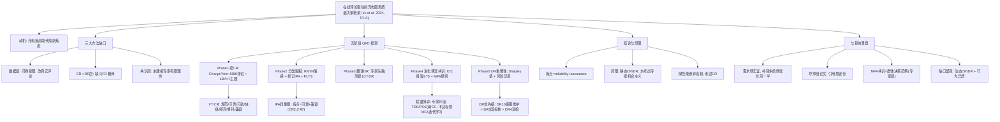

> [!abstract] 一句话
> 用 ChargePoint 的 4386 条真实在线评论挖出 EV 用户的 7 类需求（CR），结合"修订版 IPA + 概率语言术语集 PLTS + 进化博弈共识（MFA 规则）+ Shapley 风险厌恶"的 QFD 框架，给充电站运营商排出"有限资源下先改什么"的优先级——结论是 **DR10 高效客服与维护 > DR3 国际标准桩 > DR4 定期巡检** 最重要，痛点集中在 **reliability（设备可靠）与 assurance（兼容可用）**。

---

## 0. 文献底细（汇报用）
- **英文题名**：A decision framework for improving the service quality of charging stations based on online reviews and evolutionary game theory
- **作者**：Shengnan Lv, Anran Xiao, Yong Qin, **Zeshui Xu（通讯，徐泽水）**, Xinxin Wang
- **单位**：Business School, **Sichuan University（四川大学商学院）** —— 你导师（缑迅杰）的同一大团队，徐泽水是川大模糊决策学派领军人物。
- **期刊**：Transportation Research Part A: Policy and Practice, 187 (2024) 104168，DOI: 10.1016/j.tra.2024.104168
- **层级**：TR-A 是** transportation 领域老牌顶刊（ABS 3/4 星，中科院 1 区，IF≈6.3）**，比笔记 13（TCE 中区）硬得多，但本质是 **MCDM/服务管理** 而非运营优化。
- **资助**：国家自然科学基金（72271173、72101168）——和你导师的基金线一致。

> ⚠️ **认亲提示**：这篇是**导师组的论文**（徐泽水通讯）。和笔记 2（Lv 2025 eWOM 也是 Shengnan Lv 一作）是**姊妹篇**——同一批作者把"在线评论 → 用户需求"从"影响 EV 采纳"推进到了"服务质量诊断与资源排序"。引用链：`笔记15（导师综述：模糊集×决策版图）→ 笔记2（eWOM 影响采纳）→ 本文（eWOM + QFD + 进化博弈 = 需求侧诊断的终极落地）`。

---

## 1. 研究背景与动机
- **问题导向**："续航焦虑"正被"充电焦虑"取代（排队久、设备不可用、软件不可靠、油车占位 ICEd）。行业从"重数量"转向"重质量"已成共识（Zhang et al., 2020）。
- **方法缺口 1（数据层）**：前人 CR（customer requirement）几乎都来自问卷/实验，**受调查人群与评价项假设束缚**，且无法做情感分析。本文改用**真实在线评论**作为数据源。
- **方法缺口 2（需求→设计层）**：很多研究只回答"用户要什么（CR）"，不回答"运营商怎么改（DR）"；CR 与 DR 的潜在冲突会让单看 CR 的改进建议失效。本文用 **QFD（质量功能展开）** 把 CR 翻译成 DR。
- **方法缺口 3（群体共识层）**：QFD 要专家评 CR↔DR 的相关性（CCD），但前人**从没解释专家"为何/如何"达成共识、也没建模有限理性**。本文把共识过程建为**联盟进化博弈**。

**三个研究问题**：
- Q1：如何挖掘在线评论、客观提取并给 CR 赋权？
- Q2：如何得到一致的 CR↔DR 相关性评价（CCD）？
- Q3：该优先投入哪些服务改进？

---

## 2. 方法论：五阶段 QFD 决策框架
整体流程（Fig.2）：
1. **Phase 1 挖 CR**：爬评论 → LDA 主题建模 → 抽 CR。
2. **Phase 2 分类赋权**：RNTN 情感分析 + 修订版 IPA → CR 权重。
3. **Phase 3 翻译 DR**：专家头脑风暴列 10 个 DR。
4. **Phase 4 进化博弈共识**：专家圆桌打分（PLTS）→ ICC 测一致性 → 不达标就用 MFA 规则迭代更新 → 达标得可靠 CCD。
5. **Phase 5 DR 重要性**：Shapley 值 + 风险厌恶 → 专家权重 → DR 优先级。

### 2.1 数据（Phase 1）
- 数据源：ChargePoint（北美最大运营商之一，2022 占公用端口 41.2%），爬取 **New England 地区 1918 个充电站、4386 条评论**（截至 2023-04-09）。
- LDA 主题数：用 **Arun (2010) + Cao (2009)** 两个指标在 2–15 区间选优，综合定为 **7 个主题**。
- 7 个 CR（Table 5）及其代表关键词频率：
  - CR1 **Regulation 规范/占位治理**（park, block, ICEd… 1305）
  - CR2 **Reliability 设备可靠**（app, issue, fix… 506）
  - CR3 **Accessibility 可达易找**（access, entrance… 341）
  - CR4 **Quickness 充电快**（fast, DCFC… 1075）
  - CR5 **Economy 经济性**（price, fee… 1725）
  - CR6 **Convenience 便利配套**（food, coffee… 823）
  - CR7 **Assurance 兼容可用**（plug, CCS, CHAdeMO… 435）

### 2.2 情感 + 修订版 IPA（Phase 2）
- 用 **RNTN（Recursive Neural Tensor Networks，Socher 2013）** 把每条评论打成 5 类情感（很负/负/中/正/很正）的概率分布，用 **PLTS（概率语言术语集，Pang et al. 2016）** 表示。
- 修订版 IPA：用**偏相关分析**（sentiment 对 overall performance 的偏相关系数）算"隐式重要性 w^pc"，捕捉 Kano 三因子式的"不对称满意关系"，比让用户自报重要性更可信。
- 按 (w^pc, w^s) 二维把 7 个 CR 分到 IPA 四象限（Fig.6）：
  - **象限 IV「集中改进」= 痛点**：CR2 Reliability、CR7 Assurance（重要但满意度低）。
  - **象限 I「保持优势」= 亮点**：CR1 Regulation、CR6 Convenience。
  - 象限 II（过度投入）：CR3、CR5；象限 III（低优先）：CR4。
- CR 权重排序：**CR7 ≻ CR2 ≻ CR6 ≻ CR1 ≻ CR4 ≻ CR3 ≻ CR5**。

### 2.3 QFD 翻译（Phase 3）
- 专家头脑风暴出 **10 个 DR**（Table 8）：DR1 停车引导规范、DR2 定价机制、DR3 国标桩、DR4 定期巡检更新、DR5 布局标识、DR6 APP 信息准、DR7 快充、DR8 光伏提速、DR9 休息零售、DR10 高效客服与维护。

### 2.4 进化博弈共识（Phase 4）—— 本文最核心的创新
把"专家对 CCD 达成共识"建模为 **coalition 进化博弈**：
- 每位专家对 m×n 个 CR↔DR 关系打 PLTS 策略矩阵 B_e，圆桌座位成环（相邻 = 社交亲缘）。
- **联盟收益 = ICC（ intraclass correlation coefficient，组内绝对一致性）**，阈值 0.75（Koo & Li 2016）。分别对"语言项 TOE"和"概率 POE"算 ICC（π_γ, π_p）；只有 `min(π_γ, π_p) ≥ 0.75` 才算达成共识。
  - 关键洞察：单看 PLTS 期望值会丢信息（Example 1 两个期望相同但分布迥异），所以拆成 TOE/POE 分别测一致性。
- **个体收益**：若整体未共识且某指标未达标，按该专家"负贡献"给惩罚（用 Shapley 值思想：去掉该专家后联盟收益越高=他贡献越负），见 Eq.18–19。
- **策略更新规则 MFA（Meritocratic Fermi rule with Affinities，Eq.20）**：专家以概率 g 向相邻收益最高的专家学习（含亲缘 + 精英学习 + 噪声 ε<1 允许非理性）。迭代到 ICC≥0.75 终止。
  - 实验：初始 ICC 语言项 0.825（过线）但概率项 0.734（未过线）→ 1 轮迭代后 0.847 / 0.866，达成共识。

### 2.5 DR 重要性（Phase 5）
- 进化结束，用 **Shapley 值**算每位专家贡献 Z_e，再叠加**风险厌恶系数 ρ_e**（确定性等价成本 c_e = ρ_e·(Z_e·σ)²/2，Chen 2005）得到专家权重（Table 11：e1–e5 权重 0.191/0.197/0.212/0.196/0.205）。
- 加权汇总 CCD 期望 → 结合 CR 权重得 DR 初始权重 → 归一化。
- **DR 优先级（Table 12）**：**DR10(0.221) ≻ DR3(0.156) ≻ DR4(0.153) ≻ DR1(0.104) ≻ DR6(0.094) ≻ DR7(0.074) ≻ DR9(0.070) ≻ DR5(0.058) ≻ DR8(0.050) ≻ DR2(0.019)**。
  - 即：要补 reliability(CR2) 和 assurance(CR7) 的短板，应优先投 **DR10 高效客服与维护、DR3 国标桩、DR4 定期巡检**。

---

## 3. 核心结论
- EV 用户 7 大需求：规范、可靠、可达、快捷、经济、便利、兼容。
- **最大痛点 = reliability + assurance**（设备稳定可用、接口兼容）——失败率/不兼容显著影响用户行为（Hardman 2018 也佐证）。
- **最大亮点 = regulation + convenience**（占位治理、周边配套）。
- 反直觉点：**"绿色能源"在这批评论里不是高频词**，所以没进 CR——和 Fabianek & Madlener (2023) 一致（20 个访谈只有 1 人提）。这是"评论数据 vs 问卷数据"结论差异的典型例子。
- 政策启示：政府补贴应从"建桩数量"转向"以用户满意度（尤其可靠性/兼容性）为中心"的绩效评估。

## 4. 局限（作者自认）
1. CR/DR 随充电网络与 EV 保有量**动态变化**——本文假设静态，未建模。
2. **未考虑专家因信息不对称的机会主义行为**（评分时放水/操纵）。
3. 数据仅限北美 ChargePoint 一地，跨地域泛化待验证。

---

## 5. 横向对照（与你已有笔记）
| 维度 | 本文（16） | 笔记2（Lv 2025 eWOM） | 笔记4（评论数据推荐） | 笔记15（导师综述） |
|---|---|---|---|---|
| 数据源 | ChargePoint 真实评论 | eWOM 评论 | 评论文本 | 文献计量 |
| 目标 | 服务质量诊断 + 资源排序 | eWOM 对 EV 采纳影响 | 个性化充电站推荐 | 模糊集×决策版图 |
| 方法 | QFD + IPA + PLTS + 进化博弈 + Shapley | 实证/计量 | DRL/文本挖掘 | Bibliometrix/VOSviewer |
| 是否导师组 | ✅（徐泽水通讯） | ✅（同批作者） | ❌ | ✅（缑迅杰一作） |
| 碰"预约/调度"？ | ❌ 纯静态诊断 | ❌ | ❌ | ❌ |

---

## 6. 我的想法（与课题衔接）
1. **又一篇导师组论文 → 引用最安全**。把"笔记2 → 本文 → 笔记15"串成一条线，汇报时直接展示"我导师组在 eWOM+需求诊断这条线上的完整工作"，显得你吃透了方向。
2. **它是"用户需求侧实证"，正好补我"供给侧优化"的另一半**。我做的是预约/调度/机制（供给侧），本文给的是"用户到底在意什么"的实证清单（7 个 CR）。写动机时可引用 CR2/CR7 是痛点 → 解释"为什么用户不守时/取消"本质上是对 reliability/assurance 不满的下游表现，从而**把行为异质问题锚定到真实需求痛点**。
3. **进化博弈共识 = 导师"群体决策"方向的现成范例**。但它建模的是**专家层**共识（5 个专家），不是**大规模用户层**。我的切口可以反过来：把"大规模用户异质偏好共识"用模糊语言+共识模型做（呼应笔记15 的 NLP→大规模群体决策钩子），把本文的 MFA 规则当成方法论借鉴。
4. **缺口正好留给我**：本文自认"未建模 CR/DR 动态变化 + 未考虑专家机会主义"。前者 = 我若把需求权重做成**动态/随时间演化**就是增量；后者 = 把"用户不守时"当成一种"需求侧的策略性行为"而非静态 CR，正是 CPT+机制设计要解决的。
5. **QFD 质量屋可迁移**：若我最终做"充电预约机制的多准则评估"，本文 Table 8 的 10 个 DR 和 Fig.7 的 CR↔DR 关联矩阵是现成的评价维度库，能省我大量指标设计工作。

> 🔗 关联笔记：[[2 充电站在线评论（eWOM）对电动汽车采纳的影响——精读笔记]] ｜ [[15循环经济与模糊集理论：基于工业4.0技术视角的文献计量与系统综述——笔记]] ｜ [[4基于评论数据的、考虑用户偏好的电动汽车充电站推荐——笔记]]

---

## 7. 脑图

