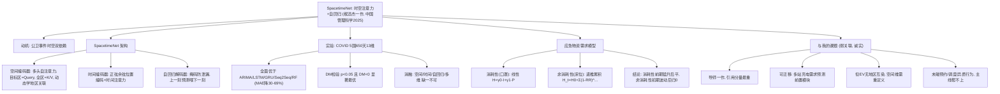

> [!abstract] 一句话
> 导师一作的论文：提出 **SpacetimeNet**——用**空间自注意力**捕捉地区间疫情动态关联 + **时间自注意力**（位置编码）捕捉时序依赖 + **自回归 Decoder**（掩码防泄漏）预测每日新增确诊，在 COVID 数据上全面优于 ARIMA/LSTM/GRU/Seq2Seq/RandomForest；再据此算实际确诊数与医护配比，把应急医疗物资分为**消耗性（口罩等，线性）**与**非消耗性（床位/呼吸机等，递推累积）**两类分别建模需求。

---

## 0. 文献底细（汇报用）
- **作者**：**GOU Xunjie（缑迅杰，第一作者，你的导师）**, Zhao Yunying, Zhang Haoyu, Zhang Yuxuan, **XU Zeshui（徐泽水，川大模糊决策学派领军）**, Deng Fumin（邓富民，川大商学院，通讯）。
- **单位**：四川大学商学院。
- **期刊**：《中国管理科学》—— 管理科学领域**中文顶刊（基金委 A 类、CSSCI 顶级）**，网络首发 2025-03-10，DOI 10.16381/j.cnki.issn1003-207x.2024.0769（2024-01-24 收稿）。
- **基金**：国家社科基金（24FGLB072、20BGL268）+ 国家自然科学基金（62406210）+ 博士后基金 + 教育部人文社科。

> ⚠️ **认亲提示（最高优先级）**：这是**导师本人一作**的论文（不是通讯，是第一作者！）。和笔记 15（导师综述）同属导师方向，但这是**导师亲自下场做的深度学习应用**。汇报/开题时引用 = 直接展示"我精读了导师的最新工作"，分量最重。引用链：`笔记15（导师综述：研究版图）→ 笔记16（导师组：QFD+进化博弈）→ 本文（导师一作：时空注意力+需求预测）`，三篇构成"导师方法谱系"。

---

## 1. 研究背景与动机
- **问题**：突发公卫事件（如 COVID）下，准确预测疫情趋势 → 推导应急医疗物资需求，是精准防控基础。
- **两大特点决定难度**：①**空间关联性**（地区间经人员流动互相影响）；②**时序依赖性**（未来高度依赖过去传播规律，如 14 天潜伏期）。
- **现有方法两大类的不足**：
  - 传统时序模型（ARIMA/LSTM/GRU/Logistic）：只拟合**单地区**时间序列，**忽略地区间关联**。
  - 传染病动力学模型（SIR/SEIR）：传播函数/参数难建模**动态时间依赖**；中长期预测波动大。
  - 时空序列预测虽有（如交通流、空气质量），但**空间关联多为静态**——而疫情地区间关联是**动态变化**的，且无周期性/趋势性。
- **本文切入**：用 NLP 里的**自注意力机制（Self-Attention）**同时抓**动态空间关联**与**时序依赖**，提出 **SpacetimeNet** 自回归框架。

---

## 2. 方法论：SpacetimeNet（核心）
Encoder-Decoder 架构，编码器分**空间**、**时间**两个子编码器，解码器解析时空特征并自回归预测。

### 2.1 空间关联性编码（Eq.1–4）
- 目标地区 i 的疫情数据作 **Query**，所有地区数据作 **Key/Value**，多头自注意力算空间注意力向量 `A_i`（Eq.1–2）。
- 关键：**不同地区间的关联是动态学习的**（不像图神经网络里固定邻接矩阵）。
- 融合方式创新：拼接 `A_i` 与 `Q_i` → 全连接聚合 → **LayerNorm** → 两层 FC（Eq.3–4），强化目标地区特征。

### 2.2 时序依赖性编码（Eq.5–7）
- 时间注意力层无法识别位置 → 引入**正弦/余弦位置编码 PE**（Transformer 经典做法，Eq.5–6）。
- 输入 = 融合特征 `FFN_i + PE`（Eq.7）。

### 2.3 自回归时空特征解码（Eq.8–9）
- 解码器同样多头注意力，两点关键：
  1. **掩码（mask）**：遮盖未来时间点，保证预测 t' 只能依赖 t' 之前的数据（防信息泄漏，Eq.8）。
  2. 第二层 K/V 来自编码器，Q 来自第一层。
- **自回归**：上一时刻预测值作为输入预测下一时刻，直到 `t'=τ` 停止（Eq.9 经 FC 预测层出 `ŷ_t^i`）。

---

## 3. 实验
- **数据**：Our World in Data + 约翰霍普金斯 COVID 数据集；选 **5 国**（法/德/印/美/英），**2020-07-16~2022-04-26 共 650 天 × 13 维**（确诊/死亡/疫苗/政府响应严格度/HDI 等），8:2 划分。
- **预处理**：取对数（e 为底，削波动增平稳）+ 用训练集 min/max 标准化（防测试集泄漏）。
- **指标**：MAE / RMSE / SMAPE + **Diebold-Mariano (DM) 统计检验**（p<0.05 且 DM<0 才算显著更优）。
- **对比模型**：ARIMA、LSTM、GRU、Seq2Seq、Random Forest。
- **结果（表3）**：平均 MAE 上 SpacetimeNet=399.55，比 ARIMA 降 **56.8%**、LSTM 降 **30.3%**、GRU 降 **29.7%**、Seq2Seq 降 **48.8%**、RF 降 **68.9%**；DM 检验所有 p<0.05 且 DM<0 → **显著最优**。
- **消融实验（表5，四个变体）**：
  - NS（去空间注意力）：MAE↑ 至 614.64 → 空间关联有用。
  - NT（去时间注意力）：MAE↑ 至 541.59 → 时序依赖有用。
  - NA（自回归换全连接）：MAE↑ 至 **1062.45** → 自回归最关键。
  - NM（只用新增确诊单变量）：MAE↑ 至 **1396.20** → 多维特征最关键。

---

## 4. 应急医疗物资需求预测（应用层）
在 SpacetimeNet 预测每日新增确诊 `ΔS_t` 基础上：
1. 算每日**实际确诊数** `I_t`（Eq.22–24，扣死亡/加痊愈）。
2. 算**配套工作人员** `P_t`（医护 2:50 配，其他人员 mr=4~6 倍，Eq.25）。
3. **消耗性物资**（口罩/防护服/消毒品，高频更换）：**线性** `H = γ0·I_t + γ1·P_t`（Eq.26）。例：患者日需 2 口罩、工作人员（日 8h、4h 换）需 3 口罩。
4. **非消耗性物资**（床位/呼吸机/测温计，长期用）：递推累积 `H_t = H0 + Σ(1-RR)^(...)`（Eq.27–29），考虑已配置资源缓解后续需求。

**结论（图5）**：疫情快速初期**消耗性需求猛升后趋平**；**非消耗性需求初期波动大、随资源累积逐渐降到 0**。

---

## 5. 局限（作者自认）
- 未考虑政府防疫措施、人口数量、无症状感染者、密接、结构分布等更多特征对疫情的影响。
- 未用国内数据（国外不单列无症状计数）。

---

## 6. 横向对照（与你已有笔记）
| 维度 | 本文（17） | 笔记15（导师综述） | 笔记16（导师组 QFD） | 笔记1（TRC 预约分配） |
|---|---|---|---|---|
| 是否导师亲笔 | ✅ **一作** | ✅ 一作（综述） | 通讯（徐泽水） | ❌ 浙大 |
| 方法 | 深度学习（Attention+自回归） | 文献计量 | MCDM/QFD/进化博弈 | 运筹（滚动分配+鲁棒） |
| 场景 | 应急医疗物资需求预测 | 研究版图 | 充电服务质量诊断 | EV 充电预约调度 |
| 碰"预约/调度/机制"？ | ❌ 纯预测 | ❌ | ❌ | ✅ 核心 |

---

## 7. 我的想法（与课题衔接——**诚实评估：弱关联**）
1. **必读但非选题模板**：导师一作，引用分量最重，但场景是**应急医疗物资**，**不是 EV 充电**，所以它是**方法参考线**而非选题抄袭对象。
2. **唯一可迁移点 = 需求预测前置模块**：很多 EV 充电调度论文（含你的笔记 1、笔记 9/10）都先**预测充电需求/负荷**再优化调度。SpacetimeNet 的"空间注意力+时间注意力+自回归"网络，若你做**多充电站/多区域 EV 充电需求联动预测**，是可照搬的结构。但注意：**EV 充电没有"地区间传染"那种强空间关联**，空间维度需重新定义（如路网连通性、相邻充电站、电网耦合），不能硬套"地区互染"。
3. **和你"动态/异质"立论的接口较弱**：本文动态指的是"地区间关联随时间变"，不是"用户行为异质/不守时"。你的 CPT+机制切口本文完全没碰。
4. **消耗性/非消耗性双分类思路**可类比但牵强：充电场景里"实时电力（消耗性）"vs"充电桩容量/储能（可累积）"勉强可比，但物理机制完全不同，不建议硬套。
5. **结论**：这篇对你=「导师最新方法论风向标」+「需求预测模块的备选网络」，主线（预约/调度/机制/异质行为）它帮不上。汇报时把它放在"我已读导师全部相关产出、理解其方法谱系"的位置，比放在"我的创新点参考"更合适。

> 🔗 关联笔记：[[15循环经济与模糊集理论：基于工业4.0技术视角的文献计量与系统综述——笔记]] ｜ [[16基于在线评论和进化博弈理论的充电站服务质量提升决策框架——笔记]]

---

## 8. 脑图

