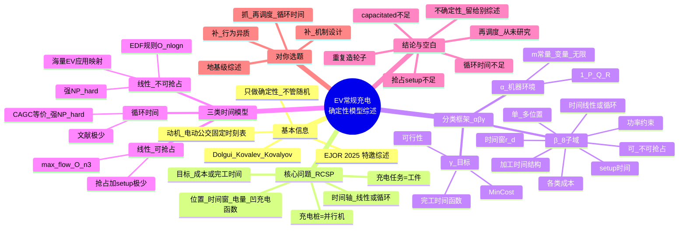

---

## 1. 研究背景与动机（为什么写这篇）
- 充电桩贵、占地大，充电过程显著影响电网负荷；优化调度能**减桩数、降电费、削峰、提升便利性**。
- 现实里城市公交充电大多用 **FCFS（先到先服务）**，桩数 = 同时到场最多车数，非常粗放。
- EV 的"路径 + 充电"问题通常**拆成两步**：先定路径，再把充电调度当子问题求解；本文聚焦后者。
- 本文**只做确定性模型**（贴合固定时刻表的公交），随机/不确定/排队类明确指给其他综述（Ji 2023、Mahyari 2023、Yan 2023、Lai & Li 2024）。
- 核心洞见：**把"充电桩 = 并行机(parallel machines)、充电任务 = 工件(jobs)"**，给"实操界"和"机器调度理论界"架一座桥。

## 2. 核心问题定义：RCSP（Regular Charging Scheduling Problem）
- 工件集合 N（充电任务）、机器集合 M（充电桩，分属位置集合 L）。
- 每个任务 j 在位置 q 有：固定时间窗 [r_qj, d_qj]、初始电量 e0、目标电量 e、凹充电函数 f_ij（依赖车与桩）。
- 充电时间 = f 的反函数之差；机器速度 v_ij 可依赖机器和任务。
- **抢占(preemption)** 可允许或不允许；每次抢占伴随 **setup 时间 s_ij + 成本 c_set**（现实中是工人拔插、耗时数分钟）。
- 目标：最小化设备/位置成本、能量成本、功率成本、setup 成本，或完工时间相关函数（如总 tardiness）。
- 时间轴可是**线性(interval)** 或**循环(circle)**（0 与 T 重合，适合"日复一日"的公交）。
- 关键假设：setup/停机期间电池**不漏电**；单位置(|L|=1)可省位置下标。

## 3. 方法论核心：α|β|γ 三域记号（本文最大贡献）
- **α 域（机器环境）**：∈ {1 单台, P 同速, Q 恒速比, R 无关机}；m 可为常量/实例参数/决策变量；∞ 表示无限副本（全并行）。
- **β 域（8 个子域，取子集）**：
  - β1：时间线性 / 循环(circ)
  - β2：不可抢占 / 可抢占(pmtn)
  - β3：单位置 / 多位置(M_q)
  - β4：时间窗（释放期 r / 截止期 d，任意 / 相等 / 无限制）
  - β5：setup 时间（0 / 任意 s_ij / 仅任务相关 s_j / 全等 s）
  - β6：功率约束（无限 / W_q(t) 动态 / W 静态）
  - β7：各类成本（设备 c_mac / 能量 c_ene / 功率 c_pwr / setup c_set / 位置 c_loc）
  - β8：加工时间结构（任意 / 仅机器相关 / 固定区间 p=d−r / 取值受限 p∈S）
- **γ 域（目标）**：∈ {可行性(−), MinCost(f), F(C1…Cn)}；f 可含 L, m, m_max, E, W, W_max, Setup, ∑T_j（总拖期）。

## 4. 三类时间模型的主要结论
### 4.1 线性时间 + 不可抢占（第 4 节）
- 理论基石：`1|r_j,d_j|−` 已**强 NP-hard**（Lenstra 1977）；agreeable / 单位时间 / 相等释放期等特例可 O(n log n)（**EDF 最早截止期优先**规则）。
- `P|r=0,d=d|−` 强 NP-hard（归约 3-Partition）；`P2|...|−` 普通 NP-hard。
- 大量 EV 文献被精确映射：如单站总拖期 `P|r_j,d_j|∑T_j`(Hernández-Arauzo 2015)、多站 `R|M_q,…|MinCost(L,E,W_max)` 等。
- 实务几乎都分 **capacitated（桩数受限）/ non-capacitated（桩数=重叠窗口上限）** 两类。

### 4.2 线性时间 + 可抢占（第 5 节）
- `1|pmtn,r_j,d_j|−` O(n²)（Horn 1974），可降到 O(n log n)；`P|pmtn,r=d|−` 用 McNaughton Wrap-Around O(n)。
- 一般 `P|pmtn,r_j,d_j|−` O(n³) max-flow（Shioura 2018）。
- **"抢占 + setup"文献极少**：每次抢占都要工人拔插、耗时数分钟，实际不能忽略（de Vos 2024 时间粒度 1/2/5/10/30 min）。唯一显式建模抢占 setup 的是 **Guschinsky et al. (2023)** 城市公交。

### 4.3 循环时间（第 6 节）
- 文献极少（除 Dondeti & Emmons 1993 两特例、Guschinsky 2023）。
- 与**循环弧图着色(CAGC)** 等价：时间窗=弧，同色=同机器，颜色数=活跃机器数；CAGC **强 NP-hard**（Garey 1980）。
- 适合公交"日复一日"的循环特性，却严重被忽视；循环时间基本只有 Guschinsky 2023 一个 MILP。

## 5. 结论与研究空白（第 7 节，对你最有用）
作者明确点名以下**机会**：
1. 大量充电调度研究"**重复造轮子**"——忽视/重证经典并行机调度结论，应直接借用机器调度理论。
2. 严重关注不足的方向：
   - **capacitated charging（桩数受限）**：现实桩少且贵，但很多文献假设无限桩。
   - **可抢占充电 + setup 成本/时间**（实际每块电池插拔要工人+时间）。
   - **循环时间模型**（公交天然循环）。
   - **再调度(re-scheduling)**：固定时刻表变化时如何重排充电——**文献从未研究，最有前景**。
3. 实际规模（数百任务、≤10 桩）常无法在合理时间求解 → 需要高效 MILP/算法。
4. 输入数据不确定性 → 鲁棒/随机/ML 方法（本文**故意不覆盖**，留给其他综述）。
5. 框架只覆盖"常规充电"，不覆盖"非常规充电"（含 deadheading 决策、路径中多次充电，此时充电时间/电量本身也是决策变量）。

## 6. 对你选题的启示（重点）
- 这篇是你方向的**"地基级"综述**：把充电调度彻底还原成并行机调度，给你一套现成建模语言 + 复杂度地图。
- 你的切入点"**行为异质 + 机制设计**"恰好**站在确定性模型之外**：本文所有模型都把车当**被动工件**（给定 r/d/能量），没有"用户不准时 / 有限理性 / 策略性报需求"——这正是你可以补的维度。
- 可优先考虑的落点：
  - 在 RCSP 框架里引入**用户行为/到达不确定性**（把确定性 r_j,d_j 变成随机或博弈变量）；
  - 设计**预约菜单 / 急迫度定价机制**让车主诚实报需求（本文完全没有 strategic/user 维度）；
  - 抓住作者点名的空白：**再调度**（预约被打破时重排）、**capacitated + 循环时间**（公交夜间循环充电）。
- 必读延伸：**Guschinsky et al. (2023)**（唯一做抢占 setup 的公交）、**de Vos et al. (2024)**（capacitated 公交）、**Zaidi et al. (2023, 2024)**（灵活能量/最小桩数）。

## 7. 关键术语中英对照
| 英文 | 中文 |
|---|---|
| regular charging task | 常规充电任务（同地同时） |
| irregular charging / deadheading | 非常规充电 / 绕行充电 |
| parallel machine scheduling | 并行机调度 |
| release date / deadline | 释放期 / 截止期 |
| preemption / setup | 抢占 / 换装(setup)时间 |
| capacitated charging | 有容量约束充电（桩数有限） |
| circular time | 循环时间 |
| RCSP | 常规充电调度问题 |
| three-field notation α\|β\|γ | 三域记号 |
| Earliest Deadline First (EDF) | 最早截止期优先 |
| tardiness | 拖期 |
| re-scheduling | 再调度 |

## 8. 一句话总结
这篇综述把"EV 常规充电调度"系统翻译成经典并行机调度理论，给出 α|β|γ 统一分类与复杂度地图；它刻意只做确定性、被动工件模型，而把**行为异质、策略性预约、再调度、循环时间**留成空白——这些恰恰是你充电桩预约机制选题可以切入的缝。

## 9. 思维导图

