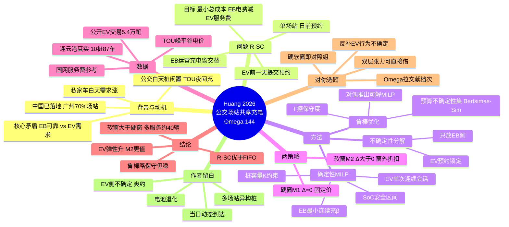

# 19 电动公交站的共享充电策略：一个稳健的优化模型（精读）

> Huang D., Jia Z., Hu Z., Liu Z., Liu R. (2026). *Omega* 144:103634. 东南大学（南京）+ 利兹大学。Received 2025-12-08, Accepted 2026-07-15.
> 关键词：电动公交(EB)；共享充电(SC)；预约制(R-SC)；混合整数规划(MILP)；鲁棒优化；分时电价(TOU)

## 1. 一句话定位
把"公交场站白天闲置充电能力开放给私家车"建模成**单场站、日前预约、EB 与 EV 联合调度**的 MILP，并用**鲁棒优化**兜底公交能耗不确定性。两个管理策略（硬窗 M1 / 软窗 M2）正好对应你选题里"日前预留固定容量 vs 预约容量可弹性挤占"的两种思路。

## 2. 研究背景与动机
- 电动公交(EB)必须配大量充电桩保可靠运营，但**分时电价(TOU)激励夜间充电**，导致白天桩大量闲置；同时私家车(EV)白天、非家充场景的充电需求在涨。
- 共享充电(SC)：公交公司把场站充电桩开放给私家车，赚服务费、提升基础设施利用率（中国已落地，2023 年广州 70% 公交场站提供公共充电）。
- **核心矛盾**：场站首要服务公交，必须保证 EB 运营可靠性；私家车需求是"外来"的，两者抢有限桩资源。
- 文献缺口（作者自述三点）：① 运营层 EB↔EV 的逐车、逐时隙资源分配研究少；② EB 能耗不确定对 SC 的影响几乎没研究；③ 现有 SC 模型被动接纳 EV 需求，缺乏**主动引导/重塑 EV 充电行为**的机制。

## 3. 问题定义（R-SC）
- 范围：单个公交场站，固定数量充电桩；规划期离散成等长时隙（案例 10 分钟/格，5:00–次日 1:00）。
- EB 侧：一天内"运营窗（黄）/ 充电窗（绿）"交替；EB 不一定每个充电窗都充，按需补到 SoC 安全区间；可多程补电；最小充电时长 β。
- EV 侧：**前一天**通过平台提交预约（偏好窗 + 所需电量），预约关闭后运营商联合决定 EB+EV 次日计划；被接受的请求按约履行；部分请求因容量被拒。
- 目标：最小化公交公司总运营成本 = EB 充电电费 − EV 服务费收入（EV 的电费最终交给电网，不计入公交收入）。

## 4. 核心方法
### 4.1 确定性 MILP（[GM]）
- 决策变量：EB 是否充电 xⱼₜ（0/1）、EV 是否充电 yᵢₜ（0/1）、EB 电量 bⱼₜ（连续）。
- 关键约束：
  - EB 运营窗内禁止充电（式5）；EB 充电需满足最小连续时长 β（式6–8，含图3 的"尾部不可行"排除）；SoC ∈ [τmin, τmax]（式9）。
  - 场站桩容量：∑yᵢₜ + ∑xⱼₜ ≤ K（式10）。
  - EV 单次连续会话、累计时长不超 αᵢ、只能在预约窗内（式14–17）。
  - 过夜边界：EB 次日以最高 SoC 出发（式11–12，聚合处理过夜容量）。

### 4.2 鲁棒模型（[RO-GM]）
- 不确定参数：EB 运营窗能耗 ̃π = π + η·γ·π，η∈[−1,1]，标准差 = γ·π（取 γ=0.3）。
- 不确定性集：**预算不确定性集**(budgeted / Bertsimas–Sim 式)，每辆车每个运营窗有预算 Γⱼₙ 控制保守度（取 Γ=0.1）。比 box 集不保守，比纯随机规划好控。
- 处理：SoC 约束里不确定项线性进入、受预算集约束 → 用**线性规划对偶**推出鲁棒对应(tractable MILP)，见附录B。目标不变，约束换成式(21)–(28)。
- 设计哲学（很关键）：不确定性**只放在主用户侧(EB 能耗)**，EV 侧用"预约锁定"当已实现输入 → **不确定性分解**写法，EV 侧不确定性留给未来。

### 4.3 两种服务策略（本文最实用的一对）
| 策略 | 时间窗 | 定价 | 含义 |
|---|---|---|---|
| **[M1] 硬窗** | Δᵢ=0，只在预约窗内 | 固定价 preg | 日前预留固定容量 |
| **[M2] 软窗** | Δᵢ>0，向前/后各扩 Δᵢ | 窗内 preg、窗外折扣 pdis | 预约容量可弹性挤占 |

M2 用"窗外折扣价"主动引导 EV 把充电挪到弹性时段，提升剩余容量利用率。

## 5. 数据来源（真实 + 公开，可复现导向）
- **真实案例**：江苏**连云港**某场站，10 个桩、87 辆 EB、286 趟次，10 分钟时隙。
- **EV 请求**：来自公开高分辨率中国 EV 充电交易数据集 [38]，提取"位于公交场站"的子集（**54,705 笔 2020–2021 交易**），按经验分布抽样生成预约请求。
- **TOU 电价**：峰 1.1815 / 平 0.7067 / 谷 0.3193 CNY/kWh。
- **服务费参考**：国网智慧车联网平台，取 0.2–0.3 CNY/kWh（preg=7.5、pdis=5 CNY/10min格@150kW）。
- 求解：Python + Gurobi 11.0.1，i7-14700KF/32GB。每配置 10 个随机实例取平均。

## 6. 主要结论
- **R-SC 全面优于 FIFO 基线**（经济 + 资源利用率）。注意：FIFO 的 EB 电费最低，但 R-SC 主动调整 EB 计划腾出 EV 机会，整体更赚。
- **软窗 M2 > 硬窗 M1**：EV 收入、服务辆次、总时长都更高（M2 多服务约 40 辆/500 请求；Table 2：M2 服务 485 vs M1 444）。
- **鲁棒模型**比确定性略保守（为保 EB 可靠，EB 被迫在更贵时段充，成本高一点），但 EV 收入/服务量只小幅下降。
- **计算**：M1 比 M2 快（M1 可行域窄，branch-and-cut 收敛快）；全部秒级（M1~6.5s，M2~21s，鲁棒更快）。
- **敏感性要点**：
  - 不确定度↑(γ/Γ↑) → 目标值↓（更保守），γ=1,Γ=1 时**不可行**（10 个桩扛不住极端不确定）。
  - EV 请求 >150 时总目标转负（服务费超过 EB 成本）；>500 后饱和，该站约可容 3000 请求。
  - 桩数 <3 不可行，≥15 后饱和。
  - 充电功率↑ → 更好，但确定/鲁棒差距只在中等功率(120–180kW)明显。
  - **EV 灵活性(Δᵢ)↑ → M2 明显变好，M1 几乎不变**（M1 只认原窗）。→ 用户弹性是软窗的价值来源。
  - TOU 放大不确定性影响；服务费高低不改变模型优劣排序。

## 7. 与你选题的衔接 / 可复用建模点
（保留你原来的洞察，并标注论文对应）
- **双层张力**：主用户(公交)可靠性 vs 次用户(私家车)需求 —— 这正是你"充电桩预约"的核心张力，可直接借用。
- **不确定性分解写法**：不确定只放主用户侧、次用户预约锁定 —— 你做"用户不准时/有限理性"时，可以反过来：把次用户(车主)的不确定性也建模进去，正好补这篇的缺口。
- **硬窗 vs 软窗 = 你"日前预留固定容量 vs 预约容量可弹性挤占"的另一种说法** —— 现成的对照组设计：你的实验可以直接做"我们(机制设计/行为建模)比硬窗 M1 好"。
- **差异化定价是软窗配套工具** —— 你设计 IC/菜单机制时可以复用"窗外折扣引导弹性行为"的思路。
- **Omega 是运筹学顶刊**，你参考文献里之前几乎没有运筹顶刊，这篇直接把文献档次拉起来（和你 18 号 Omega 论文呼应）。
- 可对标的具体点：把这篇的"EV 请求 = 固定输入"改成"EV 有策略性/不准时行为"（接你 CPT/机制设计），或做"日前预留 + 当日滚动重调度"（接 Dolgui 综述点名的 re-scheduling 空白）。

## 8. 研究空白 / 作者未来方向（对你最有用）
作者明说的扩展点：① 多场站协同 + 异构桩；② **EV 侧不确定性**（预约改约/取消/爽约 no-show）；③ **当日动态到达**（rolling-horizon / online 调度）；④ 显式建模电池退化。
其中 ②③ 正好和你"行为异质 + 机制设计"方向重合 —— 把"预约锁定"放松成"用户会不准时/会策略性虚报"，就是你的切入点。

## 9. 一句话总结
一篇 Omega 2026 的"公交场站共享充电"标杆建模论文：用 MILP + 预算不确定性集鲁棒优化，系统性给出"硬窗固定价 vs 软窗差异价"两种管理策略，并用连云港真实数据证明软窗更赚；它把 EV 当被动固定输入，留出的"EV 行为不确定 + 当日动态"正是你可以补的机制设计缝。

---

## 10. 思维导图

