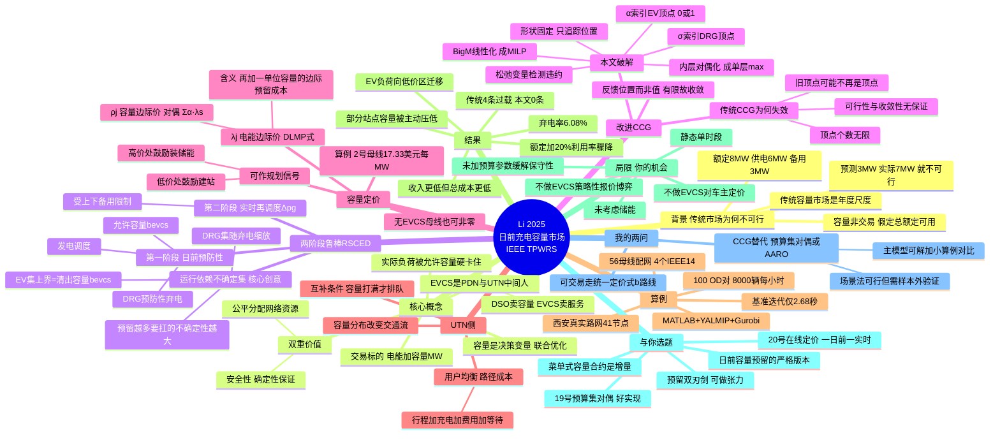

# 21 日前充电容量市场（精读）

> Li K., Shao C., Huang X., Shahidehpour M., Wang X. (2025). *IEEE Trans. Power Systems* 40(3):2258–2271. 西安交通大学 + 伊利诺伊理工。DOI: 10.1109/TPWRS.2024.3467166

## 一句话

提出**"充电容量市场"**——日前对充电站（EVCS）的**充电容量做分配与交易**，通过**预防性预留**额外配网资源来对冲 EV 负荷不确定性。

## 为什么关键

**这就是"日前容量预留"最标准的顶刊写法。**

与普通日前电力市场的区别：它不是在日前决定"买多少电"，而是在日前**预留"能充多少"的容量额度（MW）**。这正是我想做的事的严格版本。

---

## 1. 研究背景：传统日前市场为什么会"不可行"

作者用 Fig.1 的小例子点破要害：
- 某 EVCS **额定容量 8 MW**；但该母线 t=1 时刻**最大供电 6 MW、备用仅 3 MW**；日前预测 EV 负荷 3 MW，于是按 3 MW 出清。
- 若实时**实际 EV 负荷是 7 MW**（仍没超过 8 MW 的额定容量），电网约束就被违反 → **日前市场出清问题直接不可行**。

根因：传统市场把充电容量当**非交易、额定即可用**的外生常数。但配网供电/备用有限时，**EVCS 未必能一直跑在额定容量**。容量越大、EV 负荷不确定性越大，实时偏差可能超出备用/输电能力 → 不可行。

作者点出的第二条缺口：传统**容量市场**是年度/更长尺度（激励发电投资的规划视角），而 EVCS 的允许容量必须**随配网运行状态日前或实时调整** —— 这一层没人做。

---

## 2. 核心概念：充电容量市场

| | 传统日前电力市场 | 本文：日前充电容量市场 |
|---|---|---|
| 交易标的 | 电能（MWh） | **电能 + 充电容量（MW）** |
| EVCS 容量 | 非交易，= 额定值，假定总能满功率 | **是决策变量**，由 DSO 与发电调度**联合优化**出清 |
| 实时偏差 | 靠备用兜，兜不住就不可行 | 实际负荷**被允许容量硬卡住**（pev ≤ bevcs），超了就排队/换站 |
| 安全性 | 可能违反约束 | **确定性保证**（容量由 DSO 直接清出并预分配） |

**双重价值（作者自述）**：
1. **安全性**：容量被预先限制在电网能承受的范围内，实际负荷不可能突破 → 安全是"确定性"保证的，而不是"大概率"。
2. **公平分配网络资源**：容量越大 → 需要的备用和输电容量越多 → 配网不可能容纳无限容量 → 需要市场来公平分配（逻辑类似 DLMP：谁用了网络资源谁付钱）。

**概念框架（Fig.3，很值得借鉴）**：EVCS 是**配网(PDN) 与 交通网(UTN) 之间的中间人**
```
PDN：DSO 清出「容量 + 电价」→ EVCS 买
UTN：EVCS 定「充电价 + 可服务容量」→ EV 车主买
```
EVCS 报高价能拿到更多容量、吸引更多车，但利润空间被压缩；报低价容量少、等待时间长。→ **这是一个两端市场的夹层结构**。

---

## 3. 两阶段鲁棒模型（RSCED）

### 目标函数（式1）
DSO 最小化：**购电成本 + 可再生(DRG)弃电惩罚成本 − 向 EVCS 卖电收入 − 向 EVCS 卖容量收入**

### 第一阶段（日前，预防性）
联合优化：基础发电调度 pg、**允许的 EVCS 充电容量 bevcs**、DRG 预防性弃电 psdrg。
约束：容量上下界 (2)(3)、节点功率平衡 (4)(5)、**线性化配网潮流 LinDistFlow** (6)、DRG 出力 (7)、电压幅值 (8)、线路潮流 (10)(11)、机组出力 (12)。

### 第二阶段（实时，recourse）
对不确定性的任意实现，寻找可行的再调度 Δpg；受上下备用限制 (15)、出力限制 (16)、第二阶段的功率平衡 (17)。

### ★ 运行依赖的不确定性集（本文最妙的建模）
这是全文最核心的建模创意——**不确定性集的边界不是预先固定的，而是被第一阶段的决策变量决定的**：

- **EV 负荷不确定集**：`E(bevcs) = { pev | 0 ≤ pev ≤ bevcs }`
  → 上界就是你日前清出的那个容量 bevcs。
- **DRG 出力不确定集**：`W(pdrg) = { w | pdrg − wᵈ ≤ w ≤ pdrg + wᵘ, ... }`，预测误差的上下界随预防性弃电后的 pdrg 缩放。

**这对你极重要的含义**：**你预留得越多，你要对冲的不确定性就越大**（EV 负荷可以从 0 一直涨到你预留的上限）。所以"预留"不是免费的——预留越多，需要的备用/弃电越多，**容量价格 ρ 就越高**。这就是"预防性 vs 经济性"的内在张力，也是为什么必须用市场来定价。

> 你占位里写的"预留不是为了应对最坏情况，而是提前买保险"——准确，而且本文把它量化成了价格 ρ。

---

## 4. 改进 C&CG（算法贡献）

**传统 C&CG 为什么失效**：传统做法是把不确定性集替换成它的**顶点**来生成列和约束。但本文的集是"运行依赖"的 → **顶点个数无限**、且上一轮找到的顶点在下一轮（第一阶段决策变了之后）**可能不再是顶点** → 传统算法**可行性和收敛性都无法保证**（甚至会检测到落在更新后不确定集之外的场景，导致非最优）。

**本文的破解（关键 trick）**：
> 不确定性集的**形状是固定的**（超长方体），只有**尺度和位置**随第一阶段决策变 —— 所以顶点的**位置可以用有限个二进制索引唯一追踪**。

- EV 负荷顶点：`pev_j = (1 − α_j)·bevcs_j, α_j ∈ {0,1}`（α 索引顶点在"0 端"还是"bevcs 端"）
- DRG 顶点：用 `σᵈ_j, σᵘ_j ∈{0,1}, σᵈ+σᵘ=1` 索引
- 子问题加松弛变量 ε₁, ε₂ 检测违约 → 内层 min 对偶化 → 单层 max；`二进制×连续`的乘积用 **Big-M 线性化**（式25）→ 变成 **MILP**，Gurobi 直接解。
- **反馈的是顶点的"位置"（α\*, σ\*）而不是"值"** → 位置只有有限个 → **收敛且计算高效**。这是相对传统 C&CG 的本质改进。

收敛后得到一个"最劣场景集 S"，据此可以写出确定性的凸 LP。

---

## 5. 容量定价（本文的"机制"落点）

- **电能边际价 λ_j** = 节点功率平衡约束 (4) 的对偶乘子（就是 DLMP 的思路）：EVCS 用了多少电，按 λ 付钱。
- **充电容量价 ρ_j = Σ_{s∈S} α\*_{j,s} · λ_{j,s}**（式40），其中 λ_{j,s} = ∂L/∂e_{j,s} = **在节点 j 多对冲一单位不确定性所需的边际成本**。

> **ρ_j 的经济含义**：EVCS 把充电容量**再加一单位**时，系统为它多预留一份网络资源（备用/弃电/昂贵机组）的边际成本。

所以本市场对 EVCS **收两笔钱**：用了多少电（λ）+ 用了多少"被预留的网络资源"（ρ）。
- 注意：**容量价在没有 EVCS 的母线上也可以非零**（类似 DLMP 在零净负荷母线上也非零），因为它代表的是"为对冲不确定性而预留的网络资源"。
- 算例：2 号母线 ρ = **17.33 $/MW**，正好等于把发电从便宜的 2 号机转移到贵的 1 号机的成本差。
- 7/12/26 号母线 ρ 更高，因为容量增量在那里会连锁引发：① 更多灵活备用 ② 更多 DRG 弃电 ③ 更多火电。

**额外甜头**：容量价格还能当**规划信号** —— 29–35 号母线 ρ 低 → 鼓励在那建站；7/12/26 号 ρ 高 → 鼓励装灵活机组/储能。

---

## 6. UTN 侧：容量依赖的交通分配

出清容量会反过来影响车主的**路径+充电（R&C）决策**：
- 用户均衡：路径成本 = 道路行程时间 + 充电时间 + 充电费 + **在充电站的等待成本 τ_m**
- 互补条件：`0 ≤ τ_m ⊥ (bevcs_m − pev_m) ≥ 0` —— 容量没打满时等待成本为 0，**一旦打满就产生排队等待成本**
- 结果：清出的容量分布 → 改变交通流分布 → 改变 EV 负荷分布（闭环）

---

## 7. 算例与结果

**数据**：基于**真实西安市路网**改造的 41 节点交通网 + 模拟西安 110kV 供电区的 56 母线配网（4 个改造 IEEE-14 配网拼成）；100 个 O-D 对、总车流 8000 辆/h；仿真 1 小时、Δt=1h（市场按小时出清）。MATLAB 2021b + YALMIP + Gurobi，i7-1260P/16GB，**基准算例全程迭代仅 2.68 秒**。

**主要结果**：
- 本文方法中，部分 EVCS 的**容量被主动压低**（如 #10/#11/#18，因 1→3 号线路拥堵）；传统方法中所有 EVCS 都按额定容量放开。
- 基准算例 DRG 总弃电率 **6.08%**。
- 虽然本文方法下 DSO 从 EVCS 拿到的**收入更低**，但弃电更少、购电成本更低 → **总运行成本更低**。
- **安全性**：传统方法 **4 条线路过载**，本文方法 **0 条**；传统算例实质上是**不可行的**。
- EV 负荷会**从容量价高的区域迁移到价低的区域** → 提升整体效率。
- 敏感性：线路容量↑ → 成本↓、允许容量↑（+10% 即可消除过载）；DRG 预测误差↑ → 允许容量↓、成本↑、与传统方法的差距↑；EVCS 额定容量↑ → 运行成本↓（收入增加）但**EVCS 利用率骤降**（额定+20% 时），说明**盲目扩站对电网已无效**。

---

## 8. 局限与作者明确没做的（= 你的机会）

作者白纸黑字说 out of scope 的：
1. **EVCS 的策略性报价行为**（会形成 multi-leader bi-level robust game）—— 本文假设报价由历史数据外生给定。**这就是你要补的机制设计！**
2. **EVCS 对车主的定价行为**（EVCS 是自利主体）—— 建模需两层两阶段鲁棒、很难解；本文退而用 DLMP 当车主充电价。
3. **储能**未考虑（会让它变成多周期，价格跨时段耦合）。
4. **静态单时段**设定（时间下标省略）；真实应按小时滚动出清。
5. 传统负荷当作价格接受者，不考虑切负荷。
6. 保守性可通过给不确定集加**预算参数**缓解 —— 作者说"为简洁未讨论"。
7. 只到城市级，国家级/高速网超出范围。

---

## 9. 与你选题的衔接

- **"日前容量预留"的严格顶刊版本就在这里**：容量 = 决策变量 + 可交易 + 有价格（由对偶导出）+ 与调度联合优化。你要做的"预约容量"可以直接对标它的建模骨架。
- **最值得偷的建模创意**：`E(bevcs) = {pev | 0 ≤ pev ≤ bevcs}` —— **"预留多少"直接决定了"要承受多大的不确定性"**。这个"预留的双刃剑"是你论文里可以做文章的张力：预留多 → 服务好 → 但不确定性集变大 → 备用成本↑ → 容量价↑。
- **与 19 号（Huang Omega 2026）对照**：19 号是**预算不确定性集 + LP 对偶**一步到位（不确定项线性进入约束）；21 号是**运行依赖不确定集 + 改进 C&CG**（顶点无限）。前者好实现，后者更一般。**你选哪条路，决定了你的求解难度。**
- **与 20 号（Mrkos T-ITS 2025）对照**：20 号是**在线动态定价**（MDP + 泊松到达 + MCTS），管"实时怎么报价"；21 号是**日前容量市场**（两阶段鲁棒 + 对偶定价），管"日前留多少、怎么定价"。**一个日前、一个实时，正好是你"日前+临时"两阶段的两端。**
- **与 12 号（在线菜单/IC）对照**：本文是 DSO 统一清出+统一定价（posted price 式）；菜单/IC 是给一组选项让 EVCS 自选。**把本文的"统一清出"升级成"菜单式容量合约"，就是机制设计的增量。**

---

## 10. 我的想法（回答占位里的两个问题）

### Q1：我的"预留容量"要不要也做成可交易的？

先澄清一个关键点：**本文确实是"可交易"，但它没有让 EVCS 做策略性报价博弈** —— 报价是外生给定的（作者说博弈是 out of scope）。所以"可交易"有两条路：

| 路线 | 做法 | 难度 | 机制味道 |
|---|---|---|---|
| **(a) 完整双向拍卖/博弈** | EVCS 策略性报价，解 multi-leader bi-level robust game | 极高（本文都回避了） | 最强 |
| **(b) 统一定价式（本文路线）** | DSO 联合优化清出容量，价格由**对偶/影子价格**导出（ρ） | 可控 | 已有 |

**我的建议：走 (b)，先别上 (a)。**
理由：① (b) 已经比"容量只是个上下界"高一个台阶了 —— 你有**容量价格 ρ**，能做价格信号、能做公平性讨论、能做规划含义；② (b) 的求解是可控的（鲁棒→固定最劣场景→凸 LP→读对偶）；③ (a) 留作"展望/扩展"，反而显得你有分寸。
**而且本文白送一个加分项：容量价 ρ 还能当规划信号（哪建站、哪装储能），这是很好的讨论段。**

一个诚实的取舍提醒：做成可交易，你必须保证出清问题在固定最劣场景后是**凸的**（LP），否则对偶价格没有良好的经济学解释（本文特别强调"convex linear programming for RSCED"）。如果你的模型里塞了整数变量，定价那一步要额外小心。

### Q2：C&CG 我不会实现 → 用场景展开近似行不行？审稿人认不认？

**行，审稿人认。但你要知道代价，并且有几条更好的替代路。**

先说场景法（SAA / 场景树）：
- ✅ 审稿人认，是最常见的替代，实现最省事（采样/聚类出有限场景 → 大规模确定性 MILP 直接解）。
- ⚠️ 但会被要求：① 说清场景怎么生成的（蒙特卡洛？历史数据聚类？）；② 做**样本外（out-of-sample）测试**证明场景数够了；③ **诚实声明它不保证对所有不确定性实现都可行** —— 这是场景法相对鲁棒优化的本质差距，审稿人一定会盯这点。
- 结论：**能用，但如果你想保留"鲁棒"的名头，下面两条更稳。**

**更推荐的替代（按推荐度排序）**：

1. **预算不确定性集 + LP 对偶（最省事，强烈推荐）**
   如果你的第二阶段结构比较简单、**不确定项线性进入约束**，可以直接用线性规划对偶把鲁棒对应（robust counterpart）一步推出来，无需任何迭代。
   → **你的 19 号（Huang Omega 2026）就是这么干的**（SoC 约束里不确定项线性进入 → 预算集 → 对偶 → tractable MILP）。这是你最熟、也最容易复现的路子。

2. **仿射可调鲁棒（AARO，Ben-Tal 经典）**
   把第二阶段的 recourse（如 Δpg）限制为不确定性的**仿射函数** → 直接转成单层 LP/MILP，一步求解、不需要 C&CG 迭代。
   → 审稿人高度认可（是鲁棒优化的标准方法之一），计算快；代价是**保守度高于两阶段鲁棒**（因为限制了 recourse 的函数形式），你要主动说明并量化这个保守度。

3. **本文的改进 C&CG**
   只有当你坚持"两阶段鲁棒 + 不确定性集是运行依赖的（顶点无限）"时才必须用。而它的**核心 trick 是可迁移的思路**：*反馈顶点的"位置"（用二进制索引 α/σ 表示）而不是"值"，因为位置只有有限个*。这个想法本身很漂亮，值得在论文里引用并说明你为什么（或为什么不）需要它。

**我的实操建议（组合拳）**：
```
主模型：用「预算集+对偶」或「AARO」→ 一步可解，跑得动大算例
   +
小算例：用 C&CG（或顶点穷举）算出两阶段鲁棒的最优解
   +
对比：量化你主模型相对两阶段鲁棒的最优性/保守度差距 → 证明"近似可控"
```
这正是你在 20 号笔记里记下的那种写法：**"我做了近似，但我要证明近似可控"** —— 20 号用 ε₂/λ 量化离散化误差，你可以用"主模型 vs 两阶段鲁棒最优解"的 gap 来量化保守度。两篇的严谨性套路是同一套，可以互相印证。

---

## 11. 一句话总结

一篇 IEEE TPWRS 2025：把**充电容量**变成日前可交易、有价格（对偶导出）的决策变量，用**两阶段鲁棒 + 运行依赖不确定性集**建模，用**改进 C&CG（反馈顶点位置而非值）**求解，并证明传统日前市场在配网资源受限时会**不可行**、而容量市场能以更低成本换来**零过载**；它**不做 EVCS 的策略性报价博弈**——那正是你"机制设计"可以直接补的缝。

---

## 12. 思维导图


