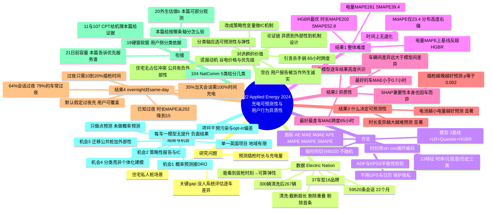

# 22 行为异质性如何影响充电预测

> 作者：Markus Kreft, Tobias Brudermueller, Elgar Fleisch, Thorsten Staake（**ETH Zurich** + 圣加仑大学 + 班贝格大学）
> 期刊：**Applied Energy 370 (2024) 123544**，CC BY 开源
> 数据/代码全公开：`github.com/markus-kreft/ev-charging-prediction` + National Grid Electric Nation

## 一句话

用 **267 辆真实 EV、59,520 条充电记录** 预测住宅充电的**插枪时长与充电量**，发现**车辆与车辆之间的可预测性差异（MAE 跨度 65 小时）远大于模型与模型之间的差异**；而一旦知道"这次是不是过夜充"，时长预测的 MAPE 从 **202% 骤降到 15%**（13 倍）。

---

## 1. 背景：为什么"预测充电需求"是智能充电的命门

智能充电/需求响应要挪负荷，前提是知道这辆车**什么时候要走（departure time）**和**要充到多少（desired SoC）**。这两个值直接决定它有多少可调度弹性。

- 现有做法：让司机自己在 App 里填 → **把配置负担甩给用户**，用户会在"给电网弹性"和"自己舒服（尽快充满）"之间纠结。
- 更理想的做法：用历史行为**预测**出真实需求，而不是问用户。
- 但**真实驾驶行为高度个体化且随时间/星期变化** → 预测到底有多可靠，是个悬而未决的问题。

**本文抓的 gap（原文原话的意思）**：以往研究要么只做公共桩、要么只做聚合需求、要么只做长期预测、要么只用少量车辆/短观测期/手工出行日志；**没有人系统评估过"不同车辆之间的预测性能差异"**。

> 对你有用的一句：作者点名批评 Huber et al. 那篇——它的 MAPE 299% 但 MdAPE 只有 28.4%，两个指标差 10 倍，说明**存在极端离群和巨大的个体差异，但作者没深挖**。本文就是来深挖这件事的。

---

## 2. 数据：Electric Nation（英国 National Grid）

| 项 | 数值 |
|---|---|
| 原始 | 300 辆 EV、71,264 条充电过程 |
| **清洗后** | **267 辆车、59,520 条会话** |
| 时间跨度 | 22 个月（2017–2018） |
| 车型多样性 | 37 种车型、16 个品牌 |
| 场景 | **住宅（at-home）私人桩**，英国 Midlands / South West / South Wales |
| 关键字段 | 充电起止（charging session）**+ 插枪/拔枪起止（plugged-in session）** |

**为什么必须区分"充电时长"和"插枪时长"**——这是本文一个很重要的设计：
- 只有 **插枪时长 > 充电时长** 时，这辆车才对电网有弹性（电可以在插枪窗口里随便挪）。
- 只看智能电表（如 Venticinque 那篇）只能看到"有没有在充"，**看不到什么时候拔枪** → 无法算弹性。本文数据能看到拔枪时刻，这是选它的理由。

### 清洗流程（值得照抄到你的方法论章节）

1. 剔除插枪 < 5 分钟的会话（511 条）→ 异常/误测
2. 插枪 > 2 周的（23 条）**不删，而是截断（clip）在阈值** → 理由：调度只关心"这是超长会话"，不关心到底多长；这样保留了"预测出它很长"这一信息
3. 剔除同车时间重叠的会话（132 条）→ 物理上不可能
4. 剔除每车的第一条会话 → **保证每条会话都有"上一次会话"可用**（历史特征需要）
5. 剔除会话数 < 10 的 12 辆车、平均每周 < 1 次的 20 辆车 → 学不出行为模式

---

## 3. 方法

### 3.1 特征：13 个，全来自充电站测量 + 车辆元数据，**不含任何个人隐私数据**

有意**不用** GPS、日历等（作者明确说：持续追踪位置在多数国家不现实，且会吓跑重视隐私的用户）。

| 类别 | 特征 |
|---|---|
| **时间类** | weekday / weekend / holiday / month / startHourNorm / **startCos + startSin（循环编码）** |
| **元信息类** | carKWh（电池容量）/ carKW（桩功率）—— 同一辆车恒定 |
| **历史类** | timeSinceLastStop / sessionsToday / lastDuration / lastConsumedKWh |

> 循环编码这个小细节值得学：把"时刻"编成 sin/cos，保证 23:00→1:00 的距离等于 6:00→8:00（否则 23 和 1 在数值上差 22 小时，模型会学歪）。

### 3.2 模型：3 个朴素基线 + 3 个训练模型

- **基线**：`LastValue`（就预测上一次的值）/ `MeanValue` / `MedianValue`
- **训练模型**：LinearRegression、QuantileRegressor（对离群更鲁棒，估中位数）、**HGBR**（Histogram-based Gradient Boosting，LightGBM 风格的树模型）
- 刻意**不用深度学习**：文献已证明神经网络在这类任务上相对树模型没有实质提升，而本文的重点是**分析差异**而非刷指标 → 这个"方法服务于问题"的取舍，是你写论文可以模仿的表态方式。

### 3.3 训练/测试切分：按时间切，不能随机打乱 ⚠️

因为会话间有时序依赖（上一段充满了，这段就不需要多少电），随机 split 会**泄漏未来信息**。

- 先做平稳性检验：ADF 检验拒绝单位根（$p<0.0005$，$DF_\tau=-43$）；KPSS 显示存在常数+线性趋势
- 于是**按时间排序后取前 80% 训练、后 20% 测试**
- 训练集：平均每车 178 条 / 299 天；测试集：平均每车 48 条 / 70 天
- 超参：10 折 CV 网格搜索，全部 scikit-learn

### 3.4 指标：6 个（AE / MAE / **MdAE** / APE / **MAPE** / **MdAPE** / **SMAPE**）

作者专门强调：**必须同时报均值和中位数**。因为分布高度右偏，MAPE 会被极端离群拉爆（小 y 做分母时 APE 可任意大），SMAPE 有 0–200% 的上界可以兜住。这也是它对既往文献的方法论批评。

---

## 4. 结果 1：整体预测有多难（Table 3 核心数字，HGBR 最佳）

| 任务 | 口径 | MAE | MdAE | MAPE | MdAPE | SMAPE |
|---|---|---|---|---|---|---|
| **插枪时长** | 全体会话 | 5.53 h | 1.91 h | **202%** | 23.4% | 52.8% |
| **插枪时长** | 逐车均值 | 6.21 h | 3.30 h | 181% | **37.6%** | 52.0% |
| **充电量** | 全体会话 | 3.83 kWh | 1.97 kWh | **281%** | 24.8% | 39.4% |
| **充电量** | 逐车均值 | 4.83 kWh | 4.15 kWh | 290% | **32.6%** | 40.7% |

- MAPE 202% / 281% 看起来"完全不能用"，但 MdAPE 只有 23.4% / 24.8% → **均值被极少数离群彻底拉爆**，中位数其实尚可。
- 所有训练模型都显著优于三个基线（T 检验 $p=0.0062$，Wilcoxon $p<0.0001$）。
- 一个反直觉现象：在**充电量的 MAPE** 上，朴素基线 `MedianValue`（219%）反而优于 HGBR（290%）——因为基线对离群极其鲁棒，而 HGBR 会被极端小电量的会话拖累。⚠️ **这说明单看一个指标会得出相反结论**，是很好的方法论警示。

**时间稳定性**：把测试集按时间分前后两半，MAE 之差的分布呈高斯形，均值 −0.067、标准差 0.525 → **平均没有性能退化**，但个体车辆在时间维度上的波动可达 AE 的一半量级。无明显季节性（但观测期 < 2 年，统计检验力度不够）。

---

## 5. 结果 2：异质性到底有多大（本文最硬的证据）

- **最好与最差车辆之间的 MAE 跨度达 65 小时**。
- 表现最好的那辆车 MAE < **0.7 小时**；一半的车 MAE < 3.3 小时。
- 🔑 **最关键的一句结论**：*"the differences in performance between vehicles are much larger than the performance differences between models"* —— **车辆之间的差异，远大于模型之间的差异。**
- 佐证：把各模型的逐车 MAE 两两画散点（Fig. 6），**所有点都紧贴对角线** → 模型之间高度共识，"哪辆车好预测"是所有模型的共识。作者由此断言：**造成差异的不是模型类型，而是各车自身的充电行为特征。**

> 这句话对你太有用了：它意味着"换个更强的预测算法"是边际收益很低的方向，而**"先把用户分对类"才是杠杆所在**。这正是你"分用户类型做差异化预留"的立论基石。

**SHAP 特征重要性**（且**重要性本身也因车而异**）：
- 预测**时长** → 最重要的特征是 `startSin`（插枪时刻）和 `lastDuration`（上次时长）
- 预测**电量** → 是 `carKWh`（电池容量）、`lastConsumedKWh`、`timeSinceLastStop`
- 作者特别指出：某些特征在平均意义上不重要，但**对特定车辆可能极其重要** → 又一次异质性。

---

## 6. 结果 3：什么决定了一辆车好不好预测（Wald 检验线性拟合斜率）

| 车辆特征 | 对**时长**可预测性 | 对**电量**可预测性 |
|---|---|---|
| **① 会话时长的变异程度**（10%–90% 分位距 ÷ 中位数） | ✅ 显著：变异越大越难预测 | ❌ 不显著 |
| **② 电池容量** | ❌ 不显著 | ✅ 显著：**电池越小，电量越好预测** |
| **③ 平均插枪时刻** | ✅ 显著：**插得越晚越好预测**（斜率 $a=-6.692,\ p=0.002$） | — |

- ① 的解释很直觉：行为越规律越好预测。对电量不显著是因为"没充满就拔（hot unplug）"很少见，所以电量需求和插枪时长基本独立。
- ② 的解释：小电池 = 续航短 = **每次都得充满** → 行为被物理约束逼得规律；大电池的车"这次要充多少"的自由度高 → 更难预测。
- ③ 是本文的转折点：插枪晚的车好预测，而**插枪晚的会话通常就是过夜充** → 引出下一个假设。

---

## 7. 结果 4：核心结论——overnight vs same-day 🔑

把数据集按"拔枪是否跨天"二分，**分别重新训练** HGBR：

| 口径 | 时长 MAE | 时长 MAPE |
|---|---|---|
| 全体会话 | 5.53 h | **202%** |
| **same-day**（当天插当天拔） | **1.35 h** | — |
| **overnight**（跨天，过夜充） | 4.05 h | **15%** |

> 注意别看错：MAE 上 same-day 更小（1.35h），但那只是因为它的时长上界被 24 小时卡住了，取值范围窄 → 绝对误差天然小。**真正有意义的是 MAPE：overnight 只要 15%，比全体的 202% 好 13 倍以上。**

**为什么 overnight 才是该被重点管理的（三重理由叠加）**：

1. **占比高**：64% 的会话是过夜充；**79% 的车过夜充比当天充更频繁**。
2. **弹性大**：35% 的 same-day 会话需要占用 100% 的插枪时间来充电（"hot unplug"，一点挪不动）；而多数 overnight 会话**只需 10%–20% 的插枪时间**就能充满 → 挪负荷空间巨大。
3. **正好撞晚高峰**：无管理的充电时段恰恰落在傍晚峰值。

→ **最有价值的那部分（弹性大、造成峰值）恰好也是最好预测的那部分（15%）。** 这是个非常"幸运"的实证结论，也是本文政策建议的底气。

**本文的政策主张**：住宅智能充电系统的**默认配置应当假定"这辆车会过夜充"**，用户可按次或长期覆盖该设置。作者还论证了默认假定出错的两种情况都无害：
- 常过夜充、但某次当天要用 → 这类特殊情形用户自己心里有数，插枪时可显式告知；且这类会话弹性本就很低，预测错了影响不大。
- 常年当天拔 → 这类用户本来弹性就极小，**压根不是智能充电的好对象**，预测错了也不改变什么。

> 换句话说：**在"预测准不准真正要紧"的那些场景里，默认假定恰好成立。** 这个论证方式很漂亮，值得学。

---

## 8. 回答你占位里的两个问题

### Q1：它怎么定义"异质性"？按人？按时段？按充电地点？

**按车（≈按人）定义，而且刻意不聚类。**

- 单位是**每一辆车**：给每辆车单独算一组误差指标（per-vehicle MAE / MdAPE），再看这个指标在车与车之间如何分布、跨度多大。
- **不是按时段**：时段（插枪时刻）在它这里是**解释变量**，不是分组变量——它用"平均插枪时刻"去解释为什么某些车好预测。
- **不是按地点**：数据全部是住宅私人桩（一桩一车），地点这个维度在数据里根本不存在。⚠️ 这是它和你的场景最大的差别，见第 9 节。
- 它解释异质性用的是**三个连续型车辆特征**（时长变异 / 电池容量 / 平均插枪时刻），**从头到尾没有把车分成几类**。

> 所以它是"**连续刻画 + 归因**"，不是"**离散分类**"。这是它和你 104 那篇方法论上最本质的区别。

### Q2：它的异质性结论，跟 Nature Comms 那篇（你的 **104**）的 5 类聚类能对上吗？

**不能直接对上，但可以搭桥——而且搭桥的方式正好是你的创新位。**

**（a）为什么不能直接对上：两者刻画的不是同一个维度。**
- 104 是**行为模式类型学**（按充电时间/地点等偏好聚成 5 类）——回答"用户是**什么类型**"。
- 22 是**可预测性能力**（MdAPE 高低）——回答"这个用户**能不能被算准**"。
- 一辆车可以属于 104 的某一类，同时可预测性高或低。这是两个正交的维度，不是同一套标签。

**（b）怎么搭桥：用 22 号的两个发现去"重标"104 的类。**
- 桥一：**22 号证明"插枪时刻晚 + 时长变异小" → 好预测**。所以你拿 104 的 5 类时，不要按"行为偏好"去合并，而应按 **"规律程度"** 这条轴去收敛到 3 类——比如「规律过夜型 / 半规律型 / 随机当天型」。22 号给你的正是这条轴的**可量化定义**（时长 IPR÷中位数）和**显著性证据**（Wald 检验）。
- 桥二：**overnight / same-day 这个二分，其实就是最粗粒度的一类聚类**，而且它是 22 号唯一证明能大幅提升预测的信息（202%→15%）。你把 104 的 5 类往下收敛时，**第一个该试的切法就是"是否跨天"**，看 5 类在这个维度上是否清晰地分成两簇。

**（c）更重要的是：22 号给了你一条 104 没有的判据——"可预测性 × 弹性"的联合分布。**
- 22 号发现这两个维度是**正相关**的：弹性最大的（overnight，只需 10–20% 插枪时间）恰好最好预测（15%）；弹性最小的（same-day，35% 是 hot unplug）恰好最难预测。
- 这意味着你在做"差异化预留"时，可以大胆地把**机制设计的激励资源集中在 overnight 型用户**身上——他们弹性大、可预测、且正是造成晚高峰的那批人；而**不必纠结"给难预测的 same-day 用户分多少预留"**，因为他们本来弹性就小、对系统价值低。
- 反过来，**如果你要按 104 的 5 类分配差异化预约策略，22 号提醒你：分类轴必须选"可预测性/弹性"，而不是"人口属性或偏好"**，否则分出来的类对调度系统没有操作意义。

> ⚠️ 一句提防：22 号的数据是**英国住宅私人桩（2017–2018）**，104 是另一批数据。**两者不能做数值层面的直接合并比对**，只能做"分类轴/维度"层面的概念对接。你论文里要写，就写"维度借鉴"，不要写"结论互证"。

---

## 9. 对你选题的价值：从"预测输入"到"机制设计"的那一步，正是你的位置

### 9.1 它给你引言段的一句杀手锏

> 连"预测这辆车什么时候拔枪"这么基础的任务，其误差在**车与车之间的跨度达 65 小时**，且这个差异**远大于换模型带来的差异**——这说明用户行为异质不是噪声项，而是**一阶结构**。既然如此，用"统一的预留规则"去应对所有用户必然失效。

你占位里那句"连预测都失效，何况统一预留"的判断，在本文是**有硬数字支撑**的（65h 跨度 + 车辆间 >> 模型间 + $p=0.002$ 的显著性）。可以直接引。

### 9.2 🔑 它真正的空白：把"用户报告"当成外生诚实输入

本文第 10 节（4.3.5 末尾）原文说：实践中要让预测能用，"**需要知道这辆车当天要用还是插到明天**"，而作者把这条信息当作"**司机在插枪时可以提供**"的东西（第 5.1 节：让用户覆盖默认设置 / 显式告知系统）。

**这里就是你的切口**：
- 作者**默认用户会如实、无成本地提供这个信息**，完全没有建模：用户有没有动机谎报？谎报的收益是什么？系统怎么防？
- 现实里谎报动机是明确的：报"过夜充"往往能换来更便宜的谷电时段、更大的调度弹性折让、更高的预约优先级；而用户**实际当天要用**时，他的真实成本是"车没充满"。
- 于是：**把 22 号里那个"用户提供的 departure 类型"从外生变量改造成内生策略性变量**，再设计一个**激励相容（IC）**的预约/定价菜单，让"如实报告"成为占优策略——这就是机制设计，也正是你主线里 108（在线菜单）那条线的延伸。

### 9.3 场景差：它是"一桩一车"，你是"多车抢桩"

22 号是住宅私人桩，**不存在占位冲突**——一个人预测错了，只影响他自己那根桩的调度，不伤害别人。

但你的**公共充电预约**场景里，**A 的不准时/虚报会通过容量竞争外溢成 B 的等待成本**。这个"负外部性"是住宅场景根本没有的，而**外部性正是机制设计存在的理由**。

> 论证链可以这么写：
> ① 22 号证明个体充电行为**高度异质且部分不可预测**（65h 跨度）→
> ② 在公共桩场景，这种不可预测**不再是私人损失，而是通过容量竞争产生负外部性** →
> ③ 因此光做"更好的预测"不够（本文已证明换模型收益有限），**必须做机制设计**来内化这个外部性 →
> ④ 而机制设计的前提是用户分类（22 号告诉你分类轴该选什么）。
>
> 这条链把"行为异质"和"机制设计"扣成了一个闭环，而不是两件事。

### 9.4 与你已读各篇的衔接

| 篇 | 关系 |
|---|---|
| **104**（NatComm，5 类） | 给你"分几类"；**22 号给你"按哪条轴分、分完怎么验"**。两者互补，见 Q2 |
| **11 / 107**（CPT 前景理论） | CPT 解释"用户为什么会偏离理性决策"；22 号**用真实数据证明这种偏离确实大到影响预测**。一个给机理，一个给证据 |
| **19**（Omega 硬窗/软窗） | 22 号的 overnight/same-day 二分，可以映射成"**软窗型用户（可跨天、弹性大）vs 硬窗型用户（当天要用、刚性）**" → 给硬/软窗的**用户侧分类依据**，19 号目前只有运营侧策略 |
| **20**（TITS 在线动态定价） | 20 号把客户估值 $b$ 当**外生隐藏变量**，且明说不建模策略性行为；22 号告诉你这个外生变量其实是**可按 overnight/same-day 部分观测的** → 两者一拼，可以做出"部分可观测类型 + 定价"的模型 |
| **21**（TPWRS 日前容量市场） | 21 号在电网侧定"日前留多少容量"，22 号在用户侧告诉你"这批容量该优先服务谁"（overnight 型：弹性大 + 可预测 + 撞峰值） |

### 9.5 可复现性：这篇对你最实在的福利

**数据和代码全开源**，且作者只用 scikit-learn + 13 个简单特征。这意味着：
- 你可以**直接下载 Electric Nation 数据**（`nationalgrid.co.uk/electric-nation-data`）跑通它的 baseline；
- 然后做一件它没做的事：**把它的 per-vehicle 可预测性指标，接进你的预约/预留模型里做差异化参数**——这就是一个可写的增量实验；
- 或者更进一步：拿它的真实数据去**标定你 CPT/机制设计模型里的用户类型分布**（而不是拍脑袋假设分布），这在审稿人眼里比合成数据强得多。

---

## 10. 局限与可攻击点（写 related work / 展望直接用）

作者自陈：
1. **单一数据源**：英国一个项目，参与人集中在 Midlands / South West / South Wales，地域代表性有限。
2. **数据被项目本身污染**：Electric Nation 项目含智能充电干预阶段（第三阶段专门激励"尽量久地插着"），作者按项目方建议剔除了该阶段，但**参与者可能仅仅因为"参与了项目"就改变了行为**（霍桑效应）。
3. **opt-in 自选偏差**：志愿参与项目的车主本身就更可能是"对充电管理感兴趣"的一类人。
4. **只用简单模型、只做点预测**，未做概率预测；未深入特征选择（有意不用 GPS/日历）。

**你可以补的缝（按性价比排序）**：
- ① **概率/分布预测**：作者自己列为未来工作。你的鲁棒/DRO 路线天然需要"不确定性集"，而点预测给不了——这是个现成的缺口。
- ② **策略性报告 + 机制设计**（见 9.2）：作者完全没碰，且是他自己提出的实践前提 → 攻击性最强。
- ③ **场景迁移到公共桩 + 考虑占位冲突/负外部性**（见 9.3）：他的数据支撑不了，你的场景天然有。
- ④ **per-vehicle 单独建模**：作者初步实验发现"每车一个模型"相对"全局一个模型"**没有显著提升**（结果未报告）——这其实是个**负面结果**，但你可以反过来做：**不是每车一个模型，而是"每类用户一个模型"**（用 104 的聚类先分组），这恰好是 22 号 + 104 的交汇点，且他的负面结果说明"纯个体化"走不通 → 给了你"分类"这条中间路线的正当性。

---

## 11. 一句话总结（写进汇报/PPT 用）

> Kreft et al.（Applied Energy 2024）用 267 辆真实 EV、59,520 条住宅充电记录证明：**充电行为的异质性是"一阶结构"而非噪声——车与车之间预测误差的跨度（65 小时）远大于换模型的收益**；而"是否过夜充"这一条信息能把时长预测误差从 202% 打到 15%。它的空白在于：把"用户自报的离站类型"当作外生且诚实的输入，既不建模谎报动机，也不涉及公共场景下的容量竞争外部性——这正是机制设计该进场的地方。

---

## 12. 思维导图

---

[[000 索引 · 第二批12篇]]
