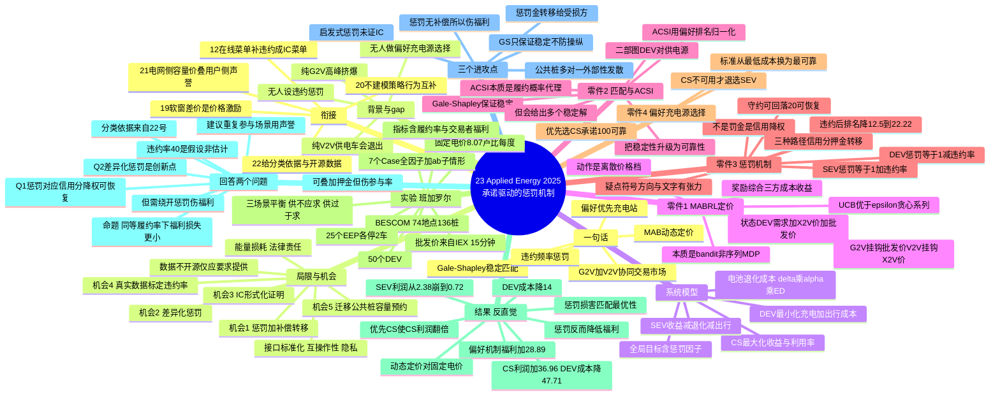

# 23 承诺驱动的惩罚机制

> 作者：Rajapandiyan Arumugam, Thangavel Subbaiyan（**National Institute of Technology Puducherry，印度**）
> 期刊：**Applied Energy 401 (2025) 126780**，2025-09-24 上线
> ⚠️ 数据可用性：**"Data will be made available on request"** —— **不开源**，复现只能照 Table 2 参数自造

## 一句话

把 **G2V（电网→车）+ V2V（车→车）** 拧成一个协同能量交易市场，用 **Gale-Shapley 稳定匹配** 配对、用 **多臂老虎机（MAB/UCB）** 动态定价、用 **基于违约频率的惩罚** 逼大家履约、用 **偏好排序（优先充电站）** 保证承诺可靠性。

---

## 1. 背景与 gap（作者自己划的）

- **纯 G2V**：高峰时段充电桩挤爆，EV 抢不到，灵活性受限。
- **纯 V2V**：供电车（SEV）**可能不靠谱**——利润不够就退出交易，导致匹配落空。
- **作者的 gap（原文强调）**：*"no prior research has incorporated a penalty mechanism for EVs that fail to comply with their scheduled matching commitments and the preference-based approach for charging source selection."*
  → **没有人给"不遵守匹配结果的 EV"设惩罚，也没有人做"基于偏好的充电源选择"。**

系统组件：CS（充电站）/ DEV（求电车）/ SEV（供电车）/ EEP（能量交换点，V2V 交接地点）+ 一个中心化的能量管理平台。

---

## 2. 系统模型（四类主体的目标函数）

| 主体 | 目标 | 关键公式 |
|---|---|---|
| **DEV** | 最小化充电成本 + 出行成本（还要缓解里程焦虑） | $R_i=\frac{(SoC_i^C-\rho)\cdot BC_i}{\gamma_i}$；$CC_i^m=DP^m\cdot ED_i$；$TC_i^k=P_i\cdot dis_i^k\cdot\gamma_i$ |
| **CS** | 最大化收益 + 最大化充电口利用率 | $RV_{n\in m}^i=(DP_{n\in m}-WP_t)\cdot ED_i$ |
| **SEV** | 最大化收益 − 电池退化成本 − 出行成本 | $RV=CC-AC$；$\phi=\delta\cdot\alpha\cdot ED_i$ |
| **全局** | — | $\max F=(CF_{SEV}\times P^S)+CF_{CS}-(CF_{DEV}\times P^D)$ ← **惩罚因子在这里进场**（式 13） |

> 电池退化成本 $\phi=\delta\alpha\cdot ED_i$，其中 $\delta$ = 电池更换成本（₹15000/kWh）、$\alpha$ = 容量退化系数（0.025）。**如果你做 V2V 或让渡电量的机制，这个成本项必须写**，否则供电方的参与约束不成立。

---

## 3. 零件一：MABRL 动态定价

### 为什么是 MAB 而不是完整 MDP
作者把它形式化成 MDP 元组 $\{S,A,P,R\}$，但明确说 **$P$（状态转移）不适用**——因为在每个时段 $T$ 内状态是**静止**的，agent 只是在同一状态下反复试不同价格 → 本质是 **bandit**，不是序列决策。这个"该简化就简化"的取舍值得学（也和你 20 号那篇刻意不用深度模型同理）。

- **状态** $s_T=\{ED_{T,n}$（各 DEV 需求）, $P_{T,j}$（各 SEV 的 X2V 单价）, $WP_T$（批发电价）$\}$，24h 分时段，时段内不变
- **动作** $A=\{DP_1,...,DP_m\}$ —— **离散价格档**（这点很重要：价格是离散菜单，不是连续变量）
- **奖励** $r_t(s_T,a_t)$ 综合 DEV/SEV/CS 三方成本收益；$q^*(a)=E[R_T|A_t=a]$，用 $Q_t(a)$ 增量估计，$a_t=\arg\max_a Q_t(a)$
- **四种算法对比**：constant ε-greedy / ε-greedy 线性衰减 / ε-greedy 指数衰减 / **UCB**：$A_t=\arg\max_a\left[Q_t(a)+c\sqrt{\frac{\ln t}{N_t(a)}}\right]$
- **选 UCB 的理由**：非平稳环境下探索-利用更平衡、收敛更快、对奖励波动自适应

**定价的双轨逻辑**：G2V 的价格挂钩**电网批发价**；V2V 的价格挂钩 **SEV 电池里现存电量的成本（X2V price）**。两者用同一个 MAB 框架但利润模型不同（CS 赚批零价差，SEV 赚售价减自身电量成本与退化）。

---

## 4. 零件二：Gale-Shapley 匹配 + ACSI（从多个稳定解里挑最优）

- 建**二部图**：一边 DEV，一边供电源（SEV + CS）。DEV 偏好低价，供电源偏好高利润。
- Gale-Shapley 保证**稳定匹配**（不存在"两个人都更想跟对方配"的阻塞对）。

**但作者发现一个问题**：在 EV 场景下，GS 会给出**多个都稳定的匹配**（同一对 DEV-SEV 可以在不同 EEP 成交）。于是引入 **ACSI（平均客户满意度指数）** 来选：

$$CSI_{i,k}=\left(1-\frac{\sigma_{j,i}-1}{N_i}\right)\times100,\qquad
ACSI_{i,k}^{j}=\frac{CSI_{i,k}+CSI_{j,k}}{2}$$

其中 $\sigma_{j,i}$ = 对方在自己偏好列表里的**排名**，$N_i$ = 可选对象总数。

> 🔑 **ACSI 的本质是一个"履约概率的代理指标"**：双方对彼此都越满意，这笔交易越可能真的发生。作者用它把"稳定性"升级成了"**可靠性**"。
> 这个思路你可以直接借：**用偏好排名归一化 → 估计承诺概率 → 进入目标函数**，比拍一个"履约率 = 0.9"高级得多。

---

## 5. 🔑 零件三：惩罚机制（本文最独的贡献，也是你最该细读的）

### 公式

$$P_i^D=1-\left(\frac{N_i^{dis}}{N_i^{ET}}\right)\qquad(21)$$
$$P_j^S=1+\left(\frac{N_j^{dis}}{N_j^{ET}}\right)\qquad(22)$$

- $N^{dis}$ = 历史**违约次数**；$N^{ET}$ = **总参与次数** → 本质是**历史违约率**
- DEV 的惩罚因子 **$P^D<1$**（违约越多越小于 1）；SEV 的 **$P^S>1$**（违约越多越大于 1）

### 它到底怎么"罚"的？—— **不是罚金，是信用评级式降权**

这一点非常关键，你占位里问"惩罚项对应什么？违约押金？信用分？"——**答案是信用分/声誉降权，且可恢复。**

原文机制（4.1 节）：惩罚**改变各方在偏好列表中的排序**（alters the preference lists），从而导致 DEV 充电成本上升、SEV 利润下降。5.3.1 给了一个完整的时间演化例子：

| 参与轮次 | 事件 | 惩罚效果 |
|---|---|---|
| 第 8 次 | DEV 4 **违约** | — |
| 第 9 次 | — | 在 SEV 偏好列表中**排名下降 12.5%** → 匹配到更贵的供电源 |
| 第 9 次 | 又违约 | 惩罚升到 **22.22%**（第 10 次） |
| 第 10 次 | **守约** | 惩罚**回落到 20%**（第 11 次） |

→ **有记忆、有衰减、可恢复**。这是标准的**声誉机制（reputation mechanism）**，不是一次性罚款。

### 三种惩罚实现路径（你选型时要写的对比）

| 路径 | 代表 | 优点 | 缺点 |
|---|---|---|---|
| (a) **信用分/排序降权** | **本文** | 无需真实资金转移、易部署、可恢复 | 不改变预算约束，只是"下次更难匹配"；威慑力依赖长期参与 |
| (b) **违约押金 / no-show fee** | — | 直接、威慑强 | 需要预付，伤害参与率（尤其新用户） |
| (c) **违约金转移给受损方** | — | 惩罚 + 补偿二合一 | 需要清算基础设施 |

> ⚠️ **本文一个可以推敲的点**：式 (13) 里 $P^S>1$ 是**乘在 SEV 利润上**的，形式上看会**放大**利润；而作者文字说的是惩罚"reduces the profitability of SEVs"。符号方向与文字描述存在张力，实际效果依赖它在偏好排序中的具体实现方式（论文未完全展开）。**你写论文时一定要把这个定义写严谨**——这正是你可以做得比它更规范的地方，也可能成为你 related work 里一句"the penalty is heuristic and its formal properties are not established"的落点。

---

## 6. 零件四：偏好驱动的充电源选择（真正的福利来源）

**规则**：DEV **优先选 CS（充电站）**，CS 不可用时才退而选 SEV。理由：
- CS 是固定基础设施，**承诺 100% 可靠**（除非检修）；
- SEV 可能因利润不足**中途退出**，留下 DEV 空等。

→ 把选择标准从"**最低成本**"换成"**承诺最有保障**"。

这个零件才是本文福利提升的主力（见第 8 节数据）。

---

## 7. 实验设计：班加罗尔智慧城市

| 参数 | 值 |
|---|---|
| 测试系统 | **印度班加罗尔（Bengaluru）**，BESCOM 配电商 |
| 真实基础设施 | 74 个地点 **136 个充电桩**（106 AC + 30 DC 快充），DC 为 25kW CCS Combo2 / CHAdeMO |
| 现行固定电价 | **₹8.07/kWh**（对照组基准） |
| 批发电价 | 印度能源交易所 **IEX**，2023-03-23，**15 分钟间隔** |
| EEP | 25 个，每个限停 2 车（1 DEV + 1 SEV），各 2 个充电口 |
| DEV | 50 辆 |
| **三个 Scenario** | S1 供需平衡（SEV=20，供=求=50）；S2 **供不应求**（SEV=10，供 40）；S3 **供过于求**（SEV=30，供 60） |
| 位置/速度 | 随机 (0,0)–(20,20) km；20–60 km/h |
| 价格 / SoC | $P^D,P^S$ ~ U(6,10) ₹/kWh；当前 SoC 10–20%，期望 50–80%，阈值 ρ=5% |
| 电池退化 | δ=₹15000/kWh，α=0.025 |

**7 个 Case 全因子**（Table 3，这个实验矩阵结构可以直接抄）：

| Case | G2V | V2V | 优先级机制 | DEV 惩罚 | SEV 惩罚 |
|---|---|---|---|---|---|
| 1 | ✓ | — | — | — | — |
| 2（baseline） | ✓ | ✓ | — | — | — |
| 3 | ✓ | ✓ | — | ✓ | — |
| 4 | ✓ | ✓ | — | — | ✓ |
| 5 | ✓ | ✓ | ✓ | — | — |
| 6 | ✓ | ✓ | ✓ | ✓ | — |
| 7 | ✓ | ✓ | ✓ | — | ✓ |

每个带惩罚的 Case 再分 **a / b** 两个子情形（a = 刚违约后的即时状态，b = 后续持续守约后的恢复状态），用来展示惩罚的**时间演化**。

**指标**：unit cost（DEV 单位充电成本）/ unit profit（供电源单位利润）/ **trader's welfare（交易者总福利）** / average satisfaction / **schedule adherence（履约率）**

---

## 8. 结果：一个反直觉但极有价值的发现 ⚠️

### 8.1 偏好机制是福利主力，惩罚反而**降低**福利

**交易者福利提升幅度（相对 Case 2 baseline）**：

| Case | 机制 | S1 | S2 | S3 |
|---|---|---|---|---|
| **5** | 仅偏好（优先 CS） | **28.89%** | **20.63%** | **35.98%** |
| 6a | 偏好 + DEV 惩罚（低参与） | 23.49% | 15.38% | 31.58% |
| 6b | 偏好 + DEV 惩罚（高参与，惩罚被稀释） | 25.93% | 18.00% | 33.87% |
| 7a | 偏好 + SEV 惩罚（低参与） | 28.36% | 20.25% | 35.60% |
| 7b | 偏好 + SEV 惩罚（高参与） | 28.78% | 20.38% | 35.76% |

**结论（原文原话）**：
> *"assigning penalties based on the EV default frequency ... raises the charging costs for DEVs, reduces the profitability of SEVs, and **reduces overall trader welfare**. Moreover, **increased penalties degrade matching optimality**, adversely affecting system efficiency."*

→ **惩罚提高了履约率，但代价是匹配最优性变差、总福利下降。** 作者如实报告了这个负面结果，非常难得。

### 8.2 偏好机制为什么赢（Scenario 1 数字）

| 指标 | Case 2（无偏好） | Case 5（优先 CS） |
|---|---|---|
| 供电源单位利润 | 4.35 ₹/kWh（CS 1.97 + SEV 2.38） | **5.08**（CS **4.36** + SEV 0.72） |
| **DEV 单位充电成本** | **13.80**（CS 4.01 + SEV 9.79） | **11.85**（CS 8.89 + SEV 2.96） |

→ 优先 CS 让 **CS 利润翻倍、DEV 总成本降 14%**，代价是 **SEV 利润从 2.38 崩到 0.72**（V2V 被边缘化）。这是一个清晰的**可靠性 vs 去中心化**的权衡。

### 8.3 动态定价 vs 现行固定电价（Table 7）

相比班加罗尔现行的 ₹8.07/kWh 固定电价，本文方案实现：
- 充电站利润 **+36.96%**
- SEV 利润 **+28.13%**
- DEV-CS 配对充电成本 **−47.71%**
- DEV-SEV 配对充电成本 **−21.5%**（基准 ₹12/kWh）

---

## 9. 回答你占位里的两个问题

### Q1：惩罚项在我的模型里对应什么？违约押金？信用分？

**本文的答案是「信用分/声誉降权」，而且是可恢复的**——违约率越高，你在对方偏好列表里排名越靠后（例子中降 12.5% → 22.22%），于是匹配到更贵的桩/更差的买家；守约后惩罚会衰减（22.22% → 20%）。

**对你的建议**：三条路径的适用性取决于你的场景——
- 你的场景是**公共桩预约（日前预留 + 实时挤占）**，用户是**重复参与者**（不是一次性路人）→ **(a) 信用分/声誉降权是合适的**，因为它靠"未来参与权"来威慑，正好契合重复博弈。
- 如果你想做**更强的承诺**，可以叠加 **(b) 违约押金**：预约时冻结一小笔，爽约扣除。但要注意押金会**伤害参与率**（新用户尤其敏感），需要做参与约束（IR）分析。
- **最推荐你做的是 (c) 的变体**：见下面第 10.2 节——惩罚金**转移给受损方**，同时实现惩罚与补偿。

### Q2：用户分类（可靠型/灵活型/高违约风险型）→ 差异化惩罚力度？是不是创新点？

**是的，是创新点——但必须绕开本文的负面结论才能立住。**

**（a）为什么是空白**：本文的 $P^D=1-N^{dis}/N^{ET}$ 是**完全同质**的。它只看历史违约频率，**不区分"为什么违约"、不区分用户类型、不给不同类型设不同系数**。所有 DEV 用同一条公式。你按类型差异化——本文没做。

**（b）但直接说"差异化惩罚更好"会被打**：因为本文已经证明**惩罚本身降低福利、损害匹配最优性**。所以"加大/精细化惩罚"不是无条件优的。

**（c）正确的命题应该是这样立（可直接写进 contribution）**：
> 在**给定的履约率目标**下，**按用户类型定制的差异化惩罚**，比统一惩罚**损失更少的总福利**（即 Pareto 改进：同样的可靠性，更低的福利代价）。

这个命题好在：① 有明确的对照组（统一惩罚 vs 差异化惩罚）；② 有明确的可视化（**履约率—福利**的权衡前沿曲线，看哪条曲线更靠外）；③ 直接回应并改进了本文自己报告的负面结论 → 有"站在巨人肩膀上"的正当性。

**（d）分类依据从哪来 —— 正好接你刚读的 22 号**：
- 22 号（Applied Energy 2024，Kreft）证明：用户行为的**可预测性**存在巨大异质（车与车 MAE 跨度 65 小时），且 **overnight 型（弹性大、好预测）vs same-day 型（刚性、难预测）** 是一个有效的二分。
- 于是：**用 22 号的行为类型/可预测性给用户分类 → 为每类设不同的惩罚系数 → 用 23 号的 G2V/V2V 匹配框架做"统一惩罚 vs 差异化惩罚"的对照实验**。
- 这是一个**完整、可复现、有明确对照**的实验设计，两篇拼起来正好构成一个 contribution。

**（e）还有一个本文的软肋你可以直接攻**：本文的违约率是**拍出来的**——原文写着 *"For simulation purposes, around 40% of the DEVs subject to penalties are assumed"*。**违约率是外生假设，不是从数据估的**。而 22 号恰恰告诉你：真实行为数据是可以估计这类参数的（而且 Electric Nation 数据开源）。→ **用真实数据标定违约概率分布**，又是一个实打实的增量。

---

## 10. 对你选题最有用的三个进攻点

### 10.1 它是"启发式惩罚"，不是"可证明的机制" 🔑

本文在摘要和 contribution 里说机制 *"incorporating individual rationality"（个体理性，IR）*，但：
- **没有给出 IR / IC 的形式化定义与证明**——只停留在"参与者有利可图才参加"的朴素层面；
- 惩罚公式 $P=1\pm N^{dis}/N^{ET}$ 是**拍的（heuristic）**，**没有证明在这个惩罚下"守约"是每个 DEV 的最优反应**。也就是说，**它不是激励相容（IC）的**——没人保证理性用户在面对这个惩罚时一定会选择守约。
- Gale-Shapley 只保证**稳定性**（无阻塞对），**不保证防操纵**。经典结果（Roth 等）：GS 只对**提议方**是 strategy-proof 的，**接受方有激励谎报偏好**。本文两边都在参与，却没讨论谁是说真话的一方、谎报会怎样。

→ **你的位置：把"启发式惩罚"升级为"可证明 IC 的承诺机制"。** 这是机制设计论文的标准要求，本文没做，而你的主线（108 在线菜单 + IC）正好有这个工具。

### 10.2 惩罚没有"补偿"，所以才伤福利——这是你最好的落点 ⭐

本文发现"惩罚降低总福利"的**根因**很容易看穿：**DEV 爽约 → SEV 白跑一趟（受损），但惩罚只是让 DEV 下次匹配更差，没有任何补偿流向那个被坑的 SEV。**

于是惩罚在系统中是**纯损**：DEV 付出了代价，但**没人因此变好**——福利当然下降。

**你可以做的机制**：**惩罚金转移（penalty-with-compensation）**——爽约方付出的代价，**定向转移给本次受损的交易对手**，而不是凭空消失。理论上：
- 惩罚仍然**提高履约率**（威慑不变）；
- 但福利**不再净损**（因为是一次转移，不是销毁）；
- 甚至可能**提升**福利：受损方得到补偿后参与意愿上升 → 供给更稳定。

> 这就把本文"惩罚必然伤福利"的负面结论**反转**成一个正面设计，而且**有明确的对照实验**（无惩罚 / 惩罚销毁 / 惩罚转移，三条曲线对比履约率与福利）。
> 这个点我觉得是你从这篇里能拿到的**最有价值的一个创新方向**，强烈建议记下来。

### 10.3 它没考虑"违约的外部性"在容量竞争下的放大

本文是 V2V/V2G 的能量交易场景，一个 DEV 爽约主要坑到**跟它配对的那个 SEV**（一对一）。

而你的**公共桩预约**场景是**多对一抢容量**：预约了不来的 DEV 占着预留容量 → 别人排不上 → **外部性是发散的、不只是坑一个对手**。外部性越大，机制设计越必要，也越难做（需要定价内化）。这是场景差异带来的天然增量。

---

## 11. 与你已读各篇的衔接

| 篇 | 关系 |
|---|---|
| **108 / 12**（在线菜单 + IC） | 12 号假设"用户说了就照做"；**23 号补上了违约**，但惩罚是启发式的、未证 IC → 两者拼接 = **"带违约风险的 IC 菜单机制"**，正是你主线该走的下一步 |
| **22**（AE 2024 可预测性） | 22 号给你**用户分类依据**（可预测性 / overnight vs same-day）+ 开源数据标定违约率；23 号给你**惩罚框架** → 拼出"分类 + 差异化惩罚"实验 |
| **20**（TITS 在线动态定价） | 20 号明说不建模策略性行为、不处理取消/改约；23 号处理了违约但没做定价的 IC 证明。两篇的"不处理"清单高度互补 |
| **19**（Omega 硬窗/软窗） | 19 号的"软窗差异价"是**价格激励**；23 号的惩罚是**非价格（排序）激励** → 你的机制可以同时用两只手 |
| **21**（TPWRS 容量市场） | 21 号在电网侧定容量价（对偶导出）；23 号在用户侧用声誉保履约 → 上下两层可以叠 |

---

## 12. 局限与作者自陈的未来工作

**技术/政策挑战（作者列）**：能量传输损耗、能源共享的法律责任、缺乏标准化接口、不同 EV 车型的互操作性、数据共享的隐私问题；密集城区的实时协调需要更强的通信与控制架构。

**作者指向的未来方向**：区块链安全交易、边缘计算实时优化、V2V/G2V 标准化互操作协议。

**你能补的缝（按性价比排序）**：
1. ⭐ **惩罚 + 补偿转移机制**，反转"惩罚伤福利"的结论（见 10.2）
2. ⭐ **差异化惩罚**：按行为类型定制系数，在同等履约率下减少福利损失（见 9-Q2）
3. **IC 的形式化证明**：把启发式惩罚升级为可证明激励相容的机制（见 10.1）
4. **用真实数据标定违约率**，替代本文"假设 40%"（见 9-Q2-e，配 22 号的开源数据）
5. **场景迁移到公共桩容量预约**，处理多对一竞争下的发散外部性（见 10.3）

---

## 13. 一句话总结（汇报/PPT 用）

> Arumugam & Subbaiyan（Applied Energy 2025）在 G2V+V2V 协同交易中首次引入**基于违约频率的声誉惩罚**（违约者在对方偏好列表中降权，可随时间恢复）与**偏好驱动的充电源选择**（优先选承诺可靠的充电站）。关键发现是反直觉的：**真正提升福利的是"优先可靠供电源"（+28.89%），而惩罚本身反而降低总福利并损害匹配最优性**——因为惩罚是纯损，爽约方付出的代价没有补偿给受损的交易对手。其机制是启发式的，未证明激励相容。

---

## 14. 思维导图

---

[[000 索引 · 第二批12篇]]
