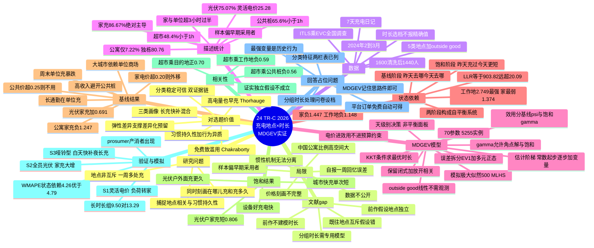

# 24 充电地点与时长的实证模型（MDGEV）

> 作者：Andrea Pellegrini, Elisabetta Cherchi, John M. Rose（**悉尼大学 ITLS** 运输与物流研究所 + NYU Abu Dhabi）
> 期刊：**Transportation Research Part C 194 (2027) 106023**（2026-09-21 在线；TR-C 是交通研究顶刊）
> 收稿 2025-11-23 → 接受 2026-09-07（约 10 个月，正常 TR-C 周期）
> ⚠️ 数据不公开："The authors do not have permission to share data"（EVC 会员调查，有保密协议）

## 

用澳大利亚 1,440 名 EV 车主的**一周充电日记**，建**多变量多离散分组极值模型（MDGEV）**，**同时**刻画"在哪儿充（5 类地点、非互斥）"和"充多久（分组时长）"，并首次在 MDGEV 里加入**跨地点相关结构**和**习惯持久性（state dependence）**；发现**光伏让家充更多但单次更短、大城市依赖非家充、用户充电有极强的路径依赖**。

---

## 1. 研究问题与文献 Gap（作者划的三级跳）

### 1.1 已有研究的两块拼图

**DCE（陈述偏好）路线**的共识：家是最优充电地点（Jabeen 2013 西澳、ArfaeiYazdiPour 2025 美国）；偏爱快充；对价格极敏感；偏好一口价（Visaria 2022）；**即使电量高也倾向早充**（Thorhauge 2023——这是个重要的行为偏差，和"理性等到需要才充"相反）。

**RP（真实数据）路线**的共识：瑞士充电多发生在工作时段（Gellrich 2022）；充电时机主要由出行距离和时长决定（Crozier 2021）；**成本与排队等待是关键决策因子**（Anderson 2022）；荷兰夜间公共桩依赖高（Wolbertus 2016，家里没桩）；多户住宅用户必须非家充（Lee 2020）；🔑 **Chakraborty 2019：工作地免费充电会诱发"过度充电"，造成充电站拥堵**。

### 1.2 本文的 gap（三级跳）

1. **地点互斥假设错**：既往把充电地点建成互斥选项（一天/一周只在一个地方充），多地点就粗暴聚成"multiple locations"一类。现实中一周内家+超市+单位全用很正常。
2. **前作（Rose & Pellegrini 2025）的不足**：error component MDCEV（Bhat 2005/2008）做了地点×时段（过夜/白天/傍晚）×**频率**，但**没有建模单次时长**——而时长对基础设施利用率与电网负荷管理至关重要；且其误差结构**假设地点选项间独立**——"白天在单位充过，晚上在商场充的概率应该变低"，忽略这个相关性会**错估全天各地点的使用量**。
3. **时长数据是分组的**：车主记不清也不愿精确报告"充了 3 小时 42 分"，只会选"3–4 小时"这类区间。传统 MDCEV 处理连续消费量，对分组数据不匹配。

→ 所以用 **MDGEV（Bhat et al. 2020）**：专为"**多离散选择 + 分组消费数据**"设计，且**本文首次扩展它**——把误差项拆成两部分，一部分保留闭式概率，另一部分引入多元正态捕捉跨选项相关。

---

## 2. 数据与问卷设计（行为实证的范本，值得照抄结构）

**来源**：悉尼大学 ITLS × 澳大利亚电动汽车委员会（EVC）全国调查系列；Qualtrics 在线问卷；**2024 年 2–3 月**；从 EVC 会员库抽 1,600 名 EV 车主（覆盖全澳各州），剔除缺失后 **1,440 人**。PHEV 仅约 3%，样本太少不单独分析，统一并入 EV（结论主要反映 BEV 车主）。

**问卷五段式**：
1. 家庭车队与车辆特征（车龄、续航、年里程、电池容量 kWh 等）
2. **家充配置**：桩技术、车位、成本、时长
3. **公共桩使用**：家/单位到最近公共桩距离、常用网络（品牌）、均价、通常时段、排队频率、公共设施对购车决策的重要性
4. 🔑 **过去 7 天充电日记**：在哪些地点充过（给了一份与 EVC 产业成员共同编制的 5 类地点清单）+ 每地每次充电时长（从预设时间档里选）
5. 社会人口与经济特征

**5 类充电地点（选项集）**：
| 编号 | 地点 | 性质 |
|---|---|---|
| k=2 | 家 Home | 私人桩 |
| k=3 | 工作地 Workplace | 半公共 |
| k=4 | 超市/购物中心 | 目的型快补 |
| k=5 | 目的地充电桩（酒店/餐厅/景区） | 附赠设施 |
| k=6 | 其他公共充电桩（途中/公共区域） | 专程充电 |
| k=1 | outside good | 当天没在上述 5 类地点充电的剩余时间 |

**时长分组**：<1h / 1–2h / 2–3h / … / >12h（Table 2 的日记格式：行=星期几，列=时长档，勾选）。

> 🔑 对你的启发：**"分组时长"是处理回忆偏差的标准做法**——用户报告精确分钟不可信，但选区间是可靠的。你如果做问卷或访谈，时长一律设档；如果用运营数据（如 22 号的桩端自动测量），才能拿精确时长。

---

## 3. 描述性统计（数字抓手，可直接引用）

### 3.1 地点使用率（可多选，总和 >100%）

| 地点 | 使用率 |
|---|---|
| **家** | **86.67%** |
| 其他公共桩 | 17.43% |
| 超市/购物中心 | 13.68% |
| 工作地 | 9.65% |
| 目的地桩 | 6.74% |

### 3.2 各地点的时长模式（Table 3，本文最有信息量的一张表）

| 时长档 | 家 | 工作地 | 超市 | 目的地 | 其他公共 |
|---|---|---|---|---|---|
| <1h | 4.5% | 3.4% | **48.4%** | 23.8% | **65.6%** |
| 1–2h | 12.9% | 18.3% | 30.3% | 31.1% | 21.3% |
| 2–3h | 17.8% | 20.2% | 10.3% | 12.6% | 4.5% |
| 3–4h | 17.3% | 16.5% | 5.5% | 10.6% | 8.7% |
| ≥9h | 7.5% | — | — | — | — |
| 6–7h | 6.3% | **19.9%** | — | — | — |

**三种用户画像一目了然**：
- **家/工作地 = 长时慢充型**：家 >50% 超 3 小时；工作地近 60% 超 3 小时（6–7h 占 19.9%——上班充一天）
- **超市/公共桩 = 快补型**：超市 48.4% <1h；公共桩 65.6% <1h、≥4h 为 0
- **目的地桩 = 混合型**：短中时长均匀分布（休闲 + 过夜两种用途）

> 🔑 这个三分类和 **22 号（Applied Energy 2024）的 overnight vs same-day 是同一枚硬币的两面**：过夜充 ≈ 家充长时；当天补 ≈ 公共桩快充。22 号用桩端自动数据证明、这篇用日记自报数据证明，两条独立证据链。

### 3.3 样本画像（Table 4–6，注意偏差）

- 地理：75% 集中在东部三州（NSW 36.46%、VIC 24.93%、QLD 13.89%）
- 年龄：25.28% 在 50–59 岁；**仅 1.46% ≤29 岁**（EV 车主偏中老年有钱人）
- **80.76% 住独栋**（仅 7.22% 公寓）；81.25% 日行驶 >30km；91.6% 家到最近公共桩 <17km
- 收入：31.18% 周入 ≥$3,000；36.67% 家有 18 岁以下孩子
- 家充配置：**75.07% 有光伏**、25.28% 有灵活电价、71.53% 无需电力升级、44.17% 安装成本为 $0
- 家电价均值 $0.19/kWh；公共桩均价 **$0.28/kWh**（中位 $0.24，SD $0.23——离散度大）
- 工作地：**79% 没有免费充电**；仅 3.86% 有快充位；平均每周只开 EV 上班 **0.92 天**

> ⚠️ 这明显是**早期采用者样本**（独栋、有钱、有光伏、有家充），作者最后也承认了。读结论时要带着这个滤镜。

---

## 4. MDGEV 模型详解（方法核心，拆开讲）

### 4.1 效用函数与预算约束

$$U_{is}(x)=\psi_{i1}x_{i1}+\sum_{k=2}^{6}\psi_{isk}\,\gamma_{isk}\,\ln\!\left(\frac{x_{isk}}{\gamma_{isk}}+1\right)\qquad(1)$$
$$x_{i1}p_{i1}+\sum_{k=2}^{6}x_{isk}\,p_{isk}=T_i\qquad(2)$$

- $x_{isk}$：个体 $i$ 第 $s$ 天（$s=1,\dots,7$）在地点 $k$ 花在充电上的时间；$K=6$（5 类地点 + outside good）
- **outside good（k=1）取线性形式**，代表"当天没在建模的 5 类地点充电的剩余时间"。妙处：因为时长是分组观测的，**无需观测 outside good 的精确消费量**，也不必重构连续的日时间分配。它还吸收了"车辆当天带着非零 SoC 进入"等未观测因素。线性形式成立的条件：内点商品分配远小于总预算——本文日均充电约 4 小时（仅占 24h 的 16.7%），最大 17h（70.8%），条件满足（作者用脚注 4 专门论证了这一点，这种自查意识值得学）。
- $\psi_{isk}$：**基线边际效用**（决定"去不去这个地点"）
- $\gamma_{isk}$：**饱和参数**（决定"去了充多久"）——$\gamma$ 越大越不容易"吃饱"，允许**角点解**（$x=0$，即当天不在此地充电）和**饱和效应**（充电的边际效用递减）
- 预算约束里 $p=1$（时间是计价物），**电价不进预算约束而是进效用函数**（作为 ψ 的解释变量）——脚注 5 解释：因为另外三个地点的成本数据拿不到，塞进预算约束会造成不一致；这是一个被迫但诚实的处理
- ⚠️ 注意：模型在**天级别**上运行（每天一个决策），一周 7 天 × 每人，所以面板是**非平衡**的（多数人不是每天充电）

### 4.2 参数化：社会人口 + 状态依赖全都要

$$\psi_{is1}=\exp(\epsilon_1)\qquad(3a)$$
$$\psi_{isk}=\exp(\theta'q_{ik}+\alpha'I_{i,s-1,k}+\epsilon_k)\qquad(3b)$$
$$\gamma_{isk}=\exp(r'd_{ik}+o'I_{i,s-1,k}+\delta'I_{i,s-2,k})\qquad(3c)$$

- $q_{ik}, d_{ik}$：**时不变变量**——社会人口特征（光伏、公寓、收入、孩子、州、城市）+ 地点属性（电价、充电技术）
- $I_{i,s-1,k}$：**状态依赖变量（时变）**——昨天是否在地点 k 充过电（0/1）
- 🔑 注意饱和阶段 $\gamma$ 同时用了 **s−1 和 s−2 两期滞后**——"昨天充过 → 今天单次充更短"和"前天充过 → 今天单次充更短"是两个不同的效应
- 全部参数用 exp(·) 保证 $\psi,\gamma>0$（效用函数有效性的技术要求）
- 过程是**遍历的（ergodic）**：初始条件未观测，故 $s=1$ 时 $I_{i,s-1,k}=0$

### 4.3 🔑 本文的方法学贡献：误差分解

$$\epsilon_k=\xi_k+\eta_k$$

- $\xi_k$：i.i.d. **Type-1 极值（EV1）**，尺度归一化为 1 → **保留 Bhat et al. (2020) 的闭式概率表达式**
- $\eta_k$：跨选项相关的**多元正态** $\eta\sim N(0,\Omega)$ → 捕捉地点间未观测相关

> 这个"**一部分保留闭式、一部分放开相关**"的拆法是本文对 MDGEV 的首次扩展。意义：完全放开相关（全模拟）会丢掉闭式解、计算爆炸；完全不放开（前作）会错估。折中方案只对 $\eta$ 部分做模拟积分。

### 4.4 求解与估计

- 对预算约束构造**拉格朗日函数**，由 **KKT 条件**导出最优时长分配 $x^*$：
  - 内点解（$x_{isk}>0$）：边际效用相等 $\epsilon_k-\epsilon_1=\tilde V_{isk}-\tilde V_{is1}$
  - 角点解（$x_{isk}=0$）：$\epsilon_k-\epsilon_1<\tilde V_{is1}-\tilde V_{isk0}$
- 无条件概率 = 对 $\eta$ 积分（式 10，含雅可比 $|J|$），用**模拟极大似然（SML）+ 500 个 MLHS 抽样**近似
- **估计的阶梯流程**（脚注 7，实操范本）：①先估只有常数的单变量 MDGEV → 参数作起始值；②逐步加解释变量看拟合贡献；③选出最优单变量设定后，再估多变量结构（150 draws 起步渐增到 500），直到拟合不再显著改善
- **收敛结果**：70 个参数、5,255 个充电实例、LL = −20236.05、AIC 40612、BIC 41072

### 4.5 状态依赖的正式检验

与非状态依赖版（滞后项全部置零，是嵌套模型）比较：
- AIC/BIC 均更低
- **LLR 检验统计量 = 903.82 >> χ²临界值 20.09（1% 水平）**

→ **习惯持久性极强，不是边际改进而是数量级差异。** 这个 903.82 这个数字值得记住。

---

## 5. 基线结果（Table 7a：去哪儿充）

### 5.1 常数与主效应

常数：**家 +1.019**，其他公共 −2.555，工作地 −3.364，目的地 −4.359，超市 −5.073 → 家一骑绝尘；公共途中桩排第二。

### 5.2 各变量的效应（挑显著的）

| 变量 | 效应 |
|---|---|
| **有光伏** | 家 **+0.691**；工作地 −0.635、其他公共 −0.603 → 光伏户更宅充 |
| **住公寓**（vs 独栋/半独栋） | 家 **−1.247**；超市 +0.796、其他公共 **+1.245** → 公寓户被迫公共充 |
| **住宅电价 >$0.20/kWh** | 家 −0.254；超市 +0.402、其他公共 **+0.729** → **家贵就外移（替代效应）** |
| **公共充电价 >$0.25/kWh** | 其他公共 −0.637 → 公共桩贵就不用 |
| **有灵活电价** | 工作地 −0.460、其他公共 −0.227（边际）→ 能在家错峰就不出去充 |
| **住大城市** | 家 −0.260、其他公共 −0.512；工作地 +0.486、超市 +0.968、目的地 +0.640 → **高密度城区家充难**（无路侧车位+高层住宅多）→ 依赖单位/超市/目的地 |
| **日行驶 >60km** | 工作地 +0.579 → 长通勤在单位充 |
| **周入 ≥$3,000** | 工作地 +0.509；超市 −0.313、其他公共 −0.314 → **高收入避开公共桩**（怕排队、怕坏桩），爱在单位充 |
| 家有孩子 | 超市 +0.131（边际）→ 充电搭购物 |
| 周末 | 工作地 −2.182（不上班）；其他公共 +0.263（休闲出行多） |

### 5.3 🔑 习惯持久性（基线阶段，全部极显著）

| 昨天在 k 充过 → 今天再去 k 的效应 |
|---|
| 工作地 **+2.749** |
| 其他公共 **+2.309** |
| 目的地 **+1.970** |
| 家 +1.374 |
| 超市 +1.118 |

→ **昨天在哪儿充，今天还去哪儿充**。且注意：**工作地和公共桩的习惯最强，家反而最弱**——解读：家充是"默认选项"（天天都在），而工作地/公共桩的使用更需要"路径依赖"来维持。这与 Philip 2022、Lim 2024 的澳大利亚真实数据研究一致（充电行为随经验演化）。

---

## 6. 饱和结果（Table 7b：充多久）

⚠️ 先纠正一个读表直觉：**正系数 = 饱和效应减弱 = 充得更久**；负系数 = 更快"吃饱" = 充得更短。

### 6.1 饱和常数（地点固有的一次时长倾向）

工作地 +1.127 > 家 +0.629 > 目的地 +0.331 > 超市 +0.196（不显著）> **其他公共 −1.134**
→ 工作地和家单次最久（跟 Table 3 描述统计完全吻合），公共桩最短。

### 6.2 变量对时长的影响

| 变量 | 效应 | 解读 |
|---|---|---|
| **有光伏 × 家** | **−0.806** | 🔑 **有光伏的家充单次更短**——白天太阳能窗口快充快补、多次短充 |
| **有光伏 × 公共桩** | **+0.691** | 有光伏的人在外面反而充更久——长途出行或太阳能不足时集中补充 |
| 家充设备投入（智能表/专用桩）× 家 | −0.330 | 设备好→充电效率高→无需长充 |
| 同上 × 公共桩 | −0.473 | 家里装备好的人，外面只做 top-up |
| 大城市 × 公共桩 | −0.597 | 城市快充多→单次时长短 |
| 年龄 ≤29 × 超市 | −0.364 | 年轻人购物时充电更利落 |
| **昨天充过 × 家** | **−1.447** | 🔑 昨天充过→今天单次更短（电池还有余电） |
| **昨天充过 × 工作地** | **−1.148** | 同上 |
| **昨天充过 × 超市** | −0.622 | 最弱——超市充电本来就是顺手的补充，与上次状态关系小 |

> 🔑 **状态依赖在两个阶段都显著**：昨天在哪儿充影响今天去哪儿（基线↑），昨天充过还影响今天充多久（饱和↓）。这构成一个自平衡系统：频繁充电 → 每次更短，偶尔充电 → 每次更长。

---

## 7. 跨地点相关（Table 8）

只有三个相关系数在 1% 水平显著：

| 配对 | 相关系数 | 解读 |
|---|---|---|
| 超市 × 工作地 | **−0.59*** | 在商场充的人不太在单位充（互斥的"白天在外充"策略） |
| 超市 × 其他公共桩 | **−0.56*** | 同上 |
| 超市 × 目的地桩 | **+0.70*** | 同为休闲/自由活动场景，经常一起用 |

> 🔑 **验证了前作的独立假设确实不成立**——如果忽略这些相关，会错估各地点全天使用量，进而错估路网交通与电网负荷。作者用实证直接证明了建模这个相关性的必要性。

---

## 8. 样本内验证（Table 9，WMAPE）

用估计参数重现观测分布（5,255 个实例、300 draws、日上限 24h），状态依赖 vs 非状态依赖对比：

| 时长组 | 状态依赖 | 非状态依赖 |
|---|---|---|
| 零充电（角点解） | **2.45%** | 2.75% |
| 0–4h | 11.73% | **11.44%** |
| >4h | **9.50%** | 13.29% |
| **总体** | **4.26%** | 4.79% |
| 仅正时长 | **10.82%** | 12.20% |

→ 状态依赖模型全面更好，**尤其长时长组（9.50% vs 13.29%）和角点解**——即"去不去充"和"充很久"这两个最有决策价值的预测，恰恰是习惯信息贡献最大的地方。

---

## 9. 政策模拟（Table 10–13）

三个情景（基线：灵活电价 25.28%、光伏 75.07%）：

| 情景 | 内容 |
|---|---|
| S1 | 灵活电价推至 100% 家庭 |
| S2 | 光伏推至 100% 家庭 |
| S3 | S1 + S2 |

（预测在个体层面做，再聚合成"地点 × 时长档"的份额变化；假设短期习惯行为持续，滞后状态照常进入预测。）

### S1 全员灵活电价（Table 11）
- 家 >9h 充电 **+4.20%**，家角点解 −1.38% → 夜间低价长充增加
- 工作地中长时长暴跌：6–9h **−24.93%**、3–6h −22.30%、1–3h −15.56%
- 其他公共 −4.66%~−13.73%
- → **负荷从单位/公共桩转移到家（错峰）**，削峰效果明确；但作者同时提醒：公寓户没法受益，公共桩网反而要扩容兜底

### S2 全员光伏（Table 12）
- 家"不充电"概率 **−16.6%**（家充大增，更少天不充电）
- 家 <1h **+4.8%**（白天太阳能快补）；工作地 −8.9%~−15.9%
- → 光伏显著降低公共桩依赖；但**公寓户/租客装不了光伏**（产权与法规障碍）→ 作者建议**社区光伏/共享屋顶计划**

### S3 双管齐下（Table 13）——最有意思的结构
- 家角点解 **−17.68%**；<1h **+4.91%** 且 >9h **+4.94%**，但中间档（1–9h）反而微降
- → **"哑铃型"充电结构**：白天太阳能快补（短）+ 夜间谷电长充（长），中间时段被掏空
- 工作地 6–9h −37.15%、3–6h −32.97% → 单位充电几乎被挤出局
- 作者点出：此时消费者变成 **prosumer（产消者）**——自发自用 + 高峰卖电回网，对电价方案设计与技术采纳都有深远影响

---

## 10. 回答你占位里的两个问题

### Q1：MDGEV 这个名字记住就行，不一定要用？

**对，你的判断完全正确。** 你的模型是优化/机制设计路线（MILP / 博弈 / 鲁棒），不是计量路线，不会用 MDGEV 做主模型。但从这篇里真正值得拿走的是四件"思路件"：

1. **分组时长处理**：用户报告的是区间不是精确值 → 你设计问卷/访谈时时长必须设档；你如果拿运营数据（22 号那种桩端记录），才用精确时长。
2. **状态依赖（habit persistence）**：昨天的行为预测今天的行为。这个概念是你做**用户分类可行性**的计量学背书（见 Q2）。
3. **"选择 + 消费量"两阶段结构**（去不去 & 充多久分别建模、参数分开）：对应你模型里"**是否预约** + **预约时长/离站时间**"两个决策——你完全可以借鉴这种分解。
4. **角点解 + 饱和效应**：MDCEV/MDGEV 家族专门处理"有人选有人不选 + 选了用量不同"的结构——你做仿真生成异质用户时，这个"参与决策 + 用量决策"的两层生成方式比"直接抽均匀分布"更真实。

### Q2：分类特征表能不能列出"文献支持的变量 + 我场景可得的变量"两栏？

**能，而且这篇就是"文献支持"那一栏的现成来源。** 以下变量全部在本模型中**统计显著**：

| 文献支持的变量（本文显著） | 效应方向 | 你的场景可得性 |
|---|---|---|
| **居住类型**（公寓 vs 独栋） | 公寓户家充 ↓↓、公共桩依赖 ↑↑ | ✅ 可从预约 App 注册信息/地址获得 |
| **是否有光伏/家充桩** | 有则家充为主、单次更短 | ✅ 注册时问卷可得 |
| **住宅电价水平**（>$0.20/kWh 阈值） | 家贵则外移 | ✅ 分档问卷可得 |
| **是否有灵活电价** | 有则外出充 ↓ | ✅ 问卷可得 |
| **城市密度**（大城市） | 家充 ↓、单位/商场充 ↑ | ✅ 地址即可判定 |
| **日行驶里程**（>60km） | 工作地充电 ↑ | ✅ 车机数据/问卷 |
| **收入**（≥$3,000/周） | 避开公共桩、偏好单位充 | ⚠️ 敏感，问卷回收率低；可用车型/居住区代理 |
| **家庭结构**（有孩子） | 商场充电 ↑ | ⚠️ 问卷可得但不必需 |
| **星期几**（周末） | 单位充 ↓↓、公共桩 ↑ | ✅ 系统时间戳天然可得 |
| **⭐ 过去充电地点/时长（习惯）** | **极强**（LLR 903.82） | ✅ **平台历史订单天然可得，是最强变量** |

> 🔑 **注意最后一行**：在你的预约平台场景里，"用户过去的充电行为"是**免费、自动、实时更新**的变量——而这恰恰是本文和 22 号共同证明的**最强预测变量**。你的分类器不需要问用户任何隐私问题，光看历史订单就能分类。这直接解决了"分类特征从哪来"的落地问题。

---

## 11. 对你选题的价值（三条硬支撑）

### 11.1 习惯持久性 = 你的"分类可行"的计量学证明（与 22 号互证）⭐

- **22 号（ML 路线）**：SHAP 分析显示 `lastDuration`、`startSin` 等历史特征是预测充电时长最重要的变量
- **24 号（计量路线）**：滞后充电状态在基线（去哪儿）和饱和（充多久）两个阶段都极显著，LLR = **903.82**（临界值 20.09 的 **45 倍**）

两条完全独立的方法论路线（澳洲自报日记 vs 英国桩端自动数据；计量经济学 vs 机器学习），得出同一个结论：**用户充电行为有强惯性**。

→ 这给你的论证链补上了关键一环：**"行为异质"（22 号 65h 跨度）+ "行为有惯性"（24 号 903.82）→ 用户类型是稳定的 → 按类型做差异化预约/惩罚是有预测力的 → 机制设计不是白做**。如果用户行为今天一个样明天一个样，分类和差异化就全是徒劳。这一段可以直接写进你论文的 motivation。

### 11.2 三类用户画像 = 你差异化预留的先验分组

| 画像 | 特征 | 弹性 | 预约策略含义 |
|---|---|---|---|
| **家/单位长充型** | 单次 >3h，规律性强 | **大**（可错峰） | 适合日前预约 + 弹性履约（给折扣换挪移权） |
| **公共桩快补型** | <1h 占 65%，途中应急 | **小**（刚性） | 适合临时快速通道/高优先级（付溢价） |
| **目的地混合型** | 短中均匀，休闲场景 | 中 | 可做次要容量池 |

这个分组和 22 号的 overnight/same-day、你 104 的 5 类收敛成 3 类，三条线互相咬合：**"过夜充 ≈ 家充长时 ≈ 弹性大"**，**"当天补 ≈ 公共桩快充 ≈ 刚性"**。你的"日前预留 + 临时充电"两个通道，正好各服务一类。

### 11.3 两个可直接引用的"机制必要性"论据

1. **Chakraborty et al. (2019)**（本文引用）：工作地**免费**充电诱发**过度充电**→充电站拥堵。→ "免费/低价导致资源滥用"的直接证据，支撑你论文里"必须用定价/机制约束需求"的立论。
2. **Thorhauge et al. (2023)**（本文引用）：用户**即使电量高也倾向早充**（尤其预计行程 ≥50km 或复杂出行链时）。→ 非理性行为的又一实证，和你的 CPT 前景理论线（107/11）呼应：用户不是等电量低了才充，而是"求安心"。

### 11.4 方法论范式参考

如果你未来做**问卷 + 实证**的章节（比如为机制参数做标定），这篇是完整模板：五段式问卷 → 7 天日记 → 分组时长 → 计量模型 → 样本内验证（WMAPE）→ 政策情景模拟。尤其它的**验证规范**（用 WMAPE 分组对比基准模型）和**情景模拟呈现**（Table 11–13 的百分比变化矩阵）可以直接借格式。

---

## 12. 局限（作者自陈四条 + 我的补充）

1. **自报告 + 仅一周**：回忆误差；无法捕捉季节效应与长期调整。（⚠️ 对照：22 号用的是 22 个月桩端自动测量——数据质量高一个量级。你若能拿到中国运营数据，在这条上直接胜出。）
2. **状态依赖 ≠ 前瞻优化**：作者自己强调，不能把惯性解释为用户在做完全前瞻的动态优化——可能是电池管理、通勤规律、家庭用电约束等多种机制混杂。**（对你的启示：不必纠结惯性的机制来源——不管什么机制造成的惯性，只要惯性存在，分类就有预测力，你就能用。）**
3. **价格刻画不完整**：工作地/零售/目的地充电免费或补贴或限时，货币权衡无法跨地点一致刻画。（⚠️ 这正是你做定价机制的地盘——它的短板就是你的长板。）
4. **样本偏差**：EVC 会员招募，偏早期采用者（独栋 81%、中老年、有钱、有光伏）。结论**不适用**于租客、公寓户、低收入家庭——而后者恰恰是公共桩最依赖的人群。⚠️ 所以"大城市依赖公共桩"的结论在它自己的样本里反而是**低估**的。（对中国市场：EV 人群更大众化、公寓比例远高于澳洲 7%，这个 gap 更大——中国数据做这个题目有天然空间。）
5. **数据不公开**："The authors do not have permission to share data"——无法复现，只能信其参数表。

---

## 13. 一句话总结（汇报/PPT 用）

> Pellegrini et al.（TR-C 2026）用澳洲 1,440 名 EV 车主的一周充电日记和扩展 MDGEV 模型，首次同时刻画"在哪儿充（非互斥 5 类地点）+ 充多久（分组时长）"，并证明：①光伏户家充更多但单次更短；②大城市户被迫依赖非家充；③**用户充电存在极强习惯持久性（LLR=903.82，临界值的 45 倍）**，且跨地点显著相关（超市×单位 −0.59）。对我而言，它给"用户分类"补上了计量学证据——行为异质（22 号）+ 行为有惯性（24 号）= 分类稳定可信，差异化预约不是白做。

---

## 14. 思维导图

---

[[000 索引 · 第二批12篇]]
