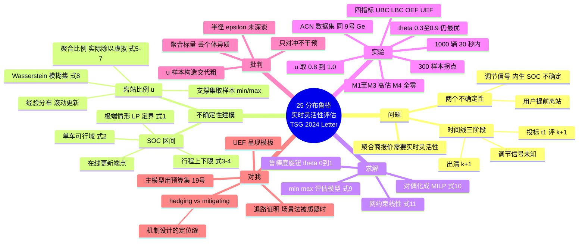

# 25 分布鲁棒 · 实时灵活性评估（TSG 2024 Letter）

> Li Y., Li Z. (2024). *IEEE Transactions on Smart Grid* 15(4): 4288–4291. 山东大学电气工程学院。NSFC 52377107 资助。Letter 体裁（PESL-00312-2023），4 页。

## 一、一句话定位

充电桩聚合商（aggregator）要在实时调频市场**报价**，就必须准确评估站内 EV 的**实时灵活性（功率可调范围）**；但两件事让评估失真——**调节信号未知导致的 SOC 不确定** + **用户提前离站的行为不确定**。本文用** Wasserstein 分布鲁棒（DRO）**把两者装进一个 min-max 评估模型，**对偶化后变成 MILP** 交给 Gurobi 直接解，100→1000 辆车规模下求解时间 <30 秒。

**注意体裁**：这是一篇 4 页 Letter，贡献是"一个模型 + 一套指标 + 一组验证"，不是系统综述。读它的价值在于**方法论零件便宜好拆**，不在问题规模。

## 二、背景：时间线是全文的钥匙

理解这篇的关键是 Figure 1 的**三阶段时间线**——为什么 SOC 会不确定，完全是市场机制"逼"出来的：

| 阶段 | 发生时刻 | 发生什么 | 聚合商知道什么 |
|---|---|---|---|
| 投标（bidding） | 区间 k 开头 t₁ | 为**下一区间 k+1** 评估灵活性 [P̲ₖ₊₁, P̄ₖ₊₁] 并报价 | 只知 k 区间**上一轮出清**的 [P̲ₖ, P̄ₖ] |
| 出清（clearing） | 区间 k 内 | 市场给出 k+1 的出清结果 | 知道出清区间 |
| 调节（regulation） | 区间 k 内 | SO 下发实时调节信号，聚合商分解到各车执行 | **不知道**信号具体轨迹，只知 Pactₖ ∈ [P̲ₖ, P̄ₖ] |

**因果链**：调节信号 → 决定区间 k 的实际功率 Pactₖ → 决定 t₂ 时刻的 SOC Eₖ,ₙ → 决定 k+1 还能充/放多少。而信号在 t₁ 投标时是未知的 → **SOC 必须当作不确定量**。这个"参与市场本身制造了不确定性"的视角很巧——不确定性不是外生噪声，而是**制度安排的内生产物**。

第二个不确定性更直白：用户到场时报了预计离站时间，但**实际经常提前走**（unexpected early departure），灵活性被砍掉一块。

## 三、不确定性一：SOC 区间模型（式 1–4）

**思路：不做分布假设，直接构造一个"安全区间"** [E̲ₖ,ₙ, Ēₖ,ₙ]，并用**在线更新**模式（随时间滚动刷新端点）。

- **取极端情形定界**（式 1）：既然 Pactₖ 按市场规则必落在 [P̲ₖ, P̄ₖ] 内，就取最坏极端 Pactₖ = P̲ₖ，解一个小型 LP：在每辆车可行域 Ωₖ,ₙ 约束下**最小化 ΣEₖ,ₙ**，得到 E̲ₖ,ₙ；同理用 P̄ₖ 得 Ēₖ,ₙ。
- **单车可行域 Ωₖ,ₙ**（式 2）：充/放互斥的二进制 z^ch + z^dis ≤ 1、功率上限、SOC 动态方程 Eₖ,ₙ = Eₖ₋₁,ₙ + η^ch·p^ch·ΔT − p^dis·ΔT/η^dis、SOC 上下限。
- **SOC 上下限本身也随行程收紧**（式 3–4）：上限 = min{额定上限, 到达 SOC + 到现在最多能充进去的}；下限 = max{额定下限, 到现在最多能放出来的, 目标 SOC − 离站前还能充的}。这一步把"用户报的离站时间和目标 SOC"编码进了可行域。
- **聚合商需要的数据假设很弱**：只知道各车报的到达/离站时间和初始 SOC——这正是你预约系统天然拥有的数据。

**可拆的零件**：这个"极端情形 + LP 定界"的 SOC 区间构造，比拟合 SOC 分布轻得多，任何"预测用户未来负荷区间"的场合都能搬。

## 四、不确定性二：提前离站比例 u 的数据驱动建模（式 5–8）

**最聪明的一步：不做逐车离站统计，只追踪一个聚合比例。**

- 定义 **u_m** = 区间 m 实际灵活性 ÷ 虚拟灵活性（假设无人提前走时反推的灵活性），即

  $$u_m = \frac{\breve{P}^{act}_m - \hat{P}^{act}_m}{\breve{P}^0_m - \hat{P}^0_m}$$

  分子分母各用一次 LP（式 6–7）算出：实际车辆集合 N_m vs 虚拟集合 N⁰_m（无人提前走）。
- **样本集滚动更新**：历史每个区间都算出一个 u_m → 样本集 {u₁,…,u_S} 随运营不断变大 → 经验分布 P̂ = (1/S)Σδ_{u_i}。
- **Wasserstein 模糊集**（式 8）：

  $$\mathcal{D} := \{P \in \mathcal{P}(\mathcal{U}) : W(P, \hat{P}) \le \varepsilon\}$$

  支撑集 U = {u : Hu ≤ h}，h 直接取样本的 min/max（式子里就是 [−min{uᵢ}, max{uᵢ}]）。半径 ε 是"经验分布离真实分布可能有多远"的容忍度。

**为什么用 Wasserstein DRO 而不是直接用经验分布**：样本少时经验分布会**过拟合历史**（低估极端离站），Wasserstein 球相当于给经验分布外一圈"最坏扰动预算"。这是 Esfahani & Kuhn (2018) 的标准套路，本文直接引用其可积重构结果。

## 五、主模型与对偶化（式 9–10）

**评估问题写成 min-max**（式 9，下界 P̲ₖ₊₁ 为例）：

$$\underline{P}_{k+1} = \min_{p, E} \ \max_{E_{k,n}\in\mathcal{U}_{k,n},\ P\in\mathcal{D}} \ \mathbb{E}_P\Big[u \cdot \sum_{n=1}^{N_{k+1}} p_{k+1,n}\Big]$$

- 内层 max：在最坏 SOC 实现（区间集 U）和最坏分布（Wasserstein 球 D）下，期望灵活性最小；
- 外层 min：聚合商在可行调度里找这个最坏值的最好情况——即**承诺给市场的"保底灵活性"**。
- 上界 P̄ₖ₊₁ 对称构造。

**对偶化成 MILP**（式 10）：目标变成 ηε + (1/S)Σβᵢ，引入辅助变量 Z、q、y、τ、β、η，逐样本约束 a·uᵢ + τᵢᵀ(h − Huᵢ) ≤ βᵢ。**关键参数 θ ∈ [0,1] 是鲁棒度旋钮**：θ 越大越保守。整个转换套 Bertsimas & Sim (2003) + Esfahani & Kuhn (2018)，**不需要自己推导**，这就是"对偶化让现成求解器可解"的全部含义。

- 配电网约束（式 11）：单站情形下就是总功率的线性不等式 P̲net ≤ Σp ≤ P̄net，直接加进模型即可。
- 结论部分剧透未来工作：多站大电网要用 Benders 分解——说明单站 MILP 规模大时会吃力。

## 六、实验设置与评价指标

- 场景：1 小时 = 12 个 5 分钟区间；站容量 100 辆同时充电；两类车型（Table I）；u 的历史样本取自**开源 ACN 充电数据集**（Lee, Li & Low 2019——就是你 ⑨ 号 Ge 用的同一个 ACN-Data！），每区间 20 个点，取值范围 [0.8, 1.0]（= 提前离站最多吃掉 20% 灵活性）。
- 工具：Gurobi 10.0 + MATLAB R2020a，2.10 GHz / 16 GB。
- **指标设计（这套四指标很值得学，评价类论文的呈现模板）**：
  | 指标 | 含义 | 反映什么 |
  |---|---|---|
  | UBC | 评估上界越过实际灵活性的次数 | 高估（不可靠，市场违约风险） |
  | LBC | 评估下界低于实际灵活性的次数 | 低估边界失守 |
  | OEF | 高估的灵活性面积（红色区域） | 高估程度 |
  | UEF | 低估的灵活性面积（蓝色区域） | **保守程度**（代价） |

  前三个必须压到 0（可靠性），UEF 越小越好（经济性）——**可靠 vs 保守的权衡被显式量化**，和你论文里"鲁棒性 vs 经济性"的呈现逻辑完全同构。

## 七、四基线对比结果（Table II / Fig. 2）

| 方法 | 考虑的不确定性 | UBC/LBC/OEF | 结论 |
|---|---|---|---|
| M1 | 仅离站行为 | 大量非零 | 严重高估 |
| M2 | 仅 SOC | 大量非零 | 严重高估 |
| M3 | 都不考虑 | 大量非零 | 最差 |
| **M4（本文，θ=1.0）** | **两者都考虑** | **全部为 0** | **唯一可靠** |

两个要点：
1. **M4 的 UEF 确实比 M1–M3 大**（更保守）——作者没有回避这个代价，而是指出它可以用 θ 调。
2. **θ ∈ 0.3–0.9 时 M4 依然全面优于 M1–M3**（Table III）——结论**不依赖精调 θ**，这是审稿人最认的稳健性论证：*superiority does not depend on a carefully selected θ*。

## 八、敏感性：样本数与规模（Fig. 3 / Table IV）

- **样本数**：u 的样本越多，经验分布越接近真分布 → 目标值（评估区间宽度）单调下降并趋稳；**300 个样本是本实验的性价比拐点**，再多计算时间明显涨、改善很小。
- **规模扩展性**：站容量 100 → 1000 辆（作者脚注：中国大充电站多为 100–600 辆，取 1000 留裕度），求解时间始终 <30 秒，且**对容量几乎不敏感**（瓶颈在样本数 S 不在车辆数 N）。

## 九、批判与局限

1. **u 样本的实验构造偏"摆拍"**：声称取自 ACN 数据集，但每区间 20 个点、范围恰好 [0.8, 1.0] 的交代很粗，u 的真实统计性质（随时间/时段变化？厚尾？）没有展示。你自己复现时这里是第一个会被问的点。
2. **u 是站级聚合比例，丢了个体异质性**：提前离站在真实世界里高度异质（22 号英国数据：行为差异 >> 模型差异；24 号澳洲：滞后状态 LLR=903.82）。把所有车压成一个标量 u，等于放弃了"识别谁会提前走"的信息——**这既是本文的简化，也正是你的机会**。
3. **只评估、不干预**：聚合商对提前离站完全被动，只能"对冲"（hedging），从不问"能不能让用户少提前走"（mitigating）。提前离站其实是**可被机制改变的行为**——报离站时间没有说真话的激励、爽约没有代价，这正是机制设计（12 号菜单/IC、23 号惩罚机制）的用武之地。
4. **Wasserstein 半径 ε 的选取没有深入讨论**；多站情形（含网络潮流约束）会破坏线性结构，作者自己承认要留待 Benders 分解。

## 十、回答占位问题：我到底走场景法还是分布鲁棒？

你占位里已经写了倾向（先场景法跑通、DRO 作讨论）——**方向对，补三点细化**：

1. **场景法主模型的合法性没问题**，但要做齐三件事：写清场景生成方式、做样本外验证、诚实声明"不保证对所有实现可行"（这是 21 号就记过的坑）。
2. **本文的 Wasserstein 路线不能直接搬**：它解的是**评估问题**（外层 min 是连续调度、不确定性只进右端项），对偶重构才便宜；你的**调度 MILP** 若套 Wasserstein DRO，逐样本约束会爆炸。真正低成本、审稿人熟悉的替代是**预算不确定性集（Bertsimas-Sim）**——恰好是你 19 号 Huang (Omega 2026) 用的那套。
3. **实操组合拳**（和 21 号的建议合并）：主模型用**场景法或预算集**（跑得动大算例）+ 小算例用 Wasserstein DRO 或完全期望作**对照**，量化"为鲁棒性多付了多少保守性"——本文的 UEF 指标就是现成的呈现模板。

一句话：**这篇给你的不是主模型，而是一张"退路证明"**——当审稿人质疑场景集来源时，你能指出"同一问题存在数据驱动 DRO 的可解重构先例"，并在小算例上真的跑给他看。

## 十一、与我其他文献的衔接

| 文献 | 衔接点 |
|---|---|
| ⑨ Ge（基线包络） | **同一个 ACN-Data 数据集**；Ge 用来生成基线，本文用来算 u 样本——数据可复用 |
| 19 Huang（Omega 2026） | 同为鲁棒家族：Huang 用预算不确定性集做日前排程，本文用 Wasserstein DRO 做实时评估——正好覆盖你"日前+实时"两端的两种鲁棒工具 |
| 21（日前容量市场） | 同一个洞察：**不确定性随决策内生放大**（21 号是预留越多需对冲越多；本文是参与市场本身制造 SOC 不确定） |
| 22 / 24（行为异质） | 本文 u 是聚合标量，与"逐车异质"直接冲突——把 u 按用户类型分层（如 22 号的 overnight vs same-day）是现成增量 |
| 12（菜单/IC）· 23（惩罚） | 本文对提前离站只对冲不干预；机制设计路线把它变成"可被激励改变的内生行为"——**hedging vs mitigating 的分野就是你论文的定位缝隙** |
| 20（T-ITS 定价） | 同样点名不处理爽约/不准时；本文进一步给了"爽约如何量化进灵活性"的具体建模（u 比例法），可当作你处理爽约的**基线方法** |

## 十二、术语中英对照

| 英文 | 中文 |
|---|---|
| aggregator | 聚合商（代理站内 EV 参与市场） |
| ancillary / frequency regulation service | 辅助服务 / 频率调节 |
| power adjustment range | 功率可调范围（= 灵活性） |
| state of charge (SOC) | 荷电状态 |
| unexpected early departure | 计划外提前离站 |
| ambiguity set | 模糊集（概率分布的不确定集） |
| Wasserstein distance / radius | Wasserstein 距离 / 球半径 ε |
| empirical distribution | 经验分布 P̂ |
| dualization theorem | 对偶化定理 |
| robustness parameter θ | 鲁棒度参数 |
| over-/under-evaluated flexibility (OEF/UEF) | 高估/低估灵活性 |
| boundary crossing (UBC/LBC) | 边界穿越次数 |

## 十三、一句话总结

**用"极端情形 LP 定界 + 聚合比例 u 的 Wasserstein 模糊集"把 SOC 和提前离站两类不确定性装进一个可对偶化成 MILP 的实时灵活性评估模型，四指标实验证明唯一可靠、θ 不需精调、千辆车 30 秒内可解——方法零件轻、可直接拆进你的"鲁棒退路"，而它对提前离站"只对冲、不干预"的被动姿态，正是你机制设计选题要补的缝。**

## 十四、思维导图

---

[[000 索引 · 第二批12篇]]
