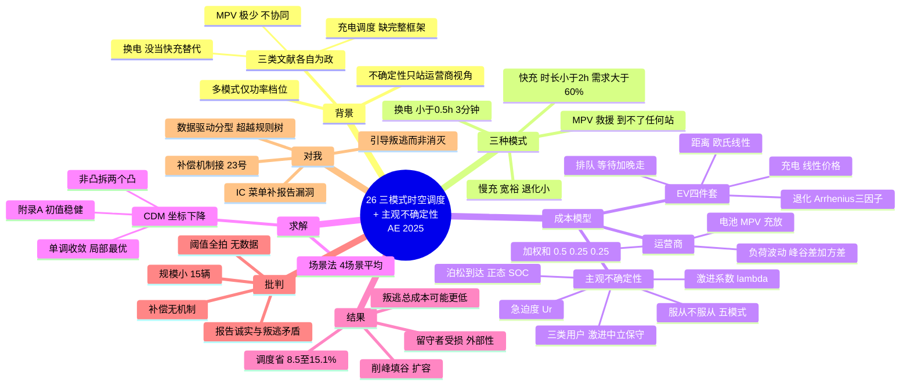

# 26 时空调度 + 用户主观不确定性（AE 2025）

> Zhang Z., Liu X.-K., Xiao J.-W., He Y., Wang Y.-W. (2025). *Applied Energy* 401: 126818. 华中科技大学人工智能与自动化学院。NSFC 62233006 / 62173152 资助。2025-05 投稿、2025-09 录用。

## 一、一句话定位

把**快/慢充电 + 换电（BsS）+ 移动充电车（MPV）**三种补能模式拧进一个时空联合调度框架：用户按成本驱动分**激进/中立/保守**三类，建模"**服从 vs 不服从**"调度的主观不确定性（选择重构算 + 换桩），运营商用电池和 MPV 的充放电做**削峰填谷 + 扩容**；非凸模型用**坐标下降（CDM）**拆成两个凸子问题交替求解。

**注意定位**：这是"调度 + 行为分类"的文章，不是机制设计——它**观察**到用户会不服从、**建议**给受影响用户补偿，但**没有设计**让用户说真话的机制。这个留白正是你的位置。

## 二、研究背景（作者的三层动机）

**第一层：现实痛点**。续航有限 → 长途要频繁补能；换电池贵 → 电池寿命成本是车主核心顾虑；拥堵/延误导致电量耗尽抛锚 → 需要应急救援。这三件事分别对应三种模式：日常充电、电池保养（慢充退化小）、移动充电车救援。

**第二层：三类文献各自为政**（Table 1 的定位逻辑）：
- **充电调度**（[5–10]）：时空调度做得细，但缺"快慢充+电池退化+排队动态"的完整框架；
- **换电调度**（[12–15]）：只管换电站运营，**没把换电当作快充的替代选项**纳入统一选择（换电 3 分钟完成，本身就是最快的"补能"）；
- **移动充电**（[17–19]）：MPV 文献极少，只做 MPV 调度，不和固定站协同；
- 已有"多充电模式"研究（[20–22]）里的"多模式"只是**不同功率档位**（慢充/快充/超充），不含换电和移动充电。

**第三层：不确定性建模的视角缺口**——这是本文自认的突破点：已有 EV 不确定性研究（[24–26]）**全部站在运营商视角**（到达时间随机、需求随机），从不问"**用户对调度安排满意吗？会照做吗？**"。本文把"用户可能不服从"作为一等公民建模。

## 三、问题设定：三种模式的触发条件（先记这张表）

| 模式 | 适用场景 | 模型判定条件 | 补能速度 |
|---|---|---|---|
| 快充 | 需求急、SOC 缺口大 | 预期充电时长 <2h 且需求电量 >60% 额定容量（式14–15） | 中 |
| 慢充 | 时间宽裕 | 时长 >2h；AC 低功率、退化小 | 慢 |
| 换电 | 极度赶时间 | 预期充电时长 <0.5h（式25）；站内电池充足（假设） | **约 3 分钟** |
| MPV 上门 | **SOC 低到开不到任何充电站**（式30） | MPV 出发→充电→返回站补充（式31 能量可行） | 应急 |

注意：**MPV 本质是"救援模式"**——约束 (30) 说明只有当前电量不足以到达任何 CS 时才选它。三模式不是平行选项，而是按"急迫程度 × 可达性"分层的递进结构。

## 四、方法一：EV 充电调度模型（四项成本，式 1–22）

用户成本 `U_i = U^e(充电) + U^d(距离) + U^B(电池退化) + U^Q(排队)`：

1. **充电成本**（式 3–4）：线性价格函数 `(α₁·r + α₃)·x_ij·f_i`，快/慢充各一套系数——价格随功率需求线性上浮（引用电力价格预测的经典线性形式）。
2. **距离成本**（式 5）：欧氏距离线性计价 `(β₁·d_ij + β₂)`。
3. **电池退化成本**（式 7–12）——**本文做得最细的成本项**：
   - 快充（DC）：退化 = 功率比的二次函数 `ξ₁(r/E)² + ξ₂(r/E) + ψ·D_i`；
   - `D_i = c_ref · T_acc · S_acc · DoC_acc`：**Arrhenius 温度加速因子**（式9，`exp(−Qa/R·(1/T−1/T_ref))`）× **充电倍率损失**（式10，与 SOC 相关）× **充电深度比**（式11）——这是一套有电化学文献支撑的退化模型（引 Qu 2022, J. Energy Storage），不是拍的；
   - 慢充（AC）：只有功率一次/二次项 + 常数（式12），低功率退化可忽略。
4. **排队成本**（式 13）：`(ts−ta)` 等待开始 + `(te−td)` 晚于预期离站，各乘系数。
   - 排队规则（式 22）：同站同桩先到先充；同时到达按**充电急迫度**排序——急迫度进了排队优先级，是个小巧思。

**关键约束**：CS 总功率 ≤ 最大负荷（式20）；电量够开到目标站（式21）；快/慢充功率上下限（式16/18）。

## 五、方法二：换电与 MPV 模型（式 23–31）

- **换电**（式24）：成本 = 实时电价 × 需求电量 + 单次换电服务费 ρ（仿真里 ¥20 + ¥80）。约束：判定条件（时长<0.5h）、需求 ≤ 满电与到达电量之差。
- **MPV**（式29）：成本 = MPV 电价 × 需求 + 出发距离成本。约束：触发条件（式30，SOC 到不了任何站）+ MPV 能量可行性（式31，够开到用户、充完电、返回站）。

## 六、方法三：CS 运营商成本（式 32–49）——电池和 MPV 是"移动储能"

这是本文贡献 2 的载体：**换下来的电池和 MPV 不只是服务工具，还是站的分布式储能**：
- **电池充放成本**（式33–38）：实时电价 ω_t 低谷充、高峰**向站放电**（V2G 桩 −15~20kW）；放电有电池损耗成本 `Bd = Γ/E_cap · C_cha`（式34–35，Γ 为放电功率）；
- **MPV 充放成本**（式39–43）：同理，回站后按负荷充放；
- **负荷波动成本**（式44–49）：`F₁ = max(L) − min(L)`（峰谷差）+ `F₂ = Σ(L_t − L̄)²`（方差），总负荷 = 基荷 + EV + 电池 + MPV（式47）；
- **多目标 → 加权和**：负荷波动权重 0.5、电池调度 0.25、MPV 调度 0.25（权重 0.4–0.6 区间结果稳定，故取 0.5）。

**机理**：高峰时电池/MPV 放电顶上去 → 站的**有效承载容量变大**（原本 210kW 上限下 EV 充不了，现在可以）+ 峰谷差缩小 → 运营商低价买电高价放电还能赚差价。

## 七、方法四：用户主观不确定性模型（第 3 节，本文核心卖点）

**"主观不确定性"的定义**（沿 Chen et al. 2019, IET GTD）：不是客观概率不够准，而是**给定调度方案后，用户会服从还是不服从**本身不确定。成本驱动分三类（Table 5）：

| 类型 | 时间敏感系数 μ | 成本敏感系数 γ | 行为倾向 |
|---|---|---|---|
| 激进 aggressive | 0.8–1 | 0.7–1 | 时间/价格都敏感，最难管 |
| 中立 neutral | 0.4–0.6 | 0.35–0.7 | 中间 |
| 保守 conservative | 0–0.2 | 0–0.35 | 最顺从 |

三个子模型：

1. **充电急迫度**（式50）：`Ur_i = (t_d − t_a)·ε_i`，ε 为类型时间敏感度——预期在场时间 × 敏感度。
2. **服从/不服从选择**（式51–54）——五种行为模式：
   - 时长 ≤2h 的用户走快充线 {OF, DF, DC}，>2h 走慢充线 {OS, DS, DF}（式51）；
   - **快充线决策**（式52）：服从成本 ≤ 不服从成本 → OF（服从快充）；否则若不服从的相对收益超过激进系数 λ 且 **Ur < 0.7** → DF（叛逃去最近站快充）；若 **Ur > 0.7**（极急）→ DC（叛逃去换电）；
   - **慢充线决策**（式53）：同理，Ur < 0.3 → DS（改慢充），Ur > 0.3 → DF（改快充）；
   - **激进系数**（式54）：`λ_i = μ_i·(等待时间占比) + γ_i·(成本节省占比)`——等待越久、省得越多，越可能叛逃。
   - **叛逃后处理**：去最近 CS，有桩立即充、没桩等前面车充完，然后**全局重算最优调度**。
3. **请求过程不确定性**（式55–56）：请求发起/离开时刻 = **非齐次泊松过程**（时变强度 λ_ini(t)、λ_d(t)）；初始 SOC ~ **正态分布** N(μ, σ²)。

**分类的应用**：先假设所有人服从解出最优调度 → 算出每个用户的服从/不服从成本 → 按式52–53 筛出潜在叛逃者 → 按其类型判定实际行为 → 重算。仿真里 15 辆车筛出 3/5/6 三辆为激进型叛逃者（λ > 1）。

## 八、求解：CDM 坐标下降 + 场景法（第 4 节）

**问题结构**：总成本 = EV 侧三项 + 运营商侧三项（式57）。换电和 MPV 子模型只含 0-1 分配 → 凸；**充电子模型因时空耦合（功率矩阵 R × 分配矩阵 X 的乘积项）非凸**。

**CDM**（Algorithm 1）：固定 X 解 R（凸）、固定 R 解 X（凸），交替迭代到收敛。
- **凸性依据**：一个矩阵定理 `g(X)=tr((A·Aᵀ)(B·Bᵀ))` 为凸 → 两个子问题都是凸的，每步得子问题全局最优；
- **单调性**：`U(R_i,X_i) ≥ U(R_{i+1},X_i) ≥ U(R_{i+1},X_{i+1}) ≥ U(R*,X*)`——成本不增；
- **诚实声明**：**局部最优、依赖初值、不保证全局**。作者的补救：①与基准策略比显著更优；②**附录 A 多初点实验**——把初值从"全部最近站"逐辆改成"最远站"，调度后成本始终 5010.7¥ 不变 → 解对初值稳健；
- 多目标用加权和；不确定性用**场景法**：生成 4 个随机场景（时刻按泊松、SOC 按正态、类型敏感系数按均匀分布）取平均。

**工具**：MATLAB R2021b + CPLEX 12.10.1。

## 九、实验设置与主要结果（第 5 节）

**设置**：15 EV / 2 CS，每站 1 快充桩（20–40kW, η=0.95）+ 1 慢充桩（0–20kW, η=0.9）+ V2G 桩（−15~20kW）；站容量 210kW（运行压到 200 以内）；电池 100kWh、MPV 300kWh；电池损耗单价 ¥35,000。价格：慢充 2.5¥/kW+服务费¥5、快充 5¥/kW+¥10、距离 0.18¥/km+¥20、退化系数 ¥100、排队 10¥/h、换电 ¥20+服务费¥80、MPV 10¥/kW+¥10。

**结果一：调度省钱**（Table 4 可扩展性测试）：

| EV / CS | 求解时间 | 调度前 | 调度后 | 降幅 |
|---|---|---|---|---|
| 15 / 2 | 8.25s | 5474.3¥ | 5010.7¥ | 8.5% |
| 20 / 2 | 9.56s | 7233.1 | 6616.8 | 8.5% |
| 25 / 3 | 12.95s | 9339.8 | 8134.9 | 12.9% |
| 30 / 4 | 17.92s | 10,954.6 | 9322.4 | 14.9% |
| 40 / 4 | 19.34s | 14,857.1 | 12,628.5 | 15.1% |

站越多降幅越大（排队成本砍得多）；40 辆也只要 19 秒。

**结果二：削峰填谷 + 扩容**（Fig. 5–6）：高峰时电池/MPV 放电（总充放功率为负）、低谷充电；站负荷被压在 200kW 内——**没有电池/MPV 调度时负荷会超容量上限**。即固定容量不变，服务能力变大了。

**结果三：叛逃实验**（Fig. 7–9，最有意思的部分）：
- 15 辆里 3/5/6 三辆"不服从反而更省"→ 判为激进型（λ>1）；3/5 选 DS（改慢充）、6 选 DF 或 DC（改快充/换电）；
- **反直觉：叛逃后总成本比全员服从还略低**——因为 6 号改快充/换电后排队成本大降；
- **但分配不均**：不叛逃的 4 号、3 号因排队变长成本上升（外部性！）；
- 作者由此建议："运营商应向受影响用户提供经济激励以防止恶意竞争"——**一句话带过，没有任何机制设计**。

**结果四：权重敏感性**（Table 7）：负荷权重 0.3→0.7 时运营商成本从 −443.9¥（净赚）升到 −244.6¥——削峰越狠、买电越多、利润越薄；0.4–0.6 区间稳定。

## 十、结论（作者自述 + 未来工作）

作者结论：三模式统一调度可行且省钱；电池/MPV 调度实现削峰填谷与扩容；用户三类主观不确定性有效识别叛逃者并支持重调度。**未来工作原话**：考虑**用户与运营商的博弈**（用户可提出偏好调度）、多层调度、用**博弈论**分别分析用户与运营商收益最大化。

## 十一、优势（我评）

1. **框架完整性是真的**：三模式 × 用户/运营商双主体 × 时空维度，Table 1 对比下确实是第一篇把换电和 MPV 纳入统一选择集的时空调度（此前"多模式"只是功率档位）。
2. **电池退化成本建模扎实**：Arrhenius + 倍率 + DoC 三因子有电化学文献支撑，快慢充差异被显式定价——大多数调度论文直接忽略这项。
3. **"主观不确定性"视角切口好**：从"世界是随机的"转到"用户会不会听我的"——这个视角和你"机制设计"的方向天然同源。
4. **求解工程化程度高**：非凸拆凸有定理支撑、单调收敛有证明、初值稳健性有附录实验、可扩展性有表格——AE 审稿人要的严谨性四件套齐了。
5. **MPV 的"救援 + 储能"双重身份**：一个资源两个用途，建模经济。

## 十二、劣势与批判（我评，写论文时可对标）

1. **"主观不确定性"名不副实**：本质是**手工设定的决策规则树**（Ur<0.7、Ur<0.3、λ>1 这些阈值全是拍的），敏感系数 μ、γ 用均匀分布随机生成——**没有任何真实行为数据估计，也没有与 CPT/实测对照验证**。它更像"异质智能体仿真规则"而非行为建模。你的机会：用 22/24 号的开源数据把这三类用户**估计出来**，就已经超过它。
2. **假设(五)自相矛盾**："用户会如实报告充电需求"——但又建模用户会不服从调度。**报告环节诚实、执行环节可能叛逃**：为什么用户报告时不说谎？叛逃的激励同样存在于报告环节（虚报离站时间换取更优调度），本文完全没有处理——这正是 IC/机制设计（12 号）要补的缝。
3. **叛逃的外部性没有闭环**：仿真发现叛逃者受益、留守者（3/4 号）受损，作者建议"给受影响者补偿"但**没有给出补偿的资金来源、额度与激励相容性**——补偿机制设计就是现成的论文题目（且和 23 号的"惩罚转移"想法直接咬合）。
4. **规模太小**：15 辆 2 站为主，可扩展性也只到 40 辆 4 站；CDM 是局部最优。真实站级调度是数百辆规模，CPLEX+CDM 这条路线的扩展性存疑。
5. **加权和的主观性**：0.5/0.25/0.25 是拍的，仅做了敏感性、没做 Pareto 前沿分析。
6. **场景法只有 4 个场景取平均**：既没有置信区间，也没有分布鲁棒兜底（对比 25 号）——统计严谨性弱。
7. **排队模型简化**：确定性先到先充规则，非排队论；换电站假设"电池永远充足"——换电排队/电池库存管理被回避。

## 十三、回答占位问题：主观不确定性 vs CPT，分类维度怎么用？

你占位里问的两个问题，现在都能答：

- **"这是不是区别于 CPT 的备选理论工具？"** → **是，但要说清楚它弱在哪**。CPT 把"主观"建模成对概率/结果的**非线性感知**（有心理学实验支撑、参数需标定——你怕的 α、λ 问题在这）；本文把"主观"建模成**成本比较 + 类型系数的规则决策**——无需标定、好实现，但行为学根基薄，审稿人可能问"阈值哪来的"。**实用建议**：主模型别用它的规则树；把它当**"用户异质分类的最低成本实现"**——你需要给仿真生成异质用户时，这套 aggressive/neutral/conservative + μ/γ 系数就是现成的参数化模板。
- **"主观不确定性能不能当我分类的维度？"** → **可以，且比它做得更实**。它给了两个可操作的行为变量：**急迫度 Ur**（时间预算 × 敏感度）和**激进系数 λ**（等待占比 + 节省占比）。你占位里"目标明确型 vs 目标模糊型"的分法，对应到数据上就是 22 号的 overnight/same-day + 时长 IPR（规律程度）——**用真实数据算 Ur/λ 的代理变量，而不是像它一样拍均匀分布**，这一步就是你的增量。

**一个必须记住的发现**：叛逃后总成本可能更低（6 号案例）——说明"全员服从"不是系统最优，**调度方案应该主动为急迫用户留"叛逃出口"**（比如本来就建议他换电），而不是追求服从率最大化。这个洞察可以直接写进你的机制设计动机：好的机制不是消灭 disobedience，而是**引导 disobedience 走向对系统有利的方向**。

## 十四、与我其他文献的衔接

| 文献 | 衔接点 |
|---|---|
| 12（在线菜单 IC） | 本文"服从/不服从"是二元的、无激励设计；菜单/IC 把它升级为"用价格菜单诱导自愿服从"——**报告环节说真话**正是本文假设(五)的漏洞 |
| 23（惩罚机制） | 本文发现留守者为叛逃者买单（外部性）+ 一句"应补偿"没有下文 → 23 号的"惩罚金定向转移给受损者"正好接住 |
| 11（CPT） | 主观不确定性的两条技术路线：CPT（感知非线性，参数贵）vs 本文（成本规则，参数免费但根基薄）——可做方法论对比段 |
| 20（T-ITS 定价） | 同用非齐次泊松刻到达；20 号用 MDP 实时定价，本文用日前调度+重算——日前 vs 实时的互补 |
| 22 / 24（行为异质） | 本文三类用户是拍的均匀分布；22/24 给了用真实数据分型的完整证据链和方法（历史订单最强变量） |
| 25（TSG DRO） | 对提前离站：25 号只对冲（hedging），本文通过换电/MPV 提供替代出口（部分缓解），你的机制让用户自愿真实报告（mitigating + IC）——三级递进 |
| 9（基准+滚动校正） | 同有削峰填谷目标；9 号在配电网约束下，本文在站级 |

## 十五、术语中英对照

| 英文 | 中文 |
|---|---|
| plug-in charging (fast/slow) | 插枪充电（快/慢） |
| battery swapping station (BsS) | 换电站 |
| mobile power vehicle (MPV) | 移动充电车 |
| subjective uncertainty | 主观不确定性 |
| obey / disobey scheduling | 服从 / 不服从调度 |
| aggressive / neutral / conservative | 激进 / 中立 / 保守（用户三型） |
| charging urgency | 充电急迫度 Ur |
| coordinate descent method (CDM) | 坐标下降法 |
| peak shaving and valley filling | 削峰填谷 |
| battery degradation | 电池退化（Arrhenius 温度加速） |
| depth of charge (DoC) | 充电深度 |
| load variation cost | 负荷波动成本（峰谷差 + 方差） |
| weighted-sum method | 加权和法（多目标） |

## 十六、一句话总结

**用"快慢充+换电+MPV"三模式统一调度把站容量和用户选择同时扩容，用成本驱动的三类型规则树建模"服从/不服从"主观不确定性——框架完整、退化建模扎实、CDM 拆凸工程漂亮，但"主观"实为拍阈值的规则、报告诚实与执行叛逃并存而未处理 IC、外部性补偿一句话带过：这三处留白（数据驱动分型、IC 菜单、叛逃外部性的补偿机制）就是你的论文位置。**

## 十七、思维导图

---

[[000 索引 · 第二批12篇]]
