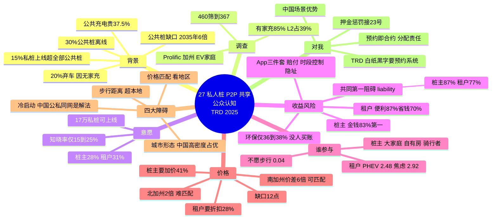

# 27 私人桩 P2P 共享的公众意愿（TRD 2025）

> Akbari A., Dean M.D. (2025). *Transportation Research Part D* 144: 104788. UC Irvine 交通研究所。开放获取（CC BY-NC），专辑 "Electric Shared Mobility"。2024-10 投稿、2025-04 录用。

## 一、一句话定位

用 **367 个加州 EV 家庭问卷**首次系统评估"私人充电桩点对点共享（P2P-EVSE）"的公众认知：**28% 愿意当桩主、31% 愿意租用**；桩主最看重租金收入、租户最看重便利+省钱；**双方第一大阻碍都是责任担忧（liability）**，环保动机几乎不重要；租户要折扣 ~28%、桩主要加价 ~40%，这个 12 个百分点的缺口在北加州（PG&E）几乎无法匹配、在南加州（SCE/SDG&E）轻松匹配——**共享充电的瓶颈不是技术、不是环保，是责任分配 + 价格匹配 + 空间邻近**。

**体裁**：实证问卷论文（stated preference），无优化模型。读它的价值是**拿真实数字写引言/讨论**，以及为"预约机制在 P2P 场景的价值"提供实证支点。

## 二、研究背景：为什么 P2P 桩共享值得做（引言数据包）

作者堆了一组可直接引用的基础设施缺口数据：

| 数据 | 数值 | 来源 |
|---|---|---|
| 2024 全球新车电动化率 | 18%（美国 2023 为 10%，2030 预计 1/5） | IEA 2024 |
| 公共桩需增长 | 2035 年前需达 2023 年 **6 倍** | IEA 2024 |
| 美国公共桩可靠性 | **任一时刻约 30% 离线** | Rempel et al. 2023 |
| 加州 EV 弃用率 | 2012–2018 约 **20% 弃车**，与无家充强相关 | Hardman & Tal 2021 |
| LA 无家充 EV 车主 | 2035 年预计 **1/5** | Lee et al. 2023 |
| 家充桩安装成本 | 平均 **$1,800** | Borlaug 2020 |
| 公共充电相对住宅电价加价 | **≥37.5%** | Borlaug 2020 |
| **供给弹性（最亮眼）** | 加州住宅私桩 50 万+；**只要 15% 上线共享就超过全部公共桩**（6.6 万公共 + 8.7 万受限共享） | CA Energy Commission 2024 |

**核心逻辑链**：无家充 → 不买 EV / 弃用 EV → 公共桩又贵又不可靠 → P2P-EVSE 用闲置私桩快速补供给、绕开安装成本、避开坏桩排队、还可能缓解充电公平性问题（Hopkins 2023 的 charging inequity 定义）。

## 三、P2P-EVSE 是什么 + 中美市场差异

**交易结构**（Fig. 1）：租户—平台—桩主三方；平台负责市场准入、注册审核、充电会话核验、支付结算。

**已有平台**：美国 EVmatch、Chargerzilla、Buzze、GRIDSPOT；欧洲 Co Charger、Bookmycharge、Zapmap；**中国特来电（Teld）、星星充电（Star Charge）允许私桩主注册入驻、自定价格与排期**。

**中美模式差异**（本文反复强调，对你的中国背景是利好）：
- 西方：P2P 是**独立 App**，冷启动难；
- 中国：私桩嵌入**公共充电同一网络**，用户一个入口可选公共+P2P → 冷启动问题被稀释，高密度城市更容易长出来。

## 四、调查设计与样本

- **渠道**：2024 年 4–6 月，Prolific 平台，加州现持/租赁插电式 EV（BEV+PHEV）的居民；初始 460 份 → 注意力检查/时长/一致性筛查后 **367 份**；平均完成 17 分钟，报酬 $10。
- **样本结构**：有家充 85.3%（n=313，其中 L2 桩 38.7%）、无家充 14.7%（n=54）；61.5% <35 岁、72.7% 本科+、40% 年入 ≥$15 万——**早期采用者样本，作者明确说不加权、不外推全体人口**。
- **问卷结构**：知情同意与筛选 → 共享经济/知识题 → 社会经济信息 → 住房与车辆 → 充电基础与焦虑 → P2P-EVSE 概念介绍与意愿 → 收益风险感知 → 最终态度（附录 A 有完整问卷）。

## 五、方法工具箱（一套可复用的实证流程）

1. **描述统计**：按有无家充分组对比。
2. **EFA + CFA**（态度量表）：提取环境意识、政策支持、一般信任、夜间社区安全感等因子（CFA 拟合：CFI=0.956、RMSEA=0.076、SRMR=0.050——达标）。
3. **PCA**（P2P 特有态度）：五个成分——**外向社交型**（15.2% 方差）、**隐私敏感型**（14.8%）、**反大公司/替代经济支持者**（14.3%）、**P2P 充电政策倡导者**（13.3%）、**捡便宜型**（11.9%）。
4. **二元 Logistic 回归 ×2**（租户/桩主），各跑"不含态度因子"与"含态度因子"两版对比（McFadden R²：租户 0.17→0.21、桩主 0.13→0.18）。
5. **经济分析**：租户最低要求折扣（0–50% 滑块）、桩主最低要求加价（0–100% 滑块）；按三大 IOU（PG&E 北加州、SCE/SDG&E 南加州，覆盖 75% 加州用电户）做 **KDE 密度图 + Kruskal-Wallis H 检验 + Dunn 事后检验（Bonferroni 校正）**；对公共价/住宅价各设低/中/高三档（±20%）共 9 情景算**匹配概率**。

## 六、核心结果一：参与意愿与认知

- **愿意当桩主 28%、愿意租用 31%**——两个负截距的回归也印证了基线犹豫（信任/责任门槛）。
- P2P-EVSE 知晓率很低：有家充者 24.9%、无家充者 14.8%——**市场认知处于萌芽期**。
- 换算成供给：39% 的加州 EV 车主有家充 L2 × 38.6% 愿意出租 → **最多约 17 万根私桩可上线**，超过全州公共桩+受限共享桩总和。

## 七、核心结果二：收益与风险排序（本文最有引用价值的部分）

**桩主侧**：
- 收益：**金钱回报 83%** 认为非常重要，断层第一；便利他人（45%）、扩充电桩选择（44%）、环保（38%）都靠后；"支持 P2P 对抗大公司"仅 37%。
- 风险：**桩损坏责任 87%**、租户车因设备故障受损责任 81%、场地事故责任 82.5%、设备不可用 86%、住宅无人看管有陌生人进入 81.8%、被骚扰 67%——**风险感知全面压过收益感知**。

**租户侧**：
- 收益：**附近有便利可用桩 87%**、省钱 70%、桩选择变多 62%；**环保收益仅 36%**、"不必自装家充"仅 38%（P2P 是补充不是替代）。
- 风险：**自己的车因坏设备受损 77%**、损坏桩的责任 63%、桩不可靠 80%+、找不到方便的桩 69%、人身安全 62%。

**App 功能需求**（桩主）：损坏赔付 **88%** 必须有、可设可预约时段 **>90%**、可批准/拒绝预约 75–78%、预约确认前隐藏真实地址 78%——**"控制权 + 隐私 + 赔付"三件套**。

**一句话**：双方要的都是"**钱要给够、锅不能背**"；环保话术在这个市场基本无效（与 Tussyadiah 2016 在 Airbnb 发现环保负效应一致）。

## 八、核心结果三：谁会成为租户/桩主（回归要点）

**租户模型**（n=367）：
| 变量 | 效应 |
|---|---|
| PHEV 车主 | OR = **2.48**（双燃料特性，短途电驱依赖充电） |
| 高周里程（250–399 mi） | OR = 2.40 |
| 强充电焦虑 | OR = **2.92** |
| **不愿步行** | OR = **0.04**（96% 更不可能） |
| 独栋住宅 | OR ≈ 0.50（有家充、不需要租） |
| 非白人非亚裔 | OR = 4.08 → 2.78（含态度后减弱；Tesla 车主交互项 OR=0.29 修饰——特斯拉自有网络降低依赖） |
| 外向型 / 政策倡导者 | OR = 1.63 / 1.43 |

**桩主模型**（n=313）：
| 变量 | 效应 |
|---|---|
| 家庭规模 | 每多 1 人 +35% |
| 独栋 × 自有房 | 独栋本身 β=−0.98，但自有房交互 +0.83 → **净效应≈0（−0.15）**：产权决定能不能共享 |
| 骑行/电动滑板车用户 | OR = 2.25–2.55（共享出行经验迁移） |
| 私人车库停车 | 负效应（怕挡门/进不去），全职工作者反转 |
| 经济动机 / 外向型 / 政策倡导 | OR = 1.22 / 1.40 / 1.40+ |

## 九、核心结果四：步行距离（空间约束是硬约束）

单程步行：**36.2% 只接受 ≤5 分钟（约 1/4 英里）**、33% 接受 ≤10 分钟（半英里）、12.8% 只走 2 分钟、11.4% 愿走 >10 分钟、6.5% 完全不 walk。→ **P2P 桩共享是"超本地"市场**，匹配半径被步行意愿锁死在几百米内；平台应该用**步行可达圈（catchment map）**定向招募桩主。作者据此承认：后文的匹配概率是**上界**（忽略空间分布）。

## 十、核心结果五：价格经济学（本文自称的关键贡献）

**期望价格缺口**：
- 租户最低折扣：均值 **~28%**（有/无 L2 无显著差异，p=0.725；注意滑块居中偏应的告警）；
- 桩主最低加价：L2 桩主均值 **41.35%** vs 无 L2 者 33.51%（Mann-Whitney p<0.01）——桩主要有投资回收、感知价值、风险溢价、机会成本四重理由要高价。
- **缺口 ≈ 12 个百分点**：价格能否成交完全取决于"住宅电价 vs 公共充电价"的地区价差。

**区域差异**（Kruskal-Wallis：折扣 H=14.33 p<0.001；加价 H=8.45 p=0.013）：
- 南加州（SCE/SDG&E）住宅-公共价差 **6 倍**，北加州（PG&E）仅 **2 倍**（引 Kandhra 2024）；
- 9 情景匹配概率：**南加州多数情景 100%，最差情景（公共低价+住宅高价）仍有 27.41%**；**北加州当前市况下 <33%**，多个情景 0–1.5%，只在最有利情景（公共高价+住宅低价）达 100%。
- 最优电价方案：EV 专属费率（无基线配额限制），P2P 可行性最高；公共充电均价取 $0.50/kWh。
- 政策建议：北加州可给 P2P 补贴/税收抵免；低收入折扣户（18–30% 账单折扣）参与 P2P 反而最赚钱，但公用事业公司应把建筑用电与 EV 用电解耦计费。
- **意外用例**：灾难疏散时公共桩排长队，P2P 桩可作应急补充——呼应你"方向②突发事件"。

## 十一、讨论：四大障碍（作者的框架，可直接借来组织文献综述）

1. **步行距离限制**：超本地市场，P2P 无法独立解决无家充问题，需与路边充电、社区充电站、多户住宅补贴并行；
2. **价格匹配**：地区电价结构决定生死（南加州活、北加州难）；
3. **冷启动**：双边平台需要两边同时有量才有价值——**中国的特来电/星星充电模式（公私同网）是解法**，西方应并入 PlugShare/停车预约平台（SpotHero）；
4. **城市形态**：加州低密度独栋 → 步行距离远、匹配难；**中国高密度小区 → 桩主租户同楼同小区、物理邻近天然解决匹配**。

## 十二、局限（作者自述 + 我补）

作者自述：Prolific 样本不具人群代表性；自报偏差；无 L2 者被要求"假设有 L2"作答（假设性偏差）；滑块居中效应；只覆盖三大 IOU；匹配概率假设租户/桩主决策独立（**系统性高估，只当下界解读的反向上界**）；加州特异性强。

**我补的三点**：
1. **stated preference ≠ revealed preference**：28%/31% 的意愿在真实平台上通常打折（引言里 Ballús-Armet 2014 的 P2P 共车就是"低知晓但高意愿"，落地后流失严重）；
2. **没有做离散选择实验（DCE）**：所有属性（价格、距离、时长）是分开问的，没有测权衡（trade-off）——作者自己在结论里承认这是下一步；
3. **责任问题只测了感知强度，没测"什么机制能消除它"**：比如平台保证金、保险、押金方案对意愿的提升幅度完全没碰——这正是机制设计研究的空间。

## 十三、结论

首次对 P2P-EVSE 的加州潜力做系统评估：意愿约三成、收益-风险权衡清晰（钱 vs 锅）、谁参与可预测（PHEV/高里程/焦虑者租；大家庭/自有房/共享出行经验者主）、价格匹配看地区价差、步行距离锁死半径。政策含义：P2P-EVSE 是未开发的近家充电资源，但需要赔付机制、价格设计、平台整合三管齐下。

## 十四、回答占位问题：我的预约机制能不能回应"liability 才是瓶颈"？

**能，而且这条回应线比你预想的更宽**。你占位里写的"我的预约机制降低的不只是运营成本，还有各方承担的风险"——本文给了三个具体接口：

1. **讨论段直接写**：本文实证表明 liability 是桩主（87%）和租户（77%）共同的第一阻碍；我的预约机制通过**预约即合约**把"什么时间、谁用、出问题谁赔"写进交易结构，配合押金/赔付条款（他们 App 调查里 88% 桩主要求赔付功能、>90% 要求时段控制权），直接消解最大阻碍。**预约 = 责任分配的载体**——这句话可以原样进你的 discussion。
2. **引言段反向引用**：租户第二大担忧是"找不到方便的桩"（69%）和"桩不可靠"（80%+），作者原话说需要 "effective reservation systems to ensure availability"——**这是 TRD 2025 论文白纸黑字为"充电预约机制"背书**，你写 motivation 时直接引。
3. **机制设计空间**：本文只测了"责任担忧有多强"，没测"什么合约能消除它"。你的模型可以做一个**担保/押金/惩罚的可信承诺机制**（接 23 号的惩罚转移思想）：平台托管押金 → 爽约惩罚定向赔付受损方 → 双方 liability 感知下降 → 参与意愿（那 28%/31%）上升——机制变量 ↔ 参与意愿的闭环，正好补它"stated preference 不知会不会兑现"的缺陷。

另外一个提示：**中国场景优势**。本文第四节强调特来电/星星充电公私同网 + 高密度小区邻近性，说明 P2P 预约在中国比加州更容易冷启动——你的研究若用中国数据/场景，天然回应"加州做不成的地方中国做得成"。

## 十五、与我其他文献的衔接

| 文献 | 衔接点 |
|---|---|
| 23（惩罚机制） | 本文 liability 第一阻碍 + 88% 要赔付功能 → 惩罚金**定向转移给受损方**的机制在 P2P 场景有直接需求侧证据 |
| 12（菜单/IC） | 桩主要"时段控制权+隐址"（>90%/78%）→ 菜单式预约（可选时段档位、匿名方案）正好把控制权做成可选项 |
| 25（离站不确定） | P2P 场景的爽约/不准时同样存在，且多了"桩主临时收回桩"这一新型违约——双边不确定 |
| 26（主观不确定性） | 租户三类来源可对标：强充电焦虑 OR=2.92 说明"焦虑型"是可识别的真实客群，不是拍的 |
| 22/24（行为异质） | 租户画像（PHEV、高里程、日充）与 22 号 overnight/same-day、24 号光伏户画像交叉验证 |
| 20（T-ITS 定价） | 28% 折扣期望 vs 40% 加价期望的缺口 = 双边定价问题；20 号的 MDP 动态定价可移植到 P2P 价格撮合 |
| 21（容量市场） | 私桩上线 P2P = 分散式容量供给；地区价差决定可行性 ↔ 21 号"容量有价"逻辑同源 |

## 十六、术语中英对照

| 英文 | 中文 |
|---|---|
| P2P-EVSE (peer-to-peer residential charger sharing) | 住宅充电桩点对点共享 |
| host / renter | 桩主 / 租户 |
| liability | 责任（赔付/事故责任） |
| markup / discount (expectation) | 加价 / 折扣（期望） |
| cold start problem | 冷启动问题（双边平台） |
| Level 1 / Level 2 / Level 3 charging | 一级 120V / 二级 240V / 三级快充 |
| charging anxiety / range anxiety | 充电焦虑 / 里程焦虑 |
| investor-owned utility (IOU) | 投资者所有的公用事业公司（PG&E、SCE、SDG&E） |
| Kruskal-Wallis H test / Dunn test | 非参数组间检验 / 事后两两检验 |
| kernel density estimation (KDE) | 核密度估计 |
| stated preference / revealed preference | 陈述性偏好 / 显示性偏好 |
| walking catchment | 步行可达圈 |

## 十七、一句话总结

**367 个加州 EV 家庭说：P2P 桩共享三成人愿意干、钱是唯一硬驱动、环保没人买账、责任赔付是共同的第一恐惧、28% 折扣对 40% 加价的价格缺口随地区价差决定生死——"预约即合约"正好是把责任写清楚的那个机制，而且 TRD 白纸黑字要 reservation system，这是给充电预约研究的直接背书。**

## 十八、思维导图

---

[[000 索引 · 第二批12篇]]
