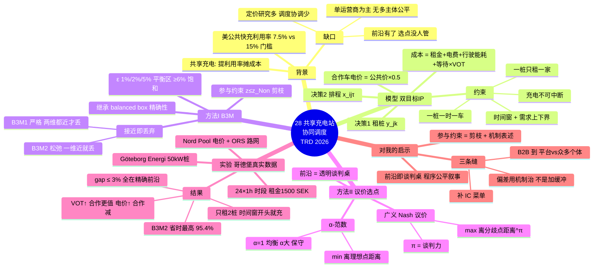

# 28 共享充电站的协同调度（双目标 + B3M + Nash 议价）

## 一句话

两家公司**共享第三方充电桩**、各自最小化自己的成本 → **双目标整数规划**；用自创的 **B3M**（平衡包围盒法升级版）只算帕累托前沿的"代表子集"省 90% 以上计算时间，再用 **Nash 议价 / α-范数**从前沿上挑出一个双方都接受的最终执行方案。

## 研究背景与动机（为什么做这篇）

- **充电基础设施的经济性困境**：美国 2022 年公共快充站平均利用率只有 **7.5%**，远低于财务可行所需的 **15%** 门槛（Fröde et al., 2023）——这是一个可以直接引用的动机级数据。
- **共享充电是出路**：让多个用户/公司共用同一批桩 → 提高利用率、摊薄成本。现实中已有平台（Share&Charge、Co Charger）和预约制充电网络（EVgo、GO TO-U）。
- **文献缺口**（作者自述的三点）：
  1. 现有共享充电研究集中在**定价与商业模式**（拍卖定价、平台机制），缺**调度层面的协调机制**；
  2. 现有充电调度研究几乎全是**单运营商集中式**，不刻画多个**独立利益主体**之间的竞争、冲突与公平；
  3. 多目标研究停在"生成帕累托前沿"，**没人回答"前沿上选哪个点执行"**——本文用议价机制补这一步。

## 问题定义与模型（双目标整数规划）

**场景**：两家车队运营商从第三方（哥德堡能源公司 Göteborg Energi）**租桩**；第二天运营计划和车辆任务已由上游排定 → 充电需求（能量、时间窗、位置）**已知**。平台做两个联合决策：

1. **租桩决策** $y_{j,k}$：桩 j 是否被公司 k 租下（每桩最多租给一家）；
2. **充电调度** $x^\tau_{ij}$：车 i 是否在时段 τ 用桩 j。

**每家公司的成本**（式 2，两个目标函数结构相同）：
$$z_k = \underbrace{\sum_j f_{j,k} y_{j,k}}_{\text{租金}} + \underbrace{\sum c^\tau_{o/c,j} \varepsilon_{ij} x^\tau_{ij}}_{\text{电费（自家车 vs 合作车单价不同）}} + \underbrace{\sum w_{ij} x^\tau_{ij}}_{\text{去桩的行驶能耗}} + \underbrace{\sum_i \lambda_i (t^s_i - e_i)}_{\text{等待时间成本 = VOT} \times \text{等待}}$$

关键设定：
- **合作折扣**：用别人租的桩充电按**合作价**（案例里是公共价 × 0.5）付费，电费付给租桩的那家公司 → 这是共享的利益来源；
- **充电连续性约束**：一旦开始充电必须**不中断**（模拟物理插枪锁 + 平台规则）；
- **容量约束**：每桩每时段只能服务 1 辆车；
- **需求上下界** $[L_i, H_i]$、每车时间窗 $[e_i, l_i]$；
- 非线性项 $x \cdot y$ 用辅助 0-1 变量 $u$ 线性化（标准三式）。

**两个目标不做加权合并**，分别最小化 $z_1, z_2$ → 产出帕累托前沿。

## 方法 I：B3M（Balanced Bounding Box Method）

**血统**：criterion space search（在目标空间搜索，保留全局最优性保证），是对 Boland et al. (2015) **balanced box method** 的升级。对比对象：ε-constraint、Tchebycheff（离散化参数导致不保证全局最优）、原版 balanced box（精确但慢）。

**两个关键设计**：

1. **参与约束（Participation constraint）**：$z_k \le z_k^{Non}$——合作后成本不得高于不合作时各自单独优化的成本。这一刀把搜索空间砍掉一大块（不合作点是前沿外右上角的参照点），既保证"自愿参与"，又**大幅加速**。
2. **"接近即丢弃"（closeness filtering）**——B3M 的核心创新：不穷举完整前沿，只保留**代表性子集**。容差 $\sigma_1 = \epsilon z^T_1,\ \sigma_2 = \epsilon z^B_2$（ε 是百分比容差）：
   - **B3M1（严格接近 $z^n \approx \mathcal{E}$）**：新解的**两个目标都**落在已有解的容差框内 → 丢弃。保守，保留点较多、gap 通常 ≤ ε。
   - **B3M2（松弛接近 $z^n \sim \mathcal{E}$）**：**任一目标**落入容差 → 丢弃（矩形整体内缩）。激进，点最少、最快。

**流程骨架**：找前沿两端点（lexicographic 优化）→ 矩形横切两半 → 每半解 lexmin 找新非支配点 → 判断接近度决定保留/丢弃 → 更新矩形集合 → 直到空。

## 方法 II：合作议价（从前沿挑最终方案）

前沿上每个点都"最优"，但必须选**一个**执行。两种互补的选法：

1. **广义 Nash 议价**：
$$s^* = \arg\max_{(z_1,z_2)\in\mathcal{F}} (z_1-\bar z_1)^\pi (z_2-\bar z_2)^{1-\pi}$$
   $\bar z_k$ 是不合作成本（威胁点/分歧点），π 是谈判力。直觉：**离不合作点越远越好**。π 变化时协议点沿前沿**平滑移动**（结论稳健，不会参数微调就跳点）。
2. **α-范数距离函数**：
$$D_\alpha = \left[\left(\tfrac{z_1-\hat z_1}{\bar z_1-\hat z_1}\right)^\alpha + \left(\tfrac{z_2-\hat z_2}{\bar z_2-\hat z_2}\right)^\alpha\right]^{1/\alpha}$$
   选**离理想点最近**的点。α=1 曼哈顿（均衡）、α=2 欧氏、大 α 强调最坏偏差（保守稳健）。

作者观点：π/α 事先未知没关系——**B3M 生成的前沿本身就是一张"透明谈判桌"**，双方在代表性方案集上共同选参数，程序公平本身就是维护长期合作的治理工具。

## 实验设计与数据

- **真实数据**：哥德堡 Göteborg Energi 充电站（只取 ≤50 kW 快充桩）位置/功率/价格；电价取 **Nord Pool** 小时价；车到桩距离用 **OpenRouteService API** 按真实路网算。
- **参数**：24 个 1 小时时段；日租金 **1500 SEK**（≈公共充电 7 小时的钱）；合作折扣 β=0.5；VOT λ=300 SEK/h（敏感性测到 500）；行驶能耗 6 SEK/km；时间窗长 4 小时。
- **算例**：案例 #1/2/3 = 20/30/40 辆车；性能测试最多 **100 辆车**；EV 空间分布（均匀/聚集）× 桩布局（均匀/集中）2×2 组合。

## 关键结果

**计算性能**（vs 原版 balanced box / ε-constraint / Tchebycheff）：
- **B3M2 最快**：大规模算例 CTS（计算时间节省）常超 60%，最高 **95.4%**（50 车 5 桩：90049s → 4164s）；
- **B3M1 均衡**：gap 几乎总在容差 ε 以内（保留的点**全部在精确前沿上**，被丢的点是"附近有点"才丢）；
- **ε 的尺度律**：ε≥6% 后解集趋于饱和（再大只是更粗）；1%/2%/5% 是信息量与效率的平衡区；
- 反例也有：Case #3 ε=1% 时 B3M1 反而比原版慢 14.3%（特殊场景下丢弃导致搜索区域变大）——作者如实报告了。
- **B3M1 vs B3M2 怎么选**：某个目标变化幅度小时 B3M2 失效 → 用 B3M1；B3M1 适合战略评估，B3M2 适合实时运营。

**敏感性分析（本文最有管理含义的部分）**：
- **VOT 越高，合作越值**：λ=500 SEK 时非合作解离前沿最远——**合作的动力来自时间价值而非电价**；
- **电价越高，合作越不划算**：θ 放大电费后，租金不变 → 公司倾向自己租桩，合作收益收窄、前沿变短；
- 若干非支配点在不同 λ/θ 下**重叠** → 存在对行为参数稳健的"稳定妥协区"，可作为长期合约执行点。

**调度结果**：最优解只租 **2 个桩**（租金太贵）；各自偏好自己租的桩（自家电价低）；多数车在时间窗**开头就开始充**（等待成本驱动）——成本激励**无通信自发协调**出无冲突的高利用率排程。

## 结论与贡献（作者自列四条）

1. 从**多独立运营商协作视角**研究充电调度（区别于集中式）；
2. **双目标整数规划**：每家最小化自己成本（区别于单目标加权）;
3. **B3M**：不穷举前沿、生成紧凑且有代表性的非支配解集，保全局最优性；
4. **议价机制衔接"前沿→可执行决策"**：透明、公平、可解释，支撑长期合作。

政策含义：改善共享充电**不是加桩**，而是设计**激励相容的协调机制**；统一电价信号不够，需要**行为感知**的机制；制度配套（数据共享标准、合约治理）是落地前提。

## 优势（亮点）

1. **方法链完整**：双目标建模 → 前沿压缩 → 议价选点，是少数把"多目标优化"做到"可执行协议"的充电论文；
2. **B3M 有普适性**：适用于一切双目标整数规划（作者明说），参与约束 + 接近过滤两个技巧都可直接搬；
3. **诚实**：报告了 B3M1 的反例（CTS 为负）、报告了 B3M2 的 gap 超容差（4.3–7.0%），不吹方法万能；
4. **数据真实**：真实桩位 + 真实电价 + 真实路网距离，非纯随机算例；
5. **管理洞察清晰**：合作动力 = 时间价值 > 电价；ε 可以解读为"谈判灵活性"的量化指标。

## 劣势与批判

1. **完全没有 IC / 激励相容讨论** ⭐：需求（能量、时间窗）被假设**如实上报**，议价时双方信息**完全透明**——但两家是自利的，虚报时间窗/需求显然有利可图（抢先占好时段）。Nash 议价解的公理保证的是"公平"，**不保证"没人有动机撒谎"**。这是机制设计最标准的批评角度。
2. **确定性模型**：需求已知、执行不偏。作者在 6.4 承认现实中会有**迟到、超时、爽约**，给出的对策只是"加缓冲"——没有任何机制（押金/惩罚/再调度）处理偏差。与 23 号（惩罚机制）、19 号（鲁棒对冲）形成鲜明对比。
3. **只有两家**：B3M 依赖二维前沿的几何性质，作者明说推广到 3+ 目标需要完全不同的算法框架；现实共享网络参与方更多。
4. **充电不可中断**：连续性约束是硬的——与 Dolgui 综述（18 号）指出的"可抢占文献极少"呼应，但本文连讨论都没有。
5. **规模仍有限**：100 辆车要 1.2 万–5 万秒（B3M2 也要小时级），离实时应用远；40 辆车算例最优化要 5 万秒（原版）。
6. **无用户行为**：车是被动工件（同 Dolgui 的批评），VOT 是同质假设的（λ=300 全体一样），没有异质性。

## 对我选题的启示

### 回答占位里的问题

**Q1：我的场景里有几个利益主体？**
这篇的答案框架：**用户（异质）→ 平台/运营商 → 电网/上游**。你之前读的 21 号（DSO vs 充电站）、26 号（运营商 vs 用户）各覆盖一段。你的预约机制至少有两个主体（平台 + 异质车主），若考虑容量约束的电网侧就是三个——**主体越多越需要机制设计，这是你的论文比"纯调度"高级的地方**。

**Q2：要不要做双目标？**
同意占位里的判断：**先单目标跑通**。但这篇给了升级路径的具体样子：单目标（平台成本/社会福利）跑通后，加第二个目标（公平/用户满意度）时，**B3M + Nash 议价是现成的求解与选点工具箱**，而且比 ε-constraint 快 60–95%，审稿人无法用"你只是启发式"攻击你。

### 最值得拿走的三件东西

1. **"前沿即谈判桌"的思想** ⭐：把帕累托前沿做成**透明、可解释的方案集**交给参与方选点——这个"程序公平"叙事可以直接用在你论文的 discussion 里（你的菜单机制给用户选、议价给运营商选，逻辑同构）。
2. **参与约束作为加速技巧**：$z_k \le z_k^{Non}$ 一刀剪掉不合作区域——写多目标扩展时既省计算又是"自愿参与"的机制表述，一石二鸟。
3. **7.5% vs 15% 利用率**：引言级数据，支撑"共享/预约提高利用率"的动机。

### 三条可攻的缝（= 你的论文位置）

1. **把"如实上报"变成机制问题**：本文假设需求透明且真实；你的 IC 菜单（12 号 Mathioudaki 那条线）让"虚报无利可图"——**在这类协作调度框架上补 IC 是标准的机制设计增量**。
2. **把"加缓冲"变成"机制治理偏差"**：作者承认迟到/超时/爽约只会加缓冲；你的 22/24 号（行为可预测性）、23 号（惩罚转移）正好提供**行为建模 + 机制干预**的组合拳。
3. **从两家到"平台 vs 众多个体"**：本文是 B2B 横向协作（两家对称车队）；你的场景是平台面对大量异质个体——个体层面才需要预约、定价与 IC，这是你与它的**场景差异化**（它引言里明说"do not fully capture coordination among multiple self-interested users"——这句话就是给你的定位留的门）。

### 与前后篇的衔接

- **19 号（Omega，公交桩开放给私家车）**：共享的"供给侧"版（桩主开放容量）；28 号是"需求侧协作"版（两家车队共租）。两者共同支撑"共享充电"大主题。
- **27 号（TRD，P2P 共享意愿）**：实证显示 liability 是瓶颈、需要预约系统背书；28 号提供了预约/协调的技术框架——**实证 + 模型配对**。
- **21 号（TPWRS，日前容量市场）**：多方主体的价格协调用市场机制；28 号用议价机制——两种"分蛋糕"方式的对照。
- **18 号（Dolgui 综述）**：本文的调度模型就是综述里 $P|r_j, d_j, cont|-(z_1, z_2)$ 型并行机问题的实例，且又一次印证"车是被动工件"的领域空白。

## 术语中英对照

| 中文 | 英文 |
|---|---|
| 协同调度 | collaborative scheduling |
| 横向协作 | horizontal collaboration |
| 双目标整数规划 | bi-objective integer programming |
| 帕累托前沿 / 非支配解 | Pareto frontier / non-dominated points |
| 平衡包围盒法 | Balanced Bounding Box Method (B3M) |
| 判据空间搜索 | criterion space search |
| 参与约束 | participation constraint |
| 容差范围 | tolerance range (ε) |
| 广义 Nash 议价 | generalized Nash bargaining |
| 谈判力 | bargaining power (π) |
| 分歧点 / 威胁点 | disagreement point（非合作成本 $\bar z$） |
| α-范数距离 | α-norm distance function |
| 时间价值 | value of time (VOT, λ) |
| 字典序优化 | lexicographic optimization (lexmin) |

## 一句话总结

**把"两家公司共桩"写成双目标 IP，用 B3M 砍掉 90% 计算量、用 Nash 议价挑出最终方案**——方法工具箱可以直接借用；而它"需求如实上报、执行不偏、无 IC"的三重假设，正是你"行为异质 + 机制设计"选题的标准入口。

## 思维导图

