# ② 离线最优 vs 在线调度（= 预约 vs 临时）

## 一句话

先用**离线 MILP**（已知全天所有请求 → 求最优解，当作上界基准），再把实际运营建模成**随机在线 MDP**，用「规则算法 / 滚动时域 MILP / 深度强化学习（带动作屏蔽的 PPO）」三类方法求解并全面对比。**离线 = 预约制（全信息），在线 = 临时到达（信息未知）**，结构上完全对应你的方向③。而且它**开源了 OpenAI-Gymnasium 仿真环境**——这是这篇最实际的价值。

---

## 文献底细

| 项 | 内容 |
|---|---|
| 题名 | Study of electric vehicle charging scheduling with renewable energy: Offline and stochastic online optimization |
| 作者 | R. Gauchotte（一作+通讯）、A. Oulamara、M. Ghogho、M. Oudani |
| 单位 | 法国洛林大学 LORIA 实验室（Nancy）+ 摩洛哥拉巴特国际大学 TICLab + 穆罕默德六世理工 |
| 期刊 | **European Journal of Operational Research (EJOR)**，Vol. 333(2026) pp. 295–319 |
| DOI | 10.1016/j.ejor.2026.01.015 |
| 时间线 | 收稿 2024-12-23 → 录用 2026-01-09 → 在线 2026-01-14 |
| 关键词 | Scheduling / Electric vehicle / Charging / Deep reinforcement learning / Mixed-integer linear program |
| **期刊层级** | **运筹学与管理科学顶刊**：ABS 4*（最高级）、FMS A 类、JCR Q1；2024 JCR 影响因子 ≈ 6.0；中科院管理学大类 2 区、运筹学小类 2 区（2024）。**不是 IEEE/TR 那种工程刊，是管理科学/运筹学口，跟你导师方向同圈** |
| 开源 | 仿真环境 GitHub：`github.com/RemiG3/Charging_Station_Env`；数据 Mendeley：`doi.org/10.17632/mp6n4532r4.2` |

> 提醒：EJOR 是"管理科学/运筹学"方向的国际权威刊，和你导师（决策理论/工业工程）是同一个学术生态。投这个口比投纯交通工程刊更贴你方向，但ABS 4* 难度也高。

---

## 研究主题

在「电网 + 光伏(PV)」双能源供电**的充电站内，做 EV 充电调度。决策链条把三件事整合进同一个问题：

1. **请求准入**：一辆车到达，接还是拒（declared departure time 已知时判断）；
2. **车-桩分配 + 等待队列**：桩满则进等待区，空出再插枪；
3. **功率分配**：每个时间步给每辆车充/不充（允许抢占式暂停）。

目标是**三重、有优先级**的（权重 β≫α≫ω）：
- (i) 最大化被接受的充电请求数；
- (ii) 让尽可能多的车在离开时达到期望 SoC；
- (iii) 优先用光伏、最小化从电网买电的成本。

---

## 研究背景与动机

- EV 普及 → 充电站饱和、电网过载。
- 光伏是有效补充，但**天气不确定、间歇性强**，只能当辅助能源（自消纳、不反向并网）。
- 充电站两种运营模式：①高速站式"高功率即到即充"（重电网投资）；②城市站式"智能充电、限制电网冲击"。**本文聚焦②**。
- 真实系统用 **OCPP 协议**控制充电桩，协议本身就支持 `Reserve Now` / `Cancel Reservation`——说明**预约和取消是工业界真实存在的控制手段**，不是作者硬造的设定。
- 本文站在**充电站运营商（CS operator）**视角，目标是"把有限的桩/电/光伏最优分配给车"。

---

## 研究问题

| 环境 | 信息条件 | 建模方式 | 解法 |
|---|---|---|---|
| **离线（Offline）** | 全天请求、电价、到达/离开全部已知（=纯预约系统） | **MILP**（混合整数线性规划） | Gurobi 求最优，**当基准上界** |
| **随机在线（Stochastic Online）** | 车随机到达、未来未知、光伏/电价波动 | **MDP**（马尔可夫决策过程） | 规则 / 滚动时域 / 深度RL |

核心研究问题：**在信息不全的在线环境下，哪种调度策略最接近离线最优？** 以及 RL 能否在高需求复杂场景胜过传统优化。

---

## 问题设定与关键假设（Section 3，必看）

**系统构成**
- `m` 个**完全相同**的充电桩，每桩恒定功率 `w`（on/off 式，不是可变功率）；
- 电网功率上限 `wG`（光伏不足时由电网补）；
- 光伏 RES 只自消纳、不反向卖电；
- 等待区车位 = `m`（可配置）；
- 时间粒度 `τ=3 分钟`，一天 `T=480` 步；
- 每车请求：`rj` 到达、`dj` 离开、`soc0j` 初始电量、`socdj=80%` 期望电量；
- **允许抢占式充电（preemption）**：充到一半可暂停、之后续充；
- **不做 V2G**（车不给电网放电）。

**两条硬约束**
- 约束(10)：任意时刻"在充 + 在等"的车总数 ≤ `m+k`（充电位+等待位）——这是容量天花板。
- `Δj` 阈值（约束2线性化而来）：保证被接受的车在等待时间里**至少能按比例充到最小所需电量**，否则干脆拒绝。公式：
  `Δj = (dj−rj)² / [ bτ(socdj−soc0j)/(wη) ] + (dj−rj)`

**作者自认的两个局限（注意，这是你的切口）**
- 等待机制**不适合"达标即走"**场景（车一满电就拔枪走），只用来在拥堵时防错拒；
- 用的是**申报离开时间（declared departure time）**，假设它已知且准确——没建模"申报≠实际""用户不准时/取消"。

---

## 核心方法

### 1. 离线 MILP（Section 4）
- 决策变量：`yij`（车j是否分到桩i）、`xijt`（t时刻是否在桩i充）、`socfj`（离开SoC）、`uj`（是否达标）、`et`（t时刻电网购电量）。
- 目标：`max Σ(α·yij + β·uj) − ω·Σ(prt·et)`，权重 **β=100 ≫ α=10 ≫ ω=1**（达标优先于接单数，接单数优先于省电费）。
- 约束(1)–(10) 覆盖：同桩时间不重叠、等待上限Δj、拒绝则全程不充、一车一桩、SoC 计算、电网购电上下界、总容量上限。

### 2. 在线 MDP（Section 5）
- **状态 s_t**：当前电价、光伏、各充电中车的 SoC/剩余时长、等待队列车的 SoC/时长、新到车的 SoC/时长（按离开时间排序）。
- **动作**：`r_action`（接受/拒绝新请求）+ `p_action`（每桩充/停）。
- **奖励 R_t**：`Σ α·r_action + Σ β·uj − ω·prt·et`（与离线目标一致）。

### 3. 四种在线算法（Section 6）
| 算法 | 思路 | 一句话评价 |
|---|---|---|
| **Baseline** | FCFS 先到先接直到满；充电优先早走车，不超电网限 | 当参照基线 |
| **PS2C** | FCFS 接受但加"剩余时间能否充到期望SoC"判断；充电优先早走车 | 规则法里最稳，低需求时接近滚动时域 |
| **Rolling Horizon（滚动时域）** | 每步在滚动窗口内解 MILP；**未来 RES 按 0、电价按最高（最坏情况）**以求保守鲁棒 | 在线方法里奖励最高、最节能 |
| **MPPO（Maskable PPO）** | PPO + **无效动作屏蔽（masking）** | **本文核心创新**，高需求场景最强 |

### 4. MPPO 的 masking（本文最核心的方法创新，Section 6.4 + Appendix H）
- 原始 PPO 在"不能超电网限"这种**硬约束**上表现很差（加惩罚项太复杂、难调）。
- **Maskable PPO**：对无效动作在 Softmax 前乘一个 `-1e8` 的大负数，把概率压到≈0，再重归一化——强迫 agent 不选非法动作。
- 本文**新增"后验无效动作（posterior invalid actions）"**：有些动作单独看合法、但组合起来才非法（比如多辆车同时充电会超电网限）。这类不能提前知道，要等 agent 选完动作后再更新 mask、把后到的车关掉。
- Appendix H 证明：**MPPO + 后验屏蔽** 在验证集泛化上显著优于 原始 PPO 和 原版 MPPO。

---

## 实验设计（Section 7，可复现参数都在这）

| 项 | 取值 |
|---|---|
| 仿真底座 | 基于 Chargym 扩展，OpenAI-Gymnasium 接口，开源 |
| 桩数/功率 | `m=k=l=10`，`w=11 kW`（三相 16A/450V），`wG=75 kW` |
| 时间 | `τ=3 min`，`T=480`，电池 `b=45 kWh`，期望 SoC=80% |
| 场景 | 50 / 60 / 70 / 90 / 120 / 150 车/天，每场景 **100 个随机实例** |
| PV 数据 | 欧洲委员会 PVGIS，巴黎+拉巴特，**138 块板、75.9 kWp** |
| 电价 | 5 个 profile（Karatzinis 的），随机抽 |
| EV 数据 | Lahariya 合成数据生成器(SDG) + 泊松到达 + **停车时长=min时长×Beta(1.5,2.5)**；初始 SoC 10%–60% |
| 权重 | **β=100, α=10, ω=1** |
| PV 预测 | **XGBoost**，前 5 步预测后 1 步（3 分钟尺度），MSE=0.0021，优于 SVR/CNN-LSTM |
| MILP 求解 | Gurobi C++ v11，**30 分钟时限** |

---

## 主要结论（带数字，汇报时挂上）

1. **离线 MILP 永远优于所有在线方法**（必然，因为它全知）。但随着车数↑，MILP 与在线的"相对奖励差"在缩小：
   - MILP 自己变难——**离线问题是 NP-Hard**；150 车时 GAP=34.6%、**100% 超时（30 分钟没解完）**（Appendix F）；
   - 在线方法变好——初始决策错了，后面还能纠错，车越多纠错机会越多。
2. **在线方法里 Rolling Horizon 几乎全场景最佳**，且低需求时与 PS2C 非常接近 → 说明 PS2C 已是有效的规则法。
3. **MPPO 反直觉**：50 车时最差（连 Baseline 都不如），但随车数↑越来越强，**120/150 车时超过 Rolling Horizon**。
   - **车主视角（MPPO 胜）**：接受率最低，但"接受的车里达标>80% 的比例高"、等待时间最短、离站 SoC 最高（89%–95%）——**它挑着接、接了就充好**；
   - **运营商视角（Rolling Horizon 胜）**：用电最少、光伏占比最高（最节能）、电网成本最低，但车主等得久、充得少。
4. 启示：**两种在线方法各有优劣，取决于你站在哪边**——这是这篇很诚实的结论。

---

## 创新点与贡献（作者自述 4 条）

1. 把**请求接受 + 等待队列 + 车-桩分配**整合进 EVCS 问题，离线建模成 MILP；
2. 把在线问题建 MDP，提出规则法 + 滚动时域两类解法；
3. **增强 MPPO**：定义两类无效动作、提出后验屏蔽机制（核心方法创新）；
4. **开源 Gymnasium 仿真环境** + 全面的计算实验对比。

---

## 局限与未来方向（Section 8，= 你的创新点矿）

作者明说的未来工作（直接抄来做选题）：
- **车辆"达标即走"**（灵活/虚拟离开时间）未建模 → 可增强灵活性；
- **混合 规则+学习 算法**；
- **公平性（fairness）** 纳入接受/充电过程；
- **申报离开时间不准**（declared vs actual）→ 局限，未建模偏差/取消；
- **多类型桩/车、多功率等级、用户特定偏好（user-specific preferences）** → 这句直接点名了你方向③的入口。

> 我的判断：这篇"信息不全"只做到了"到达随机"，但**用户行为仍是外生、同质、理性的**（申报时间给定、偏好用统一权重 β/α/ω、没有取消/不准时/风险态度）。这跟你前面四篇的共同缺口完全一致。

---

## 可复用的建模点（对你最有用）

- **「离线最优解当基准上界」的写法**——你的论文必须有这个基准，否则说不清在线策略损失了多少（这篇 Table F.9 的 GAP/超时就是范例）。
- **请求接受/拒绝 + 排队**的建模，正是"临时充电请求准入"的核心；约束(10) 的容量上限、`Δj` 的"接了就得充够"阈值都可照搬。
- **Gymnasium 环境直接拿来当实验底座**——开源，省掉至少一个月造仿真轮子的代码量。
- **MPPO 后验屏蔽**——如果你后面用 RL，这是个现成的"硬约束怎么塞进神经网络"的解法。

## 行动项

- [ ] clone 开源仓库 `github.com/RemiG3/Charging_Station_Env`，跑通最小算例
- [ ] 评估：能不能改成我的「日前（离线预约）+ 临时（在线）」两层框架
- [ ] 把"申报离开时间不准/取消"用前景理论(CPT)建模，替换本文确定性权重
- [ ] 加"用户异质偏好 + 等待焦虑"第二目标（接第三篇剥夺成本范式）

## 我的想法

<!-- 你读的时候往这里写；下面是我（助手）先塞的接口分析，可删可改 -->
**与你的充电桩预约课题的接口（助手视角）：**
- 这篇的"离线=预约、在线=临时"在结构上**完全对应方向③**。你可以做"日前预约层(离线MILP) + 当日临时层(在线MDP)"的两层架构，这篇的离线MILP和开源环境直接能当底座。
- 它的 limitation「申报离开时间不准/取消」「用户特定偏好未建模」= 你之前在 TRC2025 那篇挖的"不准时/取消"缺口，这里又出现一次——**跨两篇都点名，说明这是真空白、不是凑的**。
- 接法候选：① 用 CPT 把"用户申报行为的偏差+取消概率"写进在线 MDP 的转移/奖励；② 把统一权重(β/α/ω)换成**异质用户**（风险态度不同的车主）；③ 加"等待焦虑/剥夺成本"第二目标（接第三篇）；④ 用第四篇 Li 2024 的"用户偏好画像"给本文的 user-specific preferences 落地。

---

## 术语中英对照（给零基础同事/自己复习用）

| 英文 | 中文 | 大白话解释 |
|---|---|---|
| EVCS | 电动汽车充电调度 | 怎么安排车充电 |
| MILP | 混合整数线性规划 | 又含整数又含小数的线性优化，求最优解 |
| MDP | 马尔可夫决策过程 | 把"状态→动作→奖励→新状态"建模成序列决策 |
| RL / DRL | 强化学习 / 深度强化学习 | 让 agent 在试错中自己学出好策略 |
| PPO | 近端策略优化 | 一种稳的 RL 算法，本文 RL 主干 |
| Masking（无效动作屏蔽） | 把非法动作概率压成 0 | 强迫 AI 不选"超电网限"这类违规操作 |
| Rolling Horizon | 滚动时域 / 模型预测控制思路 | 每步只解"眼前一段"，解完推一步再解 |
| RES / PV | 可再生能源 / 光伏 | 太阳能板发的电 |
| Preemption | 抢占式充电 | 充一半可暂停、稍后续充 |
| SoC | 电量状态 | 电池剩余百分比 |
| FCFS | 先到先服务 | 排队基本规则 |
| CSMS | 充电站管理系统 | 实际调度的大脑 |
| OCPP | 开放充电点协议 | 桩和系统的通信标准，支持预约/取消 |

---

## 横向对照（与已读四篇）

| 维度 | ①Zhang 2025 TR-C | ②Lv 2025 eWOM | ③张林静 应急物流 | ④Li 2024 推荐 | **本篇 Gauchotte 2026 EJOR** |
|---|---|---|---|---|---|
| 主题 | 混合停车场预约+滚动+共享 | 口碑→EV采纳 | 卡车无人机双目标 | 评论→偏好→推荐 | **单站光伏充电 离线vs在线** |
| 方法 | MILP + DRO鲁棒 | LDA+空间计量 | MILP+INSGA-II | LightGBM+SVD | **MILP + MDP + MPPO** |
| 视角 | 运营商(供给) | 消费者(需求) | 应急管理 | 用户(需求) | **运营商(供给)** |
| 在线? | 滚动(准在线) | 截面 | 静态 | 离线 | **真·随机在线 + 离线基准** |
| 用户行为 | 不准时(时间偏差) | 口碑异质 | 同质灾民 | 偏好异质 | **外生同质(申报时间给定)** |
| 开源? | 否 | 否 | 否 | 否 | **是(Gymnasium环境)** |
| 与你方向 | 预约机制本体 | 需求侧 | 方法论参照 | 偏好画像 | **方向③底座+实验环境** |

**一句话定位**：这篇是你"方向③日前+临时"最近的现成地基——离线MILP当基准、开源环境当轮子、且两处 limitation 正好是你用 CPT/异质用户填空缺的入口。

---

## 思维导图

```mermaid
flowchart TD
    ROOT["Gauchotte 2026 EJOR<br/>离线vs在线"]

    ROOT --> A["文献底细"]
    A --> A1["EJOR 顶刊 ABS4*"]
    A --> A2["IF≈6.0 JCR Q1"]
    A --> A3["开源Gymnasium环境"]
    A --> A4["法国+摩洛哥团队"]

    ROOT --> B["研究主题"]
    B --> B1["单站光伏充电调度"]
    B --> B2["请求准入+等待队列"]
    B --> B3["车桩分配+功率分配"]
    B --> B4["三重目标优先级"]

    ROOT --> C["背景动机"]
    C --> C1["车多桩少电网过载"]
    C --> C2["光伏间歇只能辅助"]
    C --> C3["聚焦智能充电模式"]
    C --> C4["OCPP支持预约取消"]

    ROOT --> D["两环境对比"]
    D --> D1["离线=预约全信息"]
    D --> D2["在线=临时随机到达"]
    D --> D3["MILP当上界基准"]

    ROOT --> E["离线MILP"]
    E --> E1["决策变量5类"]
    E --> E2["目标 β>α>ω 优先级"]
    E --> E3["约束 110容量上限"]
    E --> E4["Delta_j 接了要充够"]

    ROOT --> F["在线MDP"]
    F --> F1["状态:电价/光伏/SoC"]
    F --> F2["动作:接受/充/停"]
    F --> F3["奖励同离线目标"]

    ROOT --> G["四种算法"]
    G --> G1["Baseline FCFS"]
    G --> G2["PS2C SoC优先"]
    G --> G3["RollingHorizon最坏情形"]
    G --> G4["MPPO动作屏蔽"]

    ROOT --> H["MPPO核心创新"]
    H --> H1["先验无效动作"]
    H --> H2["后验无效动作"]
    H --> H3["训练泛化更优"]

    ROOT --> I["实验"]
    I --> I1["10桩 11kW/75kW限"]
    I --> I2["50到150车六场景"]
    I --> I3["100实例 XGBoost预测"]
    I --> I4["MILP30分钟超时"]

    ROOT --> J["结论"]
    J --> J1["MILP恒最优但变难"]
    J --> J2["滚动时域最节能"]
    J --> J3["MPPO高需求反超"]
    J --> J4["视角不同各有优劣"]

    ROOT --> K["局限与缺口"]
    K --> K1["达标即走未建模"]
    K --> K2["申报时间不准"]
    K --> K3["用户偏好未建模"]
    K --> K4["公平性缺失"]

    ROOT --> L["与我的接口"]
    L --> L1["方向3底座"]
    L --> L2["开源环境当轮子"]
    L --> L3["用CPT补不准时"]
    L --> L4["异质用户填空白"]
```

