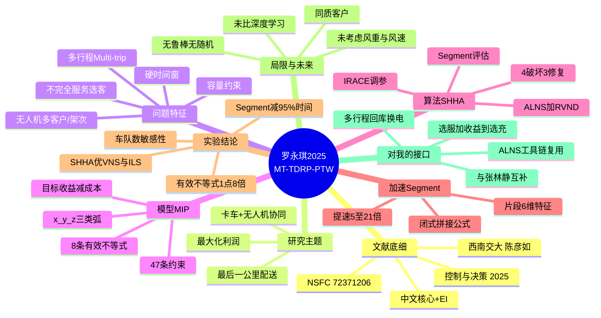

# 方法论参照：卡车-无人机协同配送（带收益 + 时间窗 + 多行程）

## 一句话

在"最后一公里"配送里，让**一辆卡车带一架无人机、一天跑多个来回（多行程）**，在客户有**硬时间窗**、车辆/无人机**容量有限**、且**不必服务所有客户（不完全服务）**的设定下，以**最大化利润（客户收益 − 运输成本）**为目标建模，并提出 **ALNS + RVND 的混合启发式（SHHA）**，再嵌入**基于 Segment 的有效评估**把可行性判断加速 5–21 倍。本质是**选择性服务 + 多行程 + 时间窗**的组合车辆路径问题（VRP 变体）。

---

## 文献底细

| 项 | 内容 |
|---|---|
| 题名 | 带收益和时间窗的多行程卡车-无人机协同配送问题（MT-TDRP-PTW） |
| 英文题名 | Multi-trip truck-drone routing problem with profits and time windows |
| 作者 | 罗永琪、陈彦如†（通讯）、冉茂亮 |
| 单位 | 西南交通大学 经济管理学院（成都） |
| 期刊 | **《控制与决策》**，2025, 40(6): 1817–1826 |
| DOI | 10.13195/j.kzyjc.2024.0852 |
| 基金 | 国家自然科学基金 72371206 |
| 收稿/录用 | 2024-07-17 / 2024-12-30 |
| 关键词 | 低空经济；卡车-无人机协同配送；客户收益；有效不等式；混合启发式算法；有效评估方法 |
| **期刊层级** | **中文核心（北大）+ 中国科技核心 + EI Compendex 收录**；国内复合影响因子约 2.x（知网）。属"控制科学与工程 / 系统工程"国内权威刊，**非 SCI、也非管理科学/运筹学顶刊**。跟你的充电桩预约主线（管理科学/运筹口）不是同一生态，作为**方法工具**参考价值大于选题参考 |
| 开源 | 无（代码未公开，仅给出参数） |

> 提醒：这篇和你的方向"充电桩预约"直接关系不大，是**纯路径优化/启发式算法**论文。但它有两个东西对你有用：①"不完全服务 + 收益最大化 + 时间窗"这个**建模范式**可以平移到充电场景；② ALNS + RVND + Segment 评估这套**工具链**是成熟可复用的。

---

## 研究主题

在「卡车 + 无人机」协同配送框架下，解决一个**带选择性服务（profit）、硬时间窗、多行程（multi-trip）**的车辆路径问题。决策要同时决定：
1. **选哪些客户**：不是所有客户都服务（不完全服务），选能赚最多利润的；
2. **谁服务**：每个被选客户由卡车单独服务、无人机单独服务、还是卡车携无人机同行（三种弧）；
3. **多行程编排**：每辆车组合（卡车+无人机）一天跑 H 个来回，回库换电池后再出发；
4. **满足硬约束**：客户时间窗（早到等、晚到不服务）、卡车/无人机容量、无人机最长飞行时间 Emax、最晚回库时间 Tmax。

**目标**：`max 利润 = Σ客户收益 − Σ运输成本`（卡车与无人机按里程计费）。

---

## 研究背景与动机

- 低空经济 + 最后一公里配送压力 → 无人机配送受关注，但**载荷小、航程短**，必须和卡车协同。
- 前人工作（Murray 2015 飞行助手 TSP、Agatz 2018 TSPD、Sacramento 多车多机 VRPD、Luo/Gu 多点配送等）几乎都假设**无人机每次飞行只服务 1 个客户**、**服务全部客户**。
- 现实里客户多、车不够、**目标变成"选客户换最大收益"**（Morandi 等首次提"带收益的卡车-无人机"，但**没时间窗、单客户/架次、无多行程、无容量/车辆数限制**）。
- 带时间窗的卡车-无人机路径**可行性判断极耗时**，需要加速策略（Vidal 等 2014 提出的 Segment 评估被 Luo/Gu 引入该问题，但**都没考虑时间窗**）。

> 本文的切入点一句话：**把"收益选择性服务 + 多客户/架次 + 硬时间窗 + 多行程 + 容量受限"全部塞进同一个模型**，并补上带时间窗的 Segment 加速。

---

## 研究问题与创新点

**三个递进的研究问题**
1. 如何在一个模型里同时表达"多行程 + 无人机多点 + 时间窗 + 不完全服务 + 容量"（模型层）？
2. 如何让精确求解器 Gurobi 在小规模上更快出解（松弛度治理）？
3. 大规模下，如何用一个高效启发式在 120s 内给出高质量解，并大幅压缩可行性判断耗时（算法层）？

**创新点（作者自述 + 我的归纳）**

| # | 创新 | 说明 |
|---|---|---|
| 1 | 提出 MT-TDRP-PTW 问题 | 首次整合"收益选择性服务 + 多行程 + 无人机多客户 + 硬时间窗 + 容量受限"，填补 Morandi 等（无时间窗/单客户/无多行程）的空白 |
| 2 | 融入 **8 条有效不等式** | 增强变量/约束耦合、收紧 big-M、减小 LP 松弛度，让 Gurobi 提速（平均求解时间降至基础模型的 **56%**，约 1.8 倍） |
| 3 | 设计 **带时间窗的 Segment 有效评估** | 把每段路径的特征（最短行驶时间 T、左窗 E、右窗 L、载重 Q、收益 P、成本 C）预存，拼接时用闭式公式 (48)–(53) 快速判可行，**省去逐点重算** |
| 4 | 提出 **SHHA**（Segment-based Hybrid Heuristic Algorithm = ALNS + RVND） | 4 个破坏算子 + 3 个修复算子做大规模扰动，5 个邻域做局部搜；参数用 **IRACE** 自动调；Segment 评估嵌入加速 |

---

## 模型与方法（重点）

### 1）数学模型（MIP，约 47 条约束，式 1–47）

- **目标（式 1）**：`max Z = Σ收益(pᵢ×(μᵢᵛ+μᵢᴰ)) − Σ成本(cᵛ×x + cᴰ×y)`，即利润。
- **三种决策弧**：
  - `xᵏᵢⱼₕ`：卡车**单独**从 i 到 j；
  - `yᵏᵢⱼₕ`：无人机**单独**从 i 到 j；
  - `zᵏᵢⱼₕ`：卡车**携无人机**从 i 到 j。
- **关键约束族**：
  - 流平衡 (2)(7)(8)(11)(12)(13)：卡车/无人机从库出发、回库、客户点流量守恒；
  - 发射/回收 `Lᵏᵢₕ / Rᵏⱼₕ` 与 `μᵏᴰ` 的关系 (3)(4)(14)(15)；
  - 容量 `Qᵛ / Qᴰ` (17)(18)(19)；
  - 无人机飞行时间 `η` 累计 ≤ `Emax` (20)(21)(22)；
  - **硬时间窗**：到达时间 `a` 满足 `[eᵢ, lᵢ]`，早到等 `ϖ`，晚到不服务 (25)–(31)；
  - **车机同步**：发射/回收点卡车与无人机时间对齐 (32)–(37)；多行程顺序 `λₕ₊₁ ≤ λₕ` (16)(38)(39)。
- **有效不等式 (40)–(47)**（8 条）：如 (41) 容量与行程指示 `λ` 绑定、(42) 到达时间 ≤ `Tmax×(N+1)×λ`、(43)(44)(45) 收紧承载/飞行时间递推、big-M 按变量取值精确化（式 18 用 `QD+max qᵢ`、式 20 用 `max τᴰ` 等）。

### 2）基于 Segment 的有效评估（加速核心）

- 把任意卡车-无人机路径切成 **Segment**：`σᵛ`（卡车单独服务的客户+发/收点）、`σᴰ`（无人机单独服务的客户+发/收点）、`σˢ`（含发/收点的组合段）。
- 每个段存 **6 个特征**：`T(σ)` 最短行驶时间、`E(σ)` 左时间窗、`L(σ)` 右时间窗、`Q(σ)` 载重、`P(σ)` 收益、`C(σ)` 成本。
- 拼接两段时用闭式公式 (48)–(53) 直接更新特征并判可行（容量是否超、时间窗是否交叠），**避免逐客户重算时间窗**。这是把 Vidal 2014 的 Segment 法扩展到**带时间窗**的卡车-无人机场景。

### 3）SHHA 算法（ALNS + RVND）

- **初始解**：先插卡车路径（4 种插入方案，见图 2），用 `ratioⱼ = ΔZⱼ/(ΔTⱼ + qⱼ)` 贪心选客户；再插无人机路径。
- **ALNS（大规模扰动）**：
  - 4 破坏算子：随机移除、相关性移除（距离倒数+时间窗重叠，轮盘赌）、随机移除 Segment、随机移除整段行程；`n_rem = min(⌊γa·n⌋, ξ_NI+1)` 动态变化。
  - 3 修复算子：随机插入、轮盘赌贪婪插入、轮盘赌懊悔插入（regret）。
  - 自适应权重：`ωⱼ ← (1−γ!)ωⱼ + γ!·Sⱼ/max(1,Nⱼ)`，反应系数 γ!。
- **RVND（局部搜索）**：5 个邻域——Best Insert / Swap / Relocate / Replace / Random Segment Replace，每次随机选邻域跳出局部最优。
- **参数**：用 **IRACE** 自动调，得 γa=0.6, αZ=3, αt=1.4, αq=1, γr=0.9, γu=0.7, κ1=25, κ2=17, γ!=0.9；`ξ_max N_I=5N`，`RT_max=120s`。

---

## 实验与结果（关键数字，可复现）

- **实现**：Python 3.8。算例规模 9 档：5/8/9/10/20/30/50/75/100 客户，每档 5 例，`K=2` 车辆组合。
- **参数（可抄）**：速度 卡车/无人机均 **40 km/h**；成本 **0.083 / 0.021 单位·min⁻¹**；`Emax=30 min`、`Tmax=480 min`、`Qᵛ=100`、`Qᴰ=20`；坐标网格 `{0,0.5,…,15}` km；包裹重 `qᵢ ~ N(30,10²)`，收益 `pᵢ = qᵢ×(0.5+ϱ)`, `ϱ~U(0,1)`；时间窗宽度按 Solomon 法（正态）。
- **有效不等式**：20 个小算例中，增强模型解出 18 个、基础 16 个；共同可解者增强模型平均耗时 **786s vs 1393s（约 56%，1.8 倍）**。
- **算法对比（SHHA vs Gurobi + VNS + ILS-VND，120s 时限，10 次运行）**：
  - 小规模 SHHA 与 Gurobi 完全一致；
  - 大规模（≥20）SHHA 最优值领先 VNS / ILS-VND：最优值差距 **−4.86% / −3.25%**，均值差距 **−10.63% / −5.41%**；SHHA 标准差最小（最稳）。
  - Gurobi 在 7200s 内对 ≥10 规模都解不出精确解。
- **Segment 加速**：SHHA vs 不用 Segment 的 HHA，每迭代时间 5–21 倍差距，**总体减少约 95% 求解时间**。
- **分布稳健性**：客户位置改服从正态分布，SHHA 仍最优（领先 VNS/ILS-VND **−9.35% / −4.1%**）。
- **敏感性**：车辆组合数 1→6；20 规模 2 组即基本满足需求，50 规模饱和于 3 组、100 规模饱和于 6 组（边际递减）。

---

## 结论与讨论

**作者自述结论**：MT-TDRP-PTW 问题被成功建模并高效求解；有效不等式使 Gurobi 提速约 1.8 倍；Segment 评估减少约 95% 时间；SHHA 在各规模/分布下均优于 Gurobi 与 VNS/ILS-VND。

**作者自述"未来方向"（也是局限）**：仅一句——"考虑包裹重量和风速对无人机最长飞行时间的影响"。**非常薄，等于没写局限**。

**我额外挑出的局限（⚠️，对你找创新点有用）**

1. **确定性模型、无鲁棒/随机**：需求（客户位置、时间窗、收益、重量）全是生成好的，没考虑实际扰动（恶劣天气、客户临时取消、到达不准时）。这点和你读的 TRC2025、EJOR2026 的"不准时/随机"缺口**呼应**——把随机/鲁棒写进这个多行程框架是干净的增量。
2. **同质客户、无行为差异**：所有客户只是"收益+时间窗"的被动参数，没有异质偏好、没有风险态度。可接你导师的**前景理论/有限理性**方向。
3. **目标只有利润，没有公平性/可靠性**：只最大化利润，不考虑服务公平性、紧急程度差异。若平移到应急/充电场景，可加第二目标（如张林静那篇的"剥夺成本"）。
4. **多行程假设偏强**：必须回库换电池、卡车发射后不能原地等回收——对真实低空物流未必成立。
5. **未与深度学习方法对比**：只比了 VNS/ILS-VND 两类启发式，没碰近年来很火的**学习化启发式 / 深度强化学习（如 EJOR2026 的 MPPO）**。这也正好是跨文献的接口。

---

## 术语中英对照

| 中文 | 英文 / 缩写 | 大白话 |
|---|---|---|
| 多行程卡车-无人机路径问题（带收益和时间窗） | MT-TDRP-PTW | 卡车带无人机一天跑多个来回送货，挑能赚钱的客户、守时间窗、求最大利润 |
| 不完全服务 | selective / incomplete service | 不强制服务所有客户，挑着服务 |
| 混合整数规划 | MIP / MILP | 又有整数变量又有连续变量的优化模型 |
| 有效不等式 | valid inequality | 数学上恒真、但能帮求解器更快剪枝的额外约束 |
| 松弛度 | LP relaxation slack | 线性松弛解离整数解有多"松"，越松越难解 |
| 大M法 | big-M | 用很大的常数把"如果…则…"写成线性约束的技巧 |
| 自适应大规模邻域搜索 | ALNS | 一组破坏/修复算子，按历史表现动态选，做全局扰动 |
| 随机变邻域下降 | RVND | 每次随机挑一个邻域做局部搜索，防卡在局部最优 |
|  Segment 有效评估 | Segment-based evaluation | 把路径切成段、预存特征，拼接时秒判可行，不用重算 |
| 初始解 | initial solution | 算法起步时先凑一个还行的可行解 |
| 迭代局部搜索 | ILS | 局部搜索 + 扰动交替的元启发式 |
| 变邻域搜索 | VNS | 按邻域结构由近到远切换的搜索框架 |
| 参数自动配置 | IRACE | 自动帮元启发式调参的工具 |

---

## 与已读文献的横向对照

| 维度 | 本篇（罗永琪 2025，控制与决策） | 笔记③（张林静 2025，系统管理学报） | EJOR2026（Gauchotte） |
|---|---|---|---|
| 载体 | 卡车 + 无人机（物流配送） | 卡车 + 无人机（应急物资） | 充电站 + 光伏（EV 充电） |
| 目标 | 单目标：利润（收益−成本） | 双目标：物流成本 + 剥夺成本 | 三目标（接入数/SoC/光伏优先） |
| 核心特征 | 多选客、硬时间窗、多行程 | 路径优化、剥夺成本量化 | 离线 MILP + 在线 MDP/RL |
| 方法 | MIP + 有效不等式 + ALNS/RVND + Segment | MIP + INSGA-II（改解码+排序） | MILP + MDP + MPPO(RL) |
| 不确定性 | **无**（确定性） | 确定性（作者方向是鲁棒，留白） | **有**（随机在线、RL 应对） |
| 求解规模 | 至 100 客户 / 120s | 至 50 节点 / 30min | 150 车/天实时 |
| 与你主线关系 | 方法参照（选服+多行程范式） | 方法参照（剥夺成本范式） | 最近（方向③日前+临时） |
| 期刊层级 | 中文核心 + EI | CSSCI + 自科A类 | ABS 4* / EJOR 顶刊 |

> 三篇都是"卡车-无人机 / EV 充电"的**路径·调度**类，但只有 EJOR2026 真正落在你的充电桩预约方向上。本篇和③是**方法论参照**：本篇给你"选客+时间窗+多行程+ALNS"的工具箱，③给你"把人的痛苦量化成第二目标"的思路。

---

## 对我的课题（充电桩预约）的接口 / 借鉴点

虽然这篇不是 EV 充电，但它的**建模范式和工具链**能平移，至少有四条接口：

1. **"不完全服务 + 收益最大化" ↔ "选择性准入"**：充电站桩位有限，不是所有 EV 请求都接——挑"收益高（服务费−电网成本）且守时间窗（离开 deadline）"的请求服务，目标函数结构（收益−成本）**几乎照搬**。这是最直接的应用。
2. **"多行程回库换电池" ↔ "移动充电车调度"**：若你的场景涉及**移动充电车/充电机器人**，它一天多次往返 depot 补能再出动，正好对应本文的多行程 + 换电假设。结合笔记③提到的"卡车作无人机移动充电桩"思路（文献[27]），可构造"移动充电桩 + 路径优化"子问题。
3. **ALNS + RVND + Segment 工具链可复用**：任何带时间窗的调度/路由（含充电排队、车-桩分配）都可以用这套元启发式框架求解，Segment 评估对"时间窗可行性判断慢"的痛点通用。
4. **与张林静③、EJOR2026 串成方法线**：把③的"剥夺成本/人的痛苦"作为第二目标、把 EJOR2026 的"随机在线/RL"作为不确定性处理、把本篇的"选择性服务 + 多行程 + ALNS"作为确定性主模型——**三者拼起来就是一个相当完整的"充电资源调度"方法栈**。

**一句话定位**：本篇是你方法工具箱里的"VRP 求解器模板"，不是选题模板；要用它，得往里塞"充电"的语义和"随机/行为"的不确定性。

---

## 思维导图（Mermaid，Obsidian 原生渲染）

