# ③ 领域地图（系统综述）：EV 充电调度/路径/时空协同的优化技术

## 一句话

目前**唯一一篇按 PRISMA 做的、专门覆盖「时间调度 / 空间协同 / 时空协同 + 优化方法」的系统综述**（沙迦美国大学团队，IEEE OJVT 2024，20 页，100+ 篇参考文献）。它把 2015–2024 年初 IEEE 体系内的 EV 充电协调文献按**问题域 × 目标函数 × 控制架构 × 求解算法**四维分类，最后点出 6 条研究空白——其中**"用户合规性（user compliance）被默认满足"**这条，正好是你（行为/决策理论方向）的天然入口。

---

## 文献底细

| 项 | 内容 |
|---|---|
| 题名 | Optimization Techniques in EV Charging Scheduling, Routing and Spatio-Temporal Demand Coordination: A Systematic Review |
| 作者 | Eiman Elghanam、Akmal AbdelFatah、Mohamed S. Hassan（通讯）、Ahmed H. Osman |
| 单位 | 沙迦美国大学（UAE）工业/土木/电气三系联合 |
| 期刊 | **IEEE Open Journal of Vehicular Technology (OJVT)**，Vol.5, 2024，Article ID 10577180 |
| DOI | 10.1109/OJVT.2024.3420244（CC BY-NC-ND 4.0 开源） |
| 收稿/录用/出版 | 2024-06-11 / 06-20 / 06-28（录用极快，仅 9 天） |
| 篇幅/数据 | 20 页，引用 100+ 篇（92 篇主样本 + 滚雪球） |
| **期刊层级** | IEEE 旗下**较新开源刊**（≈2020 创刊）；**2024 JCR IF 4.8，Q1（电气电子工程，rank 88/366）**，2025/26 升至 6.6；ESI/SCIE 收录；**中科院小类：运输科技 3 区、工程:电子与电气 3 区，大类计算机科学 2 区（升级版 25.3）**；APC ≈ $1750–1995。**不是老牌顶刊、也不是管理科学/运筹口**，当**领域地图工具**用最合适，不必大量引用 |
| 定位建议 | 要更权威的综述做引用，可另看 *Renewable & Sustainable Energy Reviews*（IF≈16）上的 EV 充电综述，但内容偏基础设施规划，对口度不如这篇 |

---

## 研究范围与方法论（PRISMA 四阶段）

- **初衷**：EV 渗透↑ → 无序充电在 **10–15% 渗透率**就会引发配网电压/频率波动、公共桩拥堵。需协调"时间（调度）+ 空间（选址/路径）"。
- **检索**：Scopus 库，限定 **IEEE 期刊/Transactions**，关键词 `(assignment|allocation|coordination|routing|scheduling) AND electric AND vehicle* AND optimiz*`，窗口 **2015 – 2024 初**。
- **层层筛选**：初检 **625** 篇 → 标题/摘要筛掉博弈论、随机优化、强化学习、深度学习、区块链、可再生能源集成（V2G/V2V）→ 剩 **162** → 全文审剔掉技术参数类/自动驾驶类 → **92** 篇 + 滚雪球补充。
- **明确排除**（⚠️ 这点对你极重要）：**随机优化、强化学习、深度学习、博弈论、V2G/V2V、FCV/混动**——即只收**确定性优化、G2V（电网到车）、纯电池 EV**。换言之，这篇综述的"确定性"口径本身就是一个**空白声明**：它把不确定性与学习类方法整体划在门外。

---

## 分类体系（这篇最有价值的部分，直接当你的"坐标盘"）

论文用**四维**把文献切成网格：

1. **问题域（Domain）**
   - **时间调度（Time-based scheduling）**：在哪个时间槽充电（图 4 停车场示例）。
   - **空间协同（Spatial coordination）**：① EV→充电站**分配（assignment）**；② **EV 路径问题（EVRP）**。
   - **时空协同（Spatio-temporal）**：时间维度嵌入空间、或空间维度嵌入调度。
2. **目标函数（Objective）**
   - **用户侧**：最小化等待/行程/电费、最大化获能。
   - **运营商侧**：最大化服务车辆数/利润（桩企、停车场主、聚合商）。
   - **电网侧**：削峰填谷、降 PAR（峰均比）、稳电压。
   - **多目标**：同时兼顾上述。
3. **控制架构（Control architecture）**：集中式 / 分层（hierarchical/distributed）/ 完全分散式（decentralized）。
4. **执行时态**：实时在线（online）vs 日前离线（offline）；EV 静止 vs 在途。

> 你写论文时，先用这张表给自己的工作"定位一格"——例如你的**充电桩预约**应落在「时间调度 / 时空协同 × 用户侧+运营商侧 × 分层/集中 × 在线+离线」的交叉区，且**补上被综述判定为缺失的"行为/不确定性"维度**。

---

## 优化算法分类（求解器对照表，可抄）

| 类别 | 具体方法 | 文中应用 |
|---|---|---|
| **精确法·线性/整数** | MIP / BIP，凸松弛后取整；分支定界(BB)、Dantzig-Wolfe 分解、Benders 分解 | [23][33][26][44] 用分解保全局最优且降通信量 |
| **精确法·非线性** | 线性化（big-M、KKT）、拉格朗日松弛、ADMM（最常用，适配含 OPF 的分层模型、可滚动时域）、A* 搜索 | [38][25][20][45][53][103] |
| **多目标整合** | 加权和(weighted-sum)、字典序(lexicographic，**优于加权和、免调权**)、增广 ε-约束(**能搜非凸、给更多 Pareto 解**) | [51][28][42][49][113] |
| **近似·启发式** | 规则启发式（小规模）、近似分解启发式 | [27][29][32][36][37][48] |
| **近似·元启发式** | **PSO、NSGA-II、GA/PGA/RI-GA、ACO、GWO、HHO、MVDE** | [50][39][40][43][72][80][104][108][112] |

**规律（论文洞察）**：时间调度偏简单→**精确法为主**；一旦引入空间维度（assignment/routing/时空）→**启发式/元启发式占比飙升**（实时性需要）。元启发式的痛点是**参数难调、易早熟**。

---

## 各域关键发现

- **时间调度**：住宅慢充（可平移负荷削峰）vs 商业/工业快充（多车、复杂度高）；不少工作把"电池退化"建模为充电成本（快充 >0.8–1C 加速容量衰减）；多为**分层/分布式**执行以保隐私。
- **空间协同**：分配问题与路径问题耦合；多数 EVRP 从**用户侧/车队**视角，**运营商侧目标很少单独立项**；**电池退化在空间域被忽视**（只管分配/路径，不管充电参数）。
- **时空协同**：2020 后才热；用在线预约策略应对 EV 移动性/用户遵从/设施可用性不确定性；**PDN（配电网）与 TN（交通网）的联合建模仍不充分**；亟需**时空双域的 EV 负荷预测**做离线验证。

---

## 研究空白（Section VI，全文最该背的 6 条）

1. **电网影响在空间问题中被忽视**：空间分配/路径大多只盯用户侧（行程/电费），没管空间分布对电网的冲击 → 呼吁 **PDN×TN 联合建模**。
2. **商用车 vs 私家车**：现有 EVRP 几乎都是**商用车队**（受约束的 TSP 变体）；**自由移动的私家 EV** 因出行随机性强、影响交通流，研究不足 → 尤其应在"调度+分配+路径"一体化中深挖。
3. **安全与隐私**：分布式多主体下信息安全是 EV 渗透的关键使能器，但几乎没人做。
4. **可扩展性（Scalability）**：EV 渗透率↑ → 大网络实时协调海量请求，可扩展算法（高级分解/并行/分布式）研究不足。
5. **⭐ 用户合规性（User compliance）**：综述明确指出——**现有文献默认 EV 用户会遵从最优调度/分配/路径方案**，但"受自利驱动，不遵从是可预期的，尤其电网侧/运营商侧目标"。→ **建议设计激励政策促使用户遵从**。
6. **元启发式杂交**：GA/PSO/ACO 个体研究多，但有效**杂交**（如 GA 全局 + 群智能局部）以扬长避短、提精度与收敛，仍有限，且需降计算复杂度。

> 第 5 条（user compliance）是**整篇对你最有用的空白**：它从顶刊综述层面坐实了"用户行为被当成外生、会乖乖听话"这一假设是领域通病——正是你塞**前景理论(CPT)/有限理性/激励相容**的切入点。第 2 条（私家车随机出行）则直接对应你的"充电桩预约面向个体 EV 用户"场景。

---

## 结论（Section VII）

综述确认：EV 充电协调研究按"时间调度 / 空间协同 / 时空协同"三类展开；EVRP 与分配类更偏用户侧；算法从精确到元启发式多样；并呼吁**扩展时空协同目标、加入隐私考量、用激励政策保用户合规**。

---

## 术语中英对照

| 中文 | 英文 / 缩写 | 大白话 |
|---|---|---|
| 系统综述 | Systematic review | 按固定流程（PRISMA）穷尽式梳理一个领域的文献 |
| 时空协同 | Spatio-temporal coordination | 同时管"何时充"和"去哪充/走哪条路" |
| 充电协调 | Charging coordination | 统筹安排谁、何时、何地、充多少 |
| 用户侧目标 | User-related objective | 车主/车队少花钱、少等待、多获能 |
| 运营商侧目标 | Operator-related objective | 桩企/停车场多赚钱、多服务车 |
| 电网侧目标 | Grid-related objective | 削峰填谷、稳电压、降峰均比 |
| 分层协调 | Hierarchical coordination | 中央出价/聚合商分头算，分布式求解 |
| 最优潮流 | OPF (Optimal Power Flow) | 在电网物理约束下算各节点能供多少电 |
| 峰均比 | PAR (Peak-to-average ratio) | 负荷曲线波峰/波谷的比值，越小越平 |
| 加权和/字典序/ε-约束 | Weighted-sum / Lexicographic / ε-constraint | 多目标变单目标的三种套路（ε-约束能搜非凸） |
| 元启发式 | Metaheuristic | 不保证最优但快、能逃局部最优的算法（PSO/GA/ACO…） |
| 用户合规性 | User compliance | 用户到底听不听调度方案的安排 |

---

## 与已读文献的横向对照

| 维度 | 本综述（Elghanam 2024, OJVT） | ①TR-C2025 浙大 | ④Energies 国网 | EJOR2026 Gauchotte | ⑥罗永琪2025 控制与决策 |
|---|---|---|---|---|---|
| 类型 | 系统综述（地图） | 预约调度原创 | 推荐原创 | 离线vs在线原创 | 路径原创 |
| 覆盖域 | 时间/空间/时空全包 | 时间调度+共享 | 仅推荐（不涉及调度） | 时间调度（离线+在线） | 纯空间路径(VRP) |
| 不确定性 | **排除随机/RL**（只收确定性） | 鲁棒(ρmax) | 无 | 随机在线+MDP/RL | 无 |
| 用户行为 | 默认合规（点名为空白） | 不准时(到达偏差) | 偏好/口碑(相关性) | 申报不准/取消(局限) | 同质客户 |
| 与你主线 | **坐标盘+空白清单** | 方法近(预约) | 方法近(偏好) | 方法最近(日前+临时) | 工具参照 |
| 期刊层级 | IEEE OJVT, IF4.8/Q1, 中科院小类3区 | TR Part C, ABS?/IEEE顶 | Energies, Q3/4区 | EJOR, ABS4*/顶刊 | 中文核心+EI |

> 这篇综述是**你 7 篇里唯一一张"地图"**：它能让你一眼看清自己论文在网格里占哪一格，以及领域内公认的 6 个缺口。其余 6 篇是"据点"，这篇是"沙盘"。

---

## 对我的课题（充电桩预约）的接口 / 借鉴点

1. **直接拿它的分类框架给论文"定位一格"**：你的工作 = 时间调度/时空协同 × 用户侧+运营商侧 × 分层+集中 × 在线+离线。写 Introduction/Related Work 时照搬它的四维切法，审稿人一眼看懂你站在哪。
2. **用它的"研究空白"话术支撑你的创新点**：综述第 5 条（user compliance）+ 第 2 条（私家车随机出行）+ 它自己"排除随机优化"的口径，三件套可以直接论证——**"现有 EV 充电协调默认用户确定性、同质、合规，而我们用 CPT/激励相容建模异质与不遵从"**。这比自己空说"有空白"硬得多。
3. **接你已读的具体文献**：综述里排除了随机/RL，而 EJOR2026（note ⑤）恰好做随机在线+MDP/RL、TR-C2019（note ⑦）做 CPT 行为建模、TRC2025（note ①）做鲁棒——**这几篇正好补在综述划掉的"不确定性"区**，可以串成"综述说这里空→下面三篇各自补一块→我整合"。
4. **算法选型参照**：若你的预约模型需要大规模实时求解，综述的"空间维度一引入就上元启发式"规律可借鉴；多目标用 **ε-约束或字典序**而非拍脑袋加权和（综述明确说加权和主观、ε-约束更优）。

---

## 我的想法（读时填入）

- 这篇对我**不是选题模板、是定位工具**：先确认"充电桩预约"在它的网格里属于哪一格（时间调度/时空协同 × 用户+运营商 × 分层/集中），再确认我要补的是"行为/不确定性"这一被综述判定为缺失的维度。
- **最锋利的一刀**：综述第 5 条"user compliance 被默认满足"是领域级证据，配合 TR-C2019 的 CPT、TRC2025 的鲁棒、EJOR2026 的随机在线，可以形成一个很干净的叙事——"确定性+同质+合规"是领域通病，我用**行为决策理论（前景理论/激励相容）+ 分布鲁棒**同时补这三处，且正好落在导师（决策理论/工业工程）的比较优势区。
- **一点提醒给自己**：这篇是综述、且只收确定性文献，引用时别把它当"方法论文"引用；它最适合出现在 Related Work 的分类框架段和"研究空白"论证段。更权威的综述（RSES Reviews, IF≈16）可补做"大背景"引用。

---

## 思维导图（Mermaid，Obsidian 原生渲染）

```mermaid
flowchart TD
    ROOT["Elghanam2024 EV充电协调综述<br/>IEEE OJVT 2024"]

    ROOT --> A["文献底细"]
    A --> A1["IEEE OJVT 2024"]
    A --> A2["IF 4.8 Q1"]
    A --> A3["中科院小类3区"]
    A --> A4["开源 CC"]

    ROOT --> B["范围方法"]
    B --> B1["PRISMA四阶段"]
    B --> B2["625到92篇"]
    B --> B3["2015至2024初"]
    B --> B4["IEEE only"]
    B --> B5["排除随机RL博弈"]

    ROOT --> C["分类四维"]
    C --> C1["问题域三型"]
    C --> C2["目标四类"]
    C --> C3["控制三架构"]
    C --> C4["在线离线"]

    ROOT --> D["目标函数"]
    D --> D1["用户侧"]
    D --> D2["运营商侧"]
    D --> D3["电网侧"]
    D --> D4["多目标"]

    ROOT --> E["算法"]
    E --> E1["精确 BB/Benders/ADMM"]
    E --> E2["元启发 PSO/GA/ACO"]
    E --> E3["多目标 ε约束优"]

    ROOT --> F["研究空白六条"]
    F --> F1["空间电网影响"]
    F --> F2["私家车随机"]
    F --> F3["安全隐私"]
    F --> F4["可扩展性"]
    F --> F5["用户合规性"]
    F --> F6["元启发杂交"]

    ROOT --> G["我的接口"]
    G --> G1["定位一格"]
    G --> G2["空白话术"]
    G --> G3["接CPT鲁棒RL"]
    G --> G4["算法选型"]
```

---

