# ④ 用真实数据聚类出 5 类充电行为

## 一句话

用国家级新能源车监测平台的高分辨率真实充电数据（**1 万辆车 / 180 万+次充电 / 分钟级**），按 6 个特征做 k-means 聚类识别出 **5 类充电行为**，再用**混合概率模型（GMM）+ 蒙特卡洛**把"行为不确定性"折算成 2050 年省级电网负荷波动，量化每类行为对系统的影响。

---

## 文献底细

| 项 | 内容 |
|---|---|
| 题名 | Behavioral uncertainty in EV charging drives heterogeneous grid load variability under climate goals |
| 作者 | Bin Zhang、Qingyao Xin（共同一作）、Siyuan Chen、Zhaohua Wang、Yang Lu、Niu Niu、Fang Zhang、Guangchuan Liu、**Prateek Bansal（通讯，NUS）** |
| 单位 | **北京理工大学（管理/经济）** + **新加坡国立大学（土木与环境工程）** + 华北电力大学 |
| 期刊 | **Nature Communications**，2026, Vol.17, Article 43 |
| DOI | 10.1038/s41467-025-66796-4（Springer，CC） |
| 收稿/录用 | 2024-08-09 → 2025-11-14（审稿约 15 个月） |
| **期刊层级** | **综合性顶刊**：2024 JCR IF ≈ **14.7** / 2025 ≈ **15.7**，中科院**大类 1 区 Top**。这是你 8 篇里**期刊层级最高**的一篇，且是**中国数据 + 中国团队**，写引言时 cite 它非常硬 |
| 数据/代码 | 个体级充电数据**不公开**（隐私），但**脱敏样例 + 统计摘要 + 简化数据集 + 完整代码包全部公开在 Zenodo**：`https://doi.org/10.5281/zenodo.17489541` |

---

## 研究问题（作者明确提出的 2 个）

1. 在气候目标下，**EV 充电行为的不确定性**到底在多大程度上推高了电网负荷波动？
2. 这种影响**在空间上（省级）如何异质**，哪些省份最急需改变充电习惯？

---

## 数据来源（关键：中国国家级平台）

- **国家新能源汽车监测与管理平台**（世界首个国家级 NEV 平台；数据联盟 NDANEV）。
- **10,000 辆 EV、>180 万条充电记录、2018 年、分钟级**。
- 每条记录含：车型、匿名车牌、开始/结束时间、时长、初始 SOC、结束 SOC、充电量、**最大充电电流**、经纬度。
- 预处理：剔除"充电量 < 0.1 kWh"、"充电前 SOC > 充电后 SOC"的脏数据。

> ⚠️ 对你最重要的信息：**原始数据需向通讯作者申请 + NDANEV 许可**（拿不到）。但**脱敏统计摘要 + 代码在 Zenodo 公开**，意味着你可以**复刻它的聚类与仿真流程**，只是换不成原始个体数据。

---

## 方法三层（这套架构最值得抄）

1. **EV 保有量预测（top-down + bottom-up）**
   - **GCAM 综合评估模型**（自上而下）：用 SSPs × RCPs 组合出社会经济与气候情景（BAU=SSP2+RCP4.5、2℃、CNCN、1.5℃）。
   - **Bass 扩散模型**（自下而上）：创新系数 p + 模仿系数 q，考虑 EV 价格、市场规模、基础设施、技术进步；EV 寿命 15 年、报废率用 **Weibull 分布**。GCAM 5 年步长 + Bass 得到 2023–2050 逐年保有量。
2. **充电行为聚类（k-means）**
   - 每个用户按 **6 个特征**取日均向量：`x_d = (开始时间, 时长, 初始SOC, 结束SOC, 充电量, 最大电流)`。
   - **k-means**（Python scikit-learn）；**类数由轮廓系数（silhouette）确定**，在 2–9 类中取最大 → **5 类**。
3. **混合概率模型 + 蒙特卡洛**
   - 联合概率 `P(s,G)=P(G)·P(s|G)`：`P(G)` = 各类人群占比（可变），`P(s|G)` = 类内特征分布（**用 GMM 高斯混合估计，分量数由 BIC 定**，保证组内多特征联合分布不被破坏）。
   - 生成未来情景时**只改各类占比、组内分布不变**——这是它比"拍脑袋假设行为"高明的地方。
   - **蒙特卡洛 1000 次**，15 分钟步长模拟单车，聚合到小时负荷。参数：单车电池 **32 kWh**、充电效率 **90%**、慢充 **3 kW**、快充 **60 kW**、假设每车每天充一次。

**四个行为情景**：SQ（维持现状）／ORDER（60% 有序慢充）／PEAK（下班高峰充电，半充满半部分充）／FAST（60% 快充，最坏）。
**两种干预**：ToU 峰谷电价（假设 50% 用户响应、用定时器挪到平/谷段）；SC 智能充电（50% 参与，避开峰时、优先谷时）。

---

## 三个负荷指标（它的度量创新在这里）

| 指标 | 定义 | 意义 |
|---|---|---|
| **日负荷峰值** | 一天最大负荷 | 容量压力 |
| **负荷波动** | 峰 − 谷（峰谷差） | 调峰压力 |
| **负荷偏差** | 峰 − 均（峰均差） | **揭示"忽略行为异质性会系统性低估需求"——作者说这个指标此前几乎没人用** |

---

## 关键结果（数字，写论文可引）

**保有量与需求**
- 2050 年中国 EV 保有量：**CNCN 目标下 3.01 亿辆**（比 BAU 高 49%）；**1.5℃ 目标下 3.88 亿辆**。
- 气候目标下 EV 使峰值负荷升至 **2509–2627 GW**（较 BAU +3.1%–8.0%）。CNCN 下 EV 占峰值负荷 **11.9%**，日峰值 2545 GW（+4.6%），日均 2228 GW（**+3.2%**）→ 需**额外每年约 2200 亿元人民币（约 310 亿美元）**的储能投资。

**单类行为的负荷影响**（假设 2050 年 100% 用户都按某一类行为充）
| 行为类 | 占比 | 峰值 | 波动增幅 | 偏差增幅 |
|---|---|---|---|---|
| **快充 FAST** | 6% | **2855 GW**（+25.5%） | **1097 GW（+82.7%）** | **548 GW（+128.3%）** ←最坏 |
| 有序充电 ORDER | 12% | **2427 GW** | 降至快充的约 1/3 | 同左 |
| 峰时充满 | 16% | 2632 GW | 806 GW（+34.2%） | 388 GW（+61.8%） |
| 里程焦虑 | 35% | 较低 | 637 GW（峰谷差仅 +6.2%） | — |

- **把用户引导为"有序充电"**：等效**少建 380 GW 备用储能、节省 1.214 万亿元（约 1700 亿美元）**。
- **60% 用户有序充电** → 2050 年全国日负荷偏差减少 **273 GW**。

**四情景 + 干预效果**
- SQ：峰值 2524 GW（20:00），波动 697 GW，偏差 296 GW。
- PEAK：峰值 2614 GW，波动 +10.5%，偏差 +15.3%。
- FAST：14:00 与 20:00 **双峰**（均 >2600 GW），波动 **917 GW**。
- ORDER：峰值 2515 GW，波动 655 GW（较 SQ −6.0%）。
- **ToU 降低波动 4.5%–20.2%；智能充电 SC 降低 22.5%–28.7%**（SC 明显更强）。

**空间异质性（省级）**
- 峰值 >150 GW 的东部省份：广东 **251 GW**（波动全国最大 **87 GW**）、江苏 196、山东 189、浙江 152。
- **江苏、山东虽然峰值高，波动反而下降 9.2% / 6.3%**——因为当地"有序充电 + 里程焦虑"两类占比高（>20% / >25%），行为本身就是电网友好的。
- **广东波动反增 12.5%**（大量用户峰时长充）。西藏、辽宁、海南相对增幅最大（9.6%–30.6%，因基线负荷低，冲击比例大）。
- 干预效果因地而异：山东/江苏/四川/河南 ToU 降 13.9%–16.7%、SC 降 18.2%–33.1%；中部（湘鄂皖滇）SC 稳定 >30%；西部/东北（青宁吉黑）**几乎无效果**（EV 少、晚峰不明显）。

---

## 讨论与作者自述局限（3 条）

1. 2050 年**基线负荷是外生给定的**，没有建模气候目标对电网基线负荷自身的影响，也不可优化。
2. **未考虑高比例波动性可再生能源**的未来电源结构，缺少"EV × 可再生"协同的仿真。
3. **没有 V2G（反向放电）数据**，无法评估车网互动行为模式对负荷的影响。

**我额外挑的局限（⚠️）**
- **数据是 2018 年的**：用 2018 年行为分布外推到 2050 年，且假设"组内分布不变、只改占比"——这个假设很强，30 年间技术/价格/基建巨变，行为分布不可能原地不动。
- **只做"何时充/充多少"，不做"是否履约"**：这是**对你最关键的空缺**——它刻画的是"充电时段偏好"，**完全没有触及预约场景下的取消、迟到、超时占用、no-show**。而这正是你课题的核心。
- **聚类是描述性的、非决策理论**：k-means 给的是统计上的行为画像，**没有解释"为什么会这样"**（虽然文中用"风险厌恶"解释了里程焦虑类，但没有建模风险态度）。这正好是你导师方向（前景理论/有限理性）能补的地方。
- 蒙特卡洛假设**每车每天只充一次**、慢充固定 3 kW、快充固定 60 kW，粒度较粗。

---

## 术语中英对照

| 中文 | 英文 / 缩写 | 大白话 |
|---|---|---|
| 有序充电 | Ordered charging | 夜间低谷慢慢充，最电网友好 |
| 里程焦虑型 | Range anxiety pattern | SOC 还很高就忍不住去充，怕没电（风险厌恶） |
| 峰时部分充 | Peak-partially-charge | 晚高峰插上但只充一点 |
| 峰时充满 | Peak-fully-charge | 晚高峰插上且一直充满，最压电网 |
| 轮廓系数 | Silhouette coefficient | 用来判断"聚成几类最合适"的指标，越大越好 |
| k-means | k-means clustering | 最经典的聚类算法，按距离把样本分成 k 堆 |
| 高斯混合模型 | GMM | 用若干个高斯分布叠加去拟合一组数据的分布 |
| BIC | Bayesian Information Criterion | 选模型复杂度用的准则，越小越好（防过拟合） |
| 混合概率模型 | Mixture probability model | 人群占比 × 类内行为分布 = 整体行为分布 |
| 蒙特卡洛 | Monte Carlo simulation | 随机抽样反复模拟，用来看随机性带来的结果分布 |
| Bass 扩散模型 | Bass model | 用"创新者 p + 模仿者 q"预测新产品普及曲线 |
| GCAM | Global Change Assessment Model | 全球综合评估模型，出宏观能源/经济/气候情景 |
| SSP / RCP | 共享社会经济路径 / 典型浓度路径 | 气候研究的标准情景框架 |
| 峰谷电价 | ToU (Time-of-Use) | 峰时贵、谷时便宜，引导用户挪时间 |
| 智能充电 | SC (Smart charging) | 电网直接调控何时充、充多少 |
| 负荷偏差 | Load deviation | 峰值 − 均值，衡量"被低估的需求波动" |

---

## 与已读文献的横向对照

| 维度 | 本篇（NatComm 2026） | OJVT综述（103） | TRC2025（1） | EJOR2026（5） | Energies国网（4） |
|---|---|---|---|---|---|
| 视角 | **宏观电网·行为异质性** | 领域地图 | 站内调度（微观运营） | 站内调度（离线/在线） | 用户偏好→推荐 |
| 用户行为 | **聚类出 5 类（数据驱动）** | 点名"合规"是空白 | 不准时(到达偏差)、鲁棒 | 申报不准/取消(局限) | 偏好相关性(非理论) |
| 方法 | GCAM+Bass / k-means / GMM / MC | 文献分类 | MIP + 鲁棒 + Gurobi | MILP+MDP+RL(MPPO) | LightGBM+SVD |
| 数据 | **1万车/180万次真实分钟级** | 92篇文献 | 仿真 | 仿真(开源环境) | 国网评论2.8万条 |
| 粒度 | 国家/省级·2050 | — | 单停车场·15min | 单站·3min | 站点级 |
| 期刊 | **NatComm IF≈15，1区Top** | OJVT IF4.8 | TR-C 顶刊 | EJOR ABS4* | Energies Q3 |
| 对你的价值 | **行为分类方法论 + 顶刊中国依据** | 定位工具 | 预约主模型 | 日前+临时 | 偏好→推荐链 |

> 本篇与 103 综述形成呼应：综述说"用户行为异质性与合规性是空白"，本篇**用真实数据证明了行为确实高度异质（5 类）且影响巨大（波动 +82.7%）**——**一"点空白"、一"证空白"**，两篇配合着引，论证链就闭环了。

---

## 可复用的范式（完整闭环，直接照搬）

**特征提取 → 聚类 → 定类数 → 命名 → 与系统指标挂钩 → 情景仿真 → 政策评估**

具体可抄的几点：
- **用轮廓系数定类数**（而不是拍脑袋定 3 类或 5 类）——这是回应"你凭什么这么分类？"的标准答案。
- **GMM + BIC 保留组内联合分布**：生成未来情景时只调占比不动组内分布，比"假设所有人都一样"严谨得多。
- **把分类结果与系统指标挂钩**的论证方式（不是只描述分类，而是算每类对负荷峰值/波动/偏差的影响）。
- **Discussion 章的写法**：先讲主发现 → 讲空间异质性 → 讲政策的因地制宜 → 最后坦白 3 条局限并各自给出 future work 方向。
- **开源规范**：脱敏数据 + 完整代码上 Zenodo（顶刊标配，也说明这套流程你能复现）。

## 提醒

它是**宏观电网视角**（国家/省级、2050、气候目标），**只借分类方法论和"行为异质性确实重要"这个证据**，别被带偏到电力系统规划/气候政策去——你的落点是**站内预约调度**。

---

## 对我的课题（充电桩预约）的接口

1. **"凭什么这么分类"的现成答案**：你有真实数据 → k-means + 轮廓系数定类数；你没有真实数据 → 见下方"我的想法"。这篇给了**顶刊级别的方法论背书**。
2. **行为异质性影响的量化证据**：行为不确定性可使负荷波动 **+82.7%**、偏差 **+128.3%**。这个数字可以直接用在引言里论证"忽略用户行为差异会严重低估系统压力"，从而支撑你把行为写进预约模型的必要性。
3. **接你的"方向①车主行为差异"**：本篇证明了行为可分 5 类且影响巨大，但**它没做预约履约**。你的增量 = 把它的"充电时段偏好分类"推进到"预约履约行为分类"，并接上决策理论解释。
4. **与 103 综述 + TRC2019(CPT) 串线**：综述点空白 → 本篇证异质性 → CPT 给行为机制 → 你做"异质行为 + 预约调度"。

---

## 我的想法（读时填入）

**① 这 5 类能否收敛成我的 3 类（履约可靠型 / 灵活型 / 高违约风险型）？**

**不能直接搬，但可以映射 + 重新聚类。** 关键区别在于**聚类用的特征不同**：

- 本篇的 5 类是用"**充电时段/SOC/电流**"聚出来的，回答的是"**用户什么时候充、充多少**"（电网负荷视角）。
- 你要的 3 类是"**履约可靠 / 灵活 / 高违约风险**"，回答的是"**用户会不会按时来、按时走、会不会取消**"（预约履约视角）。这两组特征**不在同一个维度上**。

若强行映射，大致是这样（但必须在论文里说明这是**启发式对应、非等价**）：

| 本篇 5 类 | 倾向映射 | 理由 |
|---|---|---|
| 有序充电（12%，夜间慢充、停车 >6h） | → **履约可靠型** | 停车时间长、时间弹性大、对预约窗口宽容，晚走也没关系 |
| 里程焦虑（35%，高 SOC 也充、高频小额） | → **灵活型/不确定型** | 决策频繁且由焦虑驱动，**临时起意**概率高，可能出现"临时预约/临时取消" |
| 峰时部分充（31%） | → 灵活型 | 视停留时间而定，弹性中等 |
| 峰时充满（16%，长时间占位） | → **高违约风险型** | 占用桩位久，**超时占用**风险最高（预约系统的头号杀手） |
| 快充（6%，追求时效、大电流短时长） | → **高违约风险型** | 时间敏感，**早到/临时改约/放弃排队**概率高 |

**正确的做法**：不要照抄它的类别，而是**照抄它的"聚类方法论"**，然后把特征换成**预约履约相关**的变量（这才是你的增量）：
- 实际到达时间 − 预约到达时间（早到/晚到偏差）
- 实际离开 − 预约离开（超时占用时长）
- 取消率 / no-show 率 / 改约次数
- 提前预约提前量（提前多久下单）
- 响应价格激励的弹性

**② 我的分类依据要用什么数据？没有真实数据怎么办？**

按可行性从高到低给你三条路：

| 路线 | 数据来源 | 做法 | 难度 | 备注 |
|---|---|---|---|---|
| **A. 复刻公开数据（首选）** | 本篇 **Zenodo 脱敏数据集 + 完整代码**（`doi.org/10.5281/zenodo.17489541`） | 用它公开的数据复刻 k-means+轮廓系数+GMM+MC 全流程，先把方法论跑通；个体级原始数据需向作者+NDANEV 申请（可试，但别指望） | 低（代码全开源） | 跑通后你就有了"我复现了顶刊方法"的底气 |
| **B. 情境实验/问卷 + 离散选择（最贴导师方向）** | 自己设计 **stated-preference 情境问卷**（给定等待时长/价格/违约罚金/时间窗，问是否预约、是否取消） | 用 **logit / 混合 logit** 估计行为参数，再用 **CPT（前景理论）** 修正风险态度与损失厌恶 → 得到"履约倾向"分类 | 中 | 这是**决策理论的标准玩法**，正是你导师的强项，也最能体现"为什么这题该我来做"；样本可以是校内 EV 车主 + 问卷星 |
| **C. 仿真 + 敏感性分析（兜底）** | 无真实数据 | 直接**假设**行为分布做仿真，然后像 TRC2025 那样把"分布参数"当敏感性分析对象，论证结论的稳健性 | 低 | 学 TRC2025 的写法：不硬拚真实数据，把"仿真 + 敏感性"包装成卖点 |

**我的建议**：**A + B 组合**——用 A 跑通方法链（证明你会这套），用 B 拿到"预约履约"这个独有维度的行为参数（证明你的分类有理论依据、不是拍脑袋）。这样"凭什么这么分三类"的回答就完整了：**方法论来自顶刊（A），行为机制来自决策理论（B），分类维度针对预约履约（你的增量）**。

---

## 思维导图（Mermaid，Obsidian 原生渲染）

```mermaid
flowchart TD
    ROOT["NatComm2026 行为聚类"]

    ROOT --> A["文献底细"]
    A --> A1["Nature Communications"]
    A --> A2["IF约15 一区Top"]
    A --> A3["北理工+新国大"]
    A --> A4["Zenodo开源"]

    ROOT --> B["数据"]
    B --> B1["国家NEV平台"]
    B --> B2["1万车180万次"]
    B --> B3["2018分钟级"]
    B --> B4["6个特征"]

    ROOT --> C["方法三层"]
    C --> C1["GCAM加Bass预测"]
    C --> C2["kmeans轮廓系数"]
    C --> C3["GMM加BIC"]
    C --> C4["蒙特卡洛1000次"]

    ROOT --> D["五类行为"]
    D --> D1["有序 12%"]
    D --> D2["快充 6%"]
    D --> D3["里程焦虑 35%"]
    D --> D4["峰时部分 31%"]
    D --> D5["峰时充满 16%"]

    ROOT --> E["关键结果"]
    E --> E1["快充波动 +82.7%"]
    E --> E2["有序省 1.2万亿"]
    E --> E3["ToU降 4%至20%"]
    E --> E4["SC降 22%至28%"]
    E --> E5["广东负荷最大"]

    ROOT --> F["局限"]
    F --> F1["2018外推2050"]
    F --> F2["不做履约行为"]
    F --> F3["非决策理论"]
    F --> F4["无V2G"]

    ROOT --> G["我的接口"]
    G --> G1["聚类方法论背书"]
    G --> G2["异质性证据"]
    G --> G3["重聚履约特征"]
    G --> G4["复刻Zenodo加问卷"]

    ROOT --> H["我的想法"]
    H --> H1["5类映射3类"]
    H --> H2["换履约特征"]
    H --> H3["路线A复刻"]
    H --> H4["路线B问卷CPT"]
    H --> H5["路线C仿真兜底"]
```

---

[[000 索引 · 顶刊8篇]]
