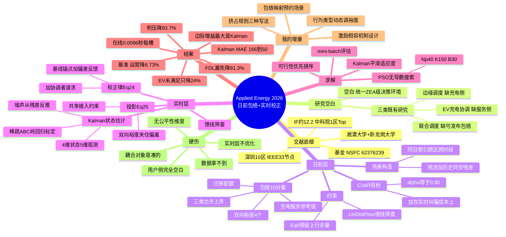

# ⑤ 日前基线包络 + 实时滚动校正

## 一句话

日前生成**"基线包络"**（不是一个点调度，而是一组"参考值 + 允许范围 + 双向裕度 + 迁移配额"），实时层**只能在包络内**做滚动校正，不能推倒重来。

## 文献底细

| 项 | 内容 |
|---|---|
| 题名 | Risk-aware day-ahead baseline scheduling and real-time rolling correction for coupled EV charging and edge-service operation under distribution-network constraints |
| 作者 | **Xiangyun Ge（葛翔云，一作）**、**Chixin Xiao（肖赤心，通讯）**、Dechen Jiang、Maoxin He、Jingao Liu |
| 单位 | **湘潭大学计算机学院** + 澳大利亚**卧龙岗大学**电气/计算机与通信工程学院 |
| 期刊 | **Applied Energy 426 (2026) 128600** |
| DOI | 10.1016/j.apenergy.2026.128600 |
| 时间线 | 收稿 2026-04-07 → 修回 2026-07-08 → 接收 2026-07-31 → online 2026-08-07（**约 4 个月，很快**） |
| 基金 | NSFC 62376239 + 湘江实验室开放课题 25XJ03033 |
| 篇幅 | 18 页，公式到 Eq.(51)，Algorithm 1/2 |

**期刊层级（重点）**：Applied Energy **2025 JCR IF ≈ 12.2，JCR Q1，中科院大类工程技术 1 区 Top**（小类：工程化工 1 区 / 能源与燃料 2 区），CiteScore 20.1，H-index 162，录用率约 47.6%，首次审稿中位 91.3 天。
→ 这是**能源领域顶刊**，跟你已读的 8 篇比：仅次于 NatComm（14.7），**高于 TR-C（8.4）、EJOR（6.0）、OJVT（4.8）、Energies（3.9）**。中国团队、中国数据（深圳）、顶刊、方法框架完整——**本文是你这批文献里"框架最该抄"的一篇**（你在 priority 里标的"最高"是对的）。

---

## 研究背景与空白

### 背景

城市配电网同时承受两类新负荷的叠加：

1. **EV 充电**：高功率、时间耦合（充不满会留到下一时段，形成"残余压力"）
2. **边缘计算服务**：数据中心/边缘节点的算力负载产生电耗，且负载有不同的时延容忍度和空间可迁移性

关键变化：馈线看到的净需求不再由"被动负荷 + 充电需求"决定，而是**出行需求 + 数字服务需求 + 背景用电**三者耦合演化的结果。

### 三类既有研究 + 作者挖的空白

| 类别 | 代表 | 作者挑的毛病 |
|---|---|---|
| ① 配网约束下的 EV 充电协调 | [6]-[21] | 只管 EV 侧电力需求，**共址的服务侧负载、积压演化、负载迁移没有建模成"与充电共享同一区域接入上限"的可比运营要素** |
| ② 边缘/云服务的能耗感知调度 | [22]-[29] | 从计算系统视角建模，**服务执行没有被嵌入为可控的馈线侧电力成分**，与充电在共享接入上限下的互动被简化或省略 |
| ③ 充电 + 边缘计算联合调度 | [30]-[34] | 有联合，但**很少构造"可提前发布的日前基线包络"，也没有把它和 Kalman 驱动的滚动校正 + 配网馈线约束串起来** |

**作者的空白一句话**：缺的不是"EV 充电 / 边缘调度 / 不确定性管理 / 在线校正"各自的论文，而是**一个把这些要素围绕同一个"馈线可接纳的运营接口"组织起来的 ZEA 级统一决策环境**。

> ⚠️ 注意作者的论证技巧：Table 1 里每一行的"Main limitation"都精准指向"没有本文这个要素"，这是把空白写实的高效写法，**你写 Related Work 时可以直接模仿这个表结构**。

---

## 系统架构

两层：

- **系统层（network-aware coordinator）**：维护馈线模型、区域→节点映射 M、可接纳性筛查程序；**不直接控制任何单个充电桩或计算任务**，只做三件事——发布包络、基于观测纠偏、筛查可行性。
- **区域层（ZEA，zone energy aggregator）**：每个区域一个，接收日前包络，在包络内实施充电与服务决策，实时上报聚合观测。

四个功能组件：协调者 / ZEA / EV 充电枢纽 / 边缘服务单元。

**边缘服务负载分三类**（这是本文特有的复杂性来源，你借框架时可以整块替换掉）：
- **FDL**（Fixed Data Load）：必须本地及时处理 → 对应"不可迁移、不可延迟"
- **BDL**（Batch Data Load）：可延后成为积压（backlog） → 对应"可延迟"
- **IDL**（Interactive Data Load）：可本地处理，也可在迁移配额内迁出 → 对应"可空间转移"

---

## 两层模型（核心，逐式拆）

### 【日前层】

#### 1. 场景构造（Eq.1-2）——**最便宜、最值得抄的一步**

$$\boldsymbol{\chi}_{z,t}(\omega)=\hat{\boldsymbol{\chi}}_{z,t}+\boldsymbol{\varepsilon}^{d(\omega)}_{z,t}$$

即：**次日预测值 + 历史上某一天 d 的"同步残差"**。

关键细节：**同一个历史日索引 d(ω) 跨区域、跨时段、跨变量统一使用**。这样做同时保住了：
- 日内时间相关性
- 充电需求 / 服务负载 / 背景负荷三者之间的**跨分量相关性**

> 比"假设各时段独立正态分布"严谨得多，而且实现成本几乎为零（只需历史残差库）。**这一步你在自己的场景里可以直接照搬。**

#### 2. 基线包络 u^DA 的 10 个分量（Eq.3）

$$\mathbf{u}^{DA}_{z,t}=\big[P^{ref,ch}_{z,t},\;S^{ref}_{z,t},\;U^{ch}_{z,t},\;U^{sv}_{z,t},\;U^{tot}_{z,t},\;R^{down,ch}_{z,t},\;R^{down,sv}_{z,t},\;R^{up,ch}_{z,t},\;R^{up,sv}_{z,t},\;\bar{B}^{mig}_{z,t}\big]^\top$$

| 分量 | 含义 |
|---|---|
| `P^{ref,ch}` / `S^{ref}` | 充电 / 服务**参考值**（基线点） |
| `U^{ch}` / `U^{sv}` / `U^{tot}` | 充电侧 / 服务侧 / **共享**区域允许上界 |
| `R^{down,ch}` / `R^{down,sv}` | **下行裕度**：给馈线让路时能削减多少 |
| `R^{up,ch}` / `R^{up,sv}` | **上行裕度**：实际需求超基线时能向上顶多少 |
| `\bar{B}^{mig}` | **迁移配额**：IDL 负载可迁出的额度 |

外加**基线状态轨迹**（Eq.4，4 维）：
$$\bar{\mathbf{x}}^{DA}_{z,t}=[\bar{E}^{res}_{z,t},\;\bar{Q}^{B}_{z,t},\;\bar{M}^{I}_{z,t},\;\bar{h}^{loc}_{z,t}]^\top$$
= 充电残余压力 / BDL 积压 / 可迁移 IDL 压力 / 本地余量。**它不是决策变量，是实时层衡量"偏离基线多少"的锚。**

#### 3. 风险目标（Eq.5-6）

$$\min_{\mathbf{u}^{DA},\beta,\xi_\omega}\;\sum_{\omega}\pi_\omega C_\omega(\mathbf{u}^{DA})+\lambda_{risk}\Big(\beta+\frac{1}{1-\alpha}\sum_\omega\pi_\omega\xi_\omega\Big)$$
$$\text{s.t. }\xi_\omega\ge Q^{RT}(\mathbf{u}^{DA},\omega)-\beta,\quad\xi_\omega\ge0$$

其中 $C_\omega(\mathbf{u}^{DA})=C^{DA}(\mathbf{u}^{DA})+Q^{RT}(\mathbf{u}^{DA},\omega)$。

**两个必须讲清的点**：
1. **CVaR 加在实时滚动校正成本 $Q^{RT}$ 上，不是加在总成本上**。即控制的是"实时纠偏动作的尾部风险"，而不是"总账的尾部"。这个设计更精细，也更好解释。
2. $Q^{RT}$ 是**政策诱导成本**（policy-induced cost），即"给定这个包络 + 这套校正律，跑完一遍情景得到的成本"，**不是第二阶段 recourse 问题的最优值**（Eq.5 下作者明确说明）。这点很重要——它意味着日前层的目标是在评价"包络 + 校正律"这个组合，而不是在求两阶段随机规划的最优。

参数：**α = 0.90**（敏感性分析：α=0.80 时积压严重，0.90/0.95 明显改善，>0.90 边际收益递减）。

#### 4. 关键约束

**局部上下界（7a-7g）**：参考值 ≤ 允许上界 ≤ 外生容量上限；下行裕度 ≤ 参考值；上行裕度 ≤ 上界 − 参考值。

**预留上行余量条件（Eq.8）** —— 这就是"预留容量"的数学写法：
$$P^{ref,ch}_{z,t}+g_z(S^{ref}_{z,t})+\hat{P}^{bg}_{z,t}+R^{up,ch}_{z,t}+\rho^{sv}_{z,t}R^{up,sv}_{z,t}\le U^{tot}_{z,t}$$
读法：**基线值 + 服务折算功率 + 预测背景负荷 + 上行裕度，必须塞进共享上界里**。

**LinDistFlow 馈线可接纳性（Eq.11a-11g）**：有功/无功支路流 + 电压幅值线性递推，电压上下限 + 支路容量限，固定的恒功率因数假设。MATLAB `linprog` 求解线性可行性问题（Eq.12-13）。

### 【实时层】

#### 1. 状态空间 + Kalman（Eq.14-23）

- 隐状态 4 维（与基线状态同坐标系）：充电残余压力 / BDL 积压 / 可迁移 IDL 压力 / 本地余量
- 观测 5 维：$\tilde{P}^{req,ch}$（充电请求）、$W^{eff}$（有效服务负载）、$Q^B$（积压）、$P^{inj}$（区域注入）、$r^{ava}$（可用裕度）
- 控制 4 维：$P^{set,ch}$ / $S^{set}$ / $x^{set,mig}$ / $x^{set,vfc}$

$$x_{t+1}=A_zx_t+B_zu^{set}_t+w_t,\qquad y_t=C_zx_t+v_t$$

**A/B/C 用稀疏结构（Eq.19a-19c）固定物理含义，自由元素用岭回归离线标定（Eq.20-21）**；过程/观测噪声协方差**从历史残差反推**（Eq.22a-22b），而不是拍脑袋调参。这个细节很讲究，值得学。

Kalman 递归（Eq.23a-23d）标准预测-校正。

#### 2. 校正律（Eq.24）——**bounded correction 的核心**

$$\tilde{u}_{z,t+1}(\omega)=\underbrace{u^{base}_{z,t+1}}_{\text{基线锚点}}+\underbrace{L_z\big(\hat{x}_{z,t+1|t}-\bar{x}^{DA}_{z,t+1}\big)}_{\text{状态偏差反馈}}+\underbrace{M_z\,a^{req}_{z,t}(\omega)}_{\text{协调者请求}}$$

**不是重优化，而是"基线 + 偏差反馈 + 网络侧请求"三项叠加**。这正是"bounded correction"的含义——实时层无权推翻日前承诺。

#### 3. 投影（Eq.25-26）——**挤占规则的数学落点**

$$u^{set}_{z,t+1}=\Pi_{\mathcal{U}^{adm}}(\tilde{u}_{z,t+1})$$

强制落回允许集，其中最关键的是**双向裕度约束（Eq.26e-26f）**：
$$-R^{up,ch}_{z,t}\;\le\;P^{ref,ch}_{z,t}-P^{set,ch}_{z,t}(\omega)\;\le\;R^{down,ch}_{z,t}$$
$$-R^{up,sv}_{z,t}\;\le\;S^{ref}_{z,t}-S^{set}_{z,t}(\omega)\;\le\;R^{down,sv}_{z,t}$$

即：**实际执行值只能在"基线 ± 裕度"这个区间里浮动**。加上共享接入约束（26g，带紧急松弛 $\zeta^{net}$ 并惩罚）。

#### 4. 馈线筛查（Eq.34-36）

校正后的区域注入映射回节点 → LinDistFlow 检验 → 可行则执行，不可行则记录违规严重度并惩罚，下一步再发起救济请求。

协调者救济请求（Eq.47-48）：检测到馈线压力时，按下行裕度比例在各区域间分配削减量 $\Delta P^{req}_t$，最小化总救济成本——**这是一个极小的 LP，不承担调度职能**。

---

## 求解方法（Section 4）

日前问题是"高维、非线性、仿真式、无闭式梯度"→ **用 PSO（无导数种群优化）**。

| 环节 | 做法 |
|---|---|
| 粒子编码（Eq.39） | 10 个块 × Z 个区域：参考值 2 + 上界 3 + 裕度比例 4 + 迁移预算 1 |
| 速度/位置更新（Eq.41-42） | 协同 PSO，每块在自己的搜索盒内更新，越界则投影 |
| **mini-batch 场景评估（Eq.44）** | 每次迭代只采样 B 个场景（B=30），而不是全场景 → 大幅省时 |
| **标量 Kalman 滤波平滑适应度（Eq.45-46）** | 把适应度当随机游走隐状态：观测噪声方差 $r^F$ 从**批内离散度**估计，过程噪声 $q^F$ 与**粒子移动距离**挂钩 |
| 可行性优先排序 | 可行 > 不可行；都不可行比违规严重度；都可行比滤波后适应度 |
| 精英重评估 | 最后用更大批量/全场景复核，防止"某一批运气好" |

**Kalman 在这里的作用要讲准**：它**不改变 PSO 的速度/位置递推**，只稳定用于"个体最优/邻域最优选择"的随机适应度信号。作者特意强调这一点（p.11）。

参数：**Np=40, K=150, w=0.70, c1=c2=1.50, B=30**。

计算复杂度（Eq.49-51）：
- 离线 $C^{DA}=O(K\,N_p\,C_{eval}(B))$
- 在线每槽 $C_{RT,slot}=O(C_{KF}+C_{req}+C_{proj}+C_{net})$

---

## 算例与结果

### 算例设置

| 项 | 值 |
|---|---|
| 场景 | **深圳南山区 10 个区域** → 改进 **IEEE 33 节点**辐射状馈线（无新增支路，区域注入叠加到映射节点） |
| 时间 | T=24，Δt=1 h |
| 数据 | **181 天轨迹 = 4344 小时记录**；前 144 天设计集，后 **37 天样本外测试** |
| 单桩功率 | 7 kW |
| ZEA 容量 | 见表 2（ZEA6 最大：充电 2030 kW / 服务 14500 unit/h / 迁移 2900 / 辅助 1450） |
| 实现 | MATLAB，AMD Ryzen 5 5600G，16 GB，6 核 12 线程 |

### Case A：整体闭环性能

**Kalman 校正的效果（最强数字）**：
- 电力侧 MAE：**166.959 → 50.011**（降 70%）
- 服务侧 MAE：**45.133 → 25.730**（降 43%）

### Case B：消融实验（Table 4-5）

| Case | 设置 | 平均总成本 | CVaR 成本 | 平均 EV 未满足 | FDL 漏失率 | 平均 BDL 积压 | IDL 迁移总量 | 灵活支撑使用 | 充电备用 |
|---|---|---|---|---|---|---|---|---|---|
| Case 1 | 全关 | 6092.655 | 9166.376 | 1150.271 | 2.492e-2 | 50.087 | 778.516 | 0.381 | 4482.648 |
| Case 2 | +耦合包络 | 5727.601 | 9018.976 | 1074.782 | 7.325e-3 | 15.923 | 739.426 | 0.257 | 3987.255 |
| Case 3 | +CVaR | 5619.489 | 8305.821 | 1038.442 | 4.420e-3 | 10.028 | 704.237 | 0.254 | 3986.844 |
| Case 4 | +Kalman | 5274.575 | 7300.789 | 975.911 | 3.287e-3 | 4.477 | 626.285 | 0.251 | 3589.318 |
| **Proposed** | **+MA-PSO** | **5240.759** | **7300.592** | **872.961** | **2.172e-3** | **3.168** | **493.157** | **0.154** | **3176.689** |

**读表要点**：
- **BDL 积压 50.087 → 3.168（降 93.7%）**，是改善最猛的维度
- **FDL 漏失率 2.492e-2 → 2.172e-3（降 91.3%）**
- **边际增益最大的一步是 Case3→Case4（加 Kalman）**：总成本 5619→5275、积压 10.03→4.48。说明"递归状态估计"比"更好的离线搜索"更值钱
- **CVaR 成本在 Case4 之后基本见底**（7300.789 → 7300.592），说明尾部风险已被实时层消化
- **EV 未满足需求只降 24%（1150→873）**，是所有维度里改善最小的 → 说明"少让用户充不上电"是最难啃的骨头

### Case C：外部基准对比（Table 6）

对比 **SSD**（场景随机调度）、**ARO**（自适应鲁棒）、**G-MPC**（电网感知日前 + MPC 跟踪）。

作者采用"**每个维度挑最强基准比**"的写法：

| 维度 | 最强基准 | 基准值 | 本文 | 绝对增益 | 相对增益 |
|---|---|---|---|---|---|
| 运营支出 | SSD | 6950.977 | 6344.368 | 606.609 | **8.73%** |
| 尾部成本暴露 | SSD | 9419.868 | 8911.336 | 508.532 | **5.40%** |
| 充电损失 | G-MPC | 316.393 | 283.392 | 33.001 | **10.43%** |
| 关键负荷漏失率 | ARO | 1.687e-3 | 1.296e-3 | 0.391e-3 | **23.18%** |
| 积压压力 | ARO | 4.140 | 2.178 | 1.962 | **47.39%** |

> 这个"逐维度挑最强对手"的呈现方式很聪明也很诚实（作者明说是 representative adaptations，不是原样复现）。**你可以学这个 Table 6 的写法**，但要注意评审可能追问"为什么不同维度用不同基准"。

### Case D：计算可处理性（Table 7）

| 测试 | 设置 | 离线 (s) | 在线/槽 (s) |
|---|---|---|---|
| 区域规模 | Z=4, B=30 | 412.96 | 0.0170 |
| | Z=10, B=30 | 952.52 | 0.0096 |
| 批量规模 | B=10, Z=10 | 328.39 | 0.0095 |
| | B=50, Z=10 | 1570.26 | 0.0092 |

**在线每槽 < 0.02 s（10 区约 0.0096 s）** → 实时性极强，这是"离线贵、在线轻"这个设计的直接兑现。

---

## 结论与未来工作

### 作者结论（Section 6）

基线包络支撑了耦合需求偏差下的自适应实时运行；Kalman 校正显著提升噪声观测下的跟踪精度；消融证实了耦合包络 / CVaR / Kalman / MA-PSO 各自的贡献；外部对比显示多维度同时改善；运行时证实了"离线重、在线轻"的计算分离。

### 作者自述的三条 Future Work（**直接对应你的机会**）

1. 用更精细的**三相不平衡配电网模型**替代 LinDistFlow
2. 细化**设备级充电行为**与车级计算参与，改进 ZEA 聚合表示
3. **开发市场化协调机制，支持充电运营商、边缘服务商、聚合商、配网运营商之间的激励相容（incentive-compatible）互动**

> 第 3 条就是你的入口。而且它和第 2 条合起来 = "用户行为建模 + 机制设计"，正好是你导师决策理论的方向。

### 我额外挑的硬伤（⚠️ 作者没写）

1. **数据拿不到**：Data availability 写的是 "Data will be made available on request" —— 实际基本等于没有。复刻要靠自己造数据（底层用的是 UrbanEV 公开数据集 [39]，Li et al., *Sci Data* 2025, 12:523，可查）。
2. **耦合对象是凑的**：边缘计算服务和充电预约在物理上没有必然联系，作者的耦合动机是"它们共享馈线容量"。你的场景里不用硬凑这个，换成"预约用户 vs 临时用户"更自然。
3. **用户侧完全空白**：EV 侧外生变量只有聚合的 $E^{arr}$（新到达的充电能量需求），**没有到达/离开时间、没有取消/no-show、没有用户异质性**。这与你已读 8 篇挖出的共同缺口完全一致。
4. **实时层不优化**：$L_z$、$M_z$ 是离线标定的**固定增益矩阵**，实时层只做"线性反馈 + 投影"，某种意义上牺牲最优性换速度。这是个可攻击点。
5. **PSO 无最优性保证**，且 K=150 × Np=40 × B=30 的离线成本不低（952 s）。
6. **单目标**（成本 + 尾部风险），**没有公平性、用户满意度维度**。
7. **场景构造隐含"残差分布无漂移"**：用历史残差整体平移，未来分布被假设与历史同分布；且只有 181 天，残差样本有限。
8. **LinDistFlow 是线性近似**，忽略无功精细建模与三相不平衡（作者自己在 future work 认了）。
9. **没有机制设计**：日前承诺了包络，但**没有任何机制保证 ZEA/用户会遵守**——作者自己把它放到 future work 第 3 条。

---

## 我的想法

### Q1：「包络」在我这儿对应什么？预留容量上界 + 下界？

**答：不只是上下界，是四层结构。** 把它翻译成充电预约场景：

| 本文符号 | 含义 | **充电预约场景对应物** |
|---|---|---|
| `P^{ref,ch}` | 充电参考值（基线点） | 日前**承诺给预约用户**的桩位/功率额度 |
| `U^{ch}` | 充电侧允许上界 | 站点总可用桩位数 × 单桩功率 |
| `R^{up,ch}` | 上行裕度 | **留给临时用户的挤占额度**（临时用户最多能多用多少） |
| `R^{down,ch}` | 下行裕度 | 突发事件（桩故障/限电/电网约束）时**能削减的额度** |
| `U^{tot}` | 共享接入上界 | 站点变压器容量 / 配网接入容量（**≈ 你场景里的"同时率约束"**） |
| `\bar{B}^{mig}` | 迁移配额 | 临时用户被**引导改约/换站**的额度上限 |
| `\bar{x}^{DA}` 中的 `\bar{E}^{res}` | 充电残余压力 | 未能满足的充电需求（积压），可当"用户不满"的代理指标 |

**所以一句话**：
> **「包络」= 预约预留量的承诺值 + 允许临时用户挤占的上行额度 + 允许突发削减的下行额度 + 三者共享的总容量闸门。**

你占位笔记里写的判断（"日前预约预留多少容量 + 临时充电能挤占多少额度"）是**对的，而且比你想的更完整**——多出一个"迁移配额"维度，对应"引导用户改约/换站"。这一维在充电场景里特别自然：**临时用户挤不进来时，不是拒单，而是引导他去邻近站点或换个时段**，这就是 $\bar{B}^{mig}$ 的现实对应物。

### Q2：挤占规则怎么写进约束里？

三种写法，由简到严：

**写法一：硬区间约束（本文 Eq.26e-26f 的做法，最推荐先做）**

原文（连续功率）：
$$-R^{up,ch}\le P^{ref,ch}-P^{set,ch}\le R^{down,ch}$$

换成充电预约的整数形式。设 $n^{res}_{z,t}$ = 日前承诺给预约用户的桩位数，$n^{set}_{z,t}$ = 时段 t 实际占用的桩位数：

$$n^{set}_{z,t}\;\ge\;n^{res}_{z,t}-R^{down}_t \qquad\text{（预约用户保障线：临时用户挤占不得超过 }R^{down}\text{）}$$
$$n^{set}_{z,t}\;\le\;n^{res}_{z,t}+R^{up}_t \qquad\text{（临时用户挤占上限：最多多用 }R^{up}\text{ 个桩位）}$$

**这就是"挤占规则"的最简形式：用一个区间把"临时用户能占多少"夹住。** 干净、可解释、可写进论文。

**写法二：软约束 + 凸惩罚（本文 Eq.38 的 $c^{dev,ch}$ 项）**

在实时成本里加：$c^{dev,ch}_{z,t}\big(P^{ref,ch}-P^{set,ch}\big)$，偏离基线就罚。

改进建议：对"挤占预约桩位"设**递增惩罚**（挤第 1 个罚 1×，第 2 个罚 3×，第 3 个罚 6×）→ 凸的分段线性惩罚，**保持 MIP 可解**（用 SOS2 或增量法建模）。好处是极端情况下允许违约、代价可控；代价是要标定惩罚系数。

**写法三：分类优先级约束（← 这才是你的增量）**

本文的根本缺陷是：**它不知道"谁的充电需求被挤占了"**——EV 侧只有一个聚合的 $E^{res}$，所有用户同质。你可以加一层用户分层：

- **预约用户**的需求 → 硬约束保障（挤占罚 ∞ / 极大值）
- **临时用户**的需求 → 软约束（可挤占、可拒单）
- **高优先级用户**（低 SOC、急救、已付溢价） → 更高保障级别

写成：
$$\sum_k \text{priority}_k\cdot x_{k,t}\;\le\;U^{tot}_t,\qquad x_{k,t}\ge L_k\ \ (\text{各类用户的保障下界})$$

### ⭐ 最关键的增量点（本文没有、你能做）

本文的 $R^{up}$ / $R^{down}$ 是**日前一次性定死的常数**，对所有时段、所有用户同质。

**你的改进：让 $R^{up}$ / $R^{down}$ 随「用户行为类型」和「时段」动态调整。**

具体接法（把 NatComm 那篇的行为聚类用起来）：

| 用户类型（NatComm 5 类 → 你的预约履约 3 类） | 预留策略 |
|---|---|
| **准时可靠型** | $R^{up}$ 给大（必须保障），$R^{down}$ 给小（尽量不削） |
| **灵活型** | $R^{up}$ 中等，$R^{down}$ 给大（可被引导改约，削减阻力小） |
| **高违约风险型**（常取消 / no-show / 超时占位） | $R^{up}$ 给**小**（他大概率不来，预留是浪费）→ 省下的额度转给临时用户 |

**这一刀下去，你的增量是"行为异质性驱动的差异化容量预留"，而且是四篇文献交叉支撑的**：方法论框架来自本文（包络 + 双向裕度），行为分层证据来自 NatComm（聚类 + 异质性确实重要），行为建模工具来自 TRC2019 的 CPT。这比"我把 PSO 换成别的算法"高一个层次。

---

## 与已读文献的关系（主线定位）

| 对比对象 | 关系 |
|---|---|
| **101 TRC2025 滚动分配** | 都有"滚动"，但本文是**两层**（日前发布承诺 + 实时受限纠偏），TRC2025 是**单层滚动重排**（15 分钟重排一次，没有"承诺—纠偏"结构）。**本文的"包络"正好补上 TRC2025 缺的"日前承诺"。** |
| **102 EJOR2026 离线 vs 在线** | 都是两时间尺度，但 EJOR 的在线层是**重新决策**（MDP / RL），本文是在线层**受限校正**（不重优化）。EJOR 更"聪明"但计算重、无可承诺性；本文可承诺但牺牲最优性。**你的方向③应该取：本文的承诺结构 + EJOR 的在线智能。** |
| **103 OJVT 综述** | 综述四维框架里的"在线/离线"维度，本文是"离线发布包络 + 在线受限校正"的**典范实例**，正好落在"时空协同 × 在线/离线"交叉格。写 Related Work 时可以用本文当该格的 anchor。 |
| **104 NatComm 行为聚类** | 本文用户侧完全空白（只有聚合 $E^{arr}$），NatComm 给的是"用户可分群且群间差异巨大"的证据。**结合点 = 按行为类型动态设定 $R^{up}$/$R^{down}$**（见上）。 |
| **107 TRC2019 CPT + 108 TSG2025 菜单机制** | 本文 future work 第 3 条"激励相容机制"正是这两篇的用武之地：用 CPT 建模用户是否会遵守包络，用菜单机制设计"分级承诺 + 差异化定价"让用户**自愿**选到适合自己的包络等级。 |

---

## 术语中英对照

| 中文 | 英文 | 大白话 |
|---|---|---|
| 基线包络 | baseline envelope | 不是"必须这样做"，而是"允许你在这一带活动" |
| 区域能量聚合商 | ZEA (zone energy aggregator) | 一个区域的"总代"，对外只报一个总用电量 |
| 允许运行范围 | admissible operating range | 上下限构成的走廊 |
| 双向灵活裕度 | bidirectional flexibility margin | 能往上加多少 / 能往下砍多少 |
| 迁移配额 | migration allowance | 允许把负载挪到别处去的上限 |
| 滚动校正 | rolling correction | 每个时段根据实际观测微调一次 |
| 向允许集投影 | projection onto admissible set | 算出来的值越界了，就按最近的合法点拉回来 |
| 条件风险价值 | CVaR | "最坏 10% 情况下的平均损失"，比"平均损失"更保守 |
| 线性配电潮流 | LinDistFlow | 把配电网潮流方程线性化，好算但忽略无功细节 |
| 卡尔曼滤波 | Kalman filtering | 在噪声观测下递推估计真实状态的标准工具 |
| 小批量场景评估 | mini-batch scenario evaluation | 每次只抽一部分场景来评价，省时间 |
| 馈线可接纳性 | feeder admissibility | 这个用电方案会不会把馈线电压/电流顶爆 |
| 固定/批量/交互数据负载 | FDL / BDL / IDL | 必须马上做 / 可以拖 / 可以挪到别处做 |
| 车辆雾计算 | VFC (vehicular fog computing) | 把车当移动算力/电源用 |
| 激励相容 | incentive-compatible | 让各方"说真话/守规矩"比"骗/违约"更划算 |

---

## 可复用的关键参数（写论文时可引）

| 参数 | 值 | 出处 |
|---|---|---|
| 调度时域 | T=24，Δt=1 h | Table 3 |
| CVaR 置信水平 | α=0.90 | Fig.10 敏感性分析 |
| PSO | Np=40, K=150, w=0.70, c1=c2=1.50 | Table 3 |
| mini-batch 大小 | B=30 | Table 3 |
| 数据集 | 181 天 = 4344 小时；设计/测试 = 144/37 天 | Section 5 |
| 单桩功率 | 7 kW | Table 3 |
| 馈线 | 改进 IEEE 33 节点，10 个 ZEA | Table 2 |
| 在线耗时 | < 0.02 s/槽（10 区约 0.0096 s） | Table 7 |
| 离线耗时 | 328–1570 s（随 Z、B 变化） | Table 7 |
| 底层数据集 | UrbanEV（Li et al., *Sci Data* 2025, 12:523） | Ref [39] |

---

## 思维导图

---

