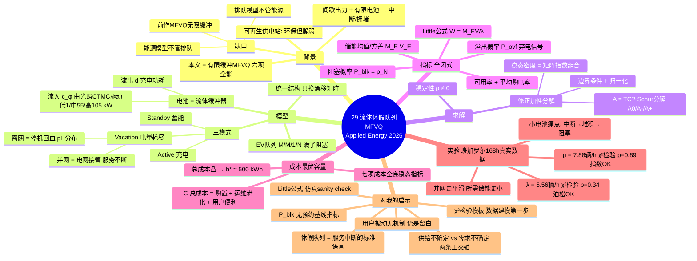

# 29 流体休假排队模型（MFVQ：可再生供电充电站的性能评估与电池容量优化）

## 一句话

把"光伏/风电 + 有限电池 + 随机到车"拧进一个**马尔可夫流体休假队列（MFVQ）**：电池是连续流体缓冲器、EV 是离散 M/M/1/N 队列、电量耗尽 = 服务台"休假"（离网=停机/并网=电网接管）；解出**闭式稳态指标**（等待时间、阻塞率、储能均值/方差），再喂进**总成本函数**求成本最优电池容量——班加罗尔真实一周数据标定，**b\*≈500 kWh**。

## 研究背景与动机

- **可再生供电充电站的两难**：环保但脆弱——可再生出力间歇性 + 电池容量有限 → 充电中断、排队拥堵、服务质量下降（离网/弱网场景尤甚）。
- **电池容量是核心设计变量**：大电池 → 可靠但投资和老化成本高；小电池 → 省钱但频繁缺电、阻塞率高、等待长。
- **文献缺口**（Table 1 的六列对照表很规整，可直接借鉴写综述）：
  1. **排队模型不管能源**：M/G/c、M/M/c/K 等假设电源确定/不间断，抓不到可再生间歇性与电池耗尽；
  2. **能源管理模型不管排队**：BESS 研究把电池当静态容器，不建模随机到车、阻塞、等待；
  3. **MFQ（马尔可夫流体队列）有能源没排队**：前作 [36] 的 MFVQ 还是无限缓冲假设。
  → 本文 = 第一个**有限缓冲 MFVQ** 统一框架，六个能力列全部打勾。

## 系统模型（三组件 + 三模式）

**三组件**：
1. **EV 队列**：泊松到达（率 λ），指数充电时间（率 μ），有限容量 N 个车位（含正在充的），满了就阻塞（blocked，去别家）；
2. **电池 = 流体缓冲器**：有限容量 b，能量水平 X(t) 连续演化——dX/dt = c_φ(t) − d（有车充时）/ c_φ(t)（无车时）；可再生流入率由**有限状态 CTMC** φ(t) 驱动（光照低/中/高三态，c_L=1、c_M=55、c_H=105 kW）；
3. **充电服务台**，三模式：
   - **Active（充电）**：有车 + 有电；
   - **Standby（待机）**：无车，电池继续蓄能；
   - **Vacation（休假）**：电池耗尽（X=0）——**离网**：充电暂停、靠可再生回血（回血时长 ~ pH 分布 (α,V)，均值 2–5 小时）；**并网**：休假被"电网辅助期"替换，服务不中断（电网供给率 g≥d），同样 pH 分布。

**统一性是本文最大卖点**：离网/并网**同一套数学结构**，只换漂移率矩阵 R 的元素和边界条件——离网 r_v = c_k（纯回血），并网 r_v = c_k + g − d（边充电边回血）。并网还支持三种运营策略（电网同时充车充电池 / 电网只供车 / 电网优先不充电池），切换只改漂移矩阵。

## 求解方法（硬核部分，知道骨架即可）

1. **状态空间**：四元组 (X(t), φ(t), N(t), ϑ(t))——能量水平 × 光照相位 × 队列长度 × 休假相位（pH 相位，n_PH+1 = 充电活跃）。用 Kronecker 积/和拼装生成矩阵 T 和漂移矩阵 C；
2. **稳定性条件**：平均漂移 ρ = πR1 ≠ 0（长期能量变化率非零；ρ<0 偏耗电、ρ>0 偏蓄能，ρ=0 无闭式稳态）；
3. **修正加性分解法**（Telek & Vécsei，比谱方法数值稳定、比矩阵解析法省算力）：解 dπ/dx·C = π·T → 令 A = TC⁻¹ 做 **Schur 分解**成 A₀/A₋/A₊ 三块（零/衰减/增长模式）→ 稳态密度 = 矩阵指数组合 π(x) = z₀e^{A₀x}L₀ + z₋e^{A₋x}L₋ + z₊e^{−A₊(b−x)}L₊ → 边界条件 + 归一化定出系数（用 Lemma 1 的矩阵指数积分技巧处理 ∫e^{Mx}dx）。

## 性能指标（全部闭式）

| 指标 | 表达 | 含义 |
|---|---|---|
| 队列长度分布 | p = π_v·P_PH[1⊗I⊗1]（定理1） | 稳态 0..N 辆车的概率 |
| 平均在站车数 | M_EV = Σ n·p_n | |
| **平均等待时间** | **W_EV = M_EV/λ（Little 公式）** | 到达车在系统内平均逗留 |
| 阻塞概率 | P_blk = p_N | 站满被拒概率 |
| 溢出概率 | P_ovf = p(b)₊·1 | 电池满、弃电的时间占比（电池过大的信号） |
| 储能均值/方差 | M_E, V_E（定理2/3，矩阵指数积分闭式） | 波动大 = 频繁缺电/溢出 |
| 服务可用率 | Avail = 活跃状态概率和 | 离网的停机时间占比；并网 ≈1 |
| 平均电网购电率 | M_E^(g) = g·π^(g)·1 | 并网成本输入 |

## 成本最优电池容量

$$C(b) = \underbrace{\gamma_{cap}b + \gamma_g M_E^{(g)}}_{\text{购置：投资+购电}} + \underbrace{\gamma_{deg}\text{Cycle}(b) + \gamma_{eng}M_E + \gamma_{ovf}P_{ovf}}_{\text{运维：老化+热管理+弃电机会成本}} + \underbrace{\gamma_{blk}\lambda P_{blk} + \gamma_{wait}\lambda W_{EV}}_{\text{用户便利：拒服务+等待惩罚}}$$

$$b^* = \arg\min_{b\in[b_{min},b_{max}]} C(b)$$

**关键性质**：各分量对 b 单调（投资/老化随 b 线性升、用户成本随 b 陡降）→ 总成本**凸** → 最优解存在且唯一。Algorithm 1 就是"网格搜 b + 每点解一次稳态"（MATLAB）。

## 实验与数据（真实数据标定，做法值得抄）

- **数据**：班加罗尔一个中型光伏充电站（快充、4 车位）**一周 168 小时**运营记录（到车时间戳、充放电起止、光伏出力）。
- **两步假设检验**（这是全文最值得你学的规范动作）：
  - 到车过程：MLE 估 λ̂ = 934/168 = **5.5595 辆/h**，Pearson χ² 拟合检验 χ²=7.9009、**p=0.3414** → 不能拒绝泊松假设 ✓
  - 服务时间：μ̂ = 1323/168 = **7.8750 辆/h**，χ²=3.6266、**p=0.8891** → 不能拒绝指数假设 ✓
- **参数**：光伏三态 CTMC；基线电池 1000 kWh（典型 100–500，取大站）；放电 d=15–30 kW；往返效率 90%；休假 pH (α={0.3,0.7}, V) 均值 2–5 h；成本系数 γ_cap=5 $/kWh、γ_deg=10 $/cycle、γ_eng=0.5、γ_ovf=20、γ_blk=350 $/辆、γ_wait=50 $/(辆·h)。
- **风能建模**也给了通用做法（Weibull 风速 + 功率曲线），展示框架普适性。

## 关键结果

1. **约 500 kWh 是经济拐点**：b < 500 时加电池收益显著（队列更空、阻塞和等待陡降、停机率降）；b ≈ 400–500 后收益边际递减（饱和区）；
2. **总成本曲线凸**：用户便利成本随 b 陡降、投资+老化近似线性升 → **b\* ≈ 500 kWh**（离网最优）；
3. **并网 vs 离网**：并网全程能量水平更高、动态更平滑、所需储能更小，代价是购电成本——"自主性换可靠性"的定量权衡；
4. 小电池系统的痛点被精确量化：频繁服务中断 → 排队堆积 → 阻塞率升高。

## 优势（亮点）

1. **统一解析框架**：能源（连续流体）+ 排队（离散顾客）+ 休假（服务中断/电网接管）三件事一个模型全包，且离网/并网只换矩阵元素；
2. **闭式 + 数值稳定**：全部指标有解析表达式（加性分解，避免谱方法病态），不做仿真就能算长期行为；
3. **数据规范**：泊松/指数假设都用真实数据做了 χ² 检验，参数 MLE 估计——不是拍参数；
4. **成本函数完整**：技术（弃电、老化、循环）+ 经济（投资、购电）+ 用户（阻塞、等待）三类七项，每项都连到稳态指标；
5. 致谢 Telek（BME），随机过程方法论有学术背书。

## 劣势与批判

1. **单服务台 M/M/1/N**：N=4 个车位但只有 1 个充电口在串行服务——快充站现实是多桩并行（M/M/c/N 才对），这是为解析可解性做的牺牲，直接限制规模适用性；
2. **指数服务时间**：充电时长现实中重尾（22 号数据：65 小时跨度、hot unplug 10–20%），指数假设过强——虽然 χ² 没拒绝，但那是小时级聚合数据，粒度粗；
3. **稳态模型 vs 昼间节律**：数据明明显示强日周期（白天到车密、夜里稀），模型却用常数 λ 做稳态分析——时变到达（非齐次泊松）没进模型；
4. **用户是被动工件**：无行为异质、无爽约/不准时、无策略行为；阻塞的车"去别家"其实就是一个分流选择，没建模；
5. **成本系数是"归一化代表值"**：γ_blk=350、γ_wait=50 等来自文献引用而非估计，成本最优解对这些系数的敏感性没做；
6. **单站单充电口**：多桩、多站网络、V2G、电池老化动态都留给未来工作。

## 对我选题的启示

### 回答占位里的问题

**Q1：等待时间指标怎么算——排队论理论值 vs 仿真统计值？**
你的直觉完全正确，这篇就是"理论值"那一半的完整示范：
- **理论锚**：Little 公式 W = L/λ（本文闭式版）；你的模型如果解析可解就用 M/M/c 或流体近似，不可解就退回 M/M/c/K 稳态公式；
- **仿真校验**：离散事件仿真（DES）出统计值，两者对上 = 模型可信。**先解析后仿真、互相验证**是审稿人最认的严谨性组合拳——正好接你 20 号记的"近似可控性证明"套路。

**Q2：占位里写"现在别读，属于弹药库"——读完的结论？**
判断正确，这篇确实是**弹药库**而非主战场：硬核随机过程，你的论文不需要复现它。但三个"轻量件"现在就能拿走：
1. **χ² 拟合检验模板** ⭐：拿到任何到车/服务数据，先检验泊松/指数假设再建模——这是你用真实运营数据（ACN-Data、国网订单）时的**第一步规范性动作**，成本极低、审稿加分极高；
2. **Little 公式作为 sanity check**：任何仿真结果的平均等待时间，用 W = L/λ 交叉验证一遍；
3. **阻塞概率 P_blk**：你预约机制的"无预约基线"场景里，到站被拒率就是 P_blk——这个指标名字和定义可以直接沿用。

### 定位：与主线的三处咬合

1. **方向②（突发事件）的排队语言**：服务能力骤降（本文=电池耗尽休假）→ 队列堆积 → 阻塞/长等待。你的突发事件场景（桩故障、电网限电）数学结构同构——**"休假队列"就是把'服务中断'变成可解模型的标准技巧**，真要用时回来看第 3 节；
2. **供给不确定 vs 需求不确定**：本文管供给侧（可再生间歇），你 19/21/25 号管需求侧（到车/能耗不确定）——写综述时这是"充电桩不确定性"的两条正交轴；
3. **它留的缝还是你的缝**：用户被动、无机制、无时变——就算做容量配置这种"规划问题"，一旦引入"用户会策略性选择何时来"，解析就变机制设计——这是你比这篇多做的那一层。

### 一句话定位

**弹药库论文**：现在只需带走 χ² 检验模板 + Little 公式校验 + P_blk 指标三件轻量工具；休假队列（vacation queue）作为"服务中断"的标准建模语言，等方向②真的动笔时再回来精读第 3 节。

## 术语中英对照

| 中文 | 英文 |
|---|---|
| 马尔可夫流体休假队列 | Markov Fluid Vacation Queue (MFVQ) |
| 马尔可夫流体队列 | Markov Fluid Queue (MFQ) |
| 流体缓冲器 / 流体水平 | fluid buffer / fluid level |
| 漂移率 | drift rate (r, 平均漂移 ρ) |
| 休假期 | vacation period |
| 电网辅助期 | grid-assisted phase |
| 相位型分布 | Phase-Type (pH) distribution (α, V) |
| 加性分解法 | additive decomposition method |
| 舒尔分解 | Schur decomposition |
| 生成元矩阵 | generator matrix (Q, T) |
| 有限状态 CTMC | finite-state continuous-time Markov chain |
| 阻塞概率 | blocking probability (P_blk) |
| 溢出概率（弃电） | overflow probability (P_ovf) |
| Little 公式 | Little's law (W = L/λ) |
| 电池容量配置 | battery sizing |
| 循环率 | cycle rate (Cycle(b)) |
| χ² 拟合优度检验 | Pearson's chi-square goodness-of-fit test |

## 一句话总结

**用"休假队列"把服务中断变成可解模型，用真实数据的 χ² 检验给泊松/指数假设背书，用凸成本函数定出 500 kWh 最优电池**——方法规范值得学，硬核数学当前只需存档；你的论文从它这里拿的不是模型，而是"数据检验 → 解析锚 → 仿真校验"这条严谨性流水线。

## 思维导图

