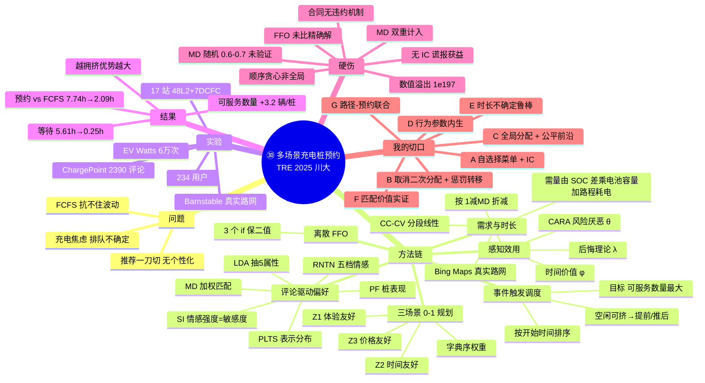

## 1. 定位

把"充电桩预约"做成一条**评论驱动 → 偏好匹配 → 时间槽调度 → 三场景推荐**的完整流水线：用 LDA+RNTN 从在线评论里挖出 5 个服务属性和用户情感分布，算出"车—桩匹配度 MD"；用一个**事件触发**的插入式调度规则，在最大化"桩可服务数量"的同时压缩用户等待；再把三类场景（体验/时间/价格）写成**三个 0-1 线性规划**，用离散 FFO 求解。实验在美 Massachusetts Barnstable County 真实路网 + 17 座真实充电站上做。

## 2. 研究背景与动机

- **痛点**：EV 用户有"充电焦虑"——不是怕没桩，是怕"桩被占着、不知道要等多久"。2024 年全球公共桩增长 >30%（IEA 2025），但高峰排队仍严重。
- **两条既有路线各有毛病**：
  - 调度侧：FCFS 抗不住排队不确定性；时间触发（固定间隔滚动）确定性强但不够灵活；**事件触发**响应快但实现复杂、用得少。
  - 推荐侧：现有模型把"价格+时间"当全部，**几乎不管用户对服务属性的个性化偏好**；且"一刀切"，不区分充电场景与充电类型（快充 vs 慢充，有人为护电池拒快充）。
- **本文主张**：预约 = 调度（时间）+ 推荐（空间/桩）两件事必须协同，且要**同时照顾需求侧（用户）和供给侧（桩主）**，不能只优化一边。
- **理论抓手**：在线评论是"真实体验"的低成本来源（问卷贵、样本受限、静态）；评论能反映**偏好动态演化**——这是它相对问卷的核心卖点。

## 3. 问题定义与系统流程（CPARS）

**CPARS（CP Advance Reservation System）**：面向用户的实时预约系统。

- 用户提交 **6 元组**请求：`(请求开始时间, 出发位置, 需求充电类型, 电池容量, 出发 SOC, 目标 SOC)`。
- 提交后该用户被标记为 **PAU（Pending Allocation User，待分配用户）**。
- 系统依次算：车—桩 MD → 每个桩上的最优充电时间槽（TS）→ 三个场景下的最优桩 → 反馈"桩 + 时间槽 + 费用"。
- **每次有新预约就更新桩的可用状态**（事件触发），因此每个反馈只是**对当前用户局部最优**，会直接影响后续用户的等待与选择。
- **合约性质**：系统在预约时段内**锁桩**，其他人不可用；服务到预约结束，但允许用户用到下一位预约的开始时间。作者明确说"订单本质是一份合同"——但**全文没有任何违约/执行机制**（这是后话，见 §17）。

## 4. 方法链一：评论驱动的个性化偏好匹配（本文最核心的"新"）

### 4.1 属性抽取：LDA
用 LDA 主题模型从评论里抽出 5 个充电服务属性，再人工清洗（LDA 出的主题/关键词会重复、带噪声）：

| 属性 | 代表关键词（原文 Table 4） |
|---|---|
| Management 管理 | park, block, service, ICEd, engine, space, sign, plate, regulate |
| Operation 运营 | app, card, issue, report, status, offline, order, fix, broken, handle |
| Efficiency 效率 | fast, time, minute, slow, DCFC, CCS, CHAdeMO, super, wait, rate |
| Price 价格 | free, hour, pay, kWh, fee, cost, expense, price |
| Facilitation 便利配套 | location, convenient, nearby, store, coffee, shopping, restaurant, exit |

### 4.2 情感：RNTN + PLTS
RNTN（递归神经张量网络）把每条评论判成 5 档情感（非常负/负/中/正/非常正），再用**概率语言术语集 PLTS** 表示：
`L(p) = {L_l(p_l) | L_l ∈ S, p_l ≥ 0, Σp_l ≤ 1}`，语言标度 `g(s_t) = (τ+t)/2τ = γ`（式 1–2）。
关键算子：期望 `E(L(p)) = Σ γ_l p̂_l / Σ p̂_l`（式 5）、两个 PLTS 的**偏差度** `d(L̂₁,L̂₂) = sqrt(Σ(γ₁p̂₁ − γ₂p̂₂)²/#L)`（式 6）。

### 4.3 两个关键量：情感强度 SI 与桩表现 PF
- **用户对属性 a 的情感强度**：`SI_k = d(L_k(p), L_neutral(p))`，其中 `L_neutral = {s₋₂(0), s₋₁(0), s₀(1), s₁(0), s₂(0)}`（式 7）。
  → 直觉：**离"完全中性"越远 = 越敏感**。用户对某属性情绪越两极，说明他越在意这个属性（作者的解释）。
- **用户 i 对属性 a 的 SI**：对其历史评论取均值；**没有评论时退化为"公众平均情感强度"** `d(L_a(p), L_neutral(p))`（式 8）。
- **桩 j 在属性 a 的表现**：`PF_j^a = Σ E(L_k(p))/k_j^a`；无评论时用公众均值（式 9）。

### 4.4 匹配度 MD
`MD_ij = Σ_a (PF̃_j^a · S̃I_i^a)`（式 10），两项都做归一化，故 `0 ≤ MD ≤ 1`。
→ **语义**：以"用户敏感度"为权重，对"桩在该属性上的表现"加权平均。**用户在意什么，就放大桩在那方面的表现**——这是本文最值得抄的一个构造。且可随新评论滚动更新（动态偏好）。

## 5. 方法链二：充电需求与时长（物理层）

- 充电电量：`q_ij = (SOC_i^e − SOC_i^d)·b_i + (d_ij^d + d_ij^s)·c_i`（式 11）
  = 电池补到目标 SOC 的电量 + **往返行驶 + 场内找桩**的耗电。搜索距离 `d^s ~ N(μ, σ²)`（GPS 只导到最近街道，所以要找）。
- 行驶距离/时间用 **Bing Maps Distance Matrix API** 取真实路网与交通流。
- SOC—时间关系：真实是 **CC-CV**（恒流段 SOC 线性升，恒压段 SOC 凹形升）；为计算效率改用**分段线性近似**（两个断点 SOC₁、SOC₂，图 6）。作者承认精度受限，但"所有方法共用同一条曲线"，比较结论不受影响。

## 6. 方法链三：事件触发调度机制（本文第二个卖点）

预约订单按"请求开始时间"排序，PAU 插在 `y_{j−1}` 与 `y_{j+1}` 之间。设 `η₁、η₂` 为两侧空闲时段 `[te(y_{j−1}), tb(y_i^j))` 与 `[te(y_i^j), tb(y_{j+1}))` 内、以最短服务时长 `t_j` 能服务的车数（**可服务数量**）。

**规则（原文 3.3.2）**：
1. **请求时段是空闲的**：
   - a) 若 `tb−te(y_{j−1}) + tb(y_{j+1})−te < (η₁+η₂+1)t_j` → 请求时段对桩已最优 → **原样接受**。
   - b) 否则（空闲时间足够再挤一辆）：
     - 若 `tb−te(y_{j−1})−η₁t_j ≤ tb(y_{j+1})−te−η₂t_j` → **提前**开始：`[tb(y_{j+1})−(η₂+1)t_j−tc, tb(y_{j+1})−(η₂+1)t_j)`
     - 反之 → **推后**：`[te(y_{j−1})+(η₁+1)t_j, te(y_{j−1})+(η₁+1)t_j+tc)`
2. **请求时段已被占**：
   - a) 若 `tb(y_{j+1})−te(y_{j−1}) ≥ tc`（两订单之间塞得下）→ 紧贴前单或紧贴后单安排；
   - b) 否则向后找第 q 个订单后的空档塞入。

**机制实质**：**贪心插入 + 就近挤压**，目标是"在不显著增加该用户等待的前提下，把空闲碎片整理成能多服务一辆车的整块"。作者强调"预约行为与充电行为分离"，因此可以**通过压缩空闲时间提升资源可用性**；并声称这"平衡了早订与晚订的不公平"（**无证明**）。
**代价**：用户被"提前/推后"了，产生等待 `t_w = |tb* − tb|`，直接进后面的效用函数。所以这是"系统效率 vs 个体体验"的显式权衡。

## 7. 方法链四：感知效用（行为层）

- 总时间：`T_ij = t^d + t^s + t^w + t^c`（行驶 + 找桩 + 等待 + 充电）（式 12）
- 总费用：`P_ij = g_j(q_ij) + p_j^p·⌈t^s + t^c⌉`（充电费 + 停车费，按小时向上取整）（式 13）
- 总成本：`C_ij = φ·T_ij + P_ij`（φ = 时间价值系数，元/小时）（式 14 前）
- **风险厌恶（CARA）**：`u(C) = (1 − e^{θC})/θ`，`θ ≥ 0`（式 14）。因 C>0，故 `u(C) < 0`，且 θ 越大越负 → **损失厌恶越强，效用越低**。
- **后悔厌恶（Bell 1982 后悔理论）**：`U(C_ij) = (1 − MD_ij)·[u(C_ij) + R(u(C_ij) − u*(C_ij))]`（式 15），`R(x) = 1 − e^{−λx}`，`u*(C) = max_j u(C_ij)`（**已放弃选项中的最好者**）。因 `u − u* ≤ 0`，`R ≤ 0` → 后悔总是减效用。
- ⚠️ **一个必须注意的结构**：`(1 − MD)` 是**乘在整块（负）效用上的系数**，不是加性项。数学上 MD↑ → 系数↓ → 负值变小 → 效用变高，方向对；但语义上它变成"匹配越好，用户对成本越不敏感"，而不是"匹配本身带来正效用"。**且 MD 在 Z1 目标里又被单独加了一次**（见 §8），存在重复计入之嫌。

## 8. 方法链五：三个 0-1 线性规划（三场景）

| 场景 | 用户特征 | 策略 | 目标函数 |
|---|---|---|---|
| General 一般 | 在意整体体验，不只看时间钱 | **体验友好 Z1** | `max Σ f_ij(priority₁·U(C_ij) + priority₂·MD_ij)`（式 16） |
| Time-saving 赶时间 | 时间紧、赶下一段行程 | **时间友好 Z2** | `max Σ f_ij(priority₃·U(T_ij) + priority₄·U(P_ij) + priority₅·MD_ij)`（式 17） |
| Money-saving 省钱 | 对价格敏感 | **价格友好 Z3** | `max Σ f_ij(priority₆·U(P_ij) + priority₇·U(T_ij) + priority₈·MD_ij)`（式 18） |

`priority(·)` 是**字典序权重**（`priority₁ ≫ priority₂`），即"先最大化主目标，并列时再看次目标"。

**约束**：
- 行驶距离上限：`Σ f_ij·d^d_ij ≤ d̂_i^d`，其中 `d̂^d = (SOC_i − SOĈ_i)·b_i/c_i`（剩余电量能跑的最远距离）（式 19）
- 行驶时间上限 `t̂_i^d`（式 20）
- **充电类型匹配**：`Σ_v Σ_j f_ij·g_j^v·h_i^v = 1`（选中的桩必须提供用户要的类型，且恰好选一个）（式 21）
- 最优性论证：因 `U(·) < 0` 有上界、`MD ∈ [0,1]`、解空间有限且非空 → 存在最优解（**只证存在性，没给求解质量**）。

## 9. 方法链六：离散 FFO

FFO（Flying Fox Optimization，果蝠优化）是连续元启发式：靠两种移动方式做全局探索 + 概率替换跳出局部最优，参数用模糊自整定（Zervoudakis & Tsafarakis 2023）。
本文改造为**离散版**：在位置更新阶段加 **3 个 if 判断**——① 保证解为整数；②③ 保证每个可行解中恰好一个分量为 1、其余为 0（对应"给用户选一个桩"）。

⚠️ 但注意：模型是**二值线性规划**、桩数只有 19 个——这类指派问题用 CPLEX/Gurobi 或匈牙利算法是**毫秒级精确解**。作者未与精确最优解对比 gap，也没系统报告运行时间。**这是方法论上的一个真实软肋**（见 §15）。

## 10. 实验设计与数据

| 项 | 内容 |
|---|---|
| 场景 | 美国 Massachusetts **Barnstable County**，约 10×8 km 真实城市路网 |
| 桩 | **17 座真实充电站**：48 个 L2 桩 + 7 个 DCFC 桩；另设 2 个"虚拟 DCFC"（无免费停车）作补充 |
| 用户 | **144 个需 L2 的用户**（平均 3 人/桩）+ **90 个需 DCFC 的用户**（平均 10 人/桩），均按一般场景 |
| 车辆参数 | 电池 55 kWh，单位电耗 0.164 kWh/km |
| 充电特性 | 依据 **EV Watts 公开库（Livewire Data Platform, DOE）新英格兰地区 6 万余次**充放电记录标定（图 A1、表 A2） |
| 评论 | Python 爬虫从 **ChargePoint** 抓 **1,314 座麻州充电站的 2,390 条评论**（截至 2023-04-09） |
| 路网 | Bing Maps Distance Matrix API |
| 行为参数 | 风险厌恶 θ = 0.01、后悔厌恶 λ = 0.05（引 Chorus 2012）；时间价值 φ = $5/h；找桩时间 2 min |
| 基线 | **Z4**：Range-friendly + FCFS（按续航最短、先到先服务）；**Z5**：Adacher et al. 2023 的按到达时间分配、最小化总完成时间 |
| 随机化 | 出发位置、请求开始时间、出发/目标 SOC 随机生成（表 A2 给出均值与标准差） |

**⚠️ 一个必须记住的硬伤**：作者说"每座桩的评论拿得到，但**个人发过的评论集拿不到**，因此 **MD 在 0.6–0.7 之间随机生成**"（§5.2 末）。也就是说——**全文最核心的"个性化偏好匹配"贡献，在实验里是用随机数代替的**。MD 的真实分布、真实区分度，完全没有被验证。

## 11. 主要结果（可直接引用的数字）

**平均表现（Table 6，L2 / DCFC）**

| 策略 | 总时间 L2 (h) | 费用 L2 ($) | MD | 等待 L2 (h) | U(C) L2 |
|---|---|---|---|---|---|
| **Z1 体验友好** | **2.091** | 0.000 | **0.686** | **0.249** | **−3.481** |
| Z2 时间友好 | 2.087 | 0.467 | 0.687 | 0.240 | −3.636 |
| Z3 价格友好 | 2.096 | 0.000 | 0.687 | 0.240 | −3.481 |
| Z4 FCFS（无预约） | **7.743** | 0.740 | 0.654 | **5.613** | **−14.158** |
| Z5 到达时间 AR | 2.085 | 0.463 | 0.666 | 0.270 | −3.881 |

- **预约 vs 不预约**：L2 总时间 7.743h → 2.091h（**降 73%**），等待 5.613h → 0.249h（**降 96%**）。这是全篇最响的数字。
- DCFC：Z1 总时间 0.410h、等待 0.007h；Z4 0.597h / 0.203h。但 **Z5 在纯时间上略优（0.379h）**，作者承认"优势不显著，且 Z2 已接近"。
- **体验友好 Z1 在总成本/总时间/总费用三个效用上全面优于基线**——这是作者最想让你记住的一句。

**需求敏感性（Table 7，L2，48/240/480 用户）**
- 480 用户时：Z1 总时间 7.098h、等待 4.653h；**Z4 崩到 31.131h / 等待 28.668h**（其 U(C) 报出 `−1.9898E+197`，明显数值溢出）。→ **越拥挤，预约机制优势越大**（作者的核心管理结论）。
- 桩车比高（48 用户）时各策略差异很小——"用户能轻松找到偏好的桩"。

**可服务数量（Table 8，相对 Z5 的每桩增量）**
- 最短服务时长 t_j = 20 min：**+3.229 / +3.375 / +3.208** 辆/桩（Z1/Z2/Z3）
- t_j = 60 min：+1.667 / +1.708 / +1.646
→ **空闲碎片越小、可挤出的服务量越多**；这是"调度机制"独立于"推荐"的贡献证据。

**敏感性（Fig. 8）**
- 风险厌恶 θ↑ → 三类感知效用全降，**影响最大**；
- 后悔厌恶 λ↑ → 也降，但**弱于风险厌恶**；
- 时间价值 φ↑ → 总成本效用降得最厉害。
- 三种策略在参数变化下**排序稳定**（Z1 综合最好、Z2 时间最好、Z3 价格最好）——稳健性论证方式值得学。

## 12. 优势（方法层面，值得学的地方）

1. **端到端闭环**：评论→属性→情感→匹配→调度→推荐→反馈，一条链打通"用户偏好"和"桩资源"，少有论文同时做。
2. **MD 的构造有巧思**：用"情感强度"当权重，等于让用户自己决定"哪个属性重要"，比让用户填权重表更隐蔽、更可自动化。
3. **调度机制明确以"可服务数量"为目标**，并给出可服务数量的增量证据——**供给侧指标**，不只讨好用户。
4. **事件触发 + 实时更新**，比固定间隔滚动更贴近真实运营。
5. **行为效用不是拍脑袋**：CARA 风险厌恶 + Bell 后悔理论，都有文献依据，且做了三参数敏感性。
6. **实验对外部效度友好**：真实路网（Bing Maps）+ 真实桩网（17 座）+ 真实 6 万次充电记录标定 + 真实评论 2,390 条。
7. **可复现性较好**：数据源全部写明（ChargePoint 爬虫、Bing API、EV Watts 公开库），参数表齐全。

## 13. 劣势与我的批判（汇报时最值钱的部分）

| # | 问题 | 具体证据 / 为什么是问题 |
|---|---|---|
| 1 | **核心贡献未被验证** | MD 在 [0.6, 0.7] 随机生成（§5.2），个性化匹配的真实效果无从判断；0.1 的窄区间还会**系统性压低 MD 的区分度**，让 Z1 与 Z3 结果几乎相同（2.091 vs 2.096，MD 都 0.686/0.687） |
| 2 | **没有 IC / 无策略性行为** | 用户自报"场景/偏好/SOC/位置"全被当真；只要报"赶时间"就能拿时间友好策略、报低 SOC 就能扩大可行驶距离上限（`d̂ = (SOC−SOĈ)b/c`）——**谎报直接获益**，全文无任何约束 |
| 3 | **"合同"无执行机制** | 明说订单是合同、系统锁桩，但**取消/爽约/迟到完全没建模**，也没押金/罚金/二次分配；作者把它列进 future work（limitation 1） |
| 4 | **顺序贪心 = 局部最优** | 作者自认"每个反馈对个体最优"，直接影响后续用户；**顺序依赖 → 早订者占优**，且"平衡了不公平"这句话没有任何证明或指标 |
| 5 | **FFO 用错了地方** | 19 个桩的 0-1 指派用元启发式，却不与 CPLEX/匈牙利算法比 gap；"NP-hard"的引用与本文算例规模不匹配；算法本身只在图里（正文无伪代码细节） |
| 6 | **效用函数结构可疑** | `(1−MD)` 乘在负效用上，使 MD 变成"成本折减系数"；且 Z1 里 MD 又被加一次 → **MD 双重计入**；Z2/Z3 用同一 θ 去度量"小时"和"美元"，量纲不一致 |
| 7 | **数值不稳定** | Z4 在 480 用户时 U(C) = `−1.9898E+197`、另处 `−6.47E+6`，说明指数效用在大成本下溢出，作者未做归一化/截断 |
| 8 | **确定性假设过强** | 充电时长由分段线性函数精确决定，无充电功率波动、无设备故障、无排队溢出；"预约=锁桩"在现实中很难做到分秒不差 |
| 9 | **未做与最优分配的对比** | 论文的核心比较对象是 FCFS 和一条 2023 年的 AR 基线，**没有"离线全局最优"上界**，因此无法知道自己的机制离最优有多远（对比 ⑳ Mrkos 有 Oracle 上界，这篇缺） |
| 10 | **场景划分是外生给的** | 三类场景（体验/时间/价格）由系统假定、用户自选，没有"用户真实属于哪类"的识别，也没有让用户为优先权付费 |

## 14. 作者自述的局限与未来工作

1. **行程变化导致取消/改约** → 未来研究"**防止不诚实行为的激励机制**" + "**取消后的二次分配机制**"；
2. 推荐顺序影响整体表现，**基于全体用户的全局优化会更好**；基于充电预测的实时推荐值得做；
3. 未考虑**后续行程与长途行程**。

> 这三条几乎逐字对应你的选题：① = 违约惩罚/IC（㉓⑫）；② = 全局 vs 顺序分配 + 公平；③ = 续航/路径耦合。**作者亲手把门留给你了。**

## 15. 与组内/既有文献的关系（定位）

- **⑯ Lv 2024 (TR-A)**：同一作者，用在线评论 + QFD + 演化博弈做"充电站服务质量改进"。㉚ 是它的**下一步**：从"评价服务质量"走到"用评价做预约匹配"。→ 你写 Related Work 时可以把这两篇串成"评论驱动研究线"。
- **② Lv 2025 (eWOM)**：同一条"评论挖偏好"的技术路线（LDA/RNTN/SVD+LightGBM），㉚ 用的是 LDA+RNTN+PLTS。
- **⑪ Hu 2019 / ⑧ Zhang 2026**：㉚ 用 CARA + 后悔理论刻画风险态度，⑪ 用 CPT——**同一件事的两种行为建模**，可做对照（CPT 有心理学根基，CARA 更省参数）。
- **⑫ Mathioudaki 2025 (TSG)**：在线菜单 + IC——㉚ 缺的正是这一层；⑫ 有 truthful 框架但没做多场景/偏好匹配。
- **⑳ Mrkos 2025 (TITS)**：预约定价 + MDP + Oracle 上界——㉚ 缺"上界"，⑳ 缺"偏好"。
- **㉒㉔**：提供"用户类型/可预测性"的真实数据与分类维度，可替代 ㉚ 里"场景由系统假定"的做法。

## 16. 可复用点

**方法件**
1. **MD 计算链**（LDA 属性 → RNTN 情感 → PLTS → SI 权重 → PF → 加权匹配）：可当我机制里的"类型/偏好观测器"，甚至可用来**估计用户的类型参数**。
2. **事件触发插入式调度规则**（4 条规则 + η₁/η₂ 可服务数量）：轻量、可解释，做我预约机制的时间槽模块 baseline 极合适（比 FCFS 强、比 MIP 快）。
3. **三场景 → 三合约**的架构：把"体验/时间/价格"直接改造成**三个自选择合约**，就是天然的菜单（menu）雏形。
4. **感知效用函数**：CARA `(1−e^{θC})/θ` + 后悔 `R(x)=1−e^{−λx}`，可直接换入 CPT 或做对照。
5. **字典序权重（priority ≫）**的写法：多目标不必加权求和，可声明主次，审稿人接受度高。
6. **"可服务数量"指标**：衡量空闲碎片利用率，比"平均等待"更能体现供给侧收益。

**数据与参数**
7. **EV Watts 公开库**（>6 万次新英格兰 L2/DCFC 充电会话，LDP DOI: 10.15483/1970735）——SOC 分布、请求时间分布可直接拿。
8. **ChargePoint 评论爬虫方案**（1,314 站 / 2,390 条）+ LDA/RNTN 流程——我若做"偏好"必须自己造数据时，这是最省的路。
9. 参数：θ=0.01、λ=0.05、φ=$5/h、找桩 2 min、电池 55 kWh、0.164 kWh/km、L2 3 人/桩、DCFC 10 人/桩、t_j = 20–60 min。

**基线**
10. **Z4（FCFS + 最短续航）与 Z5（到达时间 + 最小总完成时间）**：两条现成基线，我论文里可以直接沿用，省一大段实现工作。

## 17. 我能从哪些角度找创新点（按"贴着这篇往前一步"排序）

> 原则：**不要跟它抢"评论挖偏好"**（那是它的地盘、数据还拿不到），要抢它**明确没做、且它自己承认**的三件事。

**⭐A. 偏好/场景报告的激励相容（最直接的缝）**
它让用户自报场景与偏好，且**谎报获益**（报"赶时间"拿优先、报低 SOC 扩大可行驶范围）。→ 题目：**"偏好可私有信息下的充电桩预约机制：自选择菜单与 IC 证明"**。做法：把三场景升级为三个合约 `(价格, 优先级, 等待上界)`，证明**如实报告类型是最优反应**，并给出福利/效率损失界。依托：⑫ 的 truthful 框架 + ㉚ 的三场景。**这是最干净的一步，且能直接怼它第 2 条硬伤。**

**⭐B. 取消/改约的二次分配 + 惩罚转移（作者点名的未来工作）**
它 limitation 1 明写"激励机制防不诚实 + 取消后二次分配"。→ 题目：**"预约取消下的二次分配与惩罚转移机制"**。惩罚金不销毁、定向赔付给被影响的后续用户（㉓ 的"惩罚伤福利"正好反转为"惩罚转移不伤福利"）。依托：㉓ 三臂实验 + ㉚ 的事件触发框架（取消=释放时间槽，触发重排）。

**⭐C. 顺序贪心 → 全局分配 + 公平**
它自认"每个反馈局部最优、顺序有影响"，却没量化损失。→ 题目：**"顺序无关的充电桩预约批量分配：效率—公平前沿"**。做法：离线全局最优（MIP/匈牙利）当**上界**（补它缺的 Oracle），量化顺序贪心的 gap；再加公平约束（如早订者等待不劣于晚订者），用 ㉘ 的 B3M/Nash 做前沿。**这是方法贡献最硬的一条，也顺手补它第 4、9 条软肋。**

**D. 行为参数内生**
θ、λ 是引 Chorus (2012) 拍的。→ 用 ㉒ 的 267 车 22 个月数据 / ㉔ 的 MDGEV 估计异质风险态度，或直接换 CPT（⑪）做对照，证明"参数内生会改变推荐排序"。

**E. 不确定性进入调度**
它把充电时长当确定量。→ 引入**充电时长不确定 + 爽约**，用预算不确定集/机会约束（⑲㉕ 路线）做鲁棒预约，量化"为鲁棒多付多少等待"。

**F. 偏好匹配的"验证"本身就是一个贡献**
它 MD 是随机数的。→ 若你能拿到**真实订单 + 评论配对**（或做小规模 stated-preference 实验），做一篇"**偏好匹配到底值多少钱**"的实证，直接把它最弱的一环变成你的最强证据。**成本最低、说服力最高的一篇。**

**G. 多桩/多站的网络效应**
它是单次、单用户、单桩分配。→ 扩展到"一次行程多次充电"（它 limitation 3 提到的长途行程），做**路径—预约联合优化**（借 ⑭ 的动态思路）。

## 18. 术语表（本文出现的）

| 中文 | 英文 | 缩写 | 一句话 |
|---|---|---|---|
| 充电桩提前预约系统 | CP advance reservation system | CPARS | 本文提出的系统 |
| 待分配用户 | pending allocation user | PAU | 已提交请求、待系统分配桩的用户 |
| 匹配度 | matching degree | MD | 用户偏好与桩表现的加权匹配，0–1 |
| 概率语言术语集 | probabilistic linguistic term set | PLTS | 用"语言标签+概率"表示情感分布 |
| 情感强度 | sentiment intensity | SI | 情感分布与"完全中性"的偏差，代理"敏感度" |
| 桩表现 | performance | PF | 该桩在某属性上的平均情感期望 |
| 事件触发 | event-triggered | — | 每来一个新预约就实时重算，不等固定间隔 |
| 可服务数量 | serviceable quantity | η | 某空闲时段按最短服务时长能服务的车数 |
| 恒定绝对风险厌恶 | constant absolute risk aversion | CARA | `u(C)=(1−e^{θC})/θ` |
| 后悔厌恶 | regret aversion | λ | 与"放弃选项中的最好者"比较产生的负效用 |
| 时间价值系数 | time value conversion factor | φ | 把小时折算成货币 |
| 果蝠优化 | flying fox optimization | FFO | 本文离散化后使用的元启发式 |
| 恒流-恒压充电 | constant current–constant voltage | CC-CV | 真实充电曲线两阶段 |

## 19. 一句话总结

**它把"评论挖偏好"和"事件触发调度"接成了充电桩预约的完整流水线，工程完整、实验真实，但个性化偏好是随机数替代的、用户报告是不受约束的、取消爽约是完全缺失的、分配是顺序贪心的——这四条缺口，恰好就是你"行为异质 + 机制设计"能直接落刀的地方。**

## 20. 思维导图

